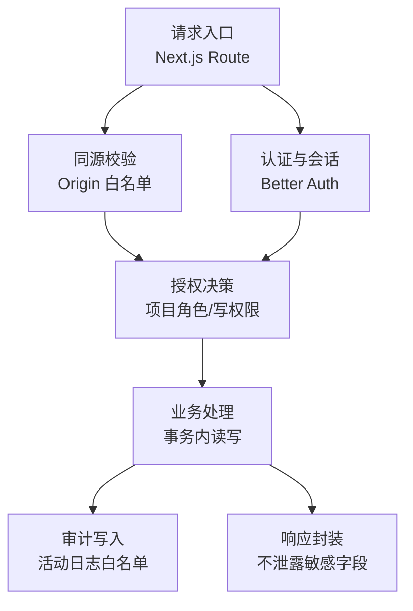
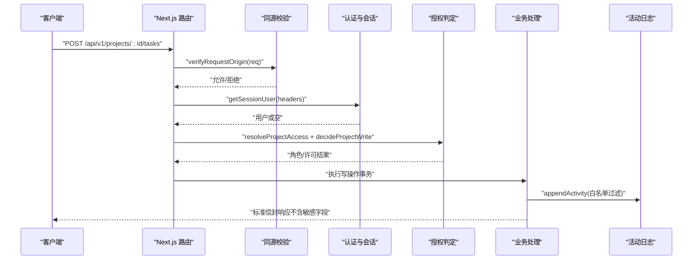
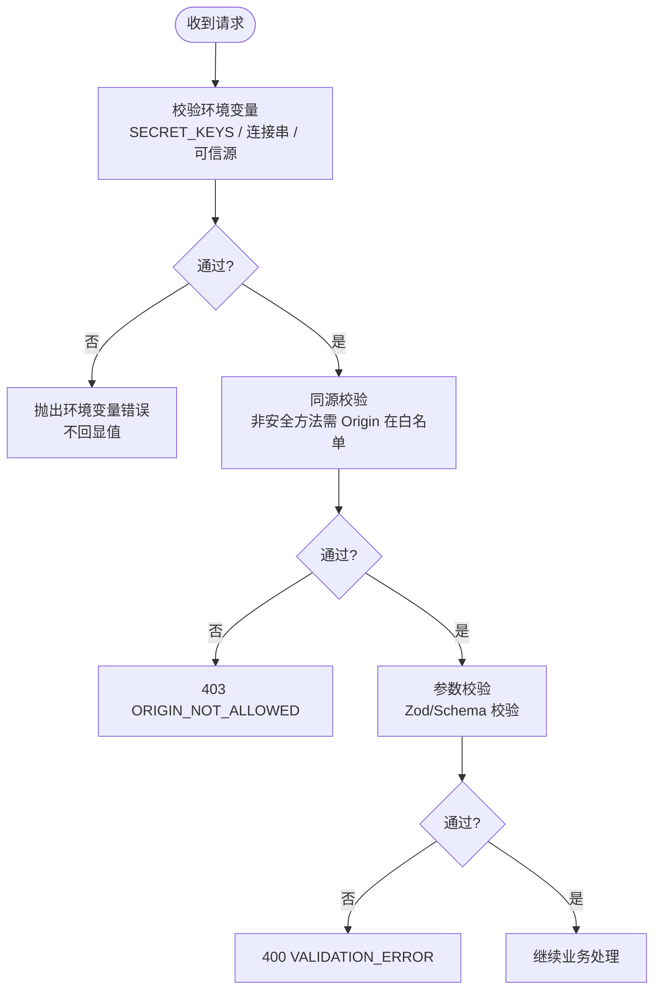
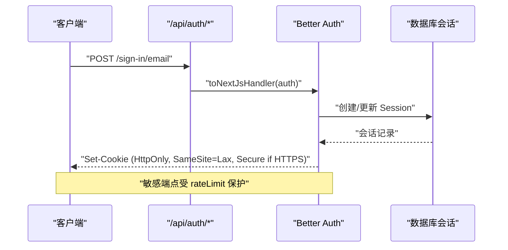
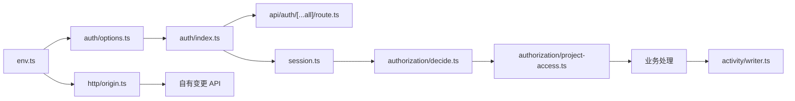

# 安全机制

<cite>
**本文引用的文件**
- [src/server/env.ts](file://src/server/env.ts)
- [src/server/auth/options.ts](file://src/server/auth/options.ts)
- [src/server/auth/index.ts](file://src/server/auth/index.ts)
- [src/app/api/auth/[...all]/route.ts](file://src/app/api/auth/[...all]/route.ts)
- [src/server/http/origin.ts](file://src/server/http/origin.ts)
- [src/lib/return-to.ts](file://src/lib/return-to.ts)
- [src/features/auth/validation.ts](file://src/features/auth/validation.ts)
- [src/server/modules/authorization/decide.ts](file://src/server/modules/authorization/decide.ts)
- [src/server/modules/authorization/project-access.ts](file://src/server/modules/authorization/project-access.ts)
- [src/server/modules/activity/writer.ts](file://src/server/modules/activity/writer.ts)
- [next.config.ts](file://next.config.ts)
- [tests/integration/me.test.ts](file://tests/integration/me.test.ts)
- [tests/integration/auth.test.ts](file://tests/integration/auth.test.ts)
- [tests/unit/env.test.ts](file://tests/unit/env.test.ts)
- [DEVELOPMENT-PLAN.md](file://DEVELOPMENT-PLAN.md)
- [docs/12-REFERENCES.md](file://docs/12-REFERENCES.md)
</cite>

## 目录
1. [简介](#简介)
2. [项目结构](#项目结构)
3. [核心组件](#核心组件)
4. [架构总览](#架构总览)
5. [详细组件分析](#详细组件分析)
6. [依赖关系分析](#依赖关系分析)
7. [性能与安全权衡](#性能与安全权衡)
8. [故障排查指南](#故障排查指南)
9. [结论](#结论)
10. [附录](#附录)

## 简介
本文件面向 Orbit 项目的安全机制，覆盖输入验证与清洗、SQL 注入与 XSS 防护、认证与授权（含会话与权限控制）、网络安全（CORS、HTTPS 强制与安全头）、敏感数据处理（密码、环境变量与密钥轮换）、审计与日志、以及漏洞扫描与合规检查。文档以代码实现为依据，提供可追溯的“章节来源”和“图示来源”，帮助读者从高层到代码级理解并落地安全实践。

## 项目结构
Orbit 的安全能力分布在以下层次：
- 配置与环境校验：集中式环境变量解析与白名单校验，防止错误配置导致的安全风险。
- 认证与会话：基于 Better Auth 的邮箱+密码认证、会话存储、限流与 Cookie 安全策略。
- 访问控制：同源 Origin 校验、项目级角色与写操作判定、资源归属校验。
- 数据与输出：活动日志白名单过滤、响应中不泄露敏感字段。
- 前端安全：登录跳转 returnTo 清洗、客户端表单校验（辅助体验）。
- 运行时安全：Next.js 安全相关配置（如关闭框架信息泄露）。



**图示来源**
- [src/server/http/origin.ts:1-69](file://src/server/http/origin.ts#L1-L69)
- [src/server/auth/options.ts:44-134](file://src/server/auth/options.ts#L44-L134)
- [src/server/modules/authorization/decide.ts:1-67](file://src/server/modules/authorization/decide.ts#L1-L67)
- [src/server/modules/activity/writer.ts:1-64](file://src/server/modules/activity/writer.ts#L1-L64)

**章节来源**
- [src/server/env.ts:1-238](file://src/server/env.ts#L1-L238)
- [src/server/http/origin.ts:1-69](file://src/server/http/origin.ts#L1-L69)
- [src/server/auth/options.ts:1-141](file://src/server/auth/options.ts#L1-L141)
- [next.config.ts:1-21](file://next.config.ts#L1-L21)

## 核心组件
- 环境变量与密钥管理：集中校验必需项、禁止秘密进入客户端、拒绝通配符可信源、测试库隔离。
- 认证与会话：Better Auth 集成，数据库会话、HttpOnly/SameSite/Lax、Secure 按 baseURL 开启、限流保护敏感端点、重置密码后撤销会话。
- 同源与跨域：自有变更 API 仅接受同源浏览器请求，GET/HEAD/OPTIONS 豁免；精确匹配 AUTH_TRUSTED_ORIGINS。
- 授权模型：项目角色 OWNER/MEMBER，读/写判定纯函数化，归档项目只读（restore 除外），非成员与不存在统一收敛为 NOT_FOUND。
- 审计与日志：活动日志只追加、metadata 白名单过滤，避免敏感内容入库。
- 前端安全：returnTo 严格清洗，拒绝反斜杠与控制字符，确保重定向目标为相对路径；客户端表单校验与服务端一致但仅作体验增强。

**章节来源**
- [src/server/env.ts:25-64](file://src/server/env.ts#L25-L64)
- [src/server/env.ts:98-155](file://src/server/env.ts#L98-L155)
- [src/server/auth/options.ts:44-134](file://src/server/auth/options.ts#L44-L134)
- [src/server/http/origin.ts:5-18](file://src/server/http/origin.ts#L5-L18)
- [src/server/modules/authorization/decide.ts:13-67](file://src/server/modules/authorization/decide.ts#L13-L67)
- [src/server/modules/activity/writer.ts:5-14](file://src/server/modules/activity/writer.ts#L5-L14)
- [src/lib/return-to.ts:53-77](file://src/lib/return-to.ts#L53-L77)
- [src/features/auth/validation.ts:1-35](file://src/features/auth/validation.ts#L1-L35)

## 架构总览
下图展示一次受保护的写请求在 Orbit 中的安全链路：同源校验 → 会话校验 → 授权判定 → 业务处理 → 审计写入 → 响应封装。



**图示来源**
- [src/server/http/origin.ts:52-69](file://src/server/http/origin.ts#L52-L69)
- [src/server/auth/session.ts:24-42](file://src/server/auth/session.ts#L24-L42)
- [src/server/modules/authorization/project-access.ts:55-121](file://src/server/modules/authorization/project-access.ts#L55-L121)
- [src/server/modules/activity/writer.ts:49-64](file://src/server/modules/activity/writer.ts#L49-L64)

## 详细组件分析

### 输入验证与清洗
- 环境变量与密钥
  - 使用 Zod schema 对 APP_ENV、DATABASE_URL、BETTER_AUTH_SECRET、AUTH_TRUSTED_ORIGINS 等强校验。
  - SECRET_KEYS 列表与关键词提示阻止 NEXT_PUBLIC_* 暴露敏感变量。
  - TEST_DATABASE_URL 必须独立于开发/生产库名，避免误连。
  - 错误消息仅包含变量名与预期格式，不回显实际值。
- 同源 Origin 校验
  - 仅对非安全方法（非 GET/HEAD/OPTIONS）进行 Origin 检查。
  - 将请求 Origin 与 AUTH_TRUSTED_ORIGINS 白名单归一化后精确匹配。
  - 不满足返回 403 ORIGIN_NOT_ALLOWED。
- 登录跳转 returnTo 清洗
  - 拒绝反斜杠与控制字符，确保 origin 未被篡改。
  - 仅允许相对路径（以 “/” 开头且不以 “//” 开头）。
  - 构造登录链接时对 safe 值进行 encodeURIComponent。
- 客户端表单校验
  - 密码长度 12–128，姓名长度 1–40，邮箱格式基础校验。
  - 明确客户端校验仅为体验增强，服务端仍为权威校验。



**图示来源**
- [src/server/env.ts:98-155](file://src/server/env.ts#L98-L155)
- [src/server/http/origin.ts:20-69](file://src/server/http/origin.ts#L20-L69)
- [src/lib/return-to.ts:53-77](file://src/lib/return-to.ts#L53-L77)
- [src/features/auth/validation.ts:8-30](file://src/features/auth/validation.ts#L8-L30)

**章节来源**
- [src/server/env.ts:25-64](file://src/server/env.ts#L25-L64)
- [src/server/env.ts:98-155](file://src/server/env.ts#L98-L155)
- [src/server/http/origin.ts:5-18](file://src/server/http/origin.ts#L5-L18)
- [src/lib/return-to.ts:53-77](file://src/lib/return-to.ts#L53-L77)
- [src/features/auth/validation.ts:1-35](file://src/features/auth/validation.ts#L1-L35)

### SQL 注入防护
- 使用 Prisma ORM 进行参数化查询，避免字符串拼接 SQL。
- 项目 ID 等关键参数先经 UUID Schema 校验，非法直接视为不可见，避免底层转换异常泄露信息。
- 活动日志 metadata 采用白名单过滤，仅保留允许字段，防止恶意内容入库。

**章节来源**
- [src/server/modules/authorization/project-access.ts:55-77](file://src/server/modules/authorization/project-access.ts#L55-L77)
- [src/server/modules/activity/writer.ts:16-47](file://src/server/modules/activity/writer.ts#L16-L47)

### XSS 攻击防护
- 活动日志 metadata 白名单过滤，避免原始描述/评论/令牌等敏感内容入库。
- 响应中不包含 password、会话 token 等敏感字段（由会话 DTO 与响应封装保证）。
- 登录跳转 returnTo 仅允许相对路径，防止重定向到恶意站点。

**章节来源**
- [src/server/modules/activity/writer.ts:5-14](file://src/server/modules/activity/writer.ts#L5-L14)
- [tests/integration/me.test.ts:321-325](file://tests/integration/me.test.ts#L321-L325)
- [src/lib/return-to.ts:53-77](file://src/lib/return-to.ts#L53-L77)

### 认证与会话安全
- 认证方式：邮箱+密码，要求邮箱验证后方可建立会话；未验证用户登录时重发验证邮件。
- 会话存储：数据库会话，默认 HttpOnly + SameSite=Lax；当 baseURL 为 https 时启用 Secure。
- 限流：针对敏感端点设置更严格的窗口与上限，test 环境关闭以便集成测试。
- 会话撤销：重置密码后撤销该用户所有既有会话；支持手动撤销会话。
- 会话过期：过期后 getSession 返回 null。
- 认证路由：通过 toNextJsHandler 挂载 /api/auth/*，不叠加自制 Origin 层以免破坏回调。



**图示来源**
- [src/app/api/auth/[...all]/route.ts:1-21](file://src/app/api/auth/[...all]/route.ts#L1-L21)
- [src/server/auth/options.ts:44-134](file://src/server/auth/options.ts#L44-L134)
- [tests/integration/auth.test.ts:192-213](file://tests/integration/auth.test.ts#L192-L213)

**章节来源**
- [src/server/auth/options.ts:44-134](file://src/server/auth/options.ts#L44-L134)
- [src/app/api/auth/[...all]/route.ts:1-21](file://src/app/api/auth/[...all]/route.ts#L1-L21)
- [tests/integration/auth.test.ts:181-216](file://tests/integration/auth.test.ts#L181-L216)

### 授权与权限控制
- 项目角色：OWNER 与 MEMBER。
- 读访问：不存在或非成员统一返回 NOT_FOUND，不泄露存在性。
- 写访问：仅 OWNER 可修改/归档/恢复；归档项目只读（restore 例外）。
- 授权 IO 层：resolveProjectAccess 负责查库与翻译领域错误；requireProjectOwner/requireWritableProject 用于写路径。

```mermaid
classDiagram
class ProjectAccessFacts {
+exists : boolean
+isOwner : boolean
+isMember : boolean
}
class ProjectRole {
<<enum>>
"OWNER"
"MEMBER"
}
class ProjectWriteDecision {
<<enum>>
"ALLOWED"
"FORBIDDEN"
"ARCHIVED"
}
class AuthorizationService {
+decideProjectAccess(facts) ProjectRole|"NOT_FOUND"
+decideProjectWrite(facts) ProjectWriteDecision
+resolveProjectAccess(client, projectId, userId) Promise<ProjectAccess>
+requireProjectOwner(...)
+requireWritableProject(...)
}
AuthorizationService --> ProjectAccessFacts : "读取事实"
AuthorizationService --> ProjectRole : "计算角色"
AuthorizationService --> ProjectWriteDecision : "判定写权限"
```

**图示来源**
- [src/server/modules/authorization/decide.ts:13-67](file://src/server/modules/authorization/decide.ts#L13-L67)
- [src/server/modules/authorization/project-access.ts:12-23](file://src/server/modules/authorization/project-access.ts#L12-L23)
- [src/server/modules/authorization/project-access.ts:55-121](file://src/server/modules/authorization/project-access.ts#L55-L121)

**章节来源**
- [src/server/modules/authorization/decide.ts:13-67](file://src/server/modules/authorization/decide.ts#L13-L67)
- [src/server/modules/authorization/project-access.ts:12-23](file://src/server/modules/authorization/project-access.ts#L12-L23)
- [src/server/modules/authorization/project-access.ts:55-121](file://src/server/modules/authorization/project-access.ts#L55-L121)

### 网络安全措施
- CORS 与同源：自有变更 API 仅接受同源浏览器请求，GET/HEAD/OPTIONS 豁免；精确匹配 AUTH_TRUSTED_ORIGINS。
- HTTPS 强制：Better Auth 的 Secure Cookie 仅在 baseURL 为 https 时启用；开发 http 不强制以避免 cookie 无法下发。
- 安全头：关闭 poweredByHeader 避免泄露框架信息；allowedDevOrigins 限制本地开发主机访问 dev server。

**章节来源**
- [src/server/http/origin.ts:5-18](file://src/server/http/origin.ts#L5-L18)
- [src/server/auth/options.ts:107-133](file://src/server/auth/options.ts#L107-L133)
- [next.config.ts:3-18](file://next.config.ts#L3-L18)

### 敏感数据处理
- 密码加密：交由 Better Auth 处理，最小长度 12、最大 128，注册后需邮箱验证。
- 环境变量管理：集中 parseEnv 校验，错误不回显值；禁止 NEXT_PUBLIC_ 前缀的秘密变量。
- 密钥轮换：重置密码后撤销该用户所有既有会话；建议定期轮换 BETTER_AUTH_SECRET 并在部署流程中更新。

**章节来源**
- [src/server/auth/options.ts:56-71](file://src/server/auth/options.ts#L56-L71)
- [src/server/env.ts:25-64](file://src/server/env.ts#L25-L64)
- [src/server/env.ts:126-155](file://src/server/env.ts#L126-L155)
- [tests/unit/env.test.ts:134-175](file://tests/unit/env.test.ts#L134-L175)

### 安全审计与日志记录
- 活动日志：只追加、事务内写入，metadata 白名单过滤，避免敏感内容入库。
- 请求追踪：回显上游合法的 x-request-id；非法值被拒绝并生成新 UUID，保持链路连续。
- 响应安全：响应体不包含 password、会话 token 等敏感字段。

**章节来源**
- [src/server/modules/activity/writer.ts:5-14](file://src/server/modules/activity/writer.ts#L5-L14)
- [src/server/modules/activity/writer.ts:16-47](file://src/server/modules/activity/writer.ts#L16-L47)
- [tests/integration/me.test.ts:296-325](file://tests/integration/me.test.ts#L296-L325)

### 安全漏洞扫描、渗透测试与合规检查
- 依赖扫描：CI 中运行依赖扫描，高危漏洞未修复不得标记发布完成；不得禁用 TLS 校验以减少告警。
- 端到端测试：固定三条主流程套件，合并前或发布候选运行；测试数据库隔离。
- 合规检查：OpenAPI 结构与契约一致性校验；规划阶段静态校验保障文档与任务依赖无环。

**章节来源**
- [DEVELOPMENT-PLAN.md:935-947](file://DEVELOPMENT-PLAN.md#L935-L947)
- [planning/VALIDATION.md:1-17](file://planning/VALIDATION.md#L1-L17)

## 依赖关系分析
- 环境变量模块为认证、同源校验、限流等提供统一配置来源。
- 认证模块依赖环境变量与数据库适配器，并通过 Next.js 路由暴露认证端点。
- 授权模块依赖数据库客户端与纯判定函数，确保逻辑可测且与 IO 解耦。
- 活动日志模块依赖事务客户端，确保审计与业务原子性。



**图示来源**
- [src/server/env.ts:227-238](file://src/server/env.ts#L227-L238)
- [src/server/auth/options.ts:44-134](file://src/server/auth/options.ts#L44-L134)
- [src/server/auth/index.ts:1-29](file://src/server/auth/index.ts#L1-L29)
- [src/app/api/auth/[...all]/route.ts:1-21](file://src/app/api/auth/[...all]/route.ts#L1-L21)
- [src/server/http/origin.ts:1-69](file://src/server/http/origin.ts#L1-L69)
- [src/server/modules/authorization/decide.ts:1-67](file://src/server/modules/authorization/decide.ts#L1-L67)
- [src/server/modules/authorization/project-access.ts:1-121](file://src/server/modules/authorization/project-access.ts#L1-L121)
- [src/server/modules/activity/writer.ts:1-64](file://src/server/modules/activity/writer.ts#L1-L64)

**章节来源**
- [src/server/env.ts:227-238](file://src/server/env.ts#L227-L238)
- [src/server/auth/options.ts:44-134](file://src/server/auth/options.ts#L44-L134)
- [src/server/auth/index.ts:1-29](file://src/server/auth/index.ts#L1-L29)
- [src/server/http/origin.ts:1-69](file://src/server/http/origin.ts#L1-L69)
- [src/server/modules/authorization/decide.ts:1-67](file://src/server/modules/authorization/decide.ts#L1-L67)
- [src/server/modules/authorization/project-access.ts:1-121](file://src/server/modules/authorization/project-access.ts#L1-L121)
- [src/server/modules/activity/writer.ts:1-64](file://src/server/modules/activity/writer.ts#L1-L64)

## 性能与安全权衡
- 限流：在敏感端点启用更严格的速率限制，平衡防暴力破解与可用性；test 环境关闭以支持高频集成测试。
- 会话刷新：数据库会话每 24 小时刷新一次，降低频繁鉴权开销同时保持安全性。
- 同源校验：对非安全方法进行 Origin 检查，减少跨站风险；GET/HEAD/OPTIONS 豁免以提升性能与兼容性。
- 活动日志：白名单过滤 metadata，避免大对象或敏感内容影响写入性能与存储成本。

[本节为通用指导，无需特定文件引用]

## 故障排查指南
- 环境变量校验失败
  - 现象：启动时报错，仅显示变量名与预期格式。
  - 排查：检查 DATABASE_URL、BETTER_AUTH_SECRET、AUTH_TRUSTED_ORIGINS 等是否满足约束；确认 TEST_DATABASE_URL 独立。
- 同源校验失败
  - 现象：写请求返回 403 ORIGIN_NOT_ALLOWED。
  - 排查：确认请求携带合法 Origin，且命中 AUTH_TRUSTED_ORIGINS 白名单；检查开发/生产域名配置。
- 会话问题
  - 现象：登录后立即失效或过期后无法访问。
  - 排查：检查会话是否被撤销（重置密码后）、是否过期；确认 Cookie 的 Secure/HttpOnly/SameSite 配置符合 baseURL。
- 响应泄露敏感字段
  - 现象：响应中包含 password 或 token。
  - 排查：确认使用会话 DTO 转换用户数据；检查活动日志 metadata 白名单；核对单元测试断言。

**章节来源**
- [src/server/env.ts:168-177](file://src/server/env.ts#L168-L177)
- [src/server/http/origin.ts:52-69](file://src/server/http/origin.ts#L52-L69)
- [tests/integration/auth.test.ts:192-213](file://tests/integration/auth.test.ts#L192-L213)
- [tests/integration/me.test.ts:321-325](file://tests/integration/me.test.ts#L321-L325)

## 结论
Orbit 的安全机制围绕“配置即安全”“认证即边界”“授权即规则”“输出即最小化”展开：通过严格的环境变量校验与密钥管理、基于 Better Auth 的会话与限流、同源 Origin 校验与项目级授权、活动日志白名单与响应脱敏，构建了从入口到输出的完整安全闭环。配合依赖扫描、端到端测试与契约校验，可在交付前发现并修复多数安全问题。建议在后续迭代中持续完善密钥轮换策略、扩展安全头与监控告警，并定期进行渗透测试与合规检查。

[本节为总结，无需特定文件引用]

## 附录
- 参考与边界：认证与 CSRF 参考 OWASP 与 Better Auth 官方文档；文件上传参考 OWASP 上传清单；可访问性与 Web 指标参考 WCAG 与 Web Vitals。
- 决策与风险：已定技术决策包括同源 REST、Owner/Member 角色、数据库锁与版本、软删除任务等；主要风险涵盖越权、附件泄露、认证联调晚等。

**章节来源**
- [docs/12-REFERENCES.md:5-21](file://docs/12-REFERENCES.md#L5-L21)
- [docs/11-DECISIONS-AND-RISKS.md:1-60](file://docs/11-DECISIONS-AND-RISKS.md#L1-L60)