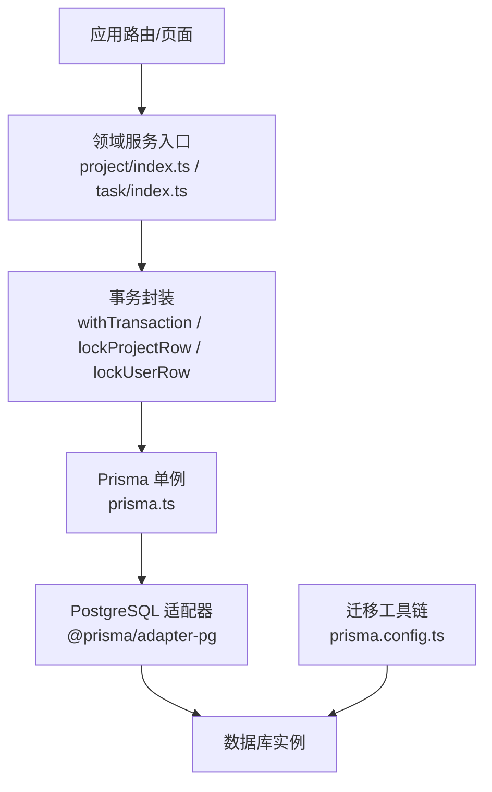
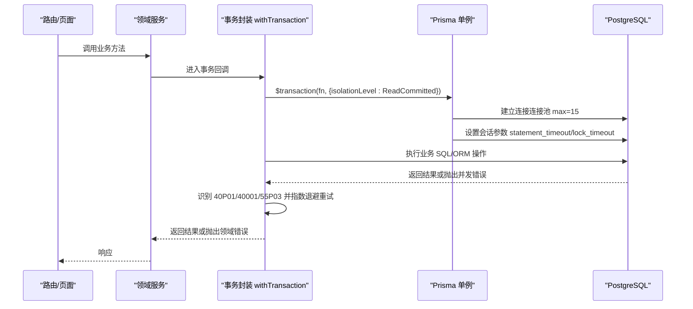
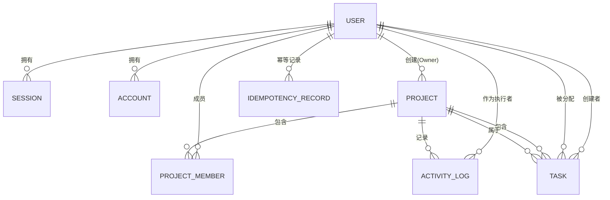
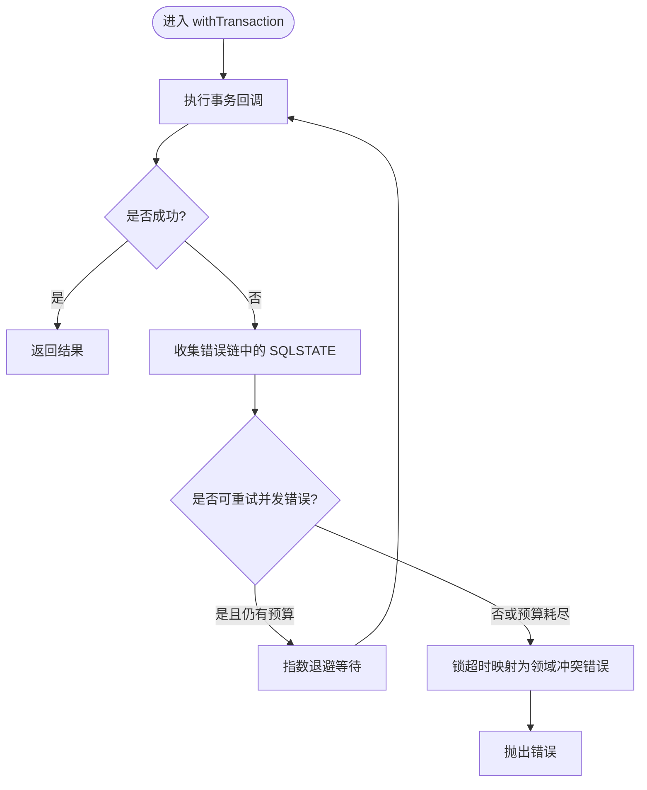
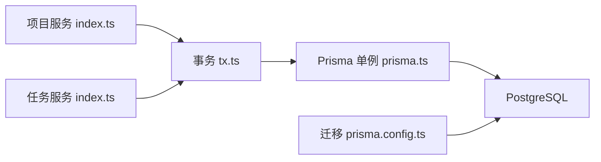

# 数据库访问层

<cite>
**本文引用的文件**
- [prisma/schema.prisma](file://prisma/schema.prisma)
- [prisma.config.ts](file://prisma.config.ts)
- [src/server/db/prisma.ts](file://src/server/db/prisma.ts)
- [src/server/db/tx.ts](file://src/server/db/tx.ts)
- [prisma/migrations/20260908162114_init_auth/migration.sql](file://prisma/migrations/20260908162114_init_auth/migration.sql)
- [prisma/migrations/20260909004718_add_task_domain/migration.sql](file://prisma/migrations/20260909004718_add_task_domain/migration.sql)
- [src/server/modules/project/index.ts](file://src/server/modules/project/index.ts)
- [src/server/modules/task/index.ts](file://src/server/modules/task/index.ts)
- [tests/integration/db-connectivity.test.ts](file://tests/integration/db-connectivity.test.ts)
- [DEVELOPMENT-PLAN.md](file://DEVELOPMENT-PLAN.md)
- [docs/04-DATA-MODEL.md](file://docs/04-DATA-MODEL.md)
</cite>

## 目录
1. [简介](#简介)
2. [项目结构](#项目结构)
3. [核心组件](#核心组件)
4. [架构总览](#架构总览)
5. [详细组件分析](#详细组件分析)
6. [依赖关系分析](#依赖关系分析)
7. [性能考虑](#性能考虑)
8. [故障排查指南](#故障排查指南)
9. [结论](#结论)
10. [附录](#附录)

## 简介
本文件面向 Orbit 项目的数据库访问层，聚焦 Prisma ORM 的配置与使用模式、数据模型设计、迁移管理、事务与并发控制、查询构建与优化、数据映射与验证、以及监控与恢复策略。文档以代码级事实为依据，结合项目既有实现与约定，给出可操作的实践建议。

## 项目结构
数据库相关代码集中在以下位置：
- 数据模型与生成配置：prisma/schema.prisma、prisma.config.ts
- 运行时连接与事务：src/server/db/prisma.ts、src/server/db/tx.ts
- 领域服务入口（体现对数据库的调用方式）：src/server/modules/project/index.ts、src/server/modules/task/index.ts
- 迁移脚本：prisma/migrations/*
- 集成测试（连接性校验）：tests/integration/db-connectivity.test.ts
- 部署与发布约定（含迁移执行策略）：DEVELOPMENT-PLAN.md、docs/04-DATA-MODEL.md

图表来源
- [src/server/db/prisma.ts:16-44](file://src/server/db/prisma.ts#L16-L44)
- [src/server/db/tx.ts:95-159](file://src/server/db/tx.ts#L95-L159)
- [prisma.config.ts:13-23](file://prisma.config.ts#L13-L23)

章节来源
- [prisma/config.ts:13-23](file://prisma.config.ts#L13-L23)
- [src/server/db/prisma.ts:16-44](file://src/server/db/prisma.ts#L16-L44)
- [src/server/db/tx.ts:95-159](file://src/server/db/tx.ts#L95-L159)

## 核心组件
- 数据源与客户端初始化：通过 Prisma 7 的 driver adapter 创建单例 PrismaClient，并配置连接池大小、空闲回收、获取超时及会话级 statement_timeout/lock_timeout。
- 事务与行锁：提供 withTransaction 封装，统一隔离级别为 ReadCommitted，内置死锁/序列化失败/锁超时的有限重试；提供 lockProjectRow/lockUserRow 用于跨表写操作的一致性保护。
- 数据模型：基于 Prisma schema 定义认证域与业务域（项目、任务等），包含枚举、索引、唯一约束与外键行为。
- 迁移管理：迁移脚本由 Prisma 生成，生产环境仅运行 migrate deploy，遵循向前兼容变更策略。

章节来源
- [src/server/db/prisma.ts:16-44](file://src/server/db/prisma.ts#L16-L44)
- [src/server/db/tx.ts:95-159](file://src/server/db/tx.ts#L95-L159)
- [prisma/schema.prisma:14-268](file://prisma/schema.prisma#L14-L268)
- [DEVELOPMENT-PLAN.md:1018-1035](file://DEVELOPMENT-PLAN.md#L1018-L1035)

## 架构总览
下图展示了从请求到数据库的完整链路，包括事务封装、连接池与会话级超时控制。

图表来源
- [src/server/db/tx.ts:95-159](file://src/server/db/tx.ts#L95-L159)
- [src/server/db/prisma.ts:16-44](file://src/server/db/prisma.ts#L16-L44)

## 详细组件分析

### 数据模型设计与关系映射
- 认证域：User、Session、Account、Verification，字段与约束严格对齐 Better Auth 1.7.3 官方 schema，User 扩展 timezone 字段。
- 项目域：Project、ProjectMember、ActivityLog、IdempotencyRecord，采用 UUID 主键、版本字段、软删除时间戳、活动日志与幂等记录。
- 任务域：Task，包含状态与优先级枚举、完成时间、版本号、软删除、排序 position 等；通过复合唯一与索引支持看板视图与分配者视图的高效查询。
- 外键与删除策略：认证域 Session/Account 对 User 级联删除；业务域普遍 Restrict，避免误删；Task.assignee 允许 SetNull。
- 索引策略：针对常见查询路径建立复合索引，如按项目+软删除+状态+排序+ID 的看板列表索引、按负责人+软删除+状态+到期日+ID 的任务视图索引等。

图表来源
- [prisma/schema.prisma:27-268](file://prisma/schema.prisma#L27-L268)

章节来源
- [prisma/schema.prisma:27-268](file://prisma/schema.prisma#L27-L268)

### 连接池管理与会话级超时
- 连接池：max=15，空闲连接 30s 回收，获取连接等待上限 5s，避免多实例打满数据库连接。
- 会话参数：statement_timeout=5000ms 防止慢查询长期占用连接；lock_timeout=3000ms 配合事务重试机制快速失败。
- 单例：全局缓存 PrismaClient，开发环境 HMR 下复用，生产保持单一实例。

章节来源
- [src/server/db/prisma.ts:16-44](file://src/server/db/prisma.ts#L16-L44)

### 事务处理与并发控制
- 隔离级别：统一 ReadCommitted，保证写事务内读己所写。
- 重试策略：对 PostgreSQL 并发冲突（死锁 40P01、序列化失败 40001、锁超时 55P03）进行最多 3 次指数退避重试。
- 锁顺序：User → Project → Task → 子资源，避免死锁。
- 行锁：提供 lockProjectRow/lockUserRow 在事务中加 FOR UPDATE，确保配额、编号、幂等记录的串行化。

图表来源
- [src/server/db/tx.ts:59-124](file://src/server/db/tx.ts#L59-L124)

章节来源
- [src/server/db/tx.ts:59-124](file://src/server/db/tx.ts#L59-L124)
- [src/server/db/tx.ts:126-159](file://src/server/db/tx.ts#L126-L159)

### 迁移管理机制
- 迁移目录：prisma/migrations，按时间戳命名，包含建表、索引、外键与 CHECK 约束。
- 生产策略：仅运行 migrate deploy，不运行 dev/push；向前兼容变更，先加字段/表→兼容代码→回填→移除旧结构。
- 种子数据：仅限开发/测试库，脚本需校验环境与库名，使用稳定 fixture ID/upsert，不清全库。

章节来源
- [prisma/migrations/20260908162114_init_auth/migration.sql:1-71](file://prisma/migrations/20260908162114_init_auth/migration.sql#L1-L71)
- [prisma/migrations/20260909004718_add_task_domain/migration.sql:1-62](file://prisma/migrations/20260909004718_add_task_domain/migration.sql#L1-L62)
- [DEVELOPMENT-PLAN.md:1018-1035](file://DEVELOPMENT-PLAN.md#L1018-L1035)
- [docs/04-DATA-MODEL.md:123-134](file://docs/04-DATA-MODEL.md#L123-L134)

### 查询构建器高级用法
- 复杂查询：通过 Prisma Client 的 where、include、orderBy、skip/take 组合条件、关联加载与分页。
- 聚合操作：使用 count/groupBy/having 等能力统计项目/任务维度指标。
- 事务内查询：所有写操作应包裹 in withTransaction，必要时使用 $queryRaw 执行原生 SQL 以表达复杂逻辑（如行锁）。

提示：具体查询写法请参考各模块服务中对 Prisma Client 的使用。

章节来源
- [src/server/modules/project/index.ts:1-24](file://src/server/modules/project/index.ts#L1-L24)
- [src/server/modules/task/index.ts:1-31](file://src/server/modules/task/index.ts#L1-L31)
- [src/server/db/tx.ts:95-159](file://src/server/db/tx.ts#L95-L159)

### 数据映射模式与类型安全
- DTO 转换：领域服务提供 toXxxDTO 函数，将数据库实体映射为对外契约类型，屏蔽内部字段（如 position、version）。
- 类型安全：Prisma Client 生成类型与 contracts 层类型共同保障端到端类型一致。
- 数据验证：输入在进入数据库前经校验（如 trim、时区合法性），非法输入直接抛领域错误，不落库。

章节来源
- [src/server/modules/project/index.ts:1-24](file://src/server/modules/project/index.ts#L1-L24)
- [src/server/modules/task/index.ts:1-31](file://src/server/modules/task/index.ts#L1-L31)

### 数据库性能监控与慢查询分析
- 会话级超时：statement_timeout 限制单条语句最长执行时间，避免慢查询拖垮连接。
- 锁超时：lock_timeout 限制等待锁的时间，配合重试与领域错误提升用户体验。
- 连接池监控：关注连接数、等待队列与超时事件，调整 max 与超时参数。
- 慢查询定位：结合数据库日志与索引使用情况，评估是否需要新增/调整索引。

章节来源
- [src/server/db/prisma.ts:16-44](file://src/server/db/prisma.ts#L16-L44)
- [src/server/db/tx.ts:95-159](file://src/server/db/tx.ts#L95-L159)

### 缓存策略
- 当前未引入应用层缓存；如需缓存热点数据（如项目元信息、看板布局），建议在服务层增加缓存层（例如 Redis），并确保与数据库一致性策略（失效/更新）明确。
- 注意：缓存不是替代数据库约束与事务的工具，关键一致性仍由数据库保证。

[本节为通用建议，不直接引用具体文件]

### 数据备份恢复与故障恢复
- 备份：生产部署前备份数据库并记录恢复点；首次空库也记录迁移版本。
- 回滚：应用回滚至兼容镜像；数据库不盲目 down migration，不可兼容变更必须有具体备份恢复方案。
- 迁移执行：仅在部署流程中执行一次 migrate deploy，禁止每个容器启动时并发执行。

章节来源
- [DEVELOPMENT-PLAN.md:1018-1035](file://DEVELOPMENT-PLAN.md#L1018-L1035)

## 依赖关系分析
- 领域服务依赖事务封装，事务封装依赖 Prisma 单例，单例依赖 PostgreSQL 适配器与数据库。
- 迁移工具链独立于运行时，但共享同一 schema 与数据库 URL。

图表来源
- [src/server/modules/project/index.ts:1-24](file://src/server/modules/project/index.ts#L1-L24)
- [src/server/modules/task/index.ts:1-31](file://src/server/modules/task/index.ts#L1-L31)
- [src/server/db/tx.ts:95-159](file://src/server/db/tx.ts#L95-L159)
- [src/server/db/prisma.ts:16-44](file://src/server/db/prisma.ts#L16-L44)
- [prisma.config.ts:13-23](file://prisma.config.ts#L13-L23)

章节来源
- [src/server/modules/project/index.ts:1-24](file://src/server/modules/project/index.ts#L1-L24)
- [src/server/modules/task/index.ts:1-31](file://src/server/modules/task/index.ts#L1-L31)
- [src/server/db/tx.ts:95-159](file://src/server/db/tx.ts#L95-L159)
- [src/server/db/prisma.ts:16-44](file://src/server/db/prisma.ts#L16-L44)
- [prisma.config.ts:13-23](file://prisma.config.ts#L13-L23)

## 性能考虑
- 连接池容量：根据实例数与数据库连接上限合理设置 max，避免排队与超时。
- 超时参数：statement_timeout/lock_timeout 与事务 timeout/maxWait 协同，确保快速失败与资源释放。
- 索引设计：围绕看板列表、分配者视图、项目成员与活动日志等高频查询路径建立复合索引。
- 事务粒度：尽量缩小事务范围，减少持锁时间与竞争概率。
- 重试策略：仅对可重试并发错误进行有限重试，避免放大负载。

[本节为通用指导，不直接引用具体文件]

## 故障排查指南
- 连接问题：确认 DATABASE_URL 正确，测试环境使用 TEST_DATABASE_URL 指向独立库，并通过集成测试验证连通性与库名。
- 慢查询/超时：检查 statement_timeout 与锁等待情况，必要时调整索引或优化查询。
- 并发冲突：出现 40P01/40001/55P03 时，优先检查锁顺序与事务粒度；若频繁发生，考虑拆分写入路径或降低并发。
- 迁移失败：核对迁移 SQL 与 schema 一致性，生产只运行 migrate deploy，避免并发执行。

章节来源
- [tests/integration/db-connectivity.test.ts:1-48](file://tests/integration/db-connectivity.test.ts#L1-L48)
- [src/server/db/prisma.ts:16-44](file://src/server/db/prisma.ts#L16-L44)
- [src/server/db/tx.ts:59-124](file://src/server/db/tx.ts#L59-L124)
- [DEVELOPMENT-PLAN.md:1018-1035](file://DEVELOPMENT-PLAN.md#L1018-L1035)

## 结论
Orbit 的数据库访问层以 Prisma 7 为核心，结合严格的连接池与会话超时配置、统一的事务封装与并发重试、完善的迁移与发布策略，构建了高可靠的数据访问基础。数据模型清晰、索引策略明确，领域服务通过 DTO 映射与类型安全保障接口契约。后续可在服务层引入缓存以提升性能，同时持续监控慢查询与连接池指标，确保系统在高并发场景下的稳定性。

## 附录
- 环境变量与配置：DATABASE_URL 由 prisma.config.ts 读取，开发建议使用 .env.local/.env 约定。
- 测试基线：集成测试验证独立测试库连接与 SELECT 1 返回，确保环境可用。
- 参考文档：数据模型与迁移策略详见 docs/04-DATA-MODEL.md 与 DEVELOPMENT-PLAN.md。

章节来源
- [prisma.config.ts:1-23](file://prisma.config.ts#L1-L23)
- [tests/integration/db-connectivity.test.ts:1-48](file://tests/integration/db-connectivity.test.ts#L1-L48)
- [docs/04-DATA-MODEL.md:123-134](file://docs/04-DATA-MODEL.md#L123-L134)
- [DEVELOPMENT-PLAN.md:1018-1035](file://DEVELOPMENT-PLAN.md#L1018-L1035)