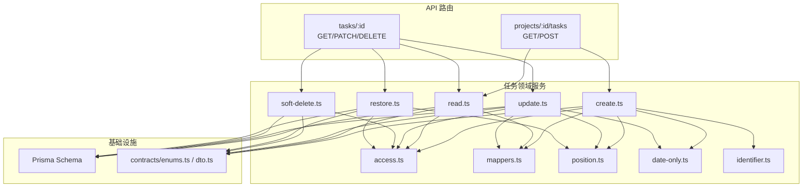
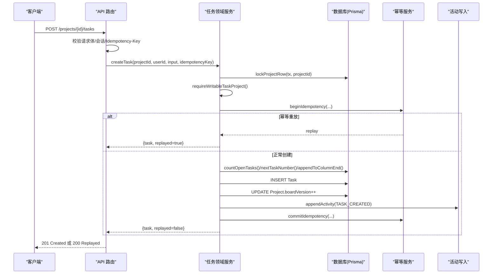
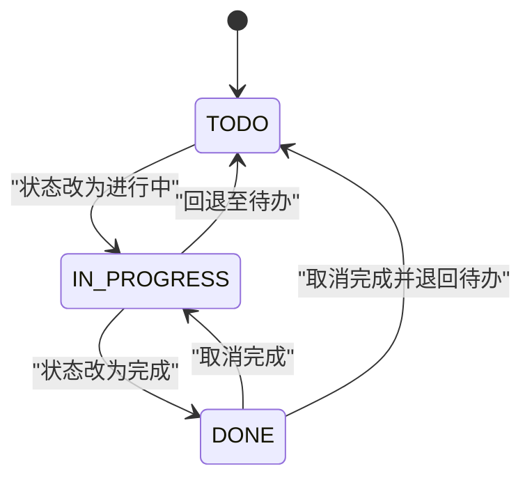
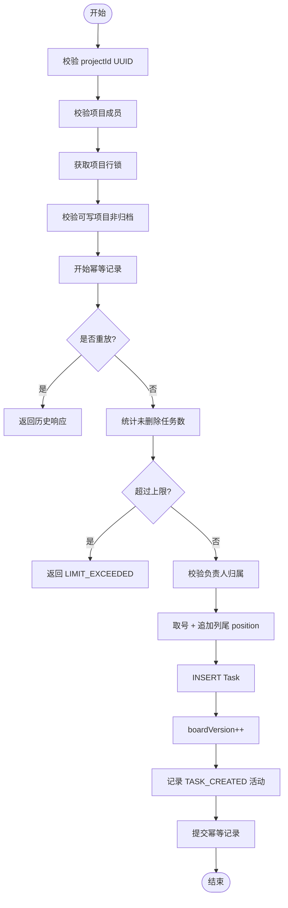
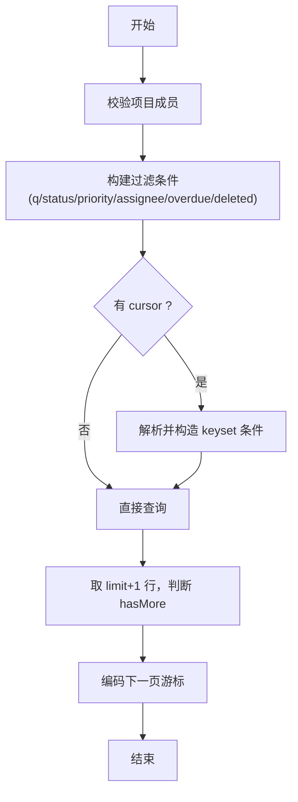
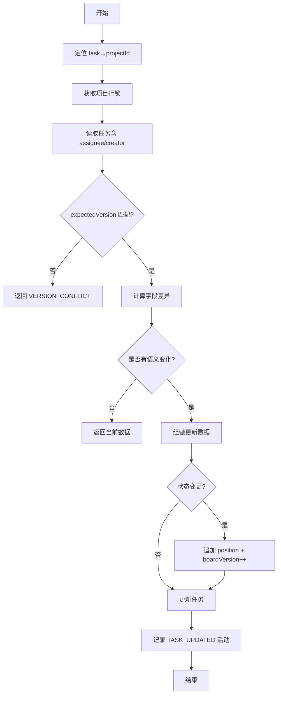
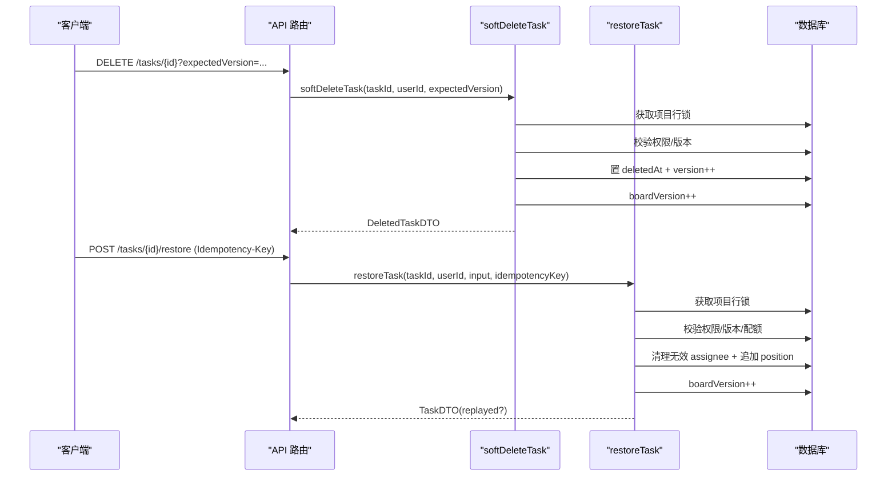
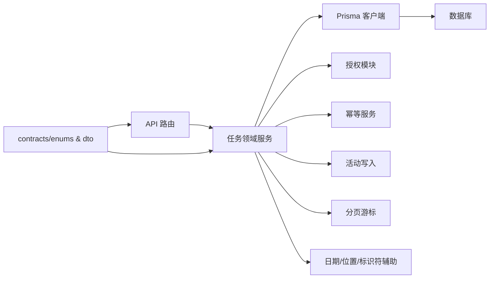

# 任务服务模块

<cite>
**本文引用的文件**
- [prisma/schema.prisma](file://prisma/schema.prisma)
- [src/server/modules/task/index.ts](file://src/server/modules/task/index.ts)
- [src/server/modules/task/create.ts](file://src/server/modules/task/create.ts)
- [src/server/modules/task/read.ts](file://src/server/modules/task/read.ts)
- [src/server/modules/task/update.ts](file://src/server/modules/task/update.ts)
- [src/server/modules/task/soft-delete.ts](file://src/server/modules/task/soft-delete.ts)
- [src/server/modules/task/restore.ts](file://src/server/modules/task/restore.ts)
- [src/server/modules/task/access.ts](file://src/server/modules/task/access.ts)
- [src/server/modules/task/mappers.ts](file://src/server/modules/task/mappers.ts)
- [src/server/modules/task/position.ts](file://src/server/modules/task/position.ts)
- [src/server/modules/task/date-only.ts](file://src/server/modules/task/date-only.ts)
- [src/server/modules/task/identifier.ts](file://src/server/modules/task/identifier.ts)
- [src/contracts/enums.ts](file://src/contracts/enums.ts)
- [src/contracts/dto.ts](file://src/contracts/dto.ts)
- [src/app/api/v1/projects/[projectId]/tasks/route.ts](file://src/app/api/v1/projects/[projectId]/tasks/route.ts)
- [src/app/api/v1/tasks/[taskId]/route.ts](file://src/app/api/v1/tasks/[taskId]/route.ts)
</cite>

## 目录
1. [简介](#简介)
2. [项目结构](#项目结构)
3. [核心组件](#核心组件)
4. [架构总览](#架构总览)
5. [详细组件分析](#详细组件分析)
6. [依赖关系分析](#依赖关系分析)
7. [性能考量](#性能考量)
8. [故障排查指南](#故障排查指南)
9. [结论](#结论)
10. [附录](#附录)

## 简介
本模块为 Orbit 项目的“任务服务”，提供任务的创建、查询、更新、恢复与软删除能力，并围绕任务数据模型（状态机、优先级、时间管理）实现生命周期管理与协作机制。通过项目行锁、事务、幂等与活动日志，保证并发安全与可审计性；通过游标分页、过滤与排序满足高效检索需求。

## 项目结构
任务服务以领域模块组织在 server/modules/task 下，按职责拆分为 create/read/update/soft-delete/restore 等子模块，并通过 index.ts 统一对外导出。数据模型定义于 Prisma schema，契约类型与 DTO 定义位于 contracts。API 路由位于 app/api/v1，负责参数校验、会话鉴权与调用领域服务。

图表来源
- [src/app/api/v1/projects/[projectId]/tasks/route.ts:1-104](file://src/app/api/v1/projects/[projectId]/tasks/route.ts#L1-L104)
- [src/app/api/v1/tasks/[taskId]/route.ts:1-112](file://src/app/api/v1/tasks/[taskId]/route.ts#L1-L112)
- [src/server/modules/task/index.ts:1-31](file://src/server/modules/task/index.ts#L1-L31)
- [src/server/modules/task/create.ts:1-202](file://src/server/modules/task/create.ts#L1-L202)
- [src/server/modules/task/read.ts:1-250](file://src/server/modules/task/read.ts#L1-L250)
- [src/server/modules/task/update.ts:1-191](file://src/server/modules/task/update.ts#L1-L191)
- [src/server/modules/task/soft-delete.ts:1-100](file://src/server/modules/task/soft-delete.ts#L1-L100)
- [src/server/modules/task/restore.ts:1-198](file://src/server/modules/task/restore.ts#L1-L198)
- [src/server/modules/task/access.ts:1-102](file://src/server/modules/task/access.ts#L1-L102)
- [src/server/modules/task/mappers.ts:1-89](file://src/server/modules/task/mappers.ts#L1-L89)
- [src/server/modules/task/position.ts:1-48](file://src/server/modules/task/position.ts#L1-L48)
- [src/server/modules/task/date-only.ts:1-48](file://src/server/modules/task/date-only.ts#L1-L48)
- [src/server/modules/task/identifier.ts:1-42](file://src/server/modules/task/identifier.ts#L1-L42)
- [src/contracts/enums.ts:1-130](file://src/contracts/enums.ts#L1-L130)
- [src/contracts/dto.ts:1-476](file://src/contracts/dto.ts#L1-L476)
- [prisma/schema.prisma:14-268](file://prisma/schema.prisma#L14-L268)

章节来源
- [src/server/modules/task/index.ts:1-31](file://src/server/modules/task/index.ts#L1-L31)
- [src/app/api/v1/projects/[projectId]/tasks/route.ts:1-104](file://src/app/api/v1/projects/[projectId]/tasks/route.ts#L1-L104)
- [src/app/api/v1/tasks/[taskId]/route.ts:1-112](file://src/app/api/v1/tasks/[taskId]/route.ts#L1-L112)

## 核心组件
- 创建任务：在持有项目行锁的事务内完成成员校验、归档检查、配额计数、编号分配、位置追加、写入任务、更新看板版本、记录活动与幂等提交。
- 读取任务：支持列表（keyset 游标分页、过滤、排序）与详情读取；详情读取先定位最小 projectId，再校验成员与软删除。
- 更新任务：白名单字段变更检测、乐观并发（expectedVersion）、状态变更驱动 completedAt 与看板重排、必要时更新看板版本并写活动。
- 软删除：仅 owner 或创建者可删；置 deletedAt、version++、boardVersion++，记录活动。
- 恢复任务：仅已软删除任务可恢复；配额检查、负责人有效性清理、放回原列尾、boardVersion++、幂等重放。
- 辅助能力：position 追加到列尾、date-only 转换、identifier 生成、DTO 映射、权限与配额校验。

章节来源
- [src/server/modules/task/create.ts:1-202](file://src/server/modules/task/create.ts#L1-L202)
- [src/server/modules/task/read.ts:1-250](file://src/server/modules/task/read.ts#L1-L250)
- [src/server/modules/task/update.ts:1-191](file://src/server/modules/task/update.ts#L1-L191)
- [src/server/modules/task/soft-delete.ts:1-100](file://src/server/modules/task/soft-delete.ts#L1-L100)
- [src/server/modules/task/restore.ts:1-198](file://src/server/modules/task/restore.ts#L1-L198)
- [src/server/modules/task/access.ts:1-102](file://src/server/modules/task/access.ts#L1-L102)
- [src/server/modules/task/position.ts:1-48](file://src/server/modules/task/position.ts#L1-L48)
- [src/server/modules/task/date-only.ts:1-48](file://src/server/modules/task/date-only.ts#L1-L48)
- [src/server/modules/task/identifier.ts:1-42](file://src/server/modules/task/identifier.ts#L1-L42)
- [src/server/modules/task/mappers.ts:1-89](file://src/server/modules/task/mappers.ts#L1-L89)

## 架构总览
任务服务遵循“路由层只做编排，领域服务承载业务”的分层设计。所有写操作均在项目行锁事务中执行，确保编号、配额、看板顺序与活动日志的原子一致性。读路径使用应用单例 Prisma，配合 keyset 游标与过滤指纹实现稳定分页。

图表来源
- [src/app/api/v1/projects/[projectId]/tasks/route.ts:65-104](file://src/app/api/v1/projects/[projectId]/tasks/route.ts#L65-L104)
- [src/server/modules/task/create.ts:32-202](file://src/server/modules/task/create.ts#L32-L202)

章节来源
- [src/app/api/v1/projects/[projectId]/tasks/route.ts:1-104](file://src/app/api/v1/projects/[projectId]/tasks/route.ts#L1-L104)
- [src/server/modules/task/create.ts:1-202](file://src/server/modules/task/create.ts#L1-L202)

## 详细组件分析

### 数据模型与状态机
- 任务实体包含：项目关联、编号、创建者、负责人、标题、描述、状态、优先级、截止日、位置、完成时间、版本号、软删除时间戳、创建/更新时间。
- 状态机：TODO → IN_PROGRESS → DONE；进入 DONE 时 completedAt 自动设置；离开 DONE 时清空。
- 优先级系统：NONE < LOW < MEDIUM < HIGH；枚举声明序用于 DESC 排序得到高优先在前。
- 时间管理：dueDate 为 date-only（UTC），避免时区偏移；overdue 基于用户时区的“今天”计算。

图表来源
- [prisma/schema.prisma:221-232](file://prisma/schema.prisma#L221-L232)
- [src/contracts/enums.ts:36-49](file://src/contracts/enums.ts#L36-L49)
- [src/server/modules/task/update.ts:137-147](file://src/server/modules/task/update.ts#L137-L147)

章节来源
- [prisma/schema.prisma:240-267](file://prisma/schema.prisma#L240-L267)
- [src/contracts/enums.ts:36-49](file://src/contracts/enums.ts#L36-L49)
- [src/server/modules/task/date-only.ts:1-48](file://src/server/modules/task/date-only.ts#L1-L48)

### 任务创建流程
- 前置校验：UUID 合法性、成员可见性、项目未归档。
- 幂等：beginIdempotency 支持重放；冲突时在新事务重试。
- 配额：锁内统计未删除任务数，超限返回 LIMIT_EXCEEDED。
- 编号与位置：原子递增 nextTaskNumber；appendToColumnEnd 将任务置于目标列尾。
- 写入与审计：插入任务、更新 boardVersion、记录 TASK_CREATED 活动。
- 结果：返回任务 DTO 与是否重放标记。

图表来源
- [src/server/modules/task/create.ts:77-202](file://src/server/modules/task/create.ts#L77-L202)
- [src/server/modules/task/identifier.ts:24-36](file://src/server/modules/task/identifier.ts#L24-L36)
- [src/server/modules/task/position.ts:31-47](file://src/server/modules/task/position.ts#L31-L47)
- [src/server/modules/task/access.ts:86-92](file://src/server/modules/task/access.ts#L86-L92)

章节来源
- [src/server/modules/task/create.ts:1-202](file://src/server/modules/task/create.ts#L1-L202)

### 任务查询与分页
- 列表：keyset 游标分页，携带排序字段值、末项 id 与过滤指纹；支持 updated_desc、due_asc、priority_desc 三种排序。
- 过滤：q（标题 ILIKE，转义通配符）、status、priority、assigneeId/unassigned、overdue（基于用户时区 today）、deleted（exclude/only）。
- 详情：getTask 先定位最小 projectId，再校验成员与软删除；不存在/非成员/已软删除均返回 404。

图表来源
- [src/server/modules/task/read.ts:149-228](file://src/server/modules/task/read.ts#L149-L228)
- [src/server/modules/task/read.ts:231-249](file://src/server/modules/task/read.ts#L231-L249)

章节来源
- [src/server/modules/task/read.ts:1-250](file://src/server/modules/task/read.ts#L1-L250)

### 任务更新流程
- 白名单字段：title、description、priority、dueDate、assigneeId、status。
- 语义不变优化：规范化后无变化则不 bump version、不写活动。
- 状态变更：进入 DONE 设置 completedAt；离开 DONE 清空；状态变更触发 position 追加与 boardVersion++。
- 乐观并发：expectedVersion 不符返回 VERSION_CONFLICT 并附带 currentVersion。

图表来源
- [src/server/modules/task/update.ts:64-191](file://src/server/modules/task/update.ts#L64-L191)

章节来源
- [src/server/modules/task/update.ts:1-191](file://src/server/modules/task/update.ts#L1-L191)

### 软删除与恢复
- 软删除：仅 owner 或创建者可删；置 deletedAt、version++、boardVersion++，记录 TASK_DELETED。
- 恢复：仅已软删除任务可恢复；配额检查；若原负责人已退出项目则置空；放回原列尾、boardVersion++、记录 TASK_RESTORED；支持幂等重放。

图表来源
- [src/server/modules/task/soft-delete.ts:47-100](file://src/server/modules/task/soft-delete.ts#L47-L100)
- [src/server/modules/task/restore.ts:85-198](file://src/server/modules/task/restore.ts#L85-L198)
- [src/app/api/v1/tasks/[taskId]/route.ts:88-112](file://src/app/api/v1/tasks/[taskId]/route.ts#L88-L112)

章节来源
- [src/server/modules/task/soft-delete.ts:1-100](file://src/server/modules/task/soft-delete.ts#L1-L100)
- [src/server/modules/task/restore.ts:1-198](file://src/server/modules/task/restore.ts#L1-L198)
- [src/app/api/v1/tasks/[taskId]/route.ts:1-112](file://src/app/api/v1/tasks/[taskId]/route.ts#L1-L112)

### 任务与项目和用户的关联
- 项目：任务属于项目，项目编号在项目内唯一且递增；看板顺序由 boardVersion 驱动。
- 用户：creator 不可变（保护历史），assignee 可为空（成员退出时置空）；负责人必须是项目 owner 或成员。
- 协作：成员可见项目任务；owner 或创建者可删除/恢复任务。

章节来源
- [prisma/schema.prisma:144-179](file://prisma/schema.prisma#L144-L179)
- [prisma/schema.prisma:240-267](file://prisma/schema.prisma#L240-L267)
- [src/server/modules/task/access.ts:48-84](file://src/server/modules/task/access.ts#L48-L84)

### 排序、分页与搜索
- 排序：updated_desc（默认）、due_asc（nulls last）、priority_desc（HIGH→NONE）。
- 分页：keyset 游标，携带排序字段值与末项 id；过滤指纹确保排序/过滤变化时游标失效。
- 搜索：q 对 title 进行 ILIKE 搜索，并对 % _ \ 进行转义以避免全表扫描。

章节来源
- [src/server/modules/task/read.ts:61-128](file://src/server/modules/task/read.ts#L61-L128)
- [src/server/modules/task/read.ts:145-228](file://src/server/modules/task/read.ts#L145-L228)

### 并发处理策略、事务管理与错误处理
- 并发：项目行锁串行化编号、配额、position 与 boardVersion 的变更；乐观并发通过 expectedVersion 防止覆盖。
- 事务：写操作在 withTransaction 中执行；幂等提交冲突时在新事务重试。
- 错误：统一 DomainError 体系，如 NOT_FOUND、LIMIT_EXCEEDED、ASSIGNEE_NOT_MEMBER、VERSION_CONFLICT、FORBIDDEN、PROJECT_ARCHIVED、INVALID_CURSOR 等。

章节来源
- [src/server/modules/task/create.ts:93-202](file://src/server/modules/task/create.ts#L93-L202)
- [src/server/modules/task/update.ts:78-191](file://src/server/modules/task/update.ts#L78-L191)
- [src/server/modules/task/restore.ts:103-198](file://src/server/modules/task/restore.ts#L103-L198)
- [src/server/modules/task/access.ts:22-46](file://src/server/modules/task/access.ts#L22-L46)

## 依赖关系分析
- API 路由依赖 contracts 中的 DTO/Schema 进行输入校验，调用任务领域服务。
- 领域服务依赖 Prisma 生成的客户端访问数据库，依赖授权、幂等、活动、分页等共享模块。
- 数据模型由 Prisma schema 定义，枚举与 DTO 在 contracts 中集中维护，确保前后端一致。

图表来源
- [src/app/api/v1/projects/[projectId]/tasks/route.ts:1-104](file://src/app/api/v1/projects/[projectId]/tasks/route.ts#L1-L104)
- [src/app/api/v1/tasks/[taskId]/route.ts:1-112](file://src/app/api/v1/tasks/[taskId]/route.ts#L1-L112)
- [src/server/modules/task/index.ts:1-31](file://src/server/modules/task/index.ts#L1-L31)
- [src/contracts/enums.ts:1-130](file://src/contracts/enums.ts#L1-L130)
- [src/contracts/dto.ts:1-476](file://src/contracts/dto.ts#L1-L476)

章节来源
- [src/server/modules/task/index.ts:1-31](file://src/server/modules/task/index.ts#L1-L31)
- [src/contracts/enums.ts:1-130](file://src/contracts/enums.ts#L1-L130)
- [src/contracts/dto.ts:1-476](file://src/contracts/dto.ts#L1-L476)

## 性能考量
- 索引利用：任务表针对 (projectId, deletedAt, status, position, id) 与 (projectId, deletedAt, updatedAt, id)、(assigneeId, deletedAt, status, dueDate, id) 建立索引，支撑列表查询与排序。
- 游标分页：keyset 游标避免深度翻页开销，适合大数据量场景。
- 行级锁：项目行锁减少竞争，保证编号、配额与看板顺序的一致性。
- 只读路径：列表与详情读取不使用事务，降低锁竞争。
- 日期处理：date-only 使用 UTC 转换，避免时区导致的额外计算与错误。

[本节为通用性能建议，无需特定文件引用]

## 故障排查指南
- 404 NOT_FOUND：任务不存在、非法 UUID、非成员或已软删除；请检查 taskId/projectId 与会话权限。
- 409 VERSION_CONFLICT：并发更新导致版本不一致；请刷新后重试并传入最新 expectedVersion。
- 422 LIMIT_EXCEEDED：项目未删除任务达到上限；请先删除部分任务。
- 422 ASSIGNEE_NOT_MEMBER：负责人不是项目 owner 或成员；请从成员列表中选择。
- 403 FORBIDDEN：非 owner 或非创建者尝试删除/恢复任务；请确认权限。
- 409 PROJECT_ARCHIVED：归档项目禁止写操作；请先恢复项目。
- 400 INVALID_CURSOR：游标损坏或过滤/排序变化；请重新获取列表并传递新游标。

章节来源
- [src/server/modules/task/access.ts:22-46](file://src/server/modules/task/access.ts#L22-L46)
- [src/server/modules/task/update.ts:41-49](file://src/server/modules/task/update.ts#L41-L49)
- [src/server/modules/task/restore.ts:61-69](file://src/server/modules/task/restore.ts#L61-L69)
- [src/server/modules/task/read.ts:54-59](file://src/server/modules/task/read.ts#L54-L59)

## 结论
任务服务通过严谨的数据模型、状态机与权限矩阵，结合项目行锁、事务、幂等与活动日志，实现了高可靠的任务生命周期管理。列表查询采用 keyset 游标与多维过滤，满足高性能检索需求。整体设计清晰分层、职责单一，便于扩展与维护。

[本节为总结性内容，无需特定文件引用]

## 附录
- 最佳实践
  - 写操作务必携带 Idempotency-Key，避免重复提交造成副作用。
  - 更新任务时始终传入最新的 expectedVersion，避免覆盖他人修改。
  - 列表查询使用游标分页，避免 deep pagination。
  - 负责人必须从项目成员中选择，避免非法分配。
  - 使用 date-only 字段时注意 UTC 转换，避免时区偏移。

[本节为通用指导，无需特定文件引用]