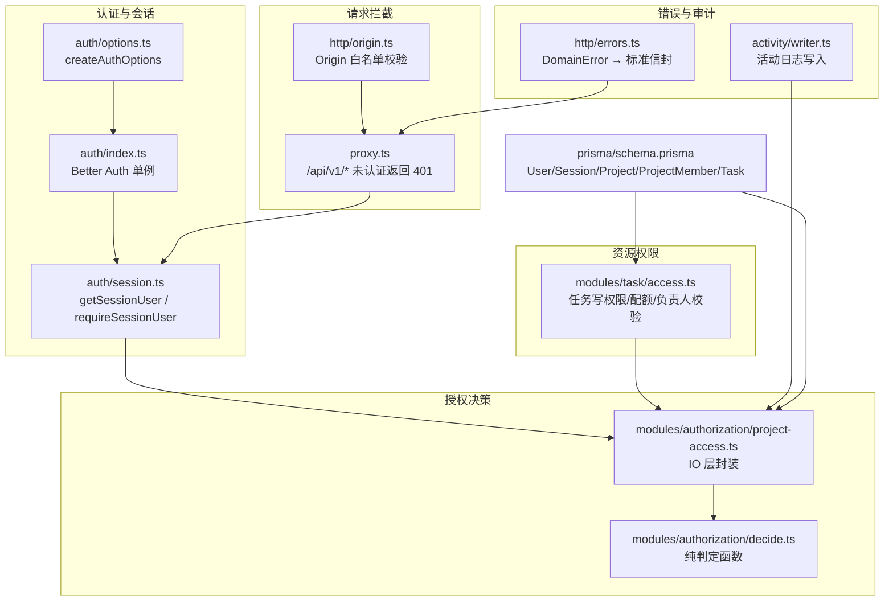
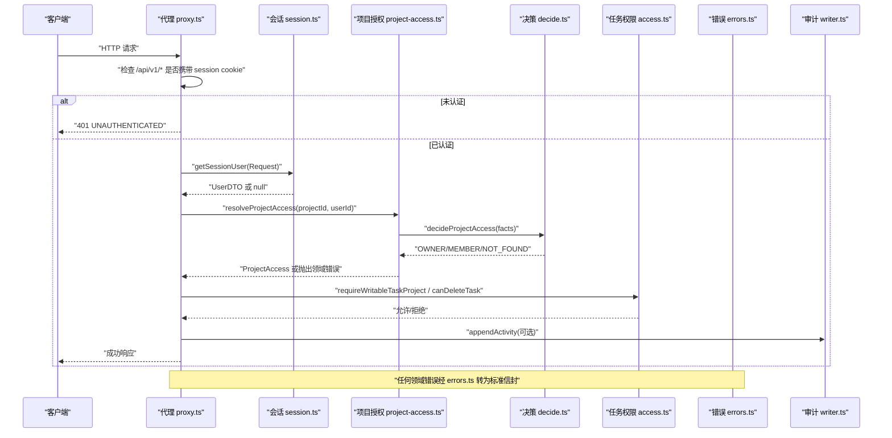
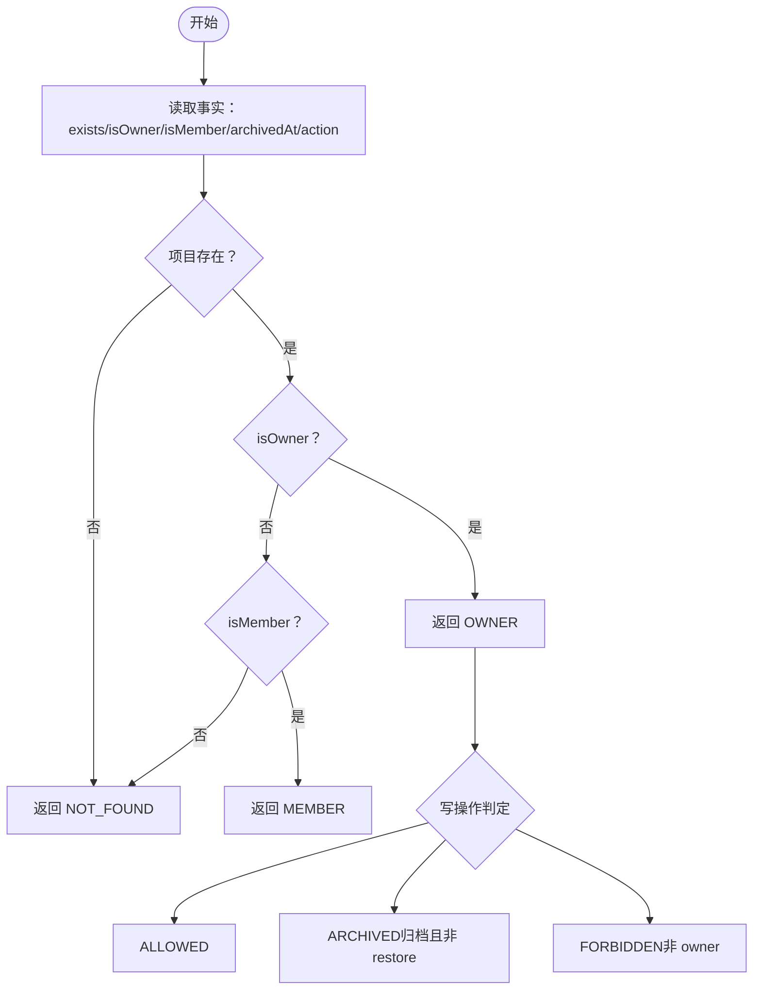
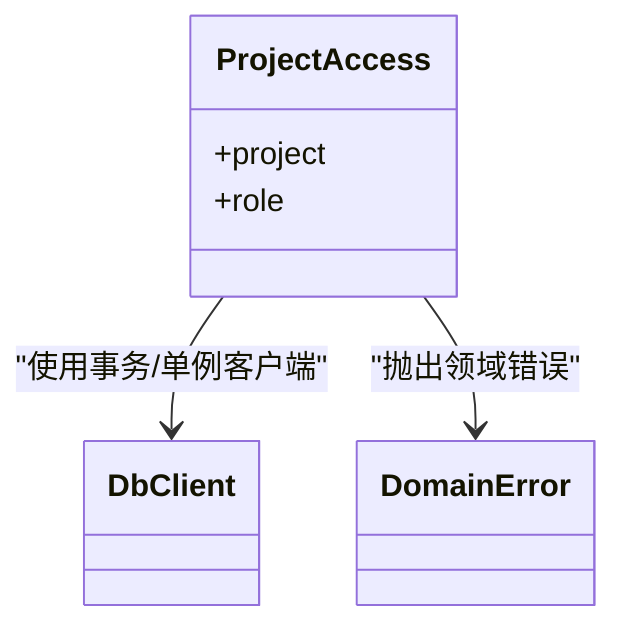
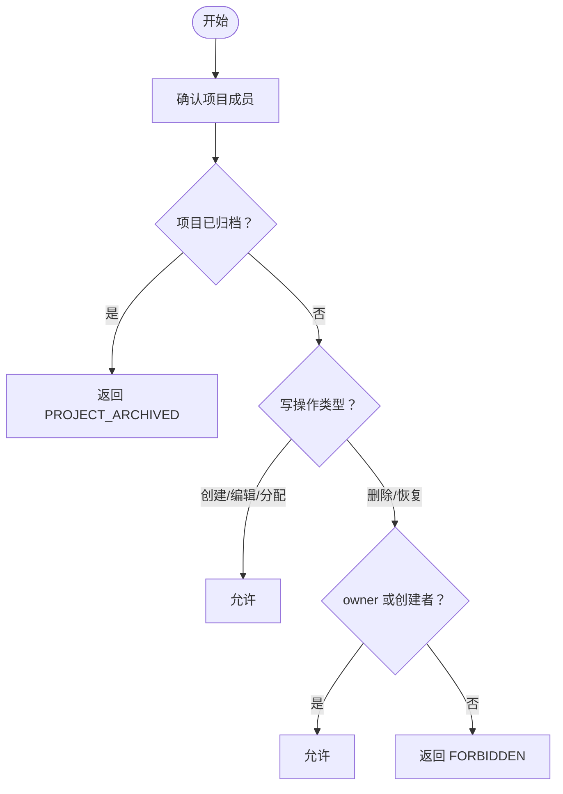
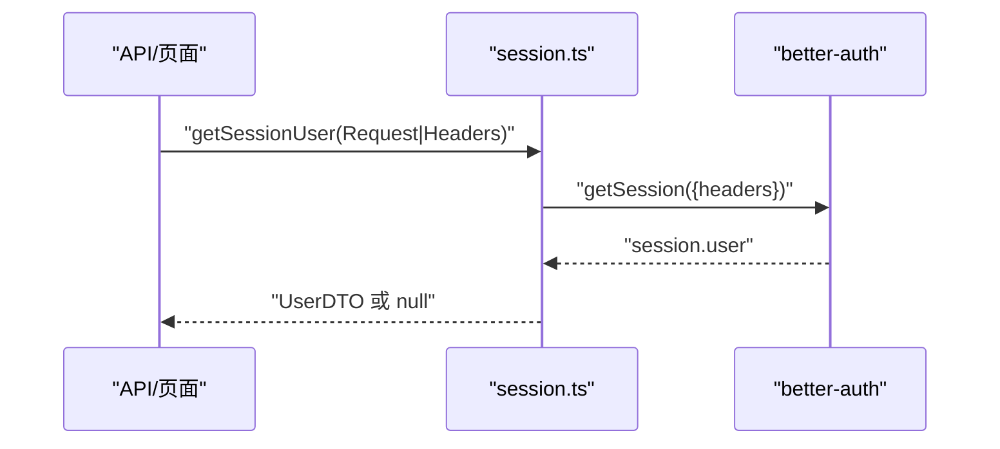
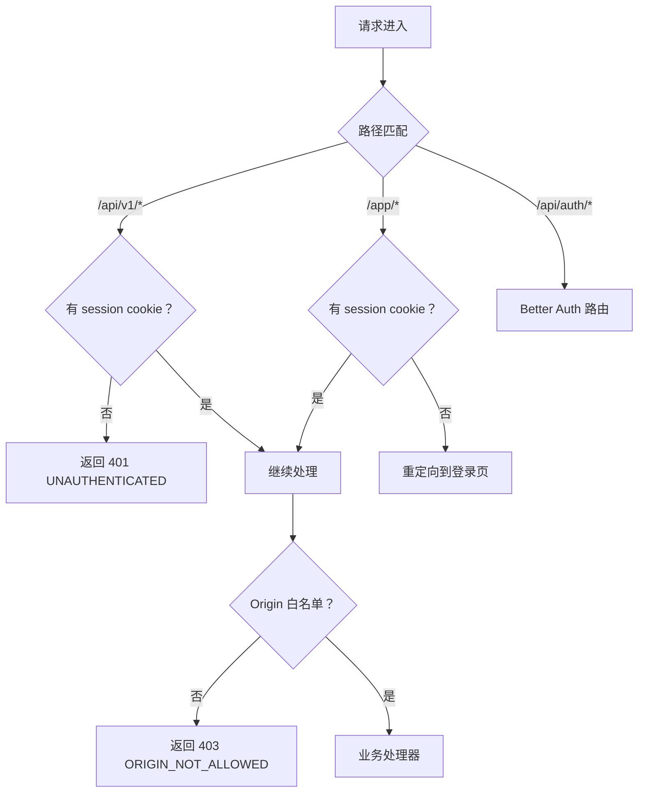
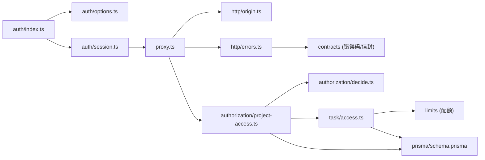
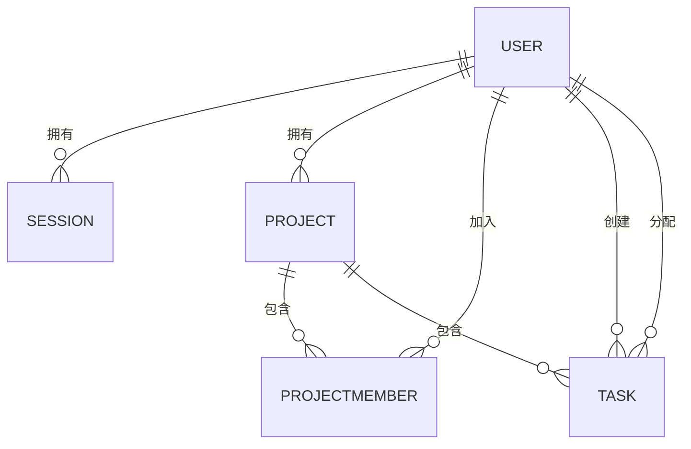

# 授权服务模块

<cite>
**本文引用的文件**
- [decide.ts](file://src/server/modules/authorization/decide.ts)
- [project-access.ts](file://src/server/modules/authorization/project-access.ts)
- [access.ts](file://src/server/modules/task/access.ts)
- [index.ts](file://src/server/auth/index.ts)
- [session.ts](file://src/server/auth/session.ts)
- [options.ts](file://src/server/auth/options.ts)
- [route.ts](file://src/app/api/auth/[...all]/route.ts)
- [schema.prisma](file://prisma/schema.prisma)
- [proxy.ts](file://src/proxy.ts)
- [origin.ts](file://src/server/http/origin.ts)
- [errors.ts](file://src/server/http/errors.ts)
- [writer.ts](file://src/server/modules/activity/writer.ts)
</cite>

## 目录
1. [简介](#简介)
2. [项目结构](#项目结构)
3. [核心组件](#核心组件)
4. [架构总览](#架构总览)
5. [详细组件分析](#详细组件分析)
6. [依赖关系分析](#依赖关系分析)
7. [性能考虑](#性能考虑)
8. [故障排查指南](#故障排查指南)
9. [结论](#结论)
10. [附录](#附录)

## 简介
本模块文档聚焦 Orbit 项目的授权体系，覆盖基于角色的访问控制（RBAC）、资源级权限检查、权限决策引擎、项目访问控制、用户会话与上下文传递、请求拦截中间件、权限配置与扩展、以及审计能力。目标是帮助读者快速理解“谁在什么条件下可以访问或修改哪些资源”，并掌握如何安全地扩展与运维该体系。

## 项目结构
授权相关代码主要分布在以下位置：
- 认证与会话：server/auth（Better Auth 集成、会话获取）
- 授权决策与资源访问：server/modules/authorization（纯判定函数 + IO 层封装）
- 任务域权限：server/modules/task/access.ts（成员可见、归档只读、创建者删除等）
- 请求拦截与边界校验：proxy.ts（会话门禁）、server/http/origin.ts（Origin 白名单）
- 错误与响应：server/http/errors.ts（领域错误到标准信封）
- 数据模型：prisma/schema.prisma（User/Session/Project/ProjectMember/Task 等）
- 审计日志：server/modules/activity/writer.ts（活动写入器）

图表来源
- [index.ts:1-29](file://src/server/auth/index.ts#L1-L29)
- [session.ts:1-43](file://src/server/auth/session.ts#L1-L43)
- [options.ts:1-141](file://src/server/auth/options.ts#L1-L141)
- [decide.ts:1-67](file://src/server/modules/authorization/decide.ts#L1-L67)
- [project-access.ts:1-121](file://src/server/modules/authorization/project-access.ts#L1-L121)
- [access.ts:1-102](file://src/server/modules/task/access.ts#L1-L102)
- [proxy.ts:1-60](file://src/proxy.ts#L1-L60)
- [origin.ts:1-69](file://src/server/http/origin.ts#L1-L69)
- [errors.ts:1-136](file://src/server/http/errors.ts#L1-L136)
- [writer.ts:1-65](file://src/server/modules/activity/writer.ts#L1-L65)
- [schema.prisma:1-200](file://prisma/schema.prisma#L1-L200)

章节来源
- [index.ts:1-29](file://src/server/auth/index.ts#L1-L29)
- [session.ts:1-43](file://src/server/auth/session.ts#L1-L43)
- [options.ts:1-141](file://src/server/auth/options.ts#L1-L141)
- [decide.ts:1-67](file://src/server/modules/authorization/decide.ts#L1-L67)
- [project-access.ts:1-121](file://src/server/modules/authorization/project-access.ts#L1-L121)
- [access.ts:1-102](file://src/server/modules/task/access.ts#L1-L102)
- [proxy.ts:1-60](file://src/proxy.ts#L1-L60)
- [origin.ts:1-69](file://src/server/http/origin.ts#L1-L69)
- [errors.ts:1-136](file://src/server/http/errors.ts#L1-L136)
- [writer.ts:1-65](file://src/server/modules/activity/writer.ts#L1-L65)
- [schema.prisma:1-200](file://prisma/schema.prisma#L1-L200)

## 核心组件
- 认证与会话
  - Better Auth 应用单例：绑定 Prisma 与环境，提供统一认证入口。
  - 会话获取：从 Request/Headers 解析当前用户，返回契约层 UserDTO，避免泄露敏感字段。
  - 配置工厂：集中管理邮箱密码、验证、会话过期、限流、可信源与安全 Cookie 策略。
- 授权决策引擎
  - 纯判定函数：将“读角色”和“写许可”的决策逻辑抽离为无 IO 的函数，便于穷举测试与复用。
  - IO 层封装：读取 Project/ProjectMember，调用纯判定函数，并将结果映射为领域错误（NOT_FOUND/FORBIDDEN/PROJECT_ARCHIVED）。
- 资源级权限
  - 项目：owner-only 写操作；成员可读；归档后仅恢复可写。
  - 任务：成员可见；创建/编辑/分配 owner 与 member 均可；删除/恢复需为 owner 或创建者；归档项目对所有业务写只读。
- 请求拦截与边界
  - 会话门禁：/api/v1/* 未携带有效 session cookie 直接返回 401 JSON。
  - Origin 白名单：对自有变更 API 进行同源校验，非信任来源拒绝。
- 错误与审计
  - 领域错误统一映射为标准信封，附带 requestId 与 no-store 缓存策略。
  - 活动日志以白名单过滤 metadata，保证审计信息最小化且不可越权。

章节来源
- [session.ts:1-43](file://src/server/auth/session.ts#L1-L43)
- [options.ts:1-141](file://src/server/auth/options.ts#L1-L141)
- [decide.ts:1-67](file://src/server/modules/authorization/decide.ts#L1-L67)
- [project-access.ts:1-121](file://src/server/modules/authorization/project-access.ts#L1-L121)
- [access.ts:1-102](file://src/server/modules/task/access.ts#L1-L102)
- [proxy.ts:1-60](file://src/proxy.ts#L1-L60)
- [origin.ts:1-69](file://src/server/http/origin.ts#L1-L69)
- [errors.ts:1-136](file://src/server/http/errors.ts#L1-L136)
- [writer.ts:1-65](file://src/server/modules/activity/writer.ts#L1-L65)

## 架构总览
下图展示了从请求进入、会话校验、资源授权到错误处理与审计的整体流程。

图表来源
- [proxy.ts:1-60](file://src/proxy.ts#L1-L60)
- [session.ts:1-43](file://src/server/auth/session.ts#L1-L43)
- [project-access.ts:1-121](file://src/server/modules/authorization/project-access.ts#L1-L121)
- [decide.ts:1-67](file://src/server/modules/authorization/decide.ts#L1-L67)
- [access.ts:1-102](file://src/server/modules/task/access.ts#L1-L102)
- [errors.ts:1-136](file://src/server/http/errors.ts#L1-L136)
- [writer.ts:1-65](file://src/server/modules/activity/writer.ts#L1-L65)

## 详细组件分析

### 权限决策引擎（decide.ts）
- 设计要点
  - 纯函数：不依赖 IO，输入为事实（是否存在、是否 owner、是否 member），输出为角色或写许可。
  - 安全收敛：非成员与不存在统一返回 NOT_FOUND，避免泄露项目存在性。
  - 写权限矩阵：仅 owner 可更新/归档/恢复；归档项目除 restore 外只读。
- 复杂度
  - 时间 O(1)，空间 O(1)。
- 优化建议
  - 可在事务内复用同一份判定结果，减少重复计算。

图表来源
- [decide.ts:1-67](file://src/server/modules/authorization/decide.ts#L1-L67)

章节来源
- [decide.ts:1-67](file://src/server/modules/authorization/decide.ts#L1-L67)

### 项目访问控制（project-access.ts）
- 职责
  - 在数据库上查询 Project 与 ProjectMember，填充事实并调用纯判定函数。
  - 将判定结果转换为领域错误：NOT_FOUND、FORBIDDEN、PROJECT_ARCHIVED。
- 关键方法
  - resolveProjectAccess：解析读访问角色。
  - requireProjectMember：要求成员可见。
  - requireProjectOwner：要求 owner 可见。
  - requireWritableProject：要求项目可写（考虑归档状态与动作）。
- 安全特性
  - 非法 UUID 直接视为不可见，避免暴露底层转换错误。
  - 非成员与不存在统一 404，不泄露存在性。

图表来源
- [project-access.ts:1-121](file://src/server/modules/authorization/project-access.ts#L1-L121)
- [errors.ts:1-136](file://src/server/http/errors.ts#L1-L136)

章节来源
- [project-access.ts:1-121](file://src/server/modules/authorization/project-access.ts#L1-L121)

### 任务域权限（task/access.ts）
- 权限矩阵
  - 成员可见：owner 与 member 均可读写任务（创建/编辑/分配）。
  - 删除/恢复：owner 或任务创建者可执行。
  - 归档项目：所有业务写操作只读。
- 辅助能力
  - isAllowedAssignee：校验负责人是否为 owner 或成员。
  - countOpenTasks：统计未删除任务数用于配额限制。
  - canDeleteTask：按角色与创建者判断删除/恢复许可。

图表来源
- [access.ts:1-102](file://src/server/modules/task/access.ts#L1-L102)

章节来源
- [access.ts:1-102](file://src/server/modules/task/access.ts#L1-L102)

### 用户会话管理与上下文传递
- 会话生命周期
  - 通过 Better Auth 管理 Session，默认落库，支持过期与刷新。
  - 注册后需邮箱验证方可建立会话；重置密码撤销旧会话。
- 会话获取
  - getSessionUser：从 Request/Headers 获取当前用户，返回 UserDTO。
  - requireSessionUser：未认证抛 UNAUTHENTICATED。
- 上下文传递
  - 路由与 Server Component 均通过 headers() 传入 Headers，确保服务端始终校验会话。

图表来源
- [session.ts:1-43](file://src/server/auth/session.ts#L1-L43)
- [options.ts:1-141](file://src/server/auth/options.ts#L1-L141)

章节来源
- [session.ts:1-43](file://src/server/auth/session.ts#L1-L43)
- [options.ts:1-141](file://src/server/auth/options.ts#L1-L141)

### 授权中间件与请求拦截机制
- 会话门禁（proxy.ts）
  - /api/v1/*：未携带 session cookie 直接返回 401 JSON，不重定向。
  - /app/*：未登录重定向至登录页并携带 returnTo。
- Origin 校验（origin.ts）
  - 对自有变更 API 进行同源校验，缺失或不匹配返回 ORIGIN_NOT_ALLOWED。
  - GET/HEAD/OPTIONS 豁免。
- 认证路由
  - /api/auth/* 由 Better Auth 全路由挂载，自带 CSRF 与 trustedOrigins 保护。

图表来源
- [proxy.ts:1-60](file://src/proxy.ts#L1-L60)
- [origin.ts:1-69](file://src/server/http/origin.ts#L1-L69)
- [route.ts:1-22](file://src/app/api/auth/[...all]/route.ts#L1-L22)

章节来源
- [proxy.ts:1-60](file://src/proxy.ts#L1-L60)
- [origin.ts:1-69](file://src/server/http/origin.ts#L1-L69)
- [route.ts:1-22](file://src/app/api/auth/[...all]/route.ts#L1-L22)

### 权限配置方法与自定义扩展
- 配置项
  - 会话过期与刷新：expiresIn/updateAge。
  - 限流：针对敏感端点设置窗口与上限，test 环境关闭。
  - 安全 Cookie：仅在 https/baseURL 下启用 Secure。
  - 可信源：精确来自 AUTH_TRUSTED_ORIGINS，不含通配符。
- 自定义规则扩展
  - 新增资源权限：在对应模块中定义“成员可见/归档只读/创建者权限”等规则，并通过 require* 方法封装。
  - 新增角色继承：若引入新角色，需在 decide.ts 中扩展判定逻辑，并在 IO 层映射为领域错误。
- 审计功能
  - 活动写入器：metadata 白名单过滤，只记录必要字段，保证审计最小化与安全性。

章节来源
- [options.ts:1-141](file://src/server/auth/options.ts#L1-L141)
- [writer.ts:1-65](file://src/server/modules/activity/writer.ts#L1-L65)

### 权限检查示例与安全最佳实践
- 示例场景
  - 读取项目：先 resolveProjectAccess，再根据 role 决定展示内容。
  - 更新项目：requireWritableProject，若 ARCHIVED 则拒绝写操作。
  - 删除任务：canDeleteTask 判断 owner 或创建者。
- 最佳实践
  - 所有资源在服务端校验会话与权限，前端仅做体验优化。
  - 非成员与不存在统一收敛为 NOT_FOUND，避免信息泄露。
  - 使用领域错误与标准信封，禁止回传内部细节。
  - 审计日志采用白名单过滤，避免存储敏感内容。

章节来源
- [project-access.ts:1-121](file://src/server/modules/authorization/project-access.ts#L1-L121)
- [access.ts:1-102](file://src/server/modules/task/access.ts#L1-L102)
- [errors.ts:1-136](file://src/server/http/errors.ts#L1-L136)
- [writer.ts:1-65](file://src/server/modules/activity/writer.ts#L1-L65)

## 依赖关系分析
- 组件耦合
  - 会话模块依赖 Better Auth 与 Prisma。
  - 授权 IO 层依赖 Prisma 与决策纯函数。
  - 任务权限依赖项目授权与配额限制。
  - 请求拦截依赖会话与 Origin 校验。
  - 错误模块被各层复用，统一响应格式。
- 外部依赖
  - Better Auth：认证与会话管理。
  - Prisma：数据库访问与类型生成。
  - Next.js：路由与中间件。

图表来源
- [index.ts:1-29](file://src/server/auth/index.ts#L1-L29)
- [options.ts:1-141](file://src/server/auth/options.ts#L1-L141)
- [session.ts:1-43](file://src/server/auth/session.ts#L1-L43)
- [proxy.ts:1-60](file://src/proxy.ts#L1-L60)
- [origin.ts:1-69](file://src/server/http/origin.ts#L1-L69)
- [errors.ts:1-136](file://src/server/http/errors.ts#L1-L136)
- [project-access.ts:1-121](file://src/server/modules/authorization/project-access.ts#L1-L121)
- [decide.ts:1-67](file://src/server/modules/authorization/decide.ts#L1-L67)
- [access.ts:1-102](file://src/server/modules/task/access.ts#L1-L102)
- [schema.prisma:1-200](file://prisma/schema.prisma#L1-L200)

章节来源
- [index.ts:1-29](file://src/server/auth/index.ts#L1-L29)
- [options.ts:1-141](file://src/server/auth/options.ts#L1-L141)
- [session.ts:1-43](file://src/server/auth/session.ts#L1-L43)
- [proxy.ts:1-60](file://src/proxy.ts#L1-L60)
- [origin.ts:1-69](file://src/server/http/origin.ts#L1-L69)
- [errors.ts:1-136](file://src/server/http/errors.ts#L1-L136)
- [project-access.ts:1-121](file://src/server/modules/authorization/project-access.ts#L1-L121)
- [decide.ts:1-67](file://src/server/modules/authorization/decide.ts#L1-L67)
- [access.ts:1-102](file://src/server/modules/task/access.ts#L1-L102)
- [schema.prisma:1-200](file://prisma/schema.prisma#L1-L200)

## 性能考虑
- 决策函数为 O(1)，适合高频调用。
- 会话获取与项目访问涉及数据库查询，建议在事务内复用已加载的项目与成员信息，减少重复 IO。
- 限流保护敏感端点，避免暴力破解与滥用。
- 审计日志追加为只写操作，注意在高并发场景下的写入压力与索引设计。

[本节为通用指导，无需特定文件引用]

## 故障排查指南
- 常见错误
  - UNAUTHENTICATED：未携带有效 session cookie 或未登录。
  - NOT_FOUND：项目不存在或非成员访问。
  - FORBIDDEN：成员尝试 owner-only 操作或任务删除/恢复非本人创建。
  - PROJECT_ARCHIVED：归档项目执行写操作。
  - ORIGIN_NOT_ALLOWED：自有变更 API 的请求来源不在白名单。
- 定位步骤
  - 检查请求路径与方法是否符合豁免规则。
  - 检查 session cookie 与 Origin 头是否正确。
  - 查看领域错误码与消息，结合日志中的 requestId 追踪链路。
  - 对于任务权限，确认角色与创建者关系。

章节来源
- [proxy.ts:1-60](file://src/proxy.ts#L1-L60)
- [origin.ts:1-69](file://src/server/http/origin.ts#L1-L69)
- [errors.ts:1-136](file://src/server/http/errors.ts#L1-L136)
- [project-access.ts:1-121](file://src/server/modules/authorization/project-access.ts#L1-L121)
- [access.ts:1-102](file://src/server/modules/task/access.ts#L1-L102)

## 结论
Orbit 的授权体系通过“纯判定 + IO 封装”实现了清晰、可测试、可扩展的 RBAC 与资源级权限控制。会话与请求拦截提供了统一的认证与边界校验，领域错误与审计日志保障了安全与可观测性。遵循本文的最佳实践与扩展指引，可在保证安全的前提下灵活演进权限模型。

[本节为总结，无需特定文件引用]

## 附录
- 数据模型概览（与授权相关）
  - User：认证主体，包含时区等业务扩展字段。
  - Session：会话记录，关联用户。
  - Project：项目实体，拥有者与成员关系。
  - ProjectMember：项目成员关系。
  - Task：任务实体，关联创建者与负责人。

图表来源
- [schema.prisma:1-200](file://prisma/schema.prisma#L1-L200)

章节来源
- [schema.prisma:1-200](file://prisma/schema.prisma#L1-L200)