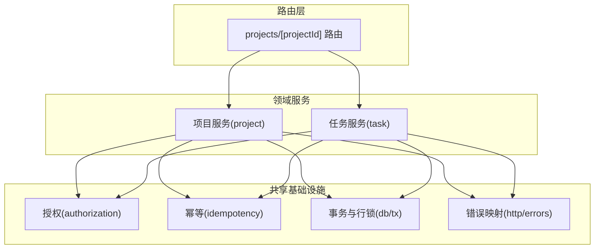
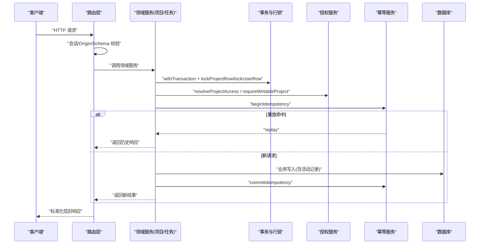
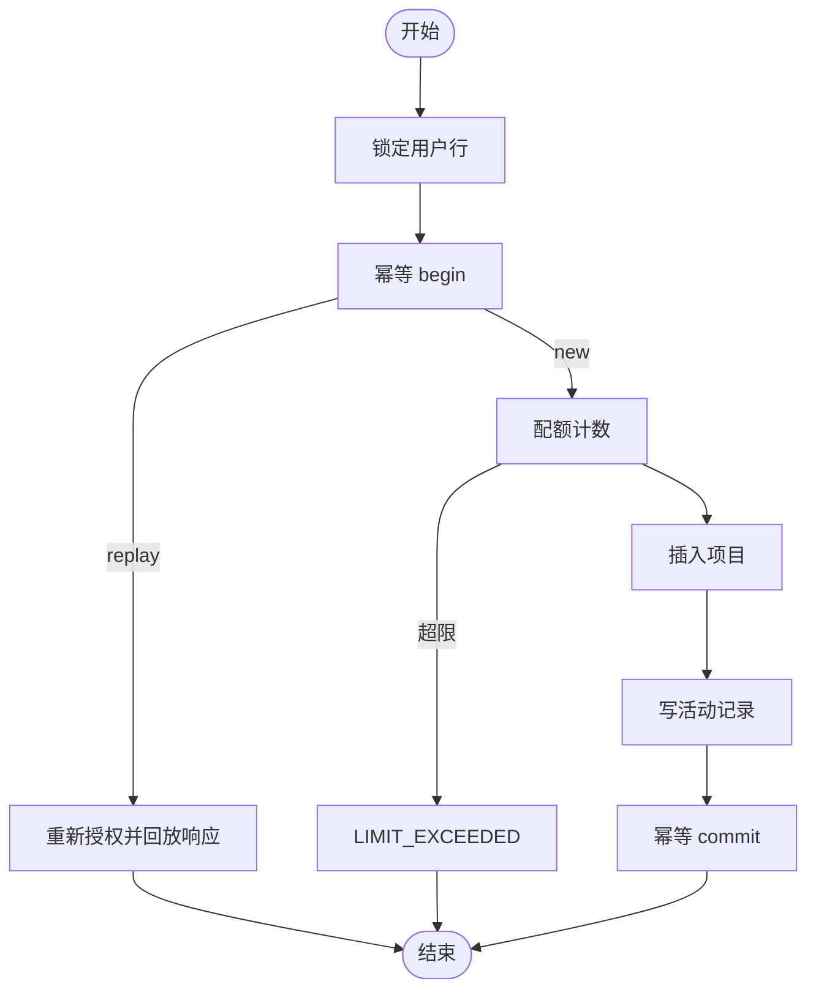
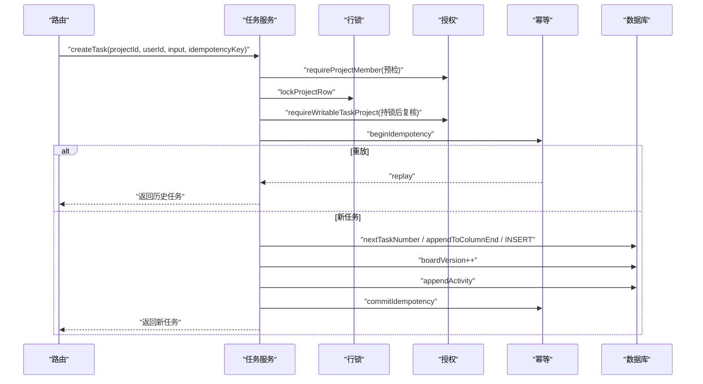
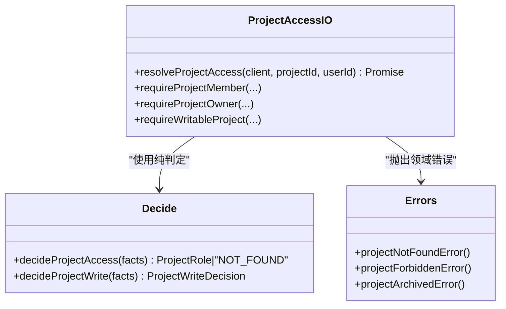
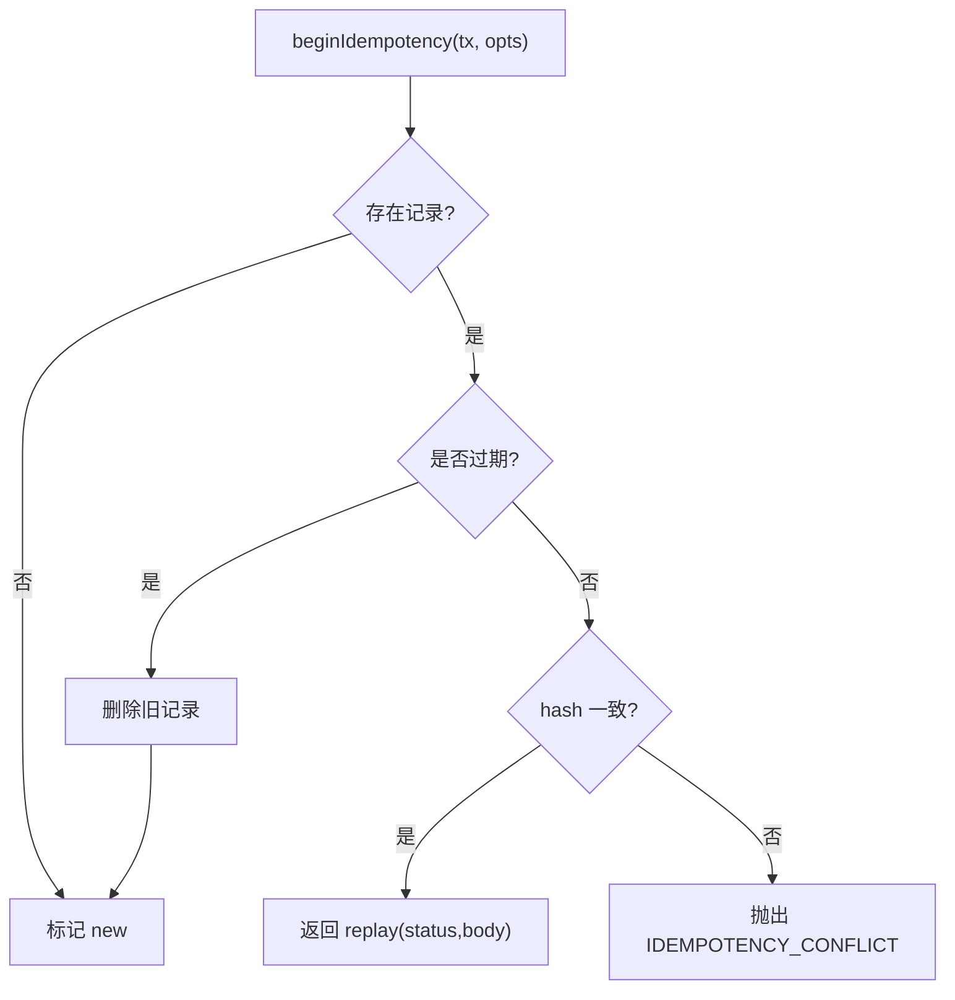
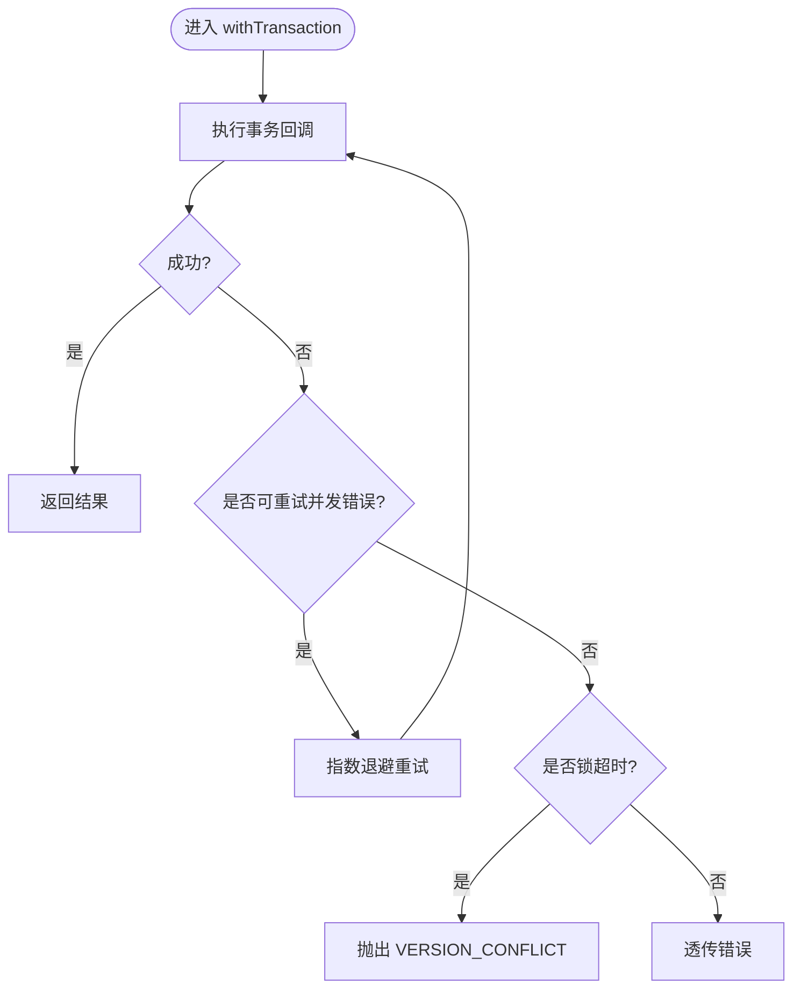
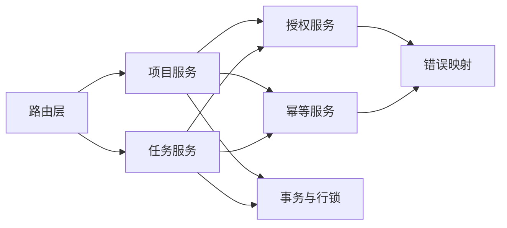

# 服务层架构

<cite>
**本文引用的文件**
- [src/server/modules/project/index.ts](file://src/server/modules/project/index.ts)
- [src/server/modules/project/create.ts](file://src/server/modules/project/create.ts)
- [src/server/modules/project/read.ts](file://src/server/modules/project/read.ts)
- [src/server/modules/project/update.ts](file://src/server/modules/project/update.ts)
- [src/server/modules/project/mappers.ts](file://src/server/modules/project/mappers.ts)
- [src/server/modules/task/index.ts](file://src/server/modules/task/index.ts)
- [src/server/modules/task/create.ts](file://src/server/modules/task/create.ts)
- [src/server/modules/task/read.ts](file://src/server/modules/task/read.ts)
- [src/server/modules/task/update.ts](file://src/server/modules/task/update.ts)
- [src/server/modules/task/soft-delete.ts](file://src/server/modules/task/soft-delete.ts)
- [src/server/modules/task/restore.ts](file://src/server/modules/task/restore.ts)
- [src/server/modules/task/access.ts](file://src/server/modules/task/access.ts)
- [src/server/modules/task/mappers.ts](file://src/server/modules/task/mappers.ts)
- [src/server/modules/authorization/decide.ts](file://src/server/modules/authorization/decide.ts)
- [src/server/modules/authorization/project-access.ts](file://src/server/modules/authorization/project-access.ts)
- [src/server/modules/idempotency/service.ts](file://src/server/modules/idempotency/service.ts)
- [src/server/db/tx.ts](file://src/server/db/tx.ts)
- [src/server/http/errors.ts](file://src/server/http/errors.ts)
- [src/app/api/v1/projects/[projectId]/route.ts](file://src/app/api/v1/projects/[projectId]/route.ts)
</cite>

## 目录
1. [简介](#简介)
2. [项目结构](#项目结构)
3. [核心组件](#核心组件)
4. [架构总览](#架构总览)
5. [详细组件分析](#详细组件分析)
6. [依赖关系分析](#依赖关系分析)
7. [性能考量](#性能考量)
8. [故障排查指南](#故障排查指南)
9. [结论](#结论)
10. [附录](#附录)

## 简介
本文件面向 Orbit 项目的服务层，聚焦模块化服务设计模式与领域服务职责划分。文档围绕以下目标展开：
- 项目模块：CRUD、成员管理与权限控制
- 任务模块：生命周期管理、状态转换与并发处理
- 授权服务：基于角色的访问控制与资源级权限检查
- 服务间通信：事务、幂等、活动记录与错误传播
- 接口定义、依赖注入与单元测试策略
- 扩展指南与最佳实践

## 项目结构
服务层采用“按领域分模块 + 共享基础设施”的组织方式：
- 领域模块：project、task，各自提供 create/read/update/soft-delete/restore 等能力，并通过 index.ts 统一导出对外 API
- 共享基础设施：authorization（纯判定函数与 IO 授权）、idempotency（幂等记录）、db（事务与行锁）、http（错误映射）
- 路由层：仅负责 HTTP 编排（鉴权、校验、调用领域服务、封装响应），不承载业务逻辑

图表来源
- [src/app/api/v1/projects/[projectId]/route.ts:1-80](file://src/app/api/v1/projects/[projectId]/route.ts#L1-L80)
- [src/server/modules/project/index.ts:1-24](file://src/server/modules/project/index.ts#L1-L24)
- [src/server/modules/task/index.ts:1-31](file://src/server/modules/task/index.ts#L1-L31)
- [src/server/modules/authorization/decide.ts:1-67](file://src/server/modules/authorization/decide.ts#L1-L67)
- [src/server/modules/idempotency/service.ts:1-181](file://src/server/modules/idempotency/service.ts#L1-L181)
- [src/server/db/tx.ts:1-159](file://src/server/db/tx.ts#L1-L159)
- [src/server/http/errors.ts:1-136](file://src/server/http/errors.ts#L1-L136)

章节来源
- [src/server/modules/project/index.ts:1-24](file://src/server/modules/project/index.ts#L1-L24)
- [src/server/modules/task/index.ts:1-31](file://src/server/modules/task/index.ts#L1-L31)
- [src/app/api/v1/projects/[projectId]/route.ts:1-80](file://src/app/api/v1/projects/[projectId]/route.ts#L1-L80)

## 核心组件
- 项目服务（project）
  - 职责：创建、读取、更新项目；列出项目与成员；DTO 映射
  - 入口：index.ts 统一导出 createProject/getProject/listProjects/listMembers/updateProject 等
- 任务服务（task）
  - 职责：创建、读取、更新、软删除、恢复任务；位置与编号计算；负责人校验
  - 入口：index.ts 统一导出 createTask/listProjectTasks/getTask/updateTask/softDeleteTask/restoreTask 等
- 授权服务（authorization）
  - 职责：纯判定函数 decideProjectAccess/decideProjectWrite；IO 层 resolveProjectAccess/requireWritableProject 等
- 幂等服务（idempotency）
  - 职责：beginIdempotency/commitIdempotency 在事务内保证幂等；冲突时通过哨兵错误在事务外复查
- 事务与行锁（db/tx）
  - 职责：withTransaction 提供 ReadCommitted 事务与有限重试；lockProjectRow/lockUserRow 提供行锁
- 错误映射（http/errors）
  - 职责：DomainError 到标准信封 Response 的映射；统一 requestId/no-store 缓存策略

章节来源
- [src/server/modules/project/index.ts:1-24](file://src/server/modules/project/index.ts#L1-L24)
- [src/server/modules/task/index.ts:1-31](file://src/server/modules/task/index.ts#L1-L31)
- [src/server/modules/authorization/decide.ts:1-67](file://src/server/modules/authorization/decide.ts#L1-L67)
- [src/server/modules/authorization/project-access.ts:1-121](file://src/server/modules/authorization/project-access.ts#L1-L121)
- [src/server/modules/idempotency/service.ts:1-181](file://src/server/modules/idempotency/service.ts#L1-L181)
- [src/server/db/tx.ts:1-159](file://src/server/db/tx.ts#L1-L159)
- [src/server/http/errors.ts:1-136](file://src/server/http/errors.ts#L1-L136)

## 架构总览
服务层遵循“路由薄、领域厚、基础设施横切”的分层原则：
- 路由层：解析参数、会话鉴权、请求体验证、调用领域服务、返回信封响应
- 领域服务：封装业务不变量、并发控制、权限校验、数据持久化、活动记录
- 基础设施：授权判定、幂等、事务/行锁、错误映射

图表来源
- [src/app/api/v1/projects/[projectId]/route.ts:1-80](file://src/app/api/v1/projects/[projectId]/route.ts#L1-L80)
- [src/server/modules/project/create.ts:1-181](file://src/server/modules/project/create.ts#L1-L181)
- [src/server/modules/task/create.ts:1-202](file://src/server/modules/task/create.ts#L1-L202)
- [src/server/modules/authorization/project-access.ts:1-121](file://src/server/modules/authorization/project-access.ts#L1-L121)
- [src/server/modules/idempotency/service.ts:1-181](file://src/server/modules/idempotency/service.ts#L1-L181)
- [src/server/db/tx.ts:1-159](file://src/server/db/tx.ts#L1-L159)

## 详细组件分析

### 项目服务（Project）
- 职责边界
  - 创建：配额校验、唯一 key 校验、幂等、活动记录
  - 读取：成员可见性、DTO 映射
  - 更新：owner-only、归档/恢复、乐观版本控制
- 关键流程（创建项目）
  - 用户级行锁 → 幂等 begin → 配额计数 → 插入项目 → 写活动 → 幂等 commit
  - 幂等冲突时，在事务外用单例只读复查 hash，决定 replay 或 409

图表来源
- [src/server/modules/project/create.ts:1-181](file://src/server/modules/project/create.ts#L1-L181)
- [src/server/modules/idempotency/service.ts:1-181](file://src/server/modules/idempotency/service.ts#L1-L181)
- [src/server/db/tx.ts:1-159](file://src/server/db/tx.ts#L1-L159)

章节来源
- [src/server/modules/project/index.ts:1-24](file://src/server/modules/project/index.ts#L1-L24)
- [src/server/modules/project/create.ts:1-181](file://src/server/modules/project/create.ts#L1-L181)
- [src/server/modules/project/read.ts](file://src/server/modules/project/read.ts)
- [src/server/modules/project/update.ts](file://src/server/modules/project/update.ts)
- [src/server/modules/project/mappers.ts](file://src/server/modules/project/mappers.ts)

### 任务服务（Task）
- 职责边界
  - 创建：成员可见性、配额、负责人校验、编号与位置分配、看板版本递增
  - 读取：列表与详情、DTO 映射
  - 更新：字段白名单、版本控制
  - 软删除：仅 owner 或创建者可删，置 deletedAt、boardVersion++
  - 恢复：仅已删除可恢复，恢复至原列尾，负责人若已退项目则清空
- 关键流程（创建任务）
  - 快速预检成员 → 项目行锁 → 可写授权 → 幂等 begin → 配额计数 → 取号/定位 → 插入 → boardVersion++ → 活动 → 幂等 commit
- 关键流程（恢复任务）
  - 定位 task→projectId → 项目行锁 → 可写授权 → 幂等 begin → 权限与版本 → 配额 → 清 deletedAt/version++ → 原列尾 position → boardVersion++ → 活动 → 幂等 commit

图表来源
- [src/server/modules/task/create.ts:1-202](file://src/server/modules/task/create.ts#L1-L202)
- [src/server/modules/task/restore.ts:1-198](file://src/server/modules/task/restore.ts#L1-L198)
- [src/server/modules/task/access.ts:1-102](file://src/server/modules/task/access.ts#L1-L102)
- [src/server/modules/authorization/project-access.ts:1-121](file://src/server/modules/authorization/project-access.ts#L1-L121)
- [src/server/modules/idempotency/service.ts:1-181](file://src/server/modules/idempotency/service.ts#L1-L181)
- [src/server/db/tx.ts:1-159](file://src/server/db/tx.ts#L1-L159)

章节来源
- [src/server/modules/task/index.ts:1-31](file://src/server/modules/task/index.ts#L1-L31)
- [src/server/modules/task/create.ts:1-202](file://src/server/modules/task/create.ts#L1-L202)
- [src/server/modules/task/restore.ts:1-198](file://src/server/modules/task/restore.ts#L1-L198)
- [src/server/modules/task/soft-delete.ts:1-100](file://src/server/modules/task/soft-delete.ts#L1-L100)
- [src/server/modules/task/access.ts:1-102](file://src/server/modules/task/access.ts#L1-L102)
- [src/server/modules/task/mappers.ts](file://src/server/modules/task/mappers.ts)

### 授权服务（Authorization）
- 设计要点
  - 纯判定函数：decideProjectAccess/decideProjectWrite，无 IO，便于穷举测试
  - IO 层：resolveProjectAccess/requireProjectMember/requireProjectOwner/requireWritableProject，将判定结果翻译为领域错误
  - 安全收敛：非成员与不存在统一 NOT_FOUND，避免泄露存在性
- 角色与写操作
  - 读：NOT_FOUND/OWNER/MEMBER
  - 写：仅 OWNER 允许 update/archive/restore；归档项目除 restore 外只读

图表来源
- [src/server/modules/authorization/decide.ts:1-67](file://src/server/modules/authorization/decide.ts#L1-L67)
- [src/server/modules/authorization/project-access.ts:1-121](file://src/server/modules/authorization/project-access.ts#L1-L121)
- [src/server/http/errors.ts:1-136](file://src/server/http/errors.ts#L1-L136)

章节来源
- [src/server/modules/authorization/decide.ts:1-67](file://src/server/modules/authorization/decide.ts#L1-L67)
- [src/server/modules/authorization/project-access.ts:1-121](file://src/server/modules/authorization/project-access.ts#L1-L121)

### 幂等服务（Idempotency）
- 语义
  - 唯一键 (userId, method, routeKey, key)，保存规范化请求 SHA-256 与响应，24h 有效
  - 同 key 同内容 → 返回原始响应；同 key 异内容 → 409 IDEMPOTENCY_CONFLICT
- 事务内调用
  - beginIdempotency：命中且未过期且 hash 一致 → replay；否则 new
  - commitIdempotency：业务成功后落库；若唯一键冲突（P2002），抛哨兵错误，由调用方在事务外用 resolveIdempotencyCommitConflict 复查
- 重放前重新授权：确保退出成员无法借旧缓存读取

图表来源
- [src/server/modules/idempotency/service.ts:1-181](file://src/server/modules/idempotency/service.ts#L1-L181)

章节来源
- [src/server/modules/idempotency/service.ts:1-181](file://src/server/modules/idempotency/service.ts#L1-L181)

### 事务与行锁（Transactions & Locks）
- 隔离级别：ReadCommitted；默认超时与连接等待时间
- 重试策略：对死锁/序列化失败/锁超时进行有限次指数退避重试
- 行锁顺序：User → Project → Task → 子资源，避免死锁
- 常用工具：withTransaction、lockProjectRow、lockUserRow

图表来源
- [src/server/db/tx.ts:1-159](file://src/server/db/tx.ts#L1-L159)

章节来源
- [src/server/db/tx.ts:1-159](file://src/server/db/tx.ts#L1-L159)

### 错误传播（Errors）
- DomainError：携带 ErrorCode、fieldErrors、details（如 currentVersion）
- 统一映射：toErrorResponse 将 DomainError 转为标准信封 Response，附加 requestId 与 no-store
- 兜底：内部错误统一 500 INTERNAL_ERROR，不泄露堆栈

章节来源
- [src/server/http/errors.ts:1-136](file://src/server/http/errors.ts#L1-L136)

## 依赖关系分析
- 路由层依赖领域服务与基础设施
- 领域服务依赖授权、幂等、事务、活动、限制常量
- 授权服务依赖纯判定函数与错误映射
- 幂等服务依赖稳定哈希与数据库记录
- 事务层提供统一的并发控制与重试

图表来源
- [src/app/api/v1/projects/[projectId]/route.ts:1-80](file://src/app/api/v1/projects/[projectId]/route.ts#L1-L80)
- [src/server/modules/project/index.ts:1-24](file://src/server/modules/project/index.ts#L1-L24)
- [src/server/modules/task/index.ts:1-31](file://src/server/modules/task/index.ts#L1-L31)
- [src/server/modules/authorization/decide.ts:1-67](file://src/server/modules/authorization/decide.ts#L1-L67)
- [src/server/modules/idempotency/service.ts:1-181](file://src/server/modules/idempotency/service.ts#L1-L181)
- [src/server/db/tx.ts:1-159](file://src/server/db/tx.ts#L1-L159)
- [src/server/http/errors.ts:1-136](file://src/server/http/errors.ts#L1-L136)

章节来源
- [src/server/modules/project/index.ts:1-24](file://src/server/modules/project/index.ts#L1-L24)
- [src/server/modules/task/index.ts:1-31](file://src/server/modules/task/index.ts#L1-L31)
- [src/server/modules/authorization/project-access.ts:1-121](file://src/server/modules/authorization/project-access.ts#L1-L121)
- [src/server/modules/idempotency/service.ts:1-181](file://src/server/modules/idempotency/service.ts#L1-L181)
- [src/server/db/tx.ts:1-159](file://src/server/db/tx.ts#L1-L159)
- [src/server/http/errors.ts:1-136](file://src/server/http/errors.ts#L1-L136)

## 性能考量
- 行锁顺序与最小锁范围：优先锁定 Project/User，减少锁竞争面
- 幂等短路：重放直接返回，避免重复业务计算与 IO
- 配额在锁内计数：保证与写入原子一致，避免超发
- 有限重试：对并发冲突进行指数退避重试，提升吞吐与稳定性
- DTO 映射与 include 选择：按需加载关联数据，减少冗余传输

[本节为通用指导，不直接分析具体文件]

## 故障排查指南
- 常见错误码与含义
  - NOT_FOUND：项目/任务不可见或不存在（统一收敛，不泄露存在性）
  - FORBIDDEN：权限不足（成员执行 owner-only 操作）
  - PROJECT_ARCHIVED：归档项目只读
  - LIMIT_EXCEEDED：超出配额（项目数/任务数）
  - VERSION_CONFLICT：乐观并发冲突（当前 version/boardVersion）
  - IDEMPOTENCY_CONFLICT：幂等键冲突（同 key 不同 body）
- 排查步骤
  - 确认路由层是否正确传递 userId、projectId、expectedVersion
  - 检查授权路径：成员可见性与归档态
  - 检查幂等键与请求体规范化（hash 一致性）
  - 查看事务重试日志与 SQLSTATE 代码（40P01/40001/55P03）
  - 核对活动记录是否写入，辅助定位操作链路

章节来源
- [src/server/http/errors.ts:1-136](file://src/server/http/errors.ts#L1-L136)
- [src/server/modules/authorization/project-access.ts:1-121](file://src/server/modules/authorization/project-access.ts#L1-L121)
- [src/server/modules/idempotency/service.ts:1-181](file://src/server/modules/idempotency/service.ts#L1-L181)
- [src/server/db/tx.ts:1-159](file://src/server/db/tx.ts#L1-L159)

## 结论
Orbit 的服务层以“领域服务为核心、基础设施横切”的方式组织，通过纯判定授权、事务与行锁、幂等机制，实现了高内聚、低耦合、强一致性的业务实现。路由层保持简洁，专注于 HTTP 编排；领域服务专注不变量与并发控制；基础设施提供可复用的能力。该设计便于扩展与维护，并为后续功能迭代提供了稳固基础。

[本节为总结性内容，不直接分析具体文件]

## 附录

### 接口定义与契约
- 路由层使用契约层 schema 进行请求体验证，并返回标准信封响应
- 领域服务输出 DTO，由路由层封装为统一响应格式

章节来源
- [src/app/api/v1/projects/[projectId]/route.ts:1-80](file://src/app/api/v1/projects/[projectId]/route.ts#L1-L80)

### 依赖注入模式
- 通过 Prisma 单例与事务 tx 注入数据库客户端
- 领域服务接收 tx 或 prisma 实例，支持事务内外复用

章节来源
- [src/server/db/tx.ts:1-159](file://src/server/db/tx.ts#L1-L159)
- [src/server/modules/authorization/project-access.ts:1-121](file://src/server/modules/authorization/project-access.ts#L1-L121)

### 单元测试策略
- 授权纯函数：穷举分支测试 decideProjectAccess/decideProjectWrite
- 幂等服务：覆盖 replay/conflict/过期场景
- 事务与行锁：模拟并发冲突与重试路径
- 领域服务：结合 mock 数据库客户端验证不变量与错误映射

章节来源
- [src/server/modules/authorization/decide.ts:1-67](file://src/server/modules/authorization/decide.ts#L1-L67)
- [src/server/modules/idempotency/service.ts:1-181](file://src/server/modules/idempotency/service.ts#L1-L181)
- [src/server/db/tx.ts:1-159](file://src/server/db/tx.ts#L1-L159)

### 扩展指南与最佳实践
- 新增领域能力时，优先在对应模块内拆分 create/read/update/... 文件，并通过 index.ts 统一导出
- 权限判定尽量抽为纯函数，便于测试与复用
- 所有写操作在事务内进行，必要时加行锁；配额在锁内计数
- 幂等键需包含方法、路由与资源标识，请求体需稳定序列化
- 错误统一使用 DomainError，避免泄露内部细节
- 活动记录与业务写入同事务，保证审计一致性

[本节为通用指导，不直接分析具体文件]