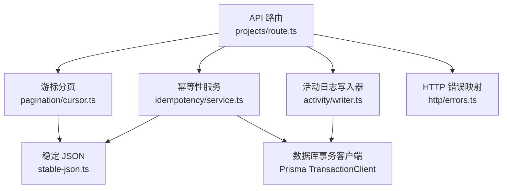
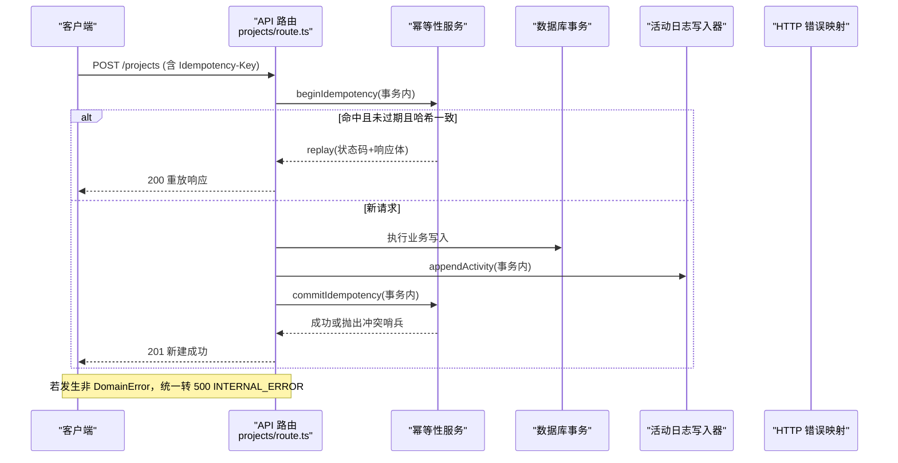
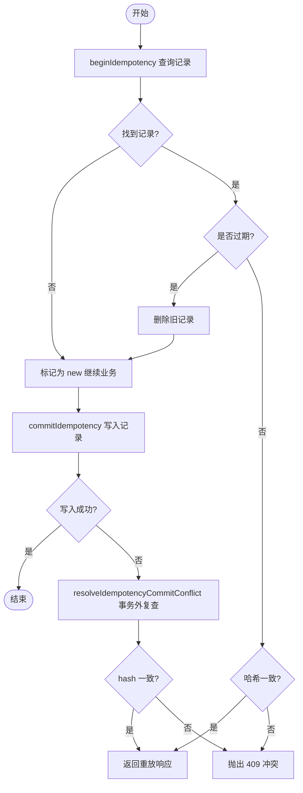
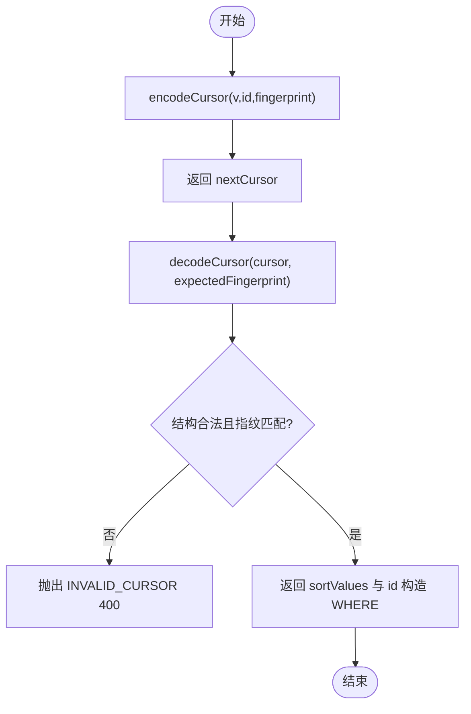
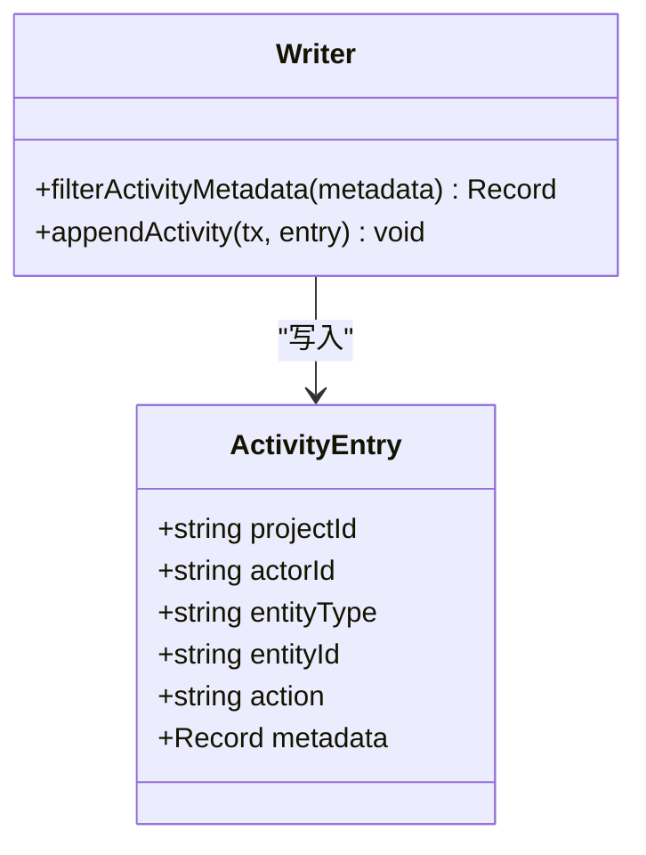
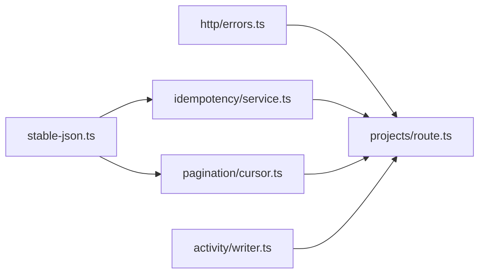

# 横切关注点服务

<cite>
**本文引用的文件**
- [src/server/modules/idempotency/service.ts](file://src/server/modules/idempotency/service.ts)
- [src/server/modules/pagination/cursor.ts](file://src/server/modules/pagination/cursor.ts)
- [src/server/modules/activity/writer.ts](file://src/server/modules/activity/writer.ts)
- [src/server/modules/limits.ts](file://src/server/modules/limits.ts)
- [src/server/modules/stable-json.ts](file://src/server/modules/stable-json.ts)
- [src/server/http/errors.ts](file://src/server/http/errors.ts)
- [src/app/api/v1/projects/route.ts](file://src/app/api/v1/projects/route.ts)
- [tests/integration/idempotency.test.ts](file://tests/integration/idempotency.test.ts)
- [tests/integration/project.test.ts](file://tests/integration/project.test.ts)
- [tests/unit/request-hash.test.ts](file://tests/unit/request-hash.test.ts)
- [DEVELOPMENT-PLAN.md](file://DEVELOPMENT-PLAN.md)
</cite>

## 目录
1. [简介](#简介)
2. [项目结构](#项目结构)
3. [核心组件](#核心组件)
4. [架构总览](#架构总览)
5. [详细组件分析](#详细组件分析)
6. [依赖关系分析](#依赖关系分析)
7. [性能考量](#性能考量)
8. [故障排除指南](#故障排除指南)
9. [结论](#结论)
10. [附录：配置与集成](#附录：配置与集成)

## 简介
本文件聚焦 Orbit 项目的横切关注点服务，覆盖幂等性、分页、活动日志、速率限制与稳定 JSON 序列化。目标是帮助开发者理解这些服务的职责边界、数据流、事务保证、扩展点与集成方式，并提供可操作的示例与排错指引。

## 项目结构
横切能力以 server/modules 下的独立模块形式提供，被 API 路由与领域服务复用：
- 幂等性：src/server/modules/idempotency/service.ts
- 游标分页：src/server/modules/pagination/cursor.ts
- 活动日志：src/server/modules/activity/writer.ts
- 业务常量（配额/间隔）：src/server/modules/limits.ts
- 稳定 JSON 序列化：src/server/modules/stable-json.ts
- HTTP 错误映射：src/server/http/errors.ts
- 典型集成入口：src/app/api/v1/projects/route.ts

图表来源
- [src/app/api/v1/projects/route.ts:35-93](file://src/app/api/v1/projects/route.ts#L35-L93)
- [src/server/modules/idempotency/service.ts:1-181](file://src/server/modules/idempotency/service.ts#L1-L181)
- [src/server/modules/pagination/cursor.ts:1-77](file://src/server/modules/pagination/cursor.ts#L1-L77)
- [src/server/modules/activity/writer.ts:1-65](file://src/server/modules/activity/writer.ts#L1-L65)
- [src/server/modules/stable-json.ts:1-41](file://src/server/modules/stable-json.ts#L1-L41)
- [src/server/http/errors.ts:1-136](file://src/server/http/errors.ts#L1-L136)

章节来源
- [src/app/api/v1/projects/route.ts:35-93](file://src/app/api/v1/projects/route.ts#L35-L93)

## 核心组件
- 幂等性服务：在事务内基于 (userId, method, routeKey, key) 唯一键与请求体规范化哈希，实现重放与冲突检测；TTL 24h；并发冲突通过哨兵错误交由事务外复查。
- 游标分页：不透明 base64url 游标，携带排序值、末项 id 与过滤指纹；过滤变化即失效，避免跨过滤拼接错误结果。
- 活动日志：只追加不可变日志，metadata 白名单过滤，确保审计安全与最小化存储。
- 速率限制：Better Auth 内置限流用于认证入口；业务配额集中在 limits.ts 常量，配合事务锁内计数校验。
- 稳定 JSON：递归键序排序、跳过 undefined、数组保序的序列化与 SHA-256 摘要，支撑幂等与游标过滤指纹一致性。

章节来源
- [src/server/modules/idempotency/service.ts:1-181](file://src/server/modules/idempotency/service.ts#L1-L181)
- [src/server/modules/pagination/cursor.ts:1-77](file://src/server/modules/pagination/cursor.ts#L1-L77)
- [src/server/modules/activity/writer.ts:1-65](file://src/server/modules/activity/writer.ts#L1-L65)
- [src/server/modules/limits.ts:1-27](file://src/server/modules/limits.ts#L1-L27)
- [src/server/modules/stable-json.ts:1-41](file://src/server/modules/stable-json.ts#L1-L41)

## 架构总览
横切服务围绕“事务内原子性 + 外部约束”展开：幂等记录与业务数据同事务提交；活动日志与业务改动同事务写入；游标分页将过滤条件绑定到游标指纹；错误统一映射为标准信封并附带 requestId。

图表来源
- [src/app/api/v1/projects/route.ts:62-93](file://src/app/api/v1/projects/route.ts#L62-L93)
- [src/server/modules/idempotency/service.ts:129-181](file://src/server/modules/idempotency/service.ts#L129-L181)
- [src/server/modules/activity/writer.ts:49-65](file://src/server/modules/activity/writer.ts#L49-L65)
- [src/server/http/errors.ts:116-136](file://src/server/http/errors.ts#L116-L136)

## 详细组件分析

### 幂等性服务
- 设计要点
  - 唯一键：(userId, method, routeKey, key)，保存规范化请求哈希与响应，有效期 24h。
  - 语义：同 key 同内容 → 返回原响应；同 key 异内容 → 409 IDEMPOTENCY_CONFLICT。
  - 事务保证：begin/commit 必须在业务事务内执行，与业务写入原子一致。
  - 并发陷阱：PG 唯一键冲突后事务进入 aborted，commit 捕获 P2002 抛哨兵错误，由调用方在事务外用 resolveIdempotencyCommitConflict 复查 hash，决定 replay 或 409。
  - 重放前需重新授权，避免退出成员读取旧缓存资源。
- 关键流程
  - beginIdempotency：查既有记录，过期则删除并按 new 处理；命中且哈希一致则 replay；否则冲突。
  - commitIdempotency：写入幂等记录；冲突时抛哨兵错误。
  - resolveIdempotencyCommitConflict：事务外只读复查，一致则 replay，否则 409。
- 复杂度与优化
  - 查询/写入均为 O(1) 索引查找；TTL 清理可通过定时任务或惰性删除（已实现过期即删）。
- 错误与异常
  - IDEMPOTENCY_CONFLICT：409，提示生成新键。
  - 内部哨兵错误仅在事务内传播，不应暴露给 HTTP 层。

图表来源
- [src/server/modules/idempotency/service.ts:129-181](file://src/server/modules/idempotency/service.ts#L129-L181)

章节来源
- [src/server/modules/idempotency/service.ts:1-181](file://src/server/modules/idempotency/service.ts#L1-L181)
- [tests/integration/idempotency.test.ts:160-211](file://tests/integration/idempotency.test.ts#L160-L211)
- [tests/unit/request-hash.test.ts:1-33](file://tests/unit/request-hash.test.ts#L1-L33)

### 游标分页服务
- 设计要点
  - 游标为不透明串，包含排序字段值、末项 id 与过滤指纹。
  - 过滤指纹基于稳定 JSON 序列化后的 SHA-256 截断，过滤变化即失效，防止跨过滤拼接错误结果。
  - 编码使用 base64url，长度受契约约束。
- 关键流程
  - encodeCursor：构造 {v, id, f} 并 base64url 编码。
  - decodeCursor：解码并校验结构与指纹，返回排序值与末项 id 供 keyset WHERE 使用。
- 性能特性
  - 基于 keyset 的分页避免偏移量扫描，适合大数据集；过滤指纹确保安全性与正确性。

图表来源
- [src/server/modules/pagination/cursor.ts:33-77](file://src/server/modules/pagination/cursor.ts#L33-L77)

章节来源
- [src/server/modules/pagination/cursor.ts:1-77](file://src/server/modules/pagination/cursor.ts#L1-L77)
- [tests/integration/project.test.ts:603-650](file://tests/integration/project.test.ts#L603-L650)

### 活动日志服务
- 设计要点
  - 只追加不可变日志，必须与业务写入同一事务，保证原子性。
  - metadata 白名单过滤，仅保留允许字段（如任务编号、变更字段名、枚举状态、用户 ID、计数），杜绝敏感信息入库。
- 关键流程
  - filterActivityMetadata：按白名单裁剪 metadata。
  - appendActivity：在事务内插入一条 activityLog。
- 审计价值
  - 支持用户操作审计、变更追踪与聚合分析；结合 projectId、entityType、action 进行多维检索。

图表来源
- [src/server/modules/activity/writer.ts:16-65](file://src/server/modules/activity/writer.ts#L16-L65)

章节来源
- [src/server/modules/activity/writer.ts:1-65](file://src/server/modules/activity/writer.ts#L1-L65)
- [tests/integration/activity.test.ts:252-311](file://tests/integration/activity.test.ts#L252-L311)

### 速率限制服务
- 认证入口限流
  - Better Auth 内置限流：在 development 下对认证端点启用阈值控制，超过返回 429，并携带重试头。
- 业务配额
  - 集中定义于 limits.ts：每用户最大活跃项目数、每项目最大成员数、每项目最大未删除任务数、看板 position 初始间隔。
  - 配额需在服务端事务锁内计数校验，不能仅依赖前端隐藏按钮。
- 防滥用机制
  - 测试验证了 429 行为与重试头；业务侧通过常量与事务锁保障上限不被绕过。

章节来源
- [tests/integration/auth-flow.test.ts:429-468](file://tests/integration/auth-flow.test.ts#L429-L468)
- [src/server/modules/limits.ts:1-27](file://src/server/modules/limits.ts#L1-L27)
- [tests/integration/project.test.ts:555-593](file://tests/integration/project.test.ts#L555-L593)

### 稳定 JSON 序列化服务
- 设计要点
  - 递归对象键排序、跳过 undefined、数组保序，确保同一逻辑请求无论字段顺序如何都能产生相同哈希。
  - 提供 SHA-256 十六进制摘要，用于幂等请求指纹与游标过滤指纹。
- 用途
  - 幂等性：hashRequest(body) = SHA-256(stableStringify(body))。
  - 分页：computeFilterFingerprint(filters) 将过滤条件绑定到游标。

章节来源
- [src/server/modules/stable-json.ts:1-41](file://src/server/modules/stable-json.ts#L1-L41)
- [tests/unit/request-hash.test.ts:1-33](file://tests/unit/request-hash.test.ts#L1-L33)

## 依赖关系分析
- 幂等性依赖稳定 JSON 与 HTTP 错误映射；与 Prisma 事务客户端交互。
- 游标分页依赖稳定 JSON 计算过滤指纹。
- 活动日志依赖 Prisma 事务客户端与 contracts 类型。
- API 路由依赖会话、Origin 校验、JSON 解析与错误映射，并组合上述横切服务。

图表来源
- [src/server/modules/stable-json.ts:1-41](file://src/server/modules/stable-json.ts#L1-L41)
- [src/server/modules/idempotency/service.ts:1-181](file://src/server/modules/idempotency/service.ts#L1-L181)
- [src/server/modules/pagination/cursor.ts:1-77](file://src/server/modules/pagination/cursor.ts#L1-L77)
- [src/server/http/errors.ts:1-136](file://src/server/http/errors.ts#L1-L136)
- [src/app/api/v1/projects/route.ts:35-93](file://src/app/api/v1/projects/route.ts#L35-L93)
- [src/server/modules/activity/writer.ts:1-65](file://src/server/modules/activity/writer.ts#L1-L65)

章节来源
- [src/app/api/v1/projects/route.ts:35-93](file://src/app/api/v1/projects/route.ts#L35-L93)

## 性能考量
- 幂等性
  - 基于唯一索引的 O(1) 查询/写入；TTL 24h 减少长期存储压力；过期记录惰性删除。
  - 并发冲突通过哨兵错误避免事务内二次失败，降低复杂分支成本。
- 游标分页
  - keyset 分页避免全表扫描；过滤指纹确保安全与正确性，代价为极小的哈希计算开销。
- 活动日志
  - 只追加写入，白名单过滤减少 jsonb 体积；建议按 (projectId, createdAt DESC, id DESC) 索引提升查询性能。
- 速率限制
  - 认证入口限流保护后端；业务配额在事务锁内计数，避免竞态导致超限。
- 稳定 JSON
  - 递归排序带来一定 CPU 开销，但换来强一致性与可预测性，适合小中型请求体。

[本节为通用指导，无需特定文件引用]

## 故障排除指南
- 幂等性冲突
  - 现象：409 IDEMPOTENCY_CONFLICT。
  - 排查：检查 Idempotency-Key 是否重复使用且请求体不同；确认 begin/commit 是否在事务内；若出现并发冲突，确认调用方在事务外调用 resolveIdempotencyCommitConflict。
  - 参考用例：同 key 异 body 返回 409；过期后同 key 异 body 按新请求执行。
- 游标无效
  - 现象：400 INVALID_CURSOR。
  - 排查：确认游标未篡改；过滤条件变化会导致旧游标失效；检查 decodeCursor 的指纹比对。
- 活动日志缺失
  - 现象：期望的操作未产生日志。
  - 排查：确认 appendActivity 在事务内调用；metadata 是否被白名单过滤为空；检查 activityLog 表写入。
- 速率限制触发
  - 现象：认证端点返回 429 并带重试头。
  - 排查：确认 APP_ENV 与限流策略；测试中 development 环境启用限流，test 环境关闭。
- 错误响应
  - 所有错误统一映射为标准信封，包含 requestId；非 DomainError 会转为 500 INTERNAL_ERROR，便于运维定位。

章节来源
- [tests/integration/idempotency.test.ts:160-211](file://tests/integration/idempotency.test.ts#L160-L211)
- [src/server/modules/pagination/cursor.ts:28-77](file://src/server/modules/pagination/cursor.ts#L28-L77)
- [src/server/modules/activity/writer.ts:36-65](file://src/server/modules/activity/writer.ts#L36-L65)
- [tests/integration/auth-flow.test.ts:429-468](file://tests/integration/auth-flow.test.ts#L429-L468)
- [src/server/http/errors.ts:116-136](file://src/server/http/errors.ts#L116-L136)

## 结论
Orbit 的横切服务以“事务内原子性 + 外部约束”为核心，提供了可靠的幂等性、安全的游标分页、可审计的活动日志、可控的速率限制与一致的序列化能力。通过统一的错误映射与清晰的扩展点，开发者可在领域服务中便捷集成这些能力，确保系统的一致性与可维护性。

[本节为总结，无需特定文件引用]

## 附录：配置与集成
- 幂等性集成
  - 在创建/恢复等小型 JSON 写操作中，使用 requireIdempotencyKey 提取键，并在事务内调用 beginIdempotency 与 commitIdempotency；若抛出哨兵错误，在事务外调用 resolveIdempotencyCommitConflict。
  - 重放前需重新授权，确保目标资源仍对当前用户可见。
- 游标分页集成
  - 列表接口使用 parseQueryParams 解析 scope/archived/limit/cursor；调用 computeFilterFingerprint 生成指纹，encodeCursor 生成 nextCursor；decodeCursor 校验并构造 keyset WHERE。
- 活动日志集成
  - 在业务事务内调用 appendActivity，传入白名单 metadata；确保一次用户操作对应清晰的一条主要事件。
- 速率限制与配额
  - 认证入口依赖 Better Auth 内置限流；业务配额使用 limits.ts 常量，在事务锁内计数校验。
- 稳定 JSON 集成
  - 使用 stableStringify 与 sha256Hex 生成幂等请求指纹与过滤指纹，确保一致性与安全性。
- 错误处理
  - 使用 errorResponse/domainErrorResponse/toErrorResponse 统一输出标准信封；避免泄露内部细节。

章节来源
- [src/app/api/v1/projects/route.ts:62-93](file://src/app/api/v1/projects/route.ts#L62-L93)
- [src/server/modules/idempotency/service.ts:129-181](file://src/server/modules/idempotency/service.ts#L129-L181)
- [src/server/modules/pagination/cursor.ts:33-77](file://src/server/modules/pagination/cursor.ts#L33-L77)
- [src/server/modules/activity/writer.ts:49-65](file://src/server/modules/activity/writer.ts#L49-L65)
- [src/server/modules/limits.ts:11-27](file://src/server/modules/limits.ts#L11-L27)
- [src/server/modules/stable-json.ts:18-41](file://src/server/modules/stable-json.ts#L18-L41)
- [src/server/http/errors.ts:91-136](file://src/server/http/errors.ts#L91-L136)
- [DEVELOPMENT-PLAN.md:550-564](file://DEVELOPMENT-PLAN.md#L550-L564)