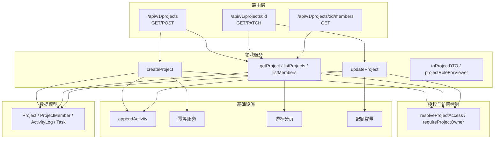
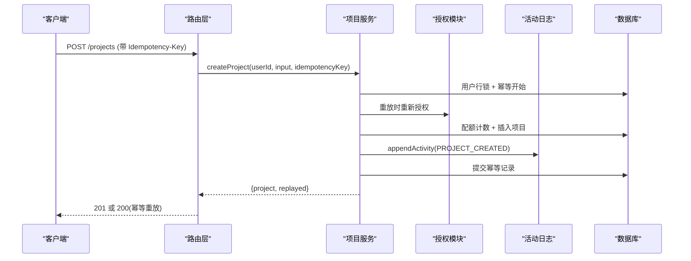
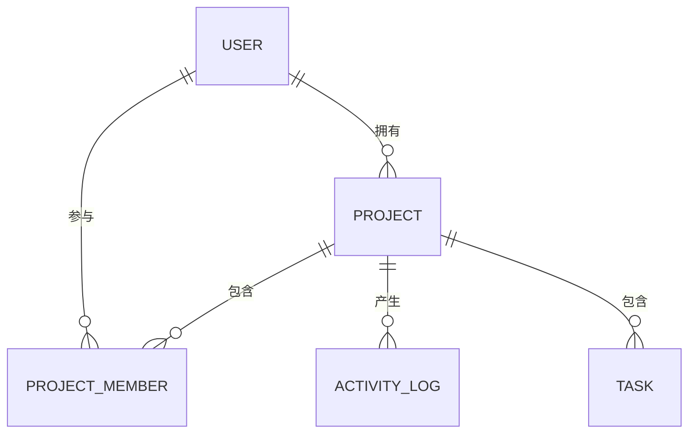
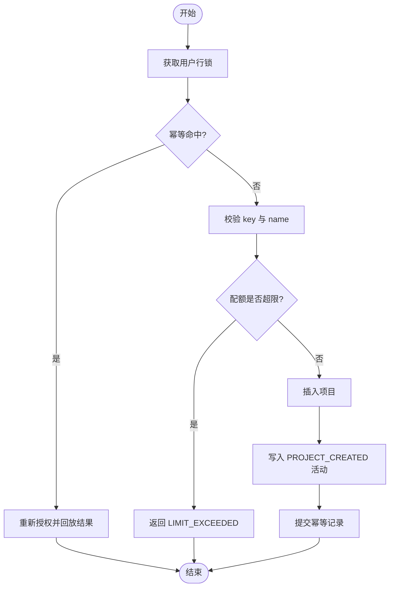
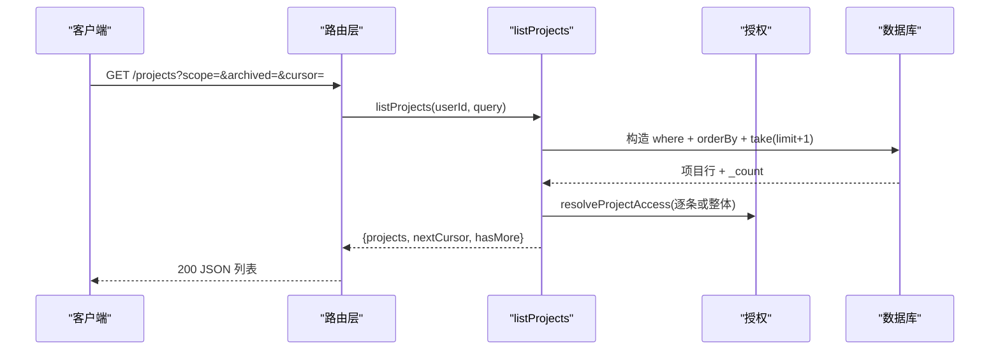
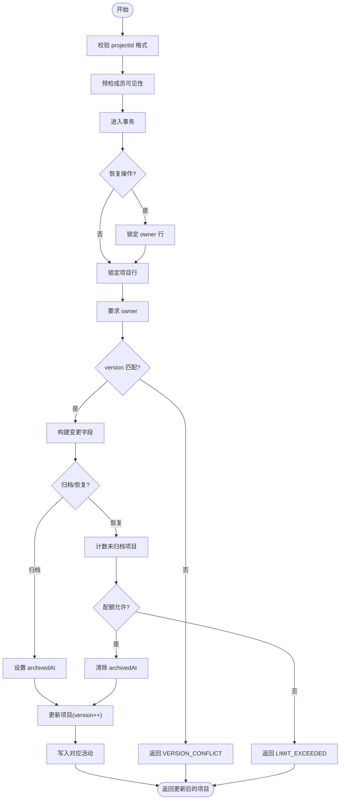
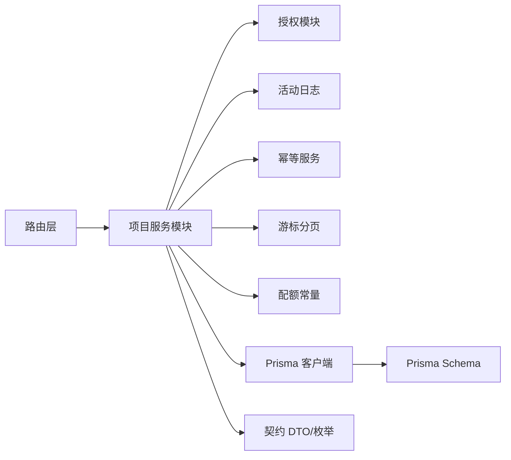

# 项目服务模块

<cite>
**本文引用的文件**
- [schema.prisma](file://prisma/schema.prisma)
- [index.ts](file://src/server/modules/project/index.ts)
- [create.ts](file://src/server/modules/project/create.ts)
- [read.ts](file://src/server/modules/project/read.ts)
- [update.ts](file://src/server/modules/project/update.ts)
- [mappers.ts](file://src/server/modules/project/mappers.ts)
- [project-access.ts](file://src/server/modules/authorization/project-access.ts)
- [writer.ts](file://src/server/modules/activity/writer.ts)
- [limits.ts](file://src/server/modules/limits.ts)
- [enums.ts](file://src/contracts/enums.ts)
- [route.ts（列表与创建）](file://src/app/api/v1/projects/route.ts)
- [route.ts（单个项目读写）](file://src/app/api/v1/projects/[projectId]/route.ts)
- [route.ts（成员列表）](file://src/app/api/v1/projects/[projectId]/members/route.ts)
- [openapi.json](file://contracts/openapi.json)
</cite>

## 目录
1. [简介](#简介)
2. [项目结构](#项目结构)
3. [核心组件](#核心组件)
4. [架构总览](#架构总览)
5. [详细组件分析](#详细组件分析)
6. [依赖关系分析](#依赖关系分析)
7. [性能考虑](#性能考虑)
8. [故障排查指南](#故障排查指南)
9. [结论](#结论)
10. [附录：API 接口定义与使用模式](#附录api-接口定义与使用模式)

## 简介
本模块为 Orbit 的“项目服务”，提供项目的创建、读取、更新与归档/恢复能力，并负责项目成员可见性控制、配额限制、幂等写入、活动日志记录以及与任务域的关联统计。该模块遵循“路由层只做 HTTP 编排，领域逻辑下沉到 server/modules”的分层设计，通过统一的授权、事务、分页和契约校验保障一致性与可维护性。

## 项目结构
- 路由层：Next.js API Routes，负责请求解析、会话校验、参数校验、统一信封响应与错误转换。
- 领域服务：server/modules/project 下的 create/read/update/mappers，封装业务不变量、并发控制与数据映射。
- 授权与访问控制：server/modules/authorization/project-access 与 decide 策略函数，统一处理成员/所有者判定与写权限。
- 基础设施：活动日志 writer、幂等服务、游标分页、配额常量 limits、契约枚举 enums。
- 数据模型：Prisma schema 定义 Project、ProjectMember、ActivityLog、Task 等实体及关系。

图表来源
- [route.ts（列表与创建）:1-93](file://src/app/api/v1/projects/route.ts#L1-L93)
- [route.ts（单个项目读写）:1-80](file://src/app/api/v1/projects/[projectId]/route.ts#L1-L80)
- [route.ts（成员列表）:1-38](file://src/app/api/v1/projects/[projectId]/members/route.ts#L1-L38)
- [index.ts:1-24](file://src/server/modules/project/index.ts#L1-L24)
- [create.ts:1-181](file://src/server/modules/project/create.ts#L1-L181)
- [read.ts:1-192](file://src/server/modules/project/read.ts#L1-L192)
- [update.ts:1-204](file://src/server/modules/project/update.ts#L1-L204)
- [project-access.ts:1-121](file://src/server/modules/authorization/project-access.ts#L1-L121)
- [writer.ts:1-65](file://src/server/modules/activity/writer.ts#L1-L65)
- [limits.ts:1-27](file://src/server/modules/limits.ts#L1-L27)
- [schema.prisma:144-195](file://prisma/schema.prisma#L144-L195)

章节来源
- [index.ts:1-24](file://src/server/modules/project/index.ts#L1-L24)
- [schema.prisma:144-195](file://prisma/schema.prisma#L144-L195)

## 核心组件
- 项目创建服务：在用户级行锁内完成幂等检查、配额计数、唯一 key 校验、项目插入与活动日志写入，返回 DTO 与是否幂等重放标记。
- 项目读取服务：基于 keyset 游标的分页列表、单项目读取、成员列表；统一通过授权模块判定可见性。
- 项目更新服务：支持资料更新、归档与恢复；持有项目行锁与可选用户行锁，执行乐观并发版本比对、白名单字段变更与活动日志记录。
- 映射器：将数据库行转换为契约 DTO，计算角色、成员数与未完成任务数，并通过 Schema 复校输出。
- 授权模块：统一判定“不存在/非成员→404”、“成员写操作→403”、“归档只读→409”等边界。
- 活动日志：在事务内追加一条不可变事件，metadata 经白名单过滤，避免敏感信息入库。
- 配额与约束：集中管理每用户未归档项目上限、项目成员上限、任务上限等常量，并在锁内计数校验。

章节来源
- [create.ts:18-181](file://src/server/modules/project/create.ts#L18-L181)
- [read.ts:20-192](file://src/server/modules/project/read.ts#L20-L192)
- [update.ts:23-204](file://src/server/modules/project/update.ts#L23-L204)
- [mappers.ts:5-50](file://src/server/modules/project/mappers.ts#L5-L50)
- [project-access.ts:12-121](file://src/server/modules/authorization/project-access.ts#L12-L121)
- [writer.ts:5-65](file://src/server/modules/activity/writer.ts#L5-L65)
- [limits.ts:1-27](file://src/server/modules/limits.ts#L1-L27)

## 架构总览
项目服务采用“路由 → 领域服务 → 授权/基础设施 → 数据库”的分层调用链。所有写操作均进入事务，必要时加行锁保证并发安全；读操作走应用单例 Prisma 客户端以提升吞吐。

图表来源
- [route.ts（列表与创建）:56-93](file://src/app/api/v1/projects/route.ts#L56-L93)
- [create.ts:71-181](file://src/server/modules/project/create.ts#L71-L181)
- [writer.ts:49-65](file://src/server/modules/activity/writer.ts#L49-L65)

## 详细组件分析

### 项目数据模型与设计
- 项目实体 Project：包含标识、名称、键、描述、颜色、归档时间、版本号、看板版本、任务序号、字节配额、时间戳等；拥有者与成员关系通过 User 与 ProjectMember 关联。
- 成员关系 ProjectMember：记录项目与用户的参与关系，去重约束确保同一用户仅加入一次。
- 活动日志 ActivityLog：记录项目域的关键动作（创建、更新、归档、恢复、成员进出等），按项目维度索引查询。
- 任务 Task：与项目一对多关联，用于统计未完成任务数；删除采用软删除（deletedAt）。

图表来源
- [schema.prisma:27-47](file://prisma/schema.prisma#L27-L47)
- [schema.prisma:144-195](file://prisma/schema.prisma#L144-L195)
- [schema.prisma:240-267](file://prisma/schema.prisma#L240-L267)

章节来源
- [schema.prisma:144-195](file://prisma/schema.prisma#L144-L195)
- [schema.prisma:240-267](file://prisma/schema.prisma#L240-L267)

### 项目创建流程
- 幂等保护：以 routeKey 与请求体哈希作为幂等键，重复请求直接回放已提交结果。
- 配额限制：在用户行锁内计数当前用户未归档项目数，超过上限返回 LIMIT_EXCEEDED。
- 唯一性校验：key 格式与服务端正则校验，数据库唯一约束兜底冲突。
- 活动日志：项目创建成功后在同一事务中追加 PROJECT_CREATED 事件。
- 返回语义：新建成功返回 201；幂等重放返回 200 与原结果。

图表来源
- [create.ts:71-181](file://src/server/modules/project/create.ts#L71-L181)
- [limits.ts:11-12](file://src/server/modules/limits.ts#L11-L12)

章节来源
- [create.ts:18-181](file://src/server/modules/project/create.ts#L18-L181)
- [limits.ts:1-27](file://src/server/modules/limits.ts#L1-L27)

### 项目读取与分页
- 列表：支持 scope（all/owned/joined）、archived（exclude/only）过滤，keyset 游标分页（updatedAt,id），默认 30 条，最大 100 条。
- 单项目：通过授权模块确认可见性，统计成员数与未完成任务数后返回 DTO。
- 成员列表：owner 排首位（role=OWNER），其余按 joinedAt 升序（role=MEMBER），不暴露 email。

图表来源
- [read.ts:60-135](file://src/server/modules/project/read.ts#L60-L135)
- [project-access.ts:55-77](file://src/server/modules/authorization/project-access.ts#L55-L77)

章节来源
- [read.ts:20-192](file://src/server/modules/project/read.ts#L20-L192)
- [project-access.ts:12-121](file://src/server/modules/authorization/project-access.ts#L12-L121)

### 项目更新、归档与恢复
- 权限：仅 owner 可执行 update/archive/restore；成员尝试写操作返回 FORBIDDEN。
- 并发：乐观并发 version 校验，不符返回 VERSION_CONFLICT 并附带 currentVersion。
- 状态迁移：归档设置 archivedAt；恢复需先取用户行锁再计数配额，超限返回 LIMIT_EXCEEDED。
- 规范化：若请求前后值无语义变化，不 bump version、不写活动，直接返回当前数据。
- 活动日志：根据实际变更写入 PROJECT_UPDATED/PROJECT_ARCHIVED/PROJECT_RESTORED。

图表来源
- [update.ts:73-204](file://src/server/modules/project/update.ts#L73-L204)
- [limits.ts:11-12](file://src/server/modules/limits.ts#L11-L12)

章节来源
- [update.ts:23-204](file://src/server/modules/project/update.ts#L23-L204)
- [limits.ts:1-27](file://src/server/modules/limits.ts#L1-L27)

### 成员管理机制
- 成员可见性：通过 resolveProjectAccess 判定是否存在且为 owner/member；非成员/不存在统一 404。
- 成员列表：owner 始终可见且 role=OWNER；其他成员按加入时间排序，role=MEMBER；不暴露邮箱。
- 权限分配：M2 阶段仅创建项目时自动写入 owner 为成员；后续邀请/移除由独立模块实现（预留 MAX_PROJECT_MEMBERS 配额）。

章节来源
- [project-access.ts:55-103](file://src/server/modules/authorization/project-access.ts#L55-L103)
- [read.ts:152-192](file://src/server/modules/project/read.ts#L152-L192)
- [limits.ts:14-20](file://src/server/modules/limits.ts#L14-L20)

### 项目状态管理与生命周期
- 状态：未归档（archivedAt=null）与已归档（archivedAt 有值）。
- 生命周期：创建→活跃→归档→恢复；归档后仅 owner 可恢复，其他写操作受限。
- 版本控制：每次有效变更 version++；乐观并发失败提示刷新重试。

章节来源
- [update.ts:104-158](file://src/server/modules/project/update.ts#L104-L158)
- [schema.prisma:144-166](file://prisma/schema.prisma#L144-L166)

### 与其他模块的集成
- 任务关联：读取项目时统计未完成任务数（deletedAt 为空且 status≠DONE），保持与任务域口径一致。
- 活动日志：项目创建、更新、归档、恢复均通过 appendActivity 写入 ActivityLog，metadata 经白名单过滤。
- 授权模块：所有读/写路径统一通过 project-access 进行可见性与权限判定。

章节来源
- [read.ts:137-149](file://src/server/modules/project/read.ts#L137-L149)
- [writer.ts:49-65](file://src/server/modules/activity/writer.ts#L49-L65)
- [project-access.ts:12-121](file://src/server/modules/authorization/project-access.ts#L12-L121)

## 依赖关系分析
- 路由层依赖领域服务与 HTTP 工具（会话、Origin、幂等键、JSON 信封）。
- 领域服务依赖授权、活动日志、幂等、分页、配额常量与 Prisma 客户端。
- 数据模型通过 Prisma 生成类型，契约层提供 DTO 与枚举校验。

图表来源
- [route.ts（列表与创建）:1-93](file://src/app/api/v1/projects/route.ts#L1-L93)
- [route.ts（单个项目读写）:1-80](file://src/app/api/v1/projects/[projectId]/route.ts#L1-L80)
- [route.ts（成员列表）:1-38](file://src/app/api/v1/projects/[projectId]/members/route.ts#L1-L38)
- [index.ts:1-24](file://src/server/modules/project/index.ts#L1-L24)
- [create.ts:1-181](file://src/server/modules/project/create.ts#L1-L181)
- [read.ts:1-192](file://src/server/modules/project/read.ts#L1-L192)
- [update.ts:1-204](file://src/server/modules/project/update.ts#L1-L204)
- [project-access.ts:1-121](file://src/server/modules/authorization/project-access.ts#L1-L121)
- [writer.ts:1-65](file://src/server/modules/activity/writer.ts#L1-L65)
- [limits.ts:1-27](file://src/server/modules/limits.ts#L1-L27)
- [schema.prisma:144-195](file://prisma/schema.prisma#L144-L195)

章节来源
- [index.ts:1-24](file://src/server/modules/project/index.ts#L1-L24)
- [openapi.json:1-200](file://contracts/openapi.json#L1-L200)

## 性能考虑
- 游标分页：使用 keyset 分页（updatedAt,id）避免深度翻页开销，默认 30 条，上限 100 条。
- 行锁串行化：创建与恢复路径对用户行加锁，避免并发突破配额；更新路径对项目行加锁，串行化写冲突。
- 最小化 IO：列表查询使用 _count 统计成员与未完成任务数，减少额外 N+1 查询。
- 幂等回放：重复请求直接回放已提交结果，降低重复写入压力。
- 白名单 metadata：活动日志仅保留必要字段，减少存储与序列化成本。

[本节为通用性能建议，无需特定文件引用]

## 故障排查指南
- 404 NOT_FOUND：项目不存在或非成员访问；检查 projectId 是否为合法 UUID，确认用户是否为成员。
- 403 FORBIDDEN：成员尝试 owner-only 操作；确认当前用户角色与操作类型。
- 409 PROJECT_ARCHIVED：对归档项目执行写操作（除 owner 恢复）；先恢复再更新。
- 409 VERSION_CONFLICT：乐观并发失败；携带最新 version 重试。
- 422 LIMIT_EXCEEDED：达到未归档项目上限；归档部分项目后再恢复。
- 400 INVALID_CURSOR：游标损坏或过滤指纹不一致；重新获取下一页游标。
- 活动日志异常：检查是否在事务内调用 appendActivity，以及 metadata 是否仅含白名单字段。

章节来源
- [project-access.ts:28-41](file://src/server/modules/authorization/project-access.ts#L28-L41)
- [update.ts:109-113](file://src/server/modules/project/update.ts#L109-L113)
- [create.ts:45-56](file://src/server/modules/project/create.ts#L45-L56)
- [read.ts:76-86](file://src/server/modules/project/read.ts#L76-L86)
- [writer.ts:36-47](file://src/server/modules/activity/writer.ts#L36-L47)

## 结论
项目服务模块通过清晰的分层与严格的不变量保障，实现了项目全生命周期的可靠管理。结合授权、幂等、配额与活动日志，既保证了数据一致性，又提供了良好的可扩展性。未来可在成员邀请/移除、任务看板等扩展点继续复用现有基础设施。

[本节为总结性内容，无需特定文件引用]

## 附录：API 接口定义与使用模式
- 列出项目：GET /api/v1/projects，支持 scope、archived、limit、cursor；返回项目列表与分页元信息。
- 创建项目：POST /api/v1/projects，必须携带 Idempotency-Key；返回 201 或 200（幂等重放）。
- 读取项目：GET /api/v1/projects/:id；成员可见，非成员/不存在 404。
- 更新项目：PATCH /api/v1/projects/:id；owner-only，支持 name/description/color/archived；乐观并发 version 校验。
- 列出成员：GET /api/v1/projects/:id/members；owner 排首，其余按 joinedAt 升序；不暴露 email。

章节来源
- [route.ts（列表与创建）:21-93](file://src/app/api/v1/projects/route.ts#L21-L93)
- [route.ts（单个项目读写）:13-80](file://src/app/api/v1/projects/[projectId]/route.ts#L13-L80)
- [route.ts（成员列表）:7-38](file://src/app/api/v1/projects/[projectId]/members/route.ts#L7-L38)
- [openapi.json:1-200](file://contracts/openapi.json#L1-L200)