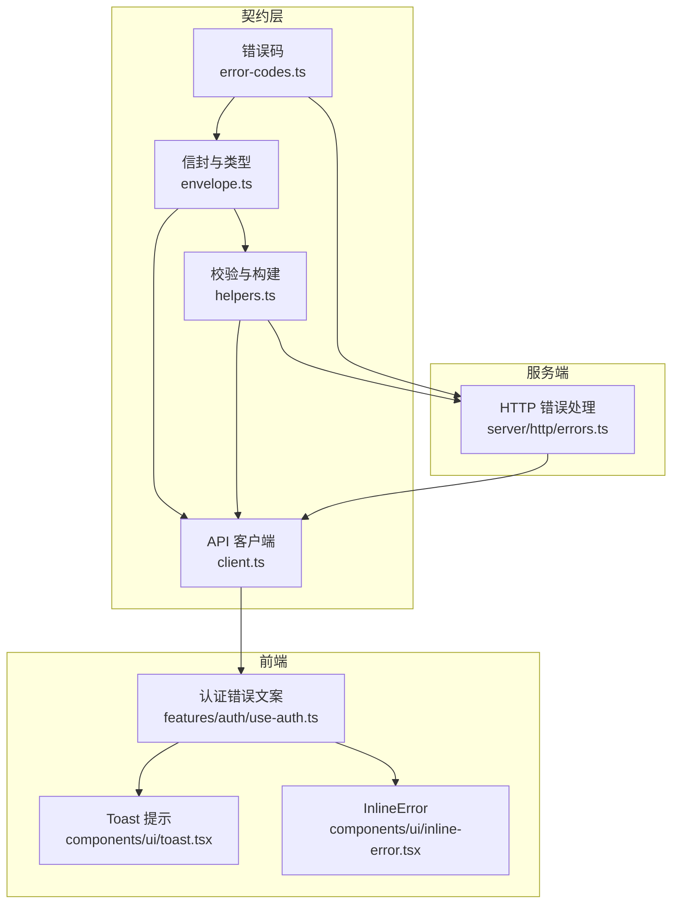
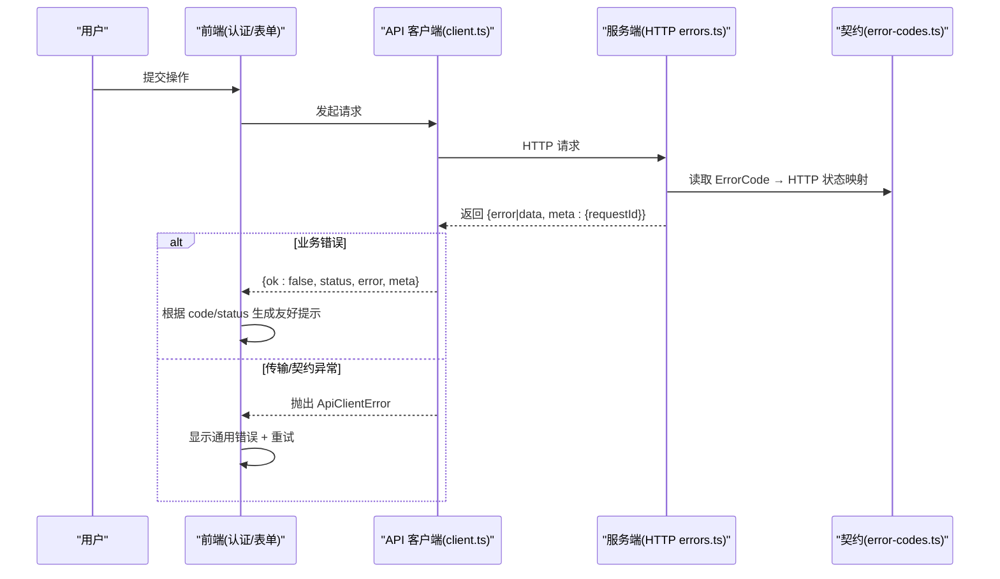
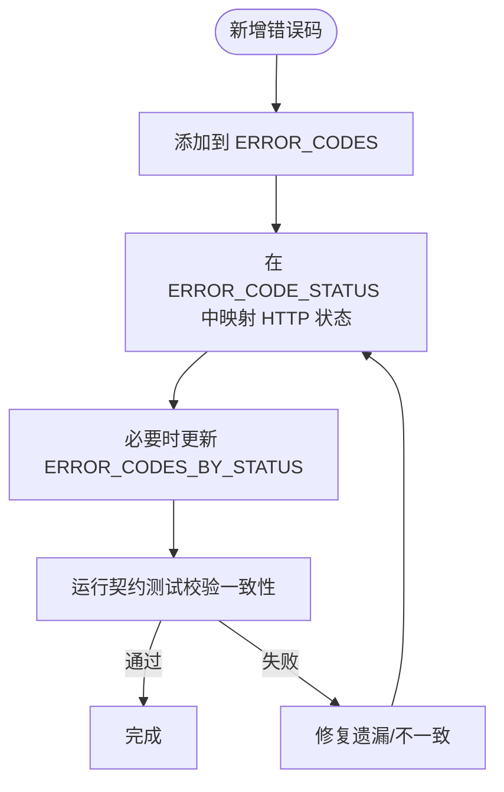
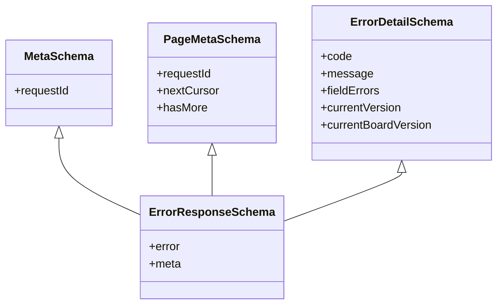
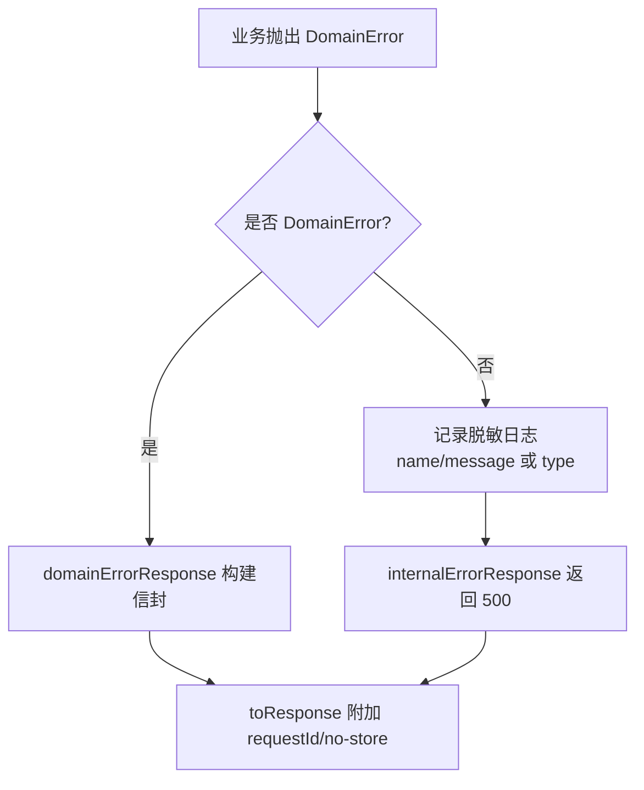
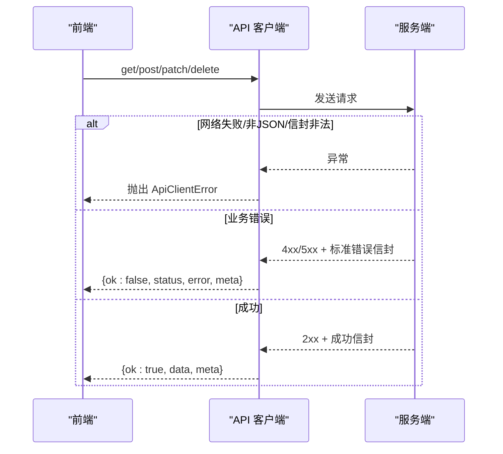
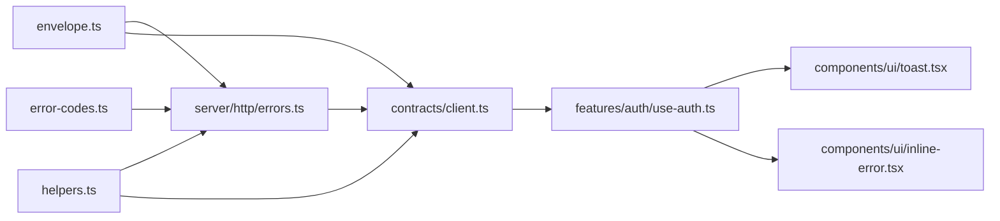

# 错误处理机制

<cite>
**本文引用的文件**
- [src/contracts/error-codes.ts](file://src/contracts/error-codes.ts)
- [src/contracts/envelope.ts](file://src/contracts/envelope.ts)
- [src/contracts/helpers.ts](file://src/contracts/helpers.ts)
- [src/contracts/client.ts](file://src/contracts/client.ts)
- [src/server/http/errors.ts](file://src/server/http/errors.ts)
- [src/components/ui/toast.tsx](file://src/components/ui/toast.tsx)
- [src/components/ui/inline-error.tsx](file://src/components/ui/inline-error.tsx)
- [src/features/auth/use-auth.ts](file://src/features/auth/use-auth.ts)
- [tests/contract/error-codes.test.ts](file://tests/contract/error-codes.test.ts)
- [tests/contract/client.test.ts](file://tests/contract/client.test.ts)
- [docs/05-API-CONTRACT.md](file://docs/05-API-CONTRACT.md)
</cite>

## 目录
1. [简介](#简介)
2. [项目结构](#项目结构)
3. [核心组件](#核心组件)
4. [架构总览](#架构总览)
5. [详细组件分析](#详细组件分析)
6. [依赖关系分析](#依赖关系分析)
7. [性能考量](#性能考量)
8. [故障排除指南](#故障排除指南)
9. [结论](#结论)
10. [附录](#附录)

## 简介
本文件系统化说明 Orbit 项目的错误处理机制，覆盖全局策略、错误分类与编码、前后端响应格式、异常捕获与日志、错误追踪与诊断、最佳实践、常见场景与排障方法，以及测试与模拟策略。目标是让非技术读者也能理解整体设计，同时为开发者提供可操作的实现参考。

## 项目结构
错误处理贯穿契约层、服务端 HTTP 层、前端 UI 与客户端网络层：
- 契约层：统一错误码、信封结构与校验工具
- 服务端：领域错误模型、统一错误响应构造与兜底策略
- 前端：用户友好提示（Toast/InlineError）、认证错误文案映射
- 客户端：统一解析成功/失败信封，传输异常抛出明确错误
- 文档与测试：错误码全表契约与交叉验证测试



图表来源
- [src/contracts/error-codes.ts:1-137](file://src/contracts/error-codes.ts#L1-L137)
- [src/contracts/envelope.ts:1-94](file://src/contracts/envelope.ts#L1-L94)
- [src/contracts/helpers.ts:1-150](file://src/contracts/helpers.ts#L1-L150)
- [src/contracts/client.ts:1-277](file://src/contracts/client.ts#L1-L277)
- [src/server/http/errors.ts:1-136](file://src/server/http/errors.ts#L1-L136)
- [src/components/ui/toast.tsx:1-131](file://src/components/ui/toast.tsx#L1-L131)
- [src/components/ui/inline-error.tsx:1-40](file://src/components/ui/inline-error.tsx#L1-L40)
- [src/features/auth/use-auth.ts:1-186](file://src/features/auth/use-auth.ts#L1-L186)

章节来源
- [docs/05-API-CONTRACT.md:1-133](file://docs/05-API-CONTRACT.md#L1-L133)

## 核心组件
- 错误码与状态映射：集中定义 ErrorCode、HTTP 状态码映射与分组视图，保证类型安全与一致性
- 统一信封：成功 {data, meta}、列表 {data[], meta}、错误 {error, meta}，严格 schema 校验
- 服务端错误基础设施：DomainError、errorResponse、domainErrorResponse、internalErrorResponse、toErrorResponse
- API 客户端：统一解析信封，业务错误返回判别联合，传输/契约异常抛出 ApiClientError
- 前端错误展示：Toast（瞬时提示）+ InlineError（驻留提示），认证错误文案映射避免信息泄露
- 契约测试：错误码全表与映射一致性校验

章节来源
- [src/contracts/error-codes.ts:1-137](file://src/contracts/error-codes.ts#L1-L137)
- [src/contracts/envelope.ts:1-94](file://src/contracts/envelope.ts#L1-L94)
- [src/contracts/helpers.ts:1-150](file://src/contracts/helpers.ts#L1-L150)
- [src/contracts/client.ts:1-277](file://src/contracts/client.ts#L1-L277)
- [src/server/http/errors.ts:1-136](file://src/server/http/errors.ts#L1-L136)
- [src/components/ui/toast.tsx:1-131](file://src/components/ui/toast.tsx#L1-L131)
- [src/components/ui/inline-error.tsx:1-40](file://src/components/ui/inline-error.tsx#L1-L40)
- [src/features/auth/use-auth.ts:1-186](file://src/features/auth/use-auth.ts#L1-L186)
- [tests/contract/error-codes.test.ts:1-98](file://tests/contract/error-codes.test.ts#L1-L98)

## 架构总览
下图展示了从请求到响应的错误处理流程：服务端将领域错误转换为标准信封并附带 requestId；客户端解析信封，业务错误以结构化结果返回，传输或契约异常抛出明确错误；前端根据 code/status 给出用户友好提示。



图表来源
- [src/contracts/client.ts:121-254](file://src/contracts/client.ts#L121-L254)
- [src/server/http/errors.ts:91-135](file://src/server/http/errors.ts#L91-L135)
- [src/contracts/error-codes.ts:18-136](file://src/contracts/error-codes.ts#L18-L136)

## 详细组件分析

### 错误码与状态映射
- 唯一真源：ERROR_CODES 元组，供 Zod enum 派生类型安全的 ErrorCode 联合
- 类型安全映射：ERROR_CODE_STATUS 将每个 ErrorCode 映射到 HttpStatus，编译期约束键值完整
- 分组视图：ERROR_CODES_BY_STATUS 按 HTTP 状态码分组，便于前端按状态分支
- 辅助函数：httpStatusForErrorCode(code) 获取状态码；isErrorCode(value) 运行时判断
- 契约测试：确保 ERROR_CODES、映射、分组与文档一致，且无多余或缺失



图表来源
- [src/contracts/error-codes.ts:18-136](file://src/contracts/error-codes.ts#L18-L136)
- [tests/contract/error-codes.test.ts:1-98](file://tests/contract/error-codes.test.ts#L1-L98)

章节来源
- [src/contracts/error-codes.ts:1-137](file://src/contracts/error-codes.ts#L1-L137)
- [tests/contract/error-codes.test.ts:1-98](file://tests/contract/error-codes.test.ts#L1-L98)
- [docs/05-API-CONTRACT.md:22-42](file://docs/05-API-CONTRACT.md#L22-L42)

### 统一信封与校验
- 成功信封：{data, meta:{requestId}}；列表信封：{data[], meta:{requestId,nextCursor,hasMore}}
- 错误信封：{error:{code,message,fieldErrors?,currentVersion?,currentBoardVersion?}, meta:{requestId}}
- 使用 strictObject 拒绝未知字段，防止敏感信息泄漏
- 构建器：buildSuccessResponse/buildListResponse/buildErrorResponse 产出前复校，保证合法



图表来源
- [src/contracts/envelope.ts:21-57](file://src/contracts/envelope.ts#L21-L57)
- [src/contracts/helpers.ts:68-85](file://src/contracts/helpers.ts#L68-L85)

章节来源
- [src/contracts/envelope.ts:1-94](file://src/contracts/envelope.ts#L1-L94)
- [src/contracts/helpers.ts:1-150](file://src/contracts/helpers.ts#L1-L150)
- [docs/05-API-CONTRACT.md:9-19](file://docs/05-API-CONTRACT.md#L9-L19)

### 服务端错误处理
- DomainError：携带 code、message、可选 fieldErrors 与 details（如 currentVersion/currentBoardVersion）
- 错误响应构造：errorResponse/domainErrorResponse/internalErrorResponse 统一封装
- 统一异常收敛：toErrorResponse 将 DomainError 转为标准信封；其它异常记录脱敏日志并返回 500 INTERNAL_ERROR
- 缓存控制：所有错误响应设置 Cache-Control: private, no-store，避免私有内容进入共享缓存
- 调试信息：响应体不含堆栈；requestId 通过头返回，便于追踪



图表来源
- [src/server/http/errors.ts:39-135](file://src/server/http/errors.ts#L39-L135)

章节来源
- [src/server/http/errors.ts:1-136](file://src/server/http/errors.ts#L1-L136)
- [docs/05-API-CONTRACT.md:22-42](file://docs/05-API-CONTRACT.md#L22-L42)

### API 客户端错误处理
- 成功/失败判别联合：ApiResult/ApiListResult，业务错误不抛异常，直接返回 {ok:false,...}
- 传输/契约异常：ApiClientError，包含 status 与 cause，便于上层区分处理
- 信封解析：对非 JSON、空 body、信封结构不匹配等情况抛出明确错误
- 幂等支持：可选 Idempotency-Key 头，配合服务端幂等逻辑



图表来源
- [src/contracts/client.ts:121-254](file://src/contracts/client.ts#L121-L254)
- [src/contracts/client.ts:257-277](file://src/contracts/client.ts#L257-L277)

章节来源
- [src/contracts/client.ts:1-277](file://src/contracts/client.ts#L1-L277)
- [tests/contract/client.test.ts:77-115](file://tests/contract/client.test.ts#L77-L115)

### 前端错误处理
- 用户友好提示：Toast 用于瞬时提示；InlineError 用于驻留提示，满足“错误不能仅靠 Toast”的要求
- 认证错误文案：基于 code/status 精确判定，避免泄露账户存在性；429 限流、403 Origin 限制、未验证邮箱等分别处理
- 重试与草稿保留：网络失败时局部错误、重试、保留输入草稿

```mermaid
flowchart TD
S["收到错误"] --> J{"code/status"}
J --> |RATE_LIMITED/429| R["提示尝试过于频繁"]
J --> |EMAIL_NOT_VERIFIED| V["提示邮箱未验证并重发验证邮件"]
J --> |403(Origin)| O["提示登录请求被拒绝"]
J --> |其他| G["提示邮箱或密码不正确"]
R --> UI["Toast/InlineError 展示"]
V --> UI
O --> UI
G --> UI
```

图表来源
- [src/features/auth/use-auth.ts:29-52](file://src/features/auth/use-auth.ts#L29-L52)
- [src/components/ui/toast.tsx:15-23](file://src/components/ui/toast.tsx#L15-L23)
- [src/components/ui/inline-error.tsx:5-10](file://src/components/ui/inline-error.tsx#L5-L10)

章节来源
- [src/features/auth/use-auth.ts:1-186](file://src/features/auth/use-auth.ts#L1-L186)
- [src/components/ui/toast.tsx:1-131](file://src/components/ui/toast.tsx#L1-L131)
- [src/components/ui/inline-error.tsx:1-40](file://src/components/ui/inline-error.tsx#L1-L40)

## 依赖关系分析
- 契约层为上游真源：错误码、信封、校验工具被服务端与客户端共同依赖
- 服务端依赖契约层进行错误映射与响应构造
- 客户端依赖契约层进行信封解析与类型推导
- 前端依赖客户端返回的结构化错误进行用户提示



图表来源
- [src/contracts/error-codes.ts:1-137](file://src/contracts/error-codes.ts#L1-L137)
- [src/contracts/envelope.ts:1-94](file://src/contracts/envelope.ts#L1-L94)
- [src/contracts/helpers.ts:1-150](file://src/contracts/helpers.ts#L1-L150)
- [src/contracts/client.ts:1-277](file://src/contracts/client.ts#L1-L277)
- [src/server/http/errors.ts:1-136](file://src/server/http/errors.ts#L1-L136)
- [src/features/auth/use-auth.ts:1-186](file://src/features/auth/use-auth.ts#L1-L186)
- [src/components/ui/toast.tsx:1-131](file://src/components/ui/toast.tsx#L1-L131)
- [src/components/ui/inline-error.tsx:1-40](file://src/components/ui/inline-error.tsx#L1-L40)

章节来源
- [src/contracts/error-codes.ts:1-137](file://src/contracts/error-codes.ts#L1-L137)
- [src/contracts/client.ts:1-277](file://src/contracts/client.ts#L1-L277)
- [src/server/http/errors.ts:1-136](file://src/server/http/errors.ts#L1-L136)

## 性能考量
- 错误响应禁止缓存：统一设置 Cache-Control: private, no-store，避免授权/私有内容进入公共缓存
- 最小化响应体：错误消息面向用户，长度受 schema 约束；避免回传堆栈或敏感字段
- 快速失败：启动期环境变量校验失败即终止进程，减少运行时不确定性
- 客户端解析开销：Zod 校验在契约层集中，避免重复逻辑；传输失败尽早抛出，减少无效渲染

[本节为通用指导，无需具体文件引用]

## 故障排除指南
- 无法解析响应体：检查是否为空或非 JSON；客户端会抛出 ApiClientError，查看 status 与 cause
- 信封结构不匹配：确认服务端返回的 error/meta 字段齐全且类型正确；契约测试可帮助定位差异
- 错误码不一致：运行错误码契约测试，确保 ERROR_CODES、映射与分组视图一致
- 认证错误误判：优先依据 code 而非 status 判定未验证邮箱；403 可能来自 Origin 校验
- 500 内部错误：服务端已记录脱敏日志；前端仅显示通用提示并建议稍后重试

章节来源
- [src/contracts/client.ts:165-195](file://src/contracts/client.ts#L165-L195)
- [src/contracts/client.ts:257-277](file://src/contracts/client.ts#L257-L277)
- [tests/contract/error-codes.test.ts:42-83](file://tests/contract/error-codes.test.ts#L42-L83)
- [src/features/auth/use-auth.ts:33-52](file://src/features/auth/use-auth.ts#L33-L52)
- [src/server/http/errors.ts:116-135](file://src/server/http/errors.ts#L116-L135)

## 结论
Orbit 的错误处理以契约为中心，通过统一的错误码、信封与校验工具，确保前后端行为一致、可测试、可扩展。服务端严格收敛异常并脱敏日志，客户端明确区分业务错误与传输异常，前端提供用户友好的提示与重试体验。配合契约测试与文档，形成闭环的质量保障体系。

[本节为总结，无需具体文件引用]

## 附录

### API 错误响应规范
- HTTP 状态码：按错误码映射表使用，涵盖 4xx/5xx 典型场景
- 错误消息结构：{error:{code,message,fieldErrors?,currentVersion?,currentBoardVersion?}, meta:{requestId}}
- 调试信息：requestId 通过响应头返回，便于跨层追踪；响应体不包含堆栈或敏感数据

章节来源
- [docs/05-API-CONTRACT.md:22-42](file://docs/05-API-CONTRACT.md#L22-L42)
- [src/contracts/envelope.ts:39-57](file://src/contracts/envelope.ts#L39-L57)
- [src/server/http/errors.ts:79-89](file://src/server/http/errors.ts#L79-L89)

### 错误追踪与诊断
- 服务端：toErrorResponse 记录脱敏日志（name/message 或 type），避免泄露敏感上下文
- 客户端：ApiClientError 携带 status 与 cause，便于上层区分处理与上报
- 前端：结合 requestId 与错误码进行问题定位与上报

章节来源
- [src/server/http/errors.ts:116-135](file://src/server/http/errors.ts#L116-L135)
- [src/contracts/client.ts:57-66](file://src/contracts/client.ts#L57-L66)

### 最佳实践
- 新增错误码必须同步更新 ERROR_CODES、映射与分组视图，并通过契约测试
- 业务错误使用 DomainError，避免直接抛出裸异常
- 前端避免信息泄露：仅依据 code 判定特定语义（如未验证邮箱）
- 所有错误响应设置 no-store，保护隐私与安全

章节来源
- [src/contracts/error-codes.ts:18-136](file://src/contracts/error-codes.ts#L18-L136)
- [src/server/http/errors.ts:39-135](file://src/server/http/errors.ts#L39-L135)
- [src/features/auth/use-auth.ts:29-52](file://src/features/auth/use-auth.ts#L29-L52)

### 常见错误场景
- 400 VALIDATION_ERROR：字段级错误映射到 fieldErrors，提示用户修正
- 401 UNAUTHENTICATED：引导登录并保留 returnTo
- 403 FORBIDDEN/EMAIL_UNVERIFIED/ORIGIN_NOT_ALLOWED：区分权限、邮箱未验证与 Origin 限制
- 409 VERSION_CONFLICT/BOARD_CONFLICT：提示版本冲突，携带当前版本以便客户端刷新重试
- 429 RATE_LIMITED：提示限流，保留输入并稍后重试
- 500 INTERNAL_ERROR：通用提示，服务端记录脱敏细节

章节来源
- [docs/05-API-CONTRACT.md:22-42](file://docs/05-API-CONTRACT.md#L22-L42)
- [src/contracts/error-codes.ts:28-136](file://src/contracts/error-codes.ts#L28-L136)

### 测试策略与模拟
- 契约测试：校验错误码全表、映射与分组一致性
- 客户端测试：模拟 fetch 返回不同信封，验证业务错误与传输异常处理
- 模拟方法：使用自定义 fetchImpl 注入响应，断言 ok/status/error/meta

章节来源
- [tests/contract/error-codes.test.ts:1-98](file://tests/contract/error-codes.test.ts#L1-L98)
- [tests/contract/client.test.ts:77-115](file://tests/contract/client.test.ts#L77-L115)
- [src/contracts/client.ts:121-254](file://src/contracts/client.ts#L121-L254)