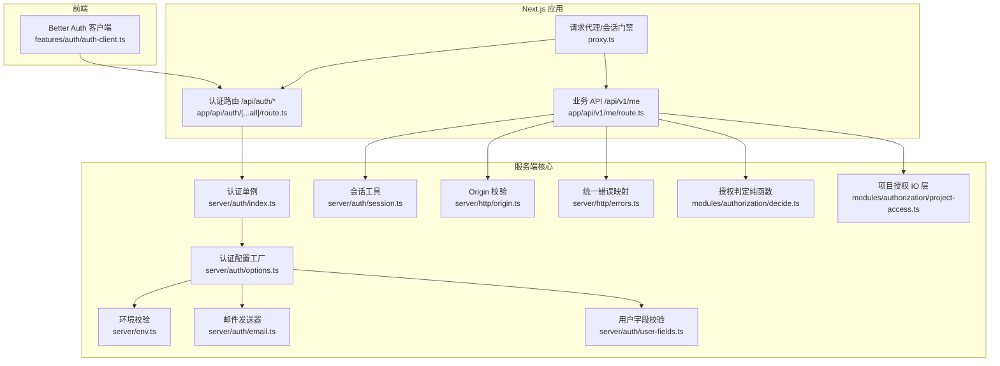
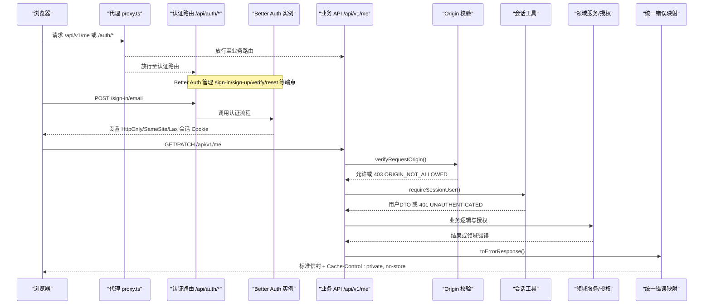
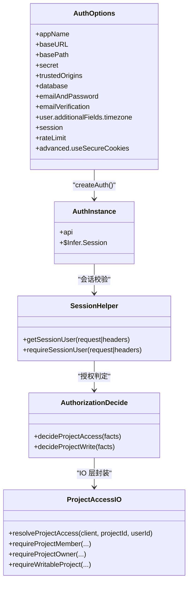
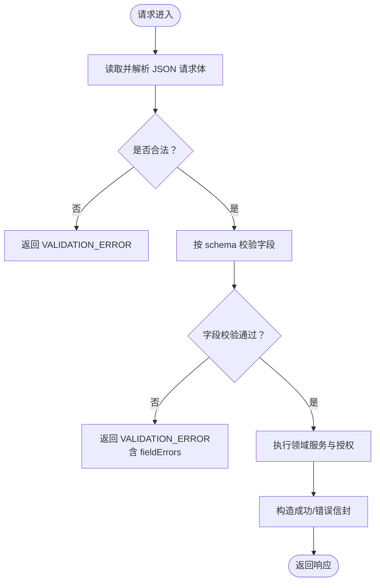
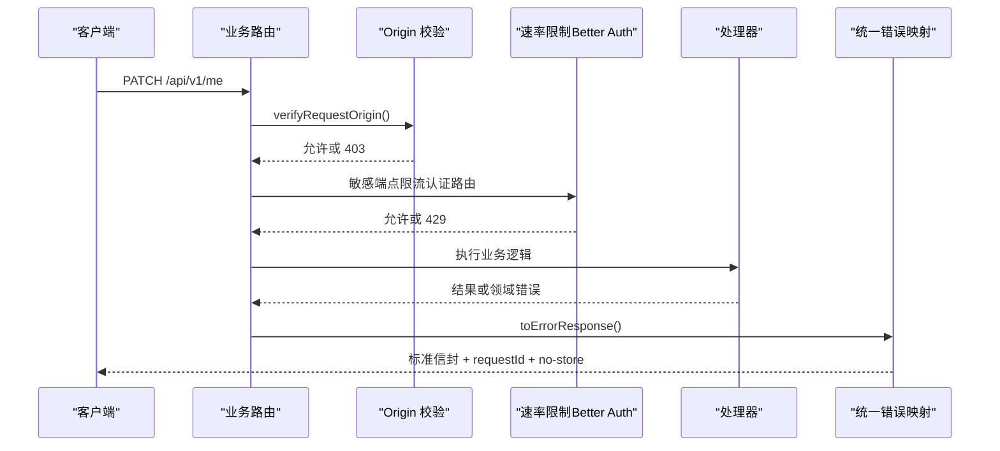
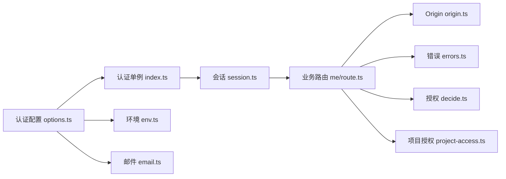

# 安全架构设计

<cite>
**本文引用的文件**
- [src/server/auth/index.ts](file://src/server/auth/index.ts)
- [src/server/auth/options.ts](file://src/server/auth/options.ts)
- [src/server/auth/session.ts](file://src/server/auth/session.ts)
- [src/app/api/auth/[...all]/route.ts](file://src/app/api/auth/[...all]/route.ts)
- [src/features/auth/auth-client.ts](file://src/features/auth/auth-client.ts)
- [src/server/modules/authorization/decide.ts](file://src/server/modules/authorization/decide.ts)
- [src/server/modules/authorization/project-access.ts](file://src/server/modules/authorization/project-access.ts)
- [src/server/http/errors.ts](file://src/server/http/errors.ts)
- [src/server/env.ts](file://src/server/env.ts)
- [src/features/auth/validation.ts](file://src/features/auth/validation.ts)
- [src/server/auth/email.ts](file://src/server/auth/email.ts)
- [src/server/auth/user-fields.ts](file://src/server/auth/user-fields.ts)
- [src/app/api/v1/me/route.ts](file://src/app/api/v1/me/route.ts)
- [src/contracts/error-codes.ts](file://src/contracts/error-codes.ts)
- [src/server/http/origin.ts](file://src/server/http/origin.ts)
- [src/proxy.ts](file://src/proxy.ts)
</cite>

## 目录
1. [简介](#简介)
2. [项目结构](#项目结构)
3. [核心组件](#核心组件)
4. [架构总览](#架构总览)
5. [详细组件分析](#详细组件分析)
6. [依赖关系分析](#依赖关系分析)
7. [性能与安全权衡](#性能与安全权衡)
8. [故障排查指南](#故障排查指南)
9. [结论](#结论)
10. [附录：威胁模型与防护层次](#附录威胁模型与防护层次)

## 简介
本安全架构设计文档围绕 Orbit 项目的认证授权、输入验证与输出编码、数据安全保护、安全中间件设计与安全最佳实践展开，结合 Better Auth 集成、会话管理、权限控制策略、请求过滤、速率限制、异常处理、安全头配置、CORS 与 CSRF 防护等关键主题，给出可落地的实现要点与图示说明。目标是帮助读者在不深入代码细节的情况下理解系统的安全边界与防护层次，并在需要时快速定位到具体实现位置。

## 项目结构
Orbit 的安全相关能力主要分布在以下模块：
- 认证与会话：Better Auth 服务端单例、客户端 SDK、会话获取与强制登录校验
- 授权与访问控制：项目级读/写决策函数与 IO 层封装
- 输入验证与输出编码：表单与 API 参数校验、邮件模板转义
- 数据安全与环境配置：环境变量强校验、敏感信息保护、传输安全（HTTPS/Secure Cookie）
- 安全中间件：Origin/CORS 校验、速率限制、统一错误响应与缓存控制
- 路由与代理：认证路由挂载、受保护路径的代理拦截

图表来源
- [src/proxy.ts:58-77](file://src/proxy.ts#L58-L77)
- [src/app/api/auth/[...all]/route.ts:1-22](file://src/app/api/auth/[...all]/route.ts#L1-L22)
- [src/app/api/v1/me/route.ts:1-91](file://src/app/api/v1/me/route.ts#L1-L91)
- [src/server/auth/index.ts:1-29](file://src/server/auth/index.ts#L1-L29)
- [src/server/auth/options.ts:1-141](file://src/server/auth/options.ts#L1-L141)
- [src/server/auth/session.ts:1-43](file://src/server/auth/session.ts#L1-L43)
- [src/server/http/origin.ts:1-69](file://src/server/http/origin.ts#L1-L69)
- [src/server/http/errors.ts:1-136](file://src/server/http/errors.ts#L1-L136)
- [src/server/env.ts:1-238](file://src/server/env.ts#L1-L238)
- [src/server/auth/email.ts:1-218](file://src/server/auth/email.ts#L1-L218)
- [src/server/auth/user-fields.ts:1-26](file://src/server/auth/user-fields.ts#L1-L26)
- [src/server/modules/authorization/decide.ts:1-67](file://src/server/modules/authorization/decide.ts#L1-L67)
- [src/server/modules/authorization/project-access.ts:1-121](file://src/server/modules/authorization/project-access.ts#L1-L121)

章节来源
- [src/proxy.ts:58-77](file://src/proxy.ts#L58-L77)
- [src/app/api/auth/[...all]/route.ts:1-22](file://src/app/api/auth/[...all]/route.ts#L1-L22)
- [src/app/api/v1/me/route.ts:1-91](file://src/app/api/v1/me/route.ts#L1-L91)
- [src/server/auth/index.ts:1-29](file://src/server/auth/index.ts#L1-L29)
- [src/server/auth/options.ts:1-141](file://src/server/auth/options.ts#L1-L141)
- [src/server/auth/session.ts:1-43](file://src/server/auth/session.ts#L1-L43)
- [src/server/http/origin.ts:1-69](file://src/server/http/origin.ts#L1-L69)
- [src/server/http/errors.ts:1-136](file://src/server/http/errors.ts#L1-L136)
- [src/server/env.ts:1-238](file://src/server/env.ts#L1-L238)
- [src/server/auth/email.ts:1-218](file://src/server/auth/email.ts#L1-L218)
- [src/server/auth/user-fields.ts:1-26](file://src/server/auth/user-fields.ts#L1-L26)
- [src/server/modules/authorization/decide.ts:1-67](file://src/server/modules/authorization/decide.ts#L1-L67)
- [src/server/modules/authorization/project-access.ts:1-121](file://src/server/modules/authorization/project-access.ts#L1-L121)

## 核心组件
- 认证与会话
  - Better Auth 服务端单例与配置工厂：集中管理数据库适配器、邮箱/密码策略、会话过期与刷新、可信源、速率限制、Secure Cookie 开关等。
  - 会话获取与强制登录：提供会话查询与“必须已登录”的强制校验，返回契约层用户 DTO，避免泄露敏感字段。
  - 客户端 SDK：通过 createAuthClient 暴露签名化方法，自动映射到 /api/auth/* 端点，并注入 additionalFields（如 timezone）。
- 授权与访问控制
  - 项目级读/写决策：将角色判定与写操作许可拆分为无 IO 的纯函数，便于测试与复用；IO 层负责查库、翻译领域错误。
- 输入验证与输出编码
  - 表单与 API 参数：客户端轻量校验用于体验，服务端权威校验确保一致性；API 使用统一信封与 schema 解析。
  - 邮件模板：对用户可控内容做 HTML 实体转义，避免注入。
- 数据安全与环境配置
  - 环境变量强校验：启动期校验必需项与格式，拒绝通配符、禁止 NEXT_PUBLIC_ 暴露秘密、非开发环境强制密钥长度。
  - 传输安全：HTTPS baseURL 下启用 Secure Cookie；HTTPOnly + SameSite=Lax 由库默认保证。
- 安全中间件
  - Origin/CORS：自有变更 API 仅接受同源浏览器请求，缺失或不匹配返回 403。
  - 速率限制：对敏感认证端点设置更严格的窗口与上限，test 环境关闭以支持集成测试。
  - 统一错误响应：所有错误经 DomainError 或 toErrorResponse 映射为标准信封，附带 requestId 与 no-store 缓存策略。

章节来源
- [src/server/auth/index.ts:1-29](file://src/server/auth/index.ts#L1-L29)
- [src/server/auth/options.ts:1-141](file://src/server/auth/options.ts#L1-L141)
- [src/server/auth/session.ts:1-43](file://src/server/auth/session.ts#L1-L43)
- [src/features/auth/auth-client.ts:1-32](file://src/features/auth/auth-client.ts#L1-L32)
- [src/server/modules/authorization/decide.ts:1-67](file://src/server/modules/authorization/decide.ts#L1-L67)
- [src/server/modules/authorization/project-access.ts:1-121](file://src/server/modules/authorization/project-access.ts#L1-L121)
- [src/features/auth/validation.ts:1-67](file://src/features/auth/validation.ts#L1-L67)
- [src/server/auth/email.ts:1-218](file://src/server/auth/email.ts#L1-L218)
- [src/server/env.ts:1-238](file://src/server/env.ts#L1-L238)
- [src/server/http/origin.ts:1-69](file://src/server/http/origin.ts#L1-L69)
- [src/server/http/errors.ts:1-136](file://src/server/http/errors.ts#L1-L136)

## 架构总览
下图展示从浏览器到后端服务的关键安全路径：代理拦截受保护路径，认证路由由 Better Auth 接管，业务 API 在入口处进行 Origin 校验与会话检查，随后进入领域服务与授权层，最终通过统一错误与信封机制返回。

图表来源
- [src/proxy.ts:58-77](file://src/proxy.ts#L58-L77)
- [src/app/api/auth/[...all]/route.ts:1-22](file://src/app/api/auth/[...all]/route.ts#L1-L22)
- [src/server/auth/index.ts:1-29](file://src/server/auth/index.ts#L1-L29)
- [src/app/api/v1/me/route.ts:1-91](file://src/app/api/v1/me/route.ts#L1-L91)
- [src/server/http/origin.ts:1-69](file://src/server/http/origin.ts#L1-L69)
- [src/server/auth/session.ts:1-43](file://src/server/auth/session.ts#L1-L43)
- [src/server/http/errors.ts:1-136](file://src/server/http/errors.ts#L1-L136)

## 详细组件分析

### 认证与授权机制（Better Auth 集成、会话管理与权限控制）
- 认证配置与策略
  - 数据库会话：使用 Prisma 适配器，会话记录在数据库，过期与刷新策略明确。
  - 邮箱与密码：最小/最大长度、注册后需邮箱验证、未验证登录重发验证邮件、重置密码后撤销全部会话。
  - 可信源：精确来源列表，禁止通配符；生产 HTTPS 下启用 Secure Cookie。
  - 速率限制：针对敏感端点设定更严格阈值，test 环境关闭以便集成测试。
- 会话管理
  - 会话获取：统一通过 auth.api.getSession 读取，未认证返回 null。
  - 强制登录：requireSessionUser 在未认证时抛出领域错误，由 HTTP 层映射为 401 UNAUTHENTICATED。
  - 类型安全：会话推断包含扩展字段（timezone），返回 DTO 不含敏感字段。
- 权限控制
  - 读访问：项目不存在或非成员 → NOT_FOUND（不泄露存在性）。
  - 写访问：仅 owner 可修改/归档/恢复；归档项目只读（restore 除外）。
  - 纯判定与 IO 分离：decide 纯函数便于测试；project-access 负责查库与错误翻译。

图表来源
- [src/server/auth/options.ts:1-141](file://src/server/auth/options.ts#L1-L141)
- [src/server/auth/index.ts:1-29](file://src/server/auth/index.ts#L1-L29)
- [src/server/auth/session.ts:1-43](file://src/server/auth/session.ts#L1-L43)
- [src/server/modules/authorization/decide.ts:1-67](file://src/server/modules/authorization/decide.ts#L1-L67)
- [src/server/modules/authorization/project-access.ts:1-121](file://src/server/modules/authorization/project-access.ts#L1-L121)

章节来源
- [src/server/auth/options.ts:1-141](file://src/server/auth/options.ts#L1-L141)
- [src/server/auth/index.ts:1-29](file://src/server/auth/index.ts#L1-L29)
- [src/server/auth/session.ts:1-43](file://src/server/auth/session.ts#L1-L43)
- [src/server/modules/authorization/decide.ts:1-67](file://src/server/modules/authorization/decide.ts#L1-L67)
- [src/server/modules/authorization/project-access.ts:1-121](file://src/server/modules/authorization/project-access.ts#L1-L121)

### 输入验证与输出编码（表单验证、API 参数验证、XSS 防护）
- 表单验证
  - 客户端：轻量校验（邮箱格式、密码长度、姓名长度）提升体验，不替代服务端校验。
  - 服务端：通过 schema 解析与领域规则（如 IANA 时区、姓名归一化）确保数据一致性与合法性。
- API 参数验证
  - 统一读取 JSON 请求体，过大直接返回 PAYLOAD_TOO_LARGE；解析失败返回 VALIDATION_ERROR。
  - 契约层错误码与状态码映射集中管理，避免不一致。
- XSS 防护
  - 邮件模板对用户可控内容进行 HTML 实体转义，避免注入。
  - 响应统一信封且带 no-store 缓存策略，防止私有内容被缓存泄露。

图表来源
- [src/app/api/v1/me/route.ts:1-91](file://src/app/api/v1/me/route.ts#L1-L91)
- [src/contracts/error-codes.ts:1-137](file://src/contracts/error-codes.ts#L1-L137)
- [src/features/auth/validation.ts:1-67](file://src/features/auth/validation.ts#L1-L67)
- [src/server/auth/email.ts:1-218](file://src/server/auth/email.ts#L1-L218)

章节来源
- [src/features/auth/validation.ts:1-67](file://src/features/auth/validation.ts#L1-L67)
- [src/app/api/v1/me/route.ts:1-91](file://src/app/api/v1/me/route.ts#L1-L91)
- [src/server/auth/email.ts:1-218](file://src/server/auth/email.ts#L1-L218)
- [src/contracts/error-codes.ts:1-137](file://src/contracts/error-codes.ts#L1-L137)

### 数据安全保护（密码加密、敏感信息处理、数据传输安全）
- 密码与令牌
  - 密码长度约束（12–128），重置密码后撤销全部会话，降低旧凭据风险。
  - 邮件中不包含密码明文与完整会话 token；链接携带一次性、可过期的令牌。
- 敏感信息处理
  - 环境变量启动期校验，禁止 NEXT_PUBLIC_ 暴露秘密；错误消息仅显示变量名与预期格式。
  - 会话返回 DTO 不含 password 与内部会话字段；响应统一 no-store 缓存策略。
- 数据传输安全
  - HTTPS baseURL 下启用 Secure Cookie；HttpOnly + SameSite=Lax 由库默认保证。
  - Origin 校验限制自有变更 API 仅接受同源浏览器请求。

章节来源
- [src/server/auth/options.ts:1-141](file://src/server/auth/options.ts#L1-L141)
- [src/server/auth/email.ts:1-218](file://src/server/auth/email.ts#L1-L218)
- [src/server/env.ts:1-238](file://src/server/env.ts#L1-L238)
- [src/server/http/errors.ts:1-136](file://src/server/http/errors.ts#L1-L136)
- [src/server/http/origin.ts:1-69](file://src/server/http/origin.ts#L1-L69)

### 安全中间件设计（请求过滤、速率限制、异常处理）
- 请求过滤
  - Origin 校验：GET/HEAD/OPTIONS 豁免，其它方法必须命中 AUTH_TRUSTED_ORIGINS 白名单。
  - 代理拦截：/app/*、/auth/*、/api/v1/* 受保护；/api/auth/* 由 Better Auth 自管。
- 速率限制
  - 针对敏感端点（登录、注册、重置、验证）设置更严格窗口与上限；test 环境关闭。
- 异常处理
  - 统一错误映射：DomainError 走其 code/status；其它意外错误收敛为 INTERNAL_ERROR，日志脱敏。
  - 响应头：requestId 透传，Cache-Control: private, no-store 防止缓存泄露。

图表来源
- [src/server/http/origin.ts:1-69](file://src/server/http/origin.ts#L1-L69)
- [src/server/auth/options.ts:1-141](file://src/server/auth/options.ts#L1-L141)
- [src/server/http/errors.ts:1-136](file://src/server/http/errors.ts#L1-L136)
- [src/proxy.ts:58-77](file://src/proxy.ts#L58-L77)

章节来源
- [src/server/http/origin.ts:1-69](file://src/server/http/origin.ts#L1-L69)
- [src/server/auth/options.ts:1-141](file://src/server/auth/options.ts#L1-L141)
- [src/server/http/errors.ts:1-136](file://src/server/http/errors.ts#L1-L136)
- [src/proxy.ts:58-77](file://src/proxy.ts#L58-L77)

### 安全最佳实践（安全头配置、CORS 设置、CSRF 防护）
- 安全头配置
  - 响应统一添加 Cache-Control: private, no-store，避免私有内容被共享缓存。
  - 响应携带 requestId，便于链路追踪与审计。
- CORS 设置
  - 自有变更 API 通过 Origin 白名单限制跨域；Better Auth 自有路由使用库内置 trustedOrigins，避免叠加自定义逻辑破坏回调。
- CSRF 防护
  - Better Auth 内置 CSRF 控制；自有 API 通过同源限制与会话 Cookie 组合防护。
  - 生产环境启用 Secure Cookie，配合 HttpOnly 与 SameSite=Lax 降低窃取风险。

章节来源
- [src/server/http/errors.ts:1-136](file://src/server/http/errors.ts#L1-L136)
- [src/server/auth/options.ts:1-141](file://src/server/auth/options.ts#L1-L141)
- [src/server/http/origin.ts:1-69](file://src/server/http/origin.ts#L1-L69)

## 依赖关系分析
- 组件耦合与内聚
  - 认证配置与实例解耦：options.ts 提供纯函数工厂，index.ts 创建单例，便于测试隔离。
  - 授权逻辑分层：decide.ts 纯函数与 project-access.ts IO 层分离，提高可测性与复用性。
  - 错误处理集中：errors.ts 统一映射，避免业务层直接构造 Response。
- 外部依赖与集成点
  - Better Auth：认证、会话、速率限制、CSRF、trustedOrigins。
  - Nodemailer：邮件发送，transport 按 env 缓存，避免重复连接。
  - Prisma：数据库会话与资源访问。
- 潜在循环依赖
  - 各模块通过接口与类型解耦，未见明显循环引用；env.ts 作为配置入口被多处依赖。

图表来源
- [src/server/auth/options.ts:1-141](file://src/server/auth/options.ts#L1-L141)
- [src/server/auth/index.ts:1-29](file://src/server/auth/index.ts#L1-L29)
- [src/server/auth/session.ts:1-43](file://src/server/auth/session.ts#L1-L43)
- [src/app/api/v1/me/route.ts:1-91](file://src/app/api/v1/me/route.ts#L1-L91)
- [src/server/http/origin.ts:1-69](file://src/server/http/origin.ts#L1-L69)
- [src/server/http/errors.ts:1-136](file://src/server/http/errors.ts#L1-L136)
- [src/server/env.ts:1-238](file://src/server/env.ts#L1-L238)
- [src/server/auth/email.ts:1-218](file://src/server/auth/email.ts#L1-L218)
- [src/server/modules/authorization/decide.ts:1-67](file://src/server/modules/authorization/decide.ts#L1-L67)
- [src/server/modules/authorization/project-access.ts:1-121](file://src/server/modules/authorization/project-access.ts#L1-L121)

章节来源
- [src/server/auth/options.ts:1-141](file://src/server/auth/options.ts#L1-L141)
- [src/server/auth/index.ts:1-29](file://src/server/auth/index.ts#L1-L29)
- [src/server/auth/session.ts:1-43](file://src/server/auth/session.ts#L1-L43)
- [src/app/api/v1/me/route.ts:1-91](file://src/app/api/v1/me/route.ts#L1-L91)
- [src/server/http/origin.ts:1-69](file://src/server/http/origin.ts#L1-L69)
- [src/server/http/errors.ts:1-136](file://src/server/http/errors.ts#L1-L136)
- [src/server/env.ts:1-238](file://src/server/env.ts#L1-L238)
- [src/server/auth/email.ts:1-218](file://src/server/auth/email.ts#L1-L218)
- [src/server/modules/authorization/decide.ts:1-67](file://src/server/modules/authorization/decide.ts#L1-L67)
- [src/server/modules/authorization/project-access.ts:1-121](file://src/server/modules/authorization/project-access.ts#L1-L121)

## 性能与安全权衡
- 速率限制
  - 内存存储适合单实例；多实例部署应切换为 database/secondary-storage 以避免限流失效。
- 会话刷新
  - updateAge 每日刷新减少频繁鉴权开销，同时保持会话活跃性。
- 邮件传输
  - transport 按 env 缓存，避免每封邮件重建 TCP 连接，提升吞吐。
- 缓存策略
  - 私有内容一律 no-store，避免缓存污染；仅在必要时考虑 CDN 缓存静态资源。

[本节为通用指导，无需特定文件来源]

## 故障排查指南
- 常见问题定位
  - 401 UNAUTHENTICATED：检查会话是否有效、Cookie 是否被浏览器策略阻止（如第三方 Cookie 限制）、是否通过正确路由发起请求。
  - 403 FORBIDDEN/ORIGIN_NOT_ALLOWED：确认 Origin 是否在 AUTH_TRUSTED_ORIGINS 白名单；自有变更 API 仅接受同源浏览器请求。
  - 429 RATE_LIMITED：检查是否触发敏感端点限流；集成测试需在 test 环境关闭限流或使用独立实例。
  - 409 PROJECT_ARCHIVED：归档项目仅读，恢复操作需 owner 权限。
  - 500 INTERNAL_ERROR：查看服务端日志中的脱敏信息（requestId、错误 name/message），避免泄露堆栈与敏感上下文。
- 调试建议
  - 使用 requestId 追踪请求链路；检查响应头是否包含 requestId 与 no-store。
  - 核对环境变量校验错误，确保 SECRET_KEYS 未被 NEXT_PUBLIC_ 暴露。

章节来源
- [src/server/http/errors.ts:1-136](file://src/server/http/errors.ts#L1-L136)
- [src/server/http/origin.ts:1-69](file://src/server/http/origin.ts#L1-L69)
- [src/server/auth/options.ts:1-141](file://src/server/auth/options.ts#L1-L141)
- [src/server/modules/authorization/project-access.ts:1-121](file://src/server/modules/authorization/project-access.ts#L1-L121)
- [src/server/env.ts:1-238](file://src/server/env.ts#L1-L238)

## 结论
Orbit 的安全架构以 Better Auth 为核心，结合严格的输入验证、统一的错误映射、Origin 校验与速率限制，构建了覆盖认证、授权、数据安全与传输安全的完整防护体系。通过纯判定与 IO 分离、环境变量强校验、邮件模板转义与 no-store 缓存策略，系统在保障用户体验的同时显著降低了攻击面与泄露风险。建议在多实例部署中升级限流存储、持续监控 Origin 白名单与 HTTPS 配置，并定期审查环境变量与依赖版本，确保安全基线不被削弱。

[本节为总结，无需特定文件来源]

## 附录：威胁模型与防护层次
- 威胁模型
  - 会话劫持：通过 HttpOnly、SameSite=Lax、Secure Cookie 与 no-store 缓存策略降低风险。
  - 暴力破解：通过速率限制与邮箱验证流程缓解。
  - 越权访问：通过项目级读/写决策与 owner-only 写操作限制。
  - 数据泄露：通过 DTO 过滤敏感字段、环境变量校验与错误响应脱敏。
  - 跨站脚本：通过邮件模板转义与输入验证减少注入面。
- 防护层次
  - 边界层：代理拦截、Origin 校验、速率限制。
  - 认证层：Better Auth 会话与令牌管理。
  - 授权层：项目级角色判定与写操作许可。
  - 数据层：环境变量强校验、敏感信息处理、传输安全。
  - 观测层：requestId 透传、统一错误映射、脱敏日志。

[本节为概念性内容，无需特定文件来源]