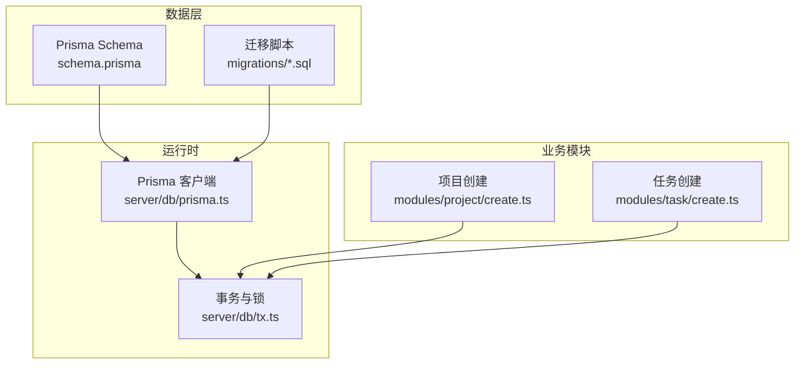
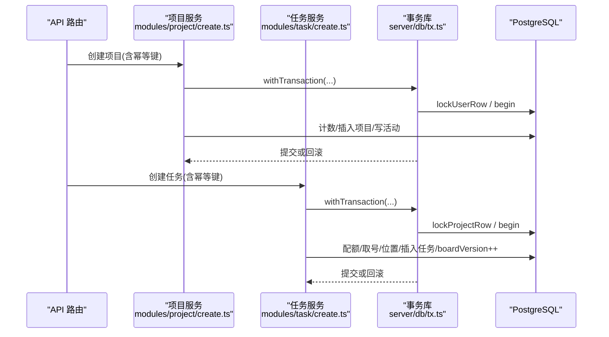
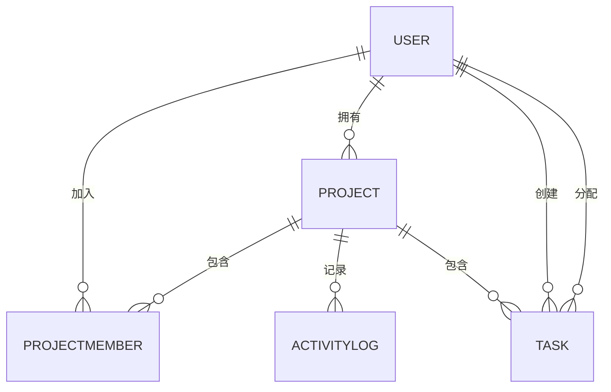
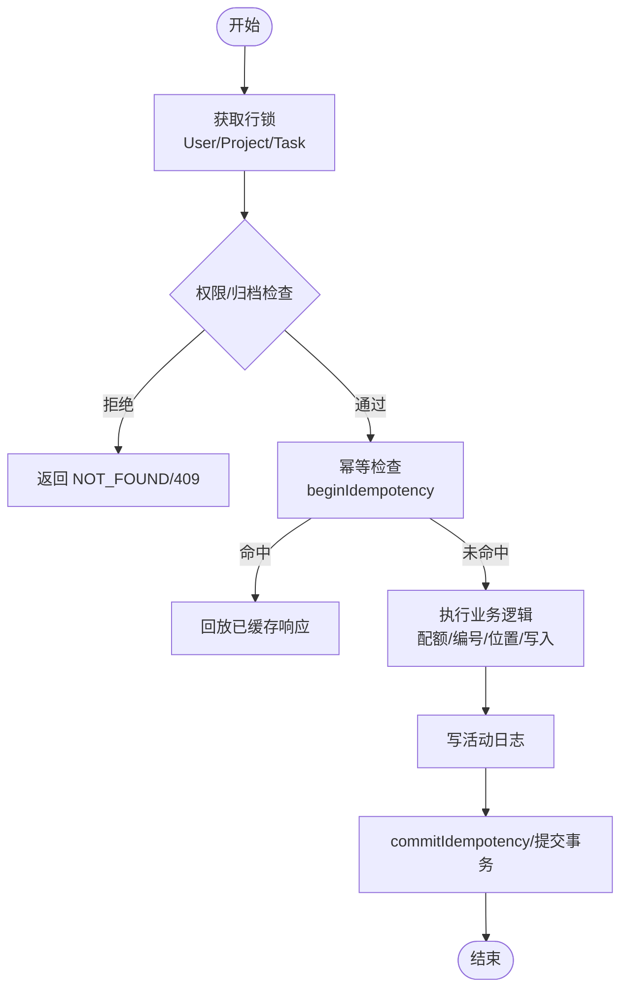
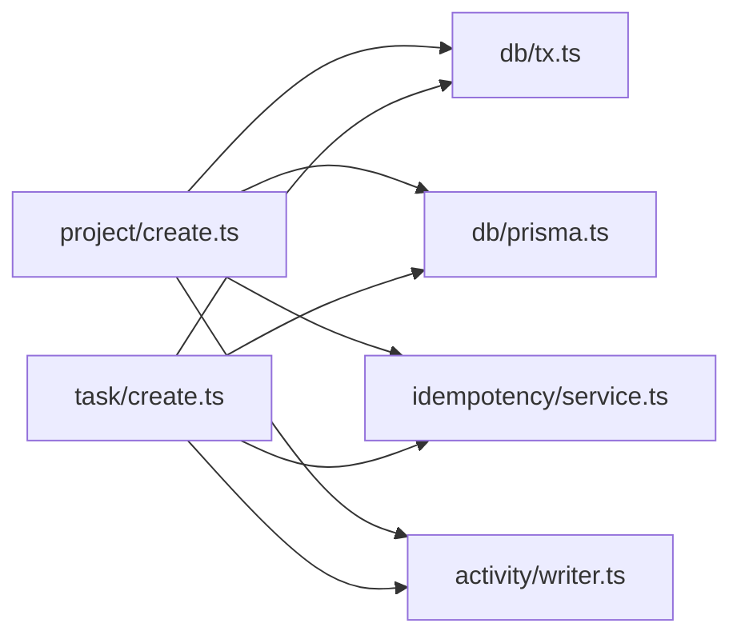
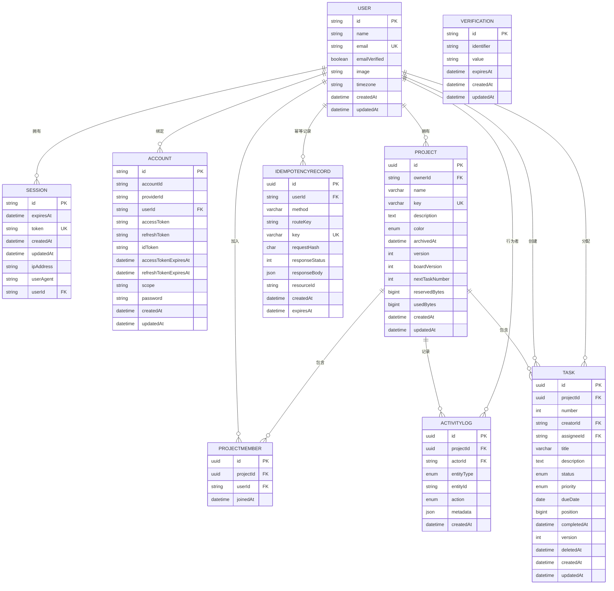

# 数据架构设计

<cite>
**本文引用的文件**
- [prisma/schema.prisma](file://prisma/schema.prisma)
- [prisma.config.ts](file://prisma.config.ts)
- [20260908162114_init_auth/migration.sql](file://prisma/migrations/20260908162114_init_auth/migration.sql)
- [20260909004718_add_task_domain/migration.sql](file://prisma/migrations/20260909004718_add_task_domain/migration.sql)
- [src/server/db/prisma.ts](file://src/server/db/prisma.ts)
- [src/server/db/tx.ts](file://src/server/db/tx.ts)
- [src/server/modules/project/create.ts](file://src/server/modules/project/create.ts)
- [src/server/modules/task/create.ts](file://src/server/modules/task/create.ts)
- [docs/04-DATA-MODEL.md](file://docs/04-DATA-MODEL.md)
</cite>

## 目录
1. [引言](#引言)
2. [项目结构](#项目结构)
3. [核心组件](#核心组件)
4. [架构总览](#架构总览)
5. [详细组件分析](#详细组件分析)
6. [依赖关系分析](#依赖关系分析)
7. [性能考量](#性能考量)
8. [故障排查指南](#故障排查指南)
9. [结论](#结论)
10. [附录](#附录)

## 引言
本文件面向 Orbit 项目的数据架构，聚焦数据库模型设计、Prisma ORM 配置与使用模式、数据一致性保障机制、数据访问模式（CRUD、复杂查询、性能优化）、以及数据版本管理与迁移策略。文档同时提供 ER 图与关键流程时序图，帮助读者从概念到代码层面理解系统的数据流转与约束。

## 项目结构
- 数据模型定义位于 Prisma Schema，涵盖认证域（User/Session/Account/Verification）与业务域（Project/ProjectMember/Task/ActivityLog/IdempotencyRecord）。
- 连接与客户端初始化在 server/db 层完成，采用 Prisma 7 + PostgreSQL adapter，并配置连接池与超时参数。
- 事务与并发控制封装在 server/db/tx.ts，提供 withTransaction、lockProjectRow、lockUserRow 等能力。
- 业务模块通过 modules/project 与 modules/task 调用上述基础设施，实现幂等、配额、权限与活动日志写入。
- 迁移脚本位于 prisma/migrations，按时间戳命名，包含建表、索引、外键与 CHECK 约束。

图表来源
- [prisma/schema.prisma:14-21](file://prisma/schema.prisma#L14-L21)
- [prisma.config.ts:13-22](file://prisma.config.ts#L13-L22)
- [src/server/db/prisma.ts:16-44](file://src/server/db/prisma.ts#L16-L44)
- [src/server/db/tx.ts:95-159](file://src/server/db/tx.ts#L95-L159)
- [src/server/modules/project/create.ts:71-181](file://src/server/modules/project/create.ts#L71-L181)
- [src/server/modules/task/create.ts:77-202](file://src/server/modules/task/create.ts#L77-L202)

章节来源
- [prisma/schema.prisma:14-268](file://prisma/schema.prisma#L14-L268)
- [prisma.config.ts:1-24](file://prisma.config.ts#L1-L24)

## 核心组件
- 数据源与客户端：PostgreSQL 提供者，Prisma 7 客户端单例化，驱动适配器为 @prisma/adapter-pg；连接池大小、空闲回收、获取等待与语句/锁超时统一配置。
- 事务与并发：withTransaction 以 ReadCommitted 隔离级别运行，对死锁/序列化失败进行有限指数退避重试；lockProjectRow/lockUserRow 提供行级排他锁，强制锁顺序 User→Project→Task→子资源。
- 模型与枚举：认证域遵循 Better Auth 官方 schema；业务域包含 Project、ProjectMember、Task、ActivityLog、IdempotencyRecord，配合枚举与复合索引。
- 迁移管理：按时间戳的 SQL 迁移，包含建表、索引、外键与手写 CHECK 约束；生产仅 deploy，不 push。

章节来源
- [src/server/db/prisma.ts:16-44](file://src/server/db/prisma.ts#L16-L44)
- [src/server/db/tx.ts:20-159](file://src/server/db/tx.ts#L20-L159)
- [prisma/schema.prisma:27-268](file://prisma/schema.prisma#L27-L268)
- [docs/04-DATA-MODEL.md:127-134](file://docs/04-DATA-MODEL.md#L127-L134)

## 架构总览
下图展示从请求到数据库的关键路径：API 路由进入业务模块，模块在事务中加锁、校验、执行写操作，并通过活动日志与幂等记录保证一致性与可重放性。

图表来源
- [src/server/modules/project/create.ts:71-181](file://src/server/modules/project/create.ts#L71-L181)
- [src/server/modules/task/create.ts:77-202](file://src/server/modules/task/create.ts#L77-L202)
- [src/server/db/tx.ts:95-159](file://src/server/db/tx.ts#L95-L159)

## 详细组件分析

### 数据模型与实体关系
- 认证域：User、Session、Account、Verification，字段与约束严格对齐 Better Auth 1.7.3；User 扩展 timezone。
- 项目域：Project（UUID PK、ownerId FK RESTRICT、key 唯一、version/boardVersion/nextTaskNumber 等）、ProjectMember（UNIQUE(projectId,userId)）、ActivityLog（只追加，JSON metadata）、IdempotencyRecord（幂等去重，过期清理）。
- 任务域：Task（UUID PK、projectId FK RESTRICT、creatorId FK RESTRICT、assigneeId FK SET NULL、status/priority 枚举、position bigint、软删除 deletedAt），配套多个复合索引用于看板排序与查询。

图表来源
- [prisma/schema.prisma:27-268](file://prisma/schema.prisma#L27-L268)

章节来源
- [prisma/schema.prisma:27-268](file://prisma/schema.prisma#L27-L268)
- [docs/04-DATA-MODEL.md:25-83](file://docs/04-DATA-MODEL.md#L25-L83)

### Prisma 配置与使用模式
- 数据源与生成器：provider=postgresql，generator 输出至 src/generated/prisma；连接串由 prisma.config.ts 读取环境变量。
- 客户端单例：server-only 保护，避免客户端打包；使用 PrismaPg 适配器，配置 max、idleTimeoutMillis、connectionTimeoutMillis 及会话级 statement_timeout/lock_timeout。
- 迁移与种子：migrations 路径与 seed 命令在 prisma.config.ts 声明；生产仅 migrate deploy。

章节来源
- [prisma/config.ts:13-22](file://prisma.config.ts#L13-L22)
- [prisma/schema.prisma:14-21](file://prisma/schema.prisma#L14-L21)
- [src/server/db/prisma.ts:16-44](file://src/server/db/prisma.ts#L16-L44)

### 数据一致性保障机制
- 事务隔离与重试：withTransaction 使用 ReadCommitted，捕获 40P01/40001/55P03 等并发错误，最多 3 次指数退避重试；锁超时映射为领域冲突错误。
- 行锁与顺序：lockProjectRow/lockUserRow 在事务内加 FOR UPDATE，强制 User→Project→Task→子资源的锁顺序，避免死锁。
- 完整性约束：迁移中手写 CHECK 约束（如 number>0、version>0、title trim 非空、DONE⇔completedAt），结合唯一索引与外键限制。

图表来源
- [src/server/db/tx.ts:95-159](file://src/server/db/tx.ts#L95-L159)
- [src/server/modules/project/create.ts:71-181](file://src/server/modules/project/create.ts#L71-L181)
- [src/server/modules/task/create.ts:77-202](file://src/server/modules/task/create.ts#L77-L202)

章节来源
- [src/server/db/tx.ts:20-159](file://src/server/db/tx.ts#L20-L159)
- [20260909004718_add_task_domain/migration.sql:53-62](file://prisma/migrations/20260909004718_add_task_domain/migration.sql#L53-L62)

### 数据访问模式与性能优化
- CRUD 与复杂查询：
  - 项目/任务创建在事务中串行化，确保 nextTaskNumber、boardVersion、position 的一致性。
  - 看板排序基于 (position,id)，初始间隔 1024，必要时在同一事务内重新编号。
  - 多索引支持常见查询：(projectId,deletedAt,status,position,id)、(assigneeId,deletedAt,status,dueDate,id) 等。
- 性能调优：
  - 连接池与超时：max=15、idleTimeout=30s、connectionTimeout=5s、statement_timeout=5s、lock_timeout=3s。
  - 短事务目标：<1s，避免长事务持锁拖垮并发。
  - 幂等与活动日志：减少重复写入与网络抖动影响，提升可观测性。

章节来源
- [src/server/db/prisma.ts:16-44](file://src/server/db/prisma.ts#L16-L44)
- [docs/04-DATA-MODEL.md:109-118](file://docs/04-DATA-MODEL.md#L109-L118)
- [prisma/schema.prisma:144-166](file://prisma/schema.prisma#L144-L166)
- [prisma/schema.prisma:240-268](file://prisma/schema.prisma#L240-L268)

### 数据版本管理与迁移策略
- 迁移规范：所有 schema 变更生成迁移并审阅 SQL；生产仅 migrate deploy；CHECK/索引/复合 FK 均纳入迁移。
- 向后兼容：新增字段/索引优先选择可增量部署；业务字段默认值与约束需与契约一致。
- 回滚机制：通过迁移历史回退；对破坏性变更建议先灰度、再回滚；幂等记录与活动日志辅助定位问题。

章节来源
- [docs/04-DATA-MODEL.md:127-134](file://docs/04-DATA-MODEL.md#L127-L134)

## 依赖关系分析
- 模块耦合：
  - project/create.ts 与 task/create.ts 共同依赖 tx.ts 的事务与锁能力，以及 prisma.ts 的客户端实例。
  - 两者均依赖 idempotency/service.ts 与 activity/writer.ts，保证幂等与审计。
- 外部依赖：
  - Prisma 7 + @prisma/adapter-pg；Better Auth 认证模型（User/Session/Account/Verification）。
  - PostgreSQL 作为存储后端，利用其事务、索引与 CHECK 约束。

图表来源
- [src/server/modules/project/create.ts:1-181](file://src/server/modules/project/create.ts#L1-L181)
- [src/server/modules/task/create.ts:1-202](file://src/server/modules/task/create.ts#L1-L202)
- [src/server/db/tx.ts:1-159](file://src/server/db/tx.ts#L1-L159)
- [src/server/db/prisma.ts:1-45](file://src/server/db/prisma.ts#L1-L45)

章节来源
- [src/server/modules/project/create.ts:1-181](file://src/server/modules/project/create.ts#L1-L181)
- [src/server/modules/task/create.ts:1-202](file://src/server/modules/task/create.ts#L1-L202)
- [src/server/db/tx.ts:1-159](file://src/server/db/tx.ts#L1-L159)
- [src/server/db/prisma.ts:1-45](file://src/server/db/prisma.ts#L1-L45)

## 性能考量
- 连接池与超时：合理设置 max、idleTimeout、connectionTimeout，避免连接耗尽；语句与锁超时防止慢查询与长事务。
- 事务粒度：保持短事务，将网络 I/O 移出事务；仅在必要时加锁。
- 索引策略：充分利用复合索引支撑看板排序、成员视图与任务列表查询。
- 幂等与重试：对并发冲突进行有限重试，降低瞬时争用带来的失败率。

[本节为通用指导，不直接分析具体文件]

## 故障排查指南
- 并发冲突与锁超时：
  - 现象：409 VERSION_CONFLICT 或 500 内部错误。
  - 排查：检查是否触发 55P03 锁超时；确认锁顺序是否正确；评估事务时长与重试预算。
- 唯一约束冲突：
  - 现象：P2002（如 key 重复）。
  - 排查：确认幂等键与业务键的唯一性；检查幂等记录提交阶段冲突处理。
- 迁移失败：
  - 现象：deploy 报错。
  - 排查：核对迁移 SQL 与当前 schema；确认生产仅 deploy 且无未审变更。

章节来源
- [src/server/db/tx.ts:28-82](file://src/server/db/tx.ts#L28-L82)
- [src/server/modules/project/create.ts:139-142](file://src/server/modules/project/create.ts#L139-L142)
- [docs/04-DATA-MODEL.md:127-134](file://docs/04-DATA-MODEL.md#L127-L134)

## 结论
Orbit 的数据架构以 Prisma 7 + PostgreSQL 为核心，通过严格的模型约束、事务与行锁、幂等与活动日志，实现了高一致性与可观测性的数据读写路径。迁移策略强调可审阅与可回滚，配合合理的连接池与超时配置，满足并发场景下的稳定性与性能要求。后续可在看板排序与查询路径上持续优化索引与事务粒度，进一步提升吞吐与延迟表现。

## 附录

### 数据库 ER 图（代码级映射）

图表来源
- [prisma/schema.prisma:27-268](file://prisma/schema.prisma#L27-L268)