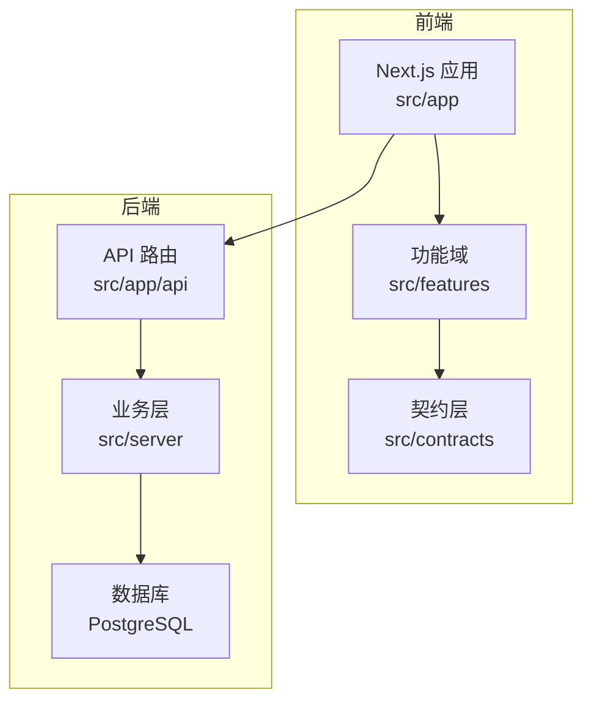
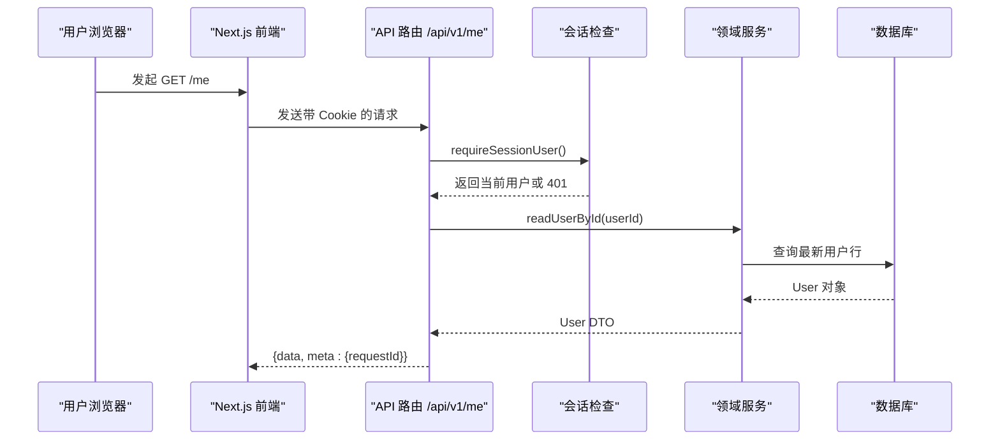
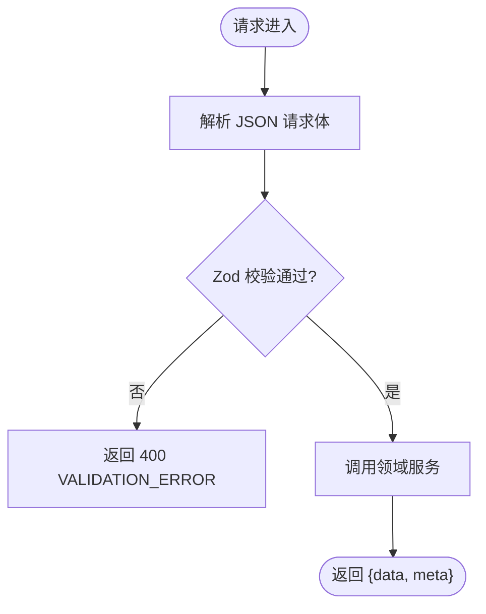
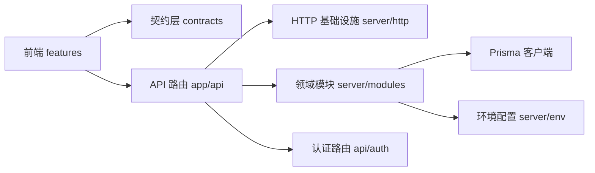

# 整体架构概览

<cite>
**本文引用的文件**
- [package.json](file://package.json)
- [next.config.ts](file://next.config.ts)
- [src/app/layout.tsx](file://src/app/layout.tsx)
- [contracts/openapi.json](file://contracts/openapi.json)
- [prisma/schema.prisma](file://prisma/schema.prisma)
- [src/contracts/index.ts](file://src/contracts/index.ts)
- [src/contracts/dto.ts](file://src/contracts/dto.ts)
- [docs/05-API-CONTRACT.md](file://docs/05-API-CONTRACT.md)
- [docs/04-DATA-MODEL.md](file://docs/04-DATA-MODEL.md)
- [src/features/README.md](file://src/features/README.md)
- [src/server/README.md](file://src/server/README.md)
- [src/app/api/v1/me/route.ts](file://src/app/api/v1/me/route.ts)
- [src/app/api/auth/[...all]/route.ts](file://src/app/api/auth/[...all]/route.ts)
- [src/server/env.ts](file://src/server/env.ts)
- [src/server/modules/project/index.ts](file://src/server/modules/project/index.ts)
</cite>

## 目录
1. [简介](#简介)
2. [项目结构](#项目结构)
3. [核心组件](#核心组件)
4. [架构总览](#架构总览)
5. [详细组件分析](#详细组件分析)
6. [依赖关系分析](#依赖关系分析)
7. [性能考量](#性能考量)
8. [故障排查指南](#故障排查指南)
9. [结论](#结论)
10. [附录](#附录)

## 简介
本概览面向 Orbit 项目的工程基线（M0）与后续里程碑演进方向，聚焦以下目标：
- 技术栈选择：Next.js 16 + React 19 + TypeScript，配合 Prisma 7、Better Auth、Zod、Tailwind CSS。
- 分层架构：明确前端功能层（features）、共享契约层（contracts）、服务端业务层（server）、API 路由层（app/api）的职责边界。
- 前后端分离与契约驱动：以 OpenAPI 为唯一契约，运行时通过 Zod DTO 校验，确保前后端类型一致、错误统一。
- 数据流向：从用户界面到数据库的完整路径，包括会话、授权、领域服务、持久化与响应信封。
- 可视化：提供系统架构图与模块依赖图，帮助快速理解设计思路。

## 项目结构
Orbit 采用“按职责分层 + 按领域模块化”的组织方式：
- src/app：Next.js App Router 页面与 API 路由。页面负责 UI 布局与导航；API 路由负责 HTTP 编排（请求 ID、Origin、会话、校验、调用领域服务、返回信封）。
- src/features：前端功能域（auth、projects、tasks、board、today、settings 等），包含组件、hooks、局部状态与查询逻辑。
- src/contracts：前后端共享的契约层，包含 OpenAPI 映射的 Zod schemas、DTO、错误码、辅助函数与客户端骨架；无服务端依赖，可安全进入客户端 bundle。
- src/server：服务端专用业务层，受 server-only 保护，包含环境配置、认证、HTTP 基础设施、领域模块（project/task 等）、权限与幂等。
- prisma：数据库模型与迁移，定义认证表与业务表（Project/Task/ActivityLog/IdempotencyRecord 等）。
- contracts/openapi.json：V1 业务 API 契约，作为机器可读的接口规范。
- docs：架构与设计文档，如数据模型、API 契约、决策与风险等。

图表来源
- [src/app/layout.tsx:1-21](file://src/app/layout.tsx#L1-L21)
- [src/features/README.md:1-8](file://src/features/README.md#L1-L8)
- [src/server/README.md:1-17](file://src/server/README.md#L1-L17)
- [contracts/openapi.json:1-200](file://contracts/openapi.json#L1-L200)

章节来源
- [package.json:1-76](file://package.json#L1-L76)
- [next.config.ts:1-21](file://next.config.ts#L1-L21)
- [src/app/layout.tsx:1-21](file://src/app/layout.tsx#L1-L21)
- [src/features/README.md:1-8](file://src/features/README.md#L1-L8)
- [src/server/README.md:1-17](file://src/server/README.md#L1-L17)
- [contracts/openapi.json:1-200](file://contracts/openapi.json#L1-L200)

## 核心组件
- 契约层（contracts）：集中管理 OpenAPI 映射的 Zod schemas、DTO、错误码与辅助函数，保证前后端类型一致，且仅暴露白名单字段，避免敏感信息泄露。
- 前端功能层（features）：按领域组织 UI 与交互逻辑，使用 TanStack Query 进行数据获取与缓存，query key 包含 userId 与过滤条件。
- 服务端业务层（server）：封装数据库访问、认证与会话、授权、幂等、活动日志、分页等能力；领域模块（project/task 等）在 modules 下按职责拆分。
- API 路由层（app/api）：处理 HTTP 生命周期（请求 ID、Origin、会话、请求体校验、领域服务调用、统一信封响应），不承载业务规则。
- 数据模型（Prisma）：定义认证表与业务表（Project、Task、ActivityLog、IdempotencyRecord 等），约束与索引在迁移中维护。

章节来源
- [src/contracts/index.ts:1-18](file://src/contracts/index.ts#L1-L18)
- [src/contracts/dto.ts:1-200](file://src/contracts/dto.ts#L1-L200)
- [src/server/modules/project/index.ts:1-24](file://src/server/modules/project/index.ts#L1-L24)
- [src/app/api/v1/me/route.ts:1-91](file://src/app/api/v1/me/route.ts#L1-L91)
- [prisma/schema.prisma:1-268](file://prisma/schema.prisma#L1-L268)

## 架构总览
Orbit 采用分层架构与契约驱动开发：
- 前端：Next.js 应用壳 + 功能域组件，通过契约层生成的类型与校验与后端保持一致。
- 后端：API 路由负责 HTTP 编排，领域服务实现业务不变量与授权，Prisma 负责数据持久化。
- 契约：OpenAPI 定义接口语义与错误码；Zod DTO 用于运行时校验；测试覆盖契约一致性。

图表来源
- [src/app/api/v1/me/route.ts:1-91](file://src/app/api/v1/me/route.ts#L1-L91)
- [src/server/auth/session.ts:1-200](file://src/server/auth/session.ts#L1-L200)
- [src/server/me/read-user.ts:1-200](file://src/server/me/read-user.ts#L1-L200)

章节来源
- [docs/05-API-CONTRACT.md:1-133](file://docs/05-API-CONTRACT.md#L1-L133)
- [docs/04-DATA-MODEL.md:1-134](file://docs/04-DATA-MODEL.md#L1-L134)

## 详细组件分析

### 契约层（contracts）
- 职责：将 OpenAPI 契约映射为 Zod schemas 与 DTO，导出统一的类型与校验工具；不包含服务端依赖，可在客户端与服务端共享。
- 关键点：严格对齐 openapi.json 的字段名、类型与约束；additionalProperties:false 对应 Zod strict；错误码与信封结构统一。
- 典型用法：API 路由使用 parseRequestBody(UpdateMeSchema, body) 进行请求体验证；前端使用相同 schema 做表单校验与类型推断。

图表来源
- [src/contracts/dto.ts:1-200](file://src/contracts/dto.ts#L1-L200)
- [src/app/api/v1/me/route.ts:1-91](file://src/app/api/v1/me/route.ts#L1-L91)

章节来源
- [src/contracts/index.ts:1-18](file://src/contracts/index.ts#L1-L18)
- [src/contracts/dto.ts:1-200](file://src/contracts/dto.ts#L1-L200)
- [contracts/openapi.json:1-200](file://contracts/openapi.json#L1-L200)

### 前端功能层（features）
- 职责：按领域组织 UI 与交互逻辑，包含组件、hooks、局部状态与查询逻辑；遵循 docs/03 §6 的 query key 约定（含 userId 与过滤条件）。
- 示例：AppShell 提供响应式外壳与导航，区分真实数据页与样例页，展示当前用户信息与设置入口。

章节来源
- [src/features/README.md:1-8](file://src/features/README.md#L1-L8)
- [src/features/shell/app-shell.tsx:1-389](file://src/features/shell/app-shell.tsx#L1-L389)

### 服务端业务层（server）
- 职责：封装数据库、认证、授权、幂等、活动、分页等基础设施；领域模块（project/task 等）按职责拆分，对外暴露统一入口。
- 关键点：server-only 保护，禁止进入客户端 bundle；环境配置在启动期校验；HTTP 层统一错误映射与 Origin 验证。

章节来源
- [src/server/README.md:1-17](file://src/server/README.md#L1-L17)
- [src/server/env.ts:1-238](file://src/server/env.ts#L1-L238)
- [src/server/modules/project/index.ts:1-24](file://src/server/modules/project/index.ts#L1-L24)

### API 路由层（app/api）
- 职责：HTTP 编排，生命周期包括请求 ID、Origin、会话、请求体验证、领域服务调用、统一信封响应；不承载业务规则。
- 示例：/api/v1/me 的 GET/PATCH 分别读取与更新当前用户档案，遵循 OpenAPI 契约与错误码约定。

章节来源
- [src/app/api/v1/me/route.ts:1-91](file://src/app/api/v1/me/route.ts#L1-L91)
- [docs/05-API-CONTRACT.md:1-133](file://docs/05-API-CONTRACT.md#L1-L133)

### 认证集成（Better Auth）
- 职责：挂载 Better Auth 全路由至 /api/auth/*，由库处理 CSRF、trustedOrigins 与回调；不与自制的 Origin 层叠加，避免破坏认证流程。
- 关键点：runtime=nodejs，生产可用；认证路由独立于 /app/* 的会话门禁。

章节来源
- [src/app/api/auth/[...all]/route.ts:1-22](file://src/app/api/auth/[...all]/route.ts#L1-L22)

### 数据模型（Prisma）
- 职责：定义认证表与业务表（Project、Task、ActivityLog、IdempotencyRecord 等），约束与索引在迁移中维护；业务规则（CHECK、排序、版本控制）在迁移 SQL 中表达。
- 关键点：User.timezone 为业务扩展；Project/Task 的 version/boardVersion 用于乐观锁与看板一致性；软删除与活动记录保障审计与恢复。

章节来源
- [prisma/schema.prisma:1-268](file://prisma/schema.prisma#L1-L268)
- [docs/04-DATA-MODEL.md:1-134](file://docs/04-DATA-MODEL.md#L1-L134)

## 依赖关系分析
- 前端依赖契约层（contracts）的类型与校验，确保与后端一致。
- API 路由依赖 server/http 基础设施（错误映射、Origin、请求 ID）与领域服务（project/task 等）。
- 领域服务依赖 Prisma 客户端与环境配置（env.ts），并遵循数据模型约束。
- 认证路由由 Better Auth 管理，独立于业务 API。

图表来源
- [src/contracts/index.ts:1-18](file://src/contracts/index.ts#L1-L18)
- [src/app/api/v1/me/route.ts:1-91](file://src/app/api/v1/me/route.ts#L1-L91)
- [src/server/modules/project/index.ts:1-24](file://src/server/modules/project/index.ts#L1-L24)
- [src/server/env.ts:1-238](file://src/server/env.ts#L1-L238)
- [src/app/api/auth/[...all]/route.ts:1-22](file://src/app/api/auth/[...all]/route.ts#L1-L22)

章节来源
- [package.json:1-76](file://package.json#L1-L76)
- [next.config.ts:1-21](file://next.config.ts#L1-L21)

## 性能考量
- 构建与运行：Next.js 配置关闭 poweredByHeader，外部化 pg 驱动以避免客户端打包问题；允许本地回环主机访问 dev server，便于 Playwright 测试。
- 数据访问：列表采用游标分页，默认 30/上限 100；看板读取使用一致快照（短只读事务）避免跨请求不一致。
- 并发与幂等：需要幂等的创建/恢复操作使用 Idempotency-Key；服务端保存规范化请求哈希与响应，24 小时有效；同 key 同内容重放，不同内容返回冲突。
- 资源限制：请求体大小限制、附件上传大小与超时、配额检查在项目锁内完成，防止越界写入。

章节来源
- [next.config.ts:1-21](file://next.config.ts#L1-L21)
- [docs/05-API-CONTRACT.md:1-133](file://docs/05-API-CONTRACT.md#L1-L133)
- [docs/04-DATA-MODEL.md:1-134](file://docs/04-DATA-MODEL.md#L1-L134)

## 故障排查指南
- 环境变量校验失败：启动期抛出 EnvValidationError，仅显示变量名与预期格式，不回显值；检查 DATABASE_URL、BETTER_AUTH_SECRET、AUTH_TRUSTED_ORIGINS 等。
- 认证相关错误：401 UNAUTHENTICATED 表示未登录；403 FORBIDDEN/EMAIL_UNVERIFIED/ORIGIN_NOT_ALLOWED 表示权限或来源限制；检查会话与 Origin 配置。
- 契约校验错误：400 VALIDATION_ERROR/INVALID_CURSOR 表示输入或游标非法；检查 Zod schema 与 OpenAPI 一致性。
- 版本冲突：409 VERSION_CONFLICT/BOARD_CONFLICT 表示乐观锁冲突；客户端应重新获取并合并草稿。
- 幂等冲突：409 IDEMPOTENCY_CONFLICT 表示请求键与内容不匹配；检查 Idempotency-Key 与请求体。

章节来源
- [src/server/env.ts:1-238](file://src/server/env.ts#L1-L238)
- [docs/05-API-CONTRACT.md:1-133](file://docs/05-API-CONTRACT.md#L1-L133)

## 结论
Orbit 以 Next.js 16 + React 19 + TypeScript 为基础，结合 Prisma 7 与 Better Auth，构建了清晰的分层架构与契约驱动开发模式。通过 contracts 层统一前后端类型与校验，server 层封装业务不变量与基础设施，API 路由专注 HTTP 编排，形成高内聚、低耦合的系统。数据流从前端到数据库路径明确，错误与状态统一，便于扩展与维护。

## 附录
- 技术栈清单：Next.js 16、React 19、TypeScript、Prisma 7、Better Auth、Zod、Tailwind CSS、PostgreSQL。
- 关键目录职责：
  - src/app：页面与 API 路由
  - src/features：前端功能域
  - src/contracts：契约层（schemas/DTO/错误码）
  - src/server：服务端业务层（认证、HTTP、领域模块）
  - prisma：数据模型与迁移
  - contracts/openapi.json：V1 业务 API 契约
  - docs：架构与设计文档