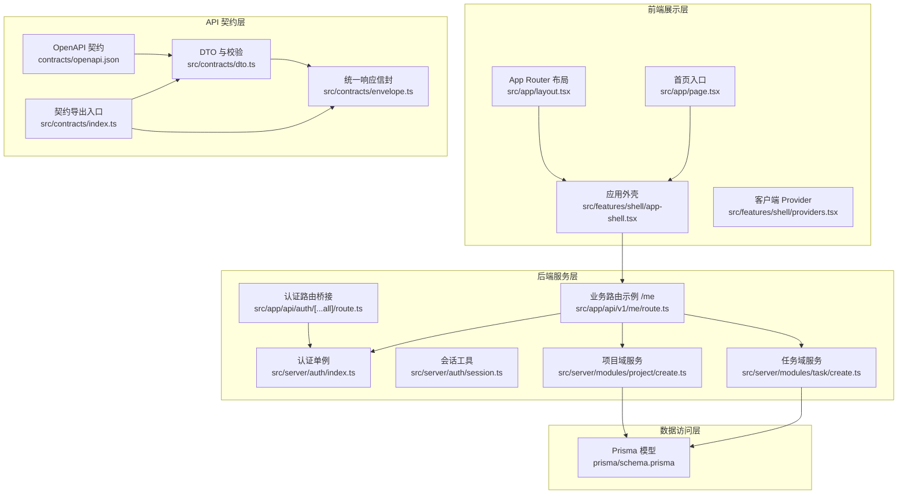
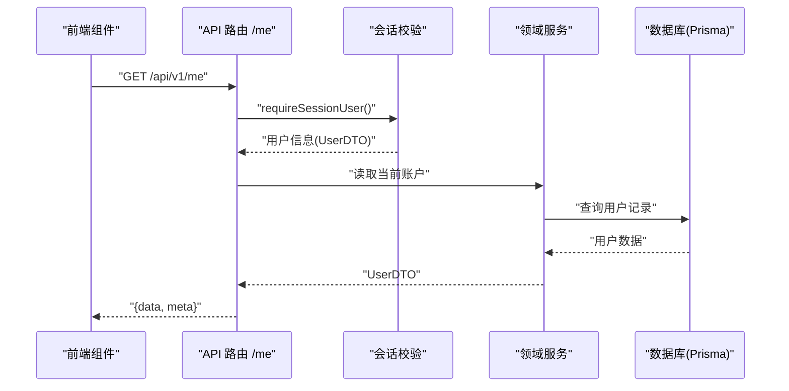
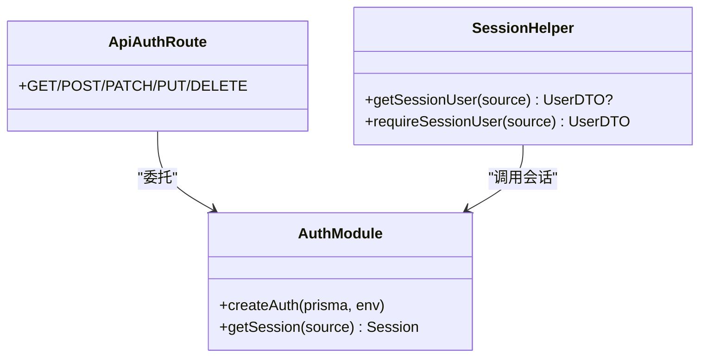
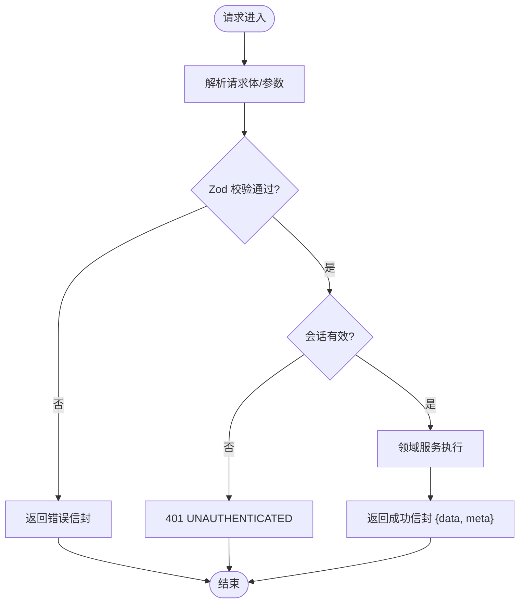
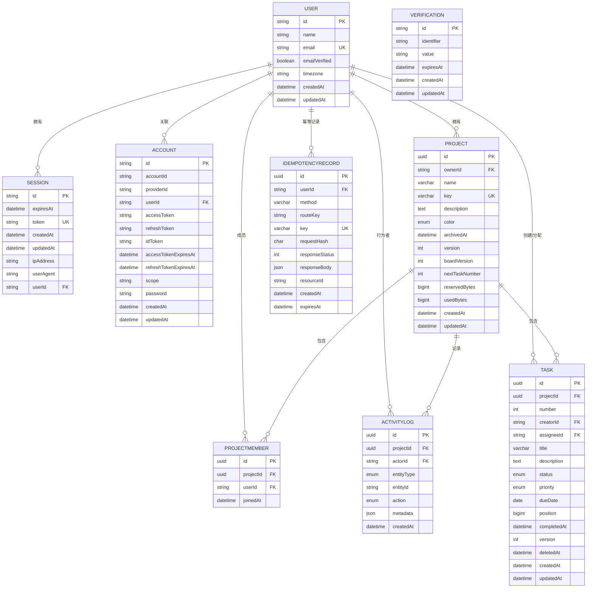
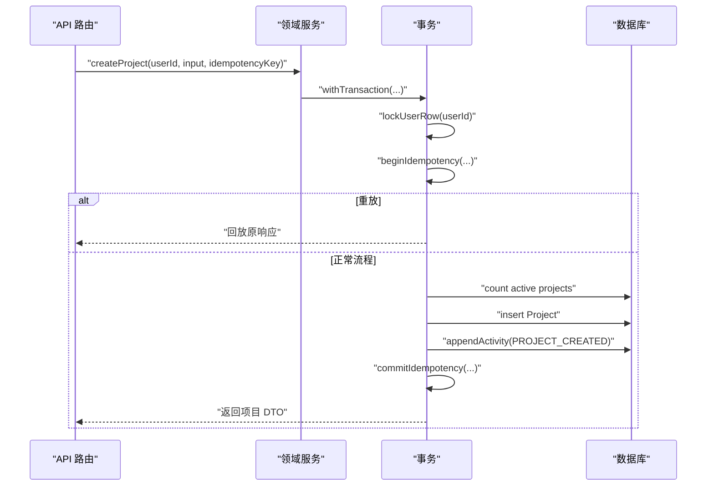
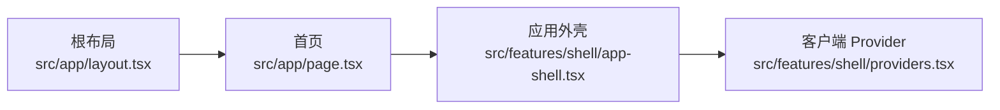
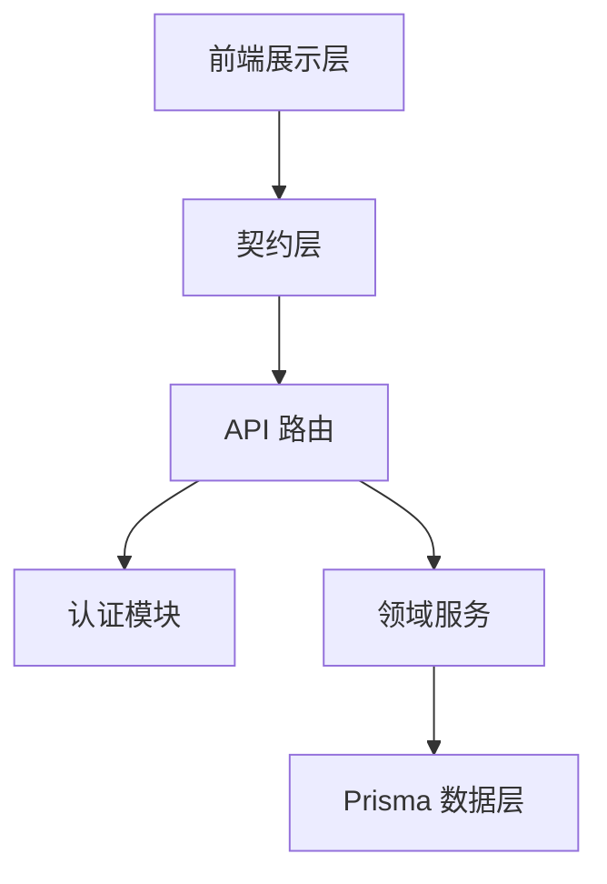

# 架构设计

<cite>
**本文引用的文件**
- [prisma/schema.prisma](file://prisma/schema.prisma)
- [src/app/layout.tsx](file://src/app/layout.tsx)
- [src/app/page.tsx](file://src/app/page.tsx)
- [contracts/openapi.json](file://contracts/openapi.json)
- [src/contracts/index.ts](file://src/contracts/index.ts)
- [src/contracts/dto.ts](file://src/contracts/dto.ts)
- [src/contracts/envelope.ts](file://src/contracts/envelope.ts)
- [src/server/auth/index.ts](file://src/server/auth/index.ts)
- [src/server/auth/session.ts](file://src/server/auth/session.ts)
- [src/app/api/auth/[...all]/route.ts](file://src/app/api/auth/[...all]/route.ts)
- [src/app/api/v1/me/route.ts](file://src/app/api/v1/me/route.ts)
- [src/features/shell/providers.tsx](file://src/features/shell/providers.tsx)
- [src/features/shell/app-shell.tsx](file://src/features/shell/app-shell.tsx)
- [src/server/modules/project/create.ts](file://src/server/modules/project/create.ts)
- [src/server/modules/task/create.ts](file://src/server/modules/task/create.ts)
</cite>

## 目录
1. [简介](#简介)
2. [项目结构](#项目结构)
3. [核心组件](#核心组件)
4. [架构总览](#架构总览)
5. [详细组件分析](#详细组件分析)
6. [依赖关系分析](#依赖关系分析)
7. [性能考量](#性能考量)
8. [故障排查指南](#故障排查指南)
9. [结论](#结论)
10. [附录](#附录)

## 简介
本架构设计文档面向 Orbit 项目的分层架构与前后端协作方式，覆盖展示层、业务逻辑层、数据访问层的职责划分；Next.js App Router 路由组织；API 契约与信封规范；数据库模型与 Prisma ORM 使用；认证授权与会话管理；以及权限控制机制。文档通过架构图与流程图帮助开发者快速理解系统设计与技术决策。

## 项目结构
Orbit 采用 Next.js App Router 作为前端与 API 的统一入口，结合 features 模块化组织 UI，server 模块承载服务端领域逻辑，contracts 提供前后端共享的契约（Zod Schema、DTO、错误码、信封），Prisma 负责数据模型与迁移。

图表来源
- [src/app/layout.tsx:1-21](file://src/app/layout.tsx#L1-L21)
- [src/app/page.tsx:1-101](file://src/app/page.tsx#L1-L101)
- [src/features/shell/app-shell.tsx:1-389](file://src/features/shell/app-shell.tsx#L1-L389)
- [src/features/shell/providers.tsx:1-20](file://src/features/shell/providers.tsx#L1-L20)
- [contracts/openapi.json:1-800](file://contracts/openapi.json#L1-L800)
- [src/contracts/index.ts:1-18](file://src/contracts/index.ts#L1-L18)
- [src/contracts/dto.ts:1-476](file://src/contracts/dto.ts#L1-L476)
- [src/contracts/envelope.ts:1-94](file://src/contracts/envelope.ts#L1-L94)
- [src/server/auth/index.ts:1-29](file://src/server/auth/index.ts#L1-L29)
- [src/server/auth/session.ts:1-43](file://src/server/auth/session.ts#L1-L43)
- [src/app/api/auth/[...all]/route.ts:1-22](file://src/app/api/auth/[...all]/route.ts#L1-L22)
- [src/app/api/v1/me/route.ts:1-91](file://src/app/api/v1/me/route.ts#L1-L91)
- [src/server/modules/project/create.ts:1-181](file://src/server/modules/project/create.ts#L1-L181)
- [src/server/modules/task/create.ts:1-202](file://src/server/modules/task/create.ts#L1-L202)
- [prisma/schema.prisma:1-268](file://prisma/schema.prisma#L1-L268)

章节来源
- [src/app/layout.tsx:1-21](file://src/app/layout.tsx#L1-L21)
- [src/app/page.tsx:1-101](file://src/app/page.tsx#L1-L101)
- [src/features/shell/app-shell.tsx:1-389](file://src/features/shell/app-shell.tsx#L1-L389)
- [src/features/shell/providers.tsx:1-20](file://src/features/shell/providers.tsx#L1-L20)
- [contracts/openapi.json:1-800](file://contracts/openapi.json#L1-L800)
- [src/contracts/index.ts:1-18](file://src/contracts/index.ts#L1-L18)
- [src/contracts/dto.ts:1-476](file://src/contracts/dto.ts#L1-L476)
- [src/contracts/envelope.ts:1-94](file://src/contracts/envelope.ts#L1-L94)
- [src/server/auth/index.ts:1-29](file://src/server/auth/index.ts#L1-L29)
- [src/server/auth/session.ts:1-43](file://src/server/auth/session.ts#L1-L43)
- [src/app/api/auth/[...all]/route.ts:1-22](file://src/app/api/auth/[...all]/route.ts#L1-L22)
- [src/app/api/v1/me/route.ts:1-91](file://src/app/api/v1/me/route.ts#L1-L91)
- [src/server/modules/project/create.ts:1-181](file://src/server/modules/project/create.ts#L1-L181)
- [src/server/modules/task/create.ts:1-202](file://src/server/modules/task/create.ts#L1-L202)
- [prisma/schema.prisma:1-268](file://prisma/schema.prisma#L1-L268)

## 核心组件
- 展示层：Next.js App Router 根布局与页面、应用外壳与客户端 Provider，负责渲染、导航与上下文装配。
- 契约层：OpenAPI 契约与 Zod DTO、统一信封，确保前后端一致的数据结构与错误格式。
- 服务层：Better Auth 认证集成、会话校验、领域服务（项目/任务等）实现业务规则、幂等与活动日志。
- 数据层：Prisma 模型定义与迁移，封装数据库访问与事务。

章节来源
- [src/features/shell/app-shell.tsx:1-389](file://src/features/shell/app-shell.tsx#L1-L389)
- [src/features/shell/providers.tsx:1-20](file://src/features/shell/providers.tsx#L1-L20)
- [contracts/openapi.json:1-800](file://contracts/openapi.json#L1-L800)
- [src/contracts/dto.ts:1-476](file://src/contracts/dto.ts#L1-L476)
- [src/contracts/envelope.ts:1-94](file://src/contracts/envelope.ts#L1-L94)
- [src/server/auth/index.ts:1-29](file://src/server/auth/index.ts#L1-L29)
- [src/server/auth/session.ts:1-43](file://src/server/auth/session.ts#L1-L43)
- [src/server/modules/project/create.ts:1-181](file://src/server/modules/project/create.ts#L1-L181)
- [src/server/modules/task/create.ts:1-202](file://src/server/modules/task/create.ts#L1-L202)
- [prisma/schema.prisma:1-268](file://prisma/schema.prisma#L1-L268)

## 架构总览
系统采用分层架构：
- 展示层：Next.js 页面与组件，消费 UI 组件库与状态上下文。
- 契约层：OpenAPI + Zod 驱动的类型安全契约，贯穿前后端。
- 服务层：路由处理请求生命周期（请求 ID、同源校验、会话、校验、领域服务、信封）。
- 数据层：Prisma 模型与事务，保证一致性。

图表来源
- [src/app/api/v1/me/route.ts:1-91](file://src/app/api/v1/me/route.ts#L1-L91)
- [src/server/auth/session.ts:1-43](file://src/server/auth/session.ts#L1-L43)
- [src/contracts/envelope.ts:1-94](file://src/contracts/envelope.ts#L1-L94)

## 详细组件分析

### 认证与会话管理
- Better Auth 单例绑定 Prisma 与已校验环境，提供会话能力。
- 认证路由通过 toNextJsHandler 挂载到 /api/auth/*，由库内置 CSRF 与可信源控制。
- 会话工具提供 getSessionUser 与 requireSessionUser，返回契约层 UserDTO，避免泄露敏感字段。

图表来源
- [src/server/auth/index.ts:1-29](file://src/server/auth/index.ts#L1-L29)
- [src/server/auth/session.ts:1-43](file://src/server/auth/session.ts#L1-L43)
- [src/app/api/auth/[...all]/route.ts:1-22](file://src/app/api/auth/[...all]/route.ts#L1-L22)

章节来源
- [src/server/auth/index.ts:1-29](file://src/server/auth/index.ts#L1-L29)
- [src/server/auth/session.ts:1-43](file://src/server/auth/session.ts#L1-L43)
- [src/app/api/auth/[...all]/route.ts:1-22](file://src/app/api/auth/[...all]/route.ts#L1-L22)

### API 契约与数据流
- OpenAPI 定义 V1 业务 API，包含 Account、Projects、Tasks 等标签与路径。
- 契约层以 Zod 严格模式映射 DTO，禁止额外字段，保障安全与一致性。
- 统一信封规范成功与错误响应，meta 携带 requestId，列表支持游标分页。

图表来源
- [contracts/openapi.json:1-800](file://contracts/openapi.json#L1-L800)
- [src/contracts/dto.ts:1-476](file://src/contracts/dto.ts#L1-L476)
- [src/contracts/envelope.ts:1-94](file://src/contracts/envelope.ts#L1-L94)
- [src/app/api/v1/me/route.ts:1-91](file://src/app/api/v1/me/route.ts#L1-L91)

章节来源
- [contracts/openapi.json:1-800](file://contracts/openapi.json#L1-L800)
- [src/contracts/dto.ts:1-476](file://src/contracts/dto.ts#L1-L476)
- [src/contracts/envelope.ts:1-94](file://src/contracts/envelope.ts#L1-L94)
- [src/app/api/v1/me/route.ts:1-91](file://src/app/api/v1/me/route.ts#L1-L91)

### 数据库模型与实体关系
- 认证模型：User、Session、Account、Verification，遵循 Better Auth 1.7.3 约定。
- 项目域：Project、ProjectMember、ActivityLog、IdempotencyRecord，含枚举 ProjectColor、ActivityEntityType、ActivityAction。
- 任务域：Task，含枚举 TaskStatus、TaskPriority，软删除与版本控制。

图表来源
- [prisma/schema.prisma:1-268](file://prisma/schema.prisma#L1-L268)

章节来源
- [prisma/schema.prisma:1-268](file://prisma/schema.prisma#L1-L268)

### 项目与任务领域服务
- 项目创建：在事务中串行化配额与幂等，校验 key 唯一性，写入活动日志，返回 DTO。
- 任务创建：锁项目行，复核成员与归档态，配额计数，生成编号与位置，插入任务并更新看板版本，写入活动日志。

图表来源
- [src/server/modules/project/create.ts:1-181](file://src/server/modules/project/create.ts#L1-L181)

章节来源
- [src/server/modules/project/create.ts:1-181](file://src/server/modules/project/create.ts#L1-L181)
- [src/server/modules/task/create.ts:1-202](file://src/server/modules/task/create.ts#L1-L202)

### 前端展示层与路由组织
- 根布局设置元信息与最小外壳。
- 首页提供开发样例入口，链接至工作台、看板、任务详情等。
- 应用外壳提供响应式侧栏、顶栏与内容区，区分真实数据页与样例横幅。
- 客户端 Provider 组合 Tooltip 与 Toast 上下文。

图表来源
- [src/app/layout.tsx:1-21](file://src/app/layout.tsx#L1-L21)
- [src/app/page.tsx:1-101](file://src/app/page.tsx#L1-L101)
- [src/features/shell/app-shell.tsx:1-389](file://src/features/shell/app-shell.tsx#L1-L389)
- [src/features/shell/providers.tsx:1-20](file://src/features/shell/providers.tsx#L1-L20)

章节来源
- [src/app/layout.tsx:1-21](file://src/app/layout.tsx#L1-L21)
- [src/app/page.tsx:1-101](file://src/app/page.tsx#L1-L101)
- [src/features/shell/app-shell.tsx:1-389](file://src/features/shell/app-shell.tsx#L1-L389)
- [src/features/shell/providers.tsx:1-20](file://src/features/shell/providers.tsx#L1-L20)

## 依赖关系分析
- 展示层依赖契约层类型与 UI 组件，不直接访问数据库。
- 服务层依赖契约层 DTO 与信封，使用 Prisma 进行数据访问。
- 认证模块独立于业务路由，通过会话工具注入用户上下文。
- 领域服务之间通过事务与锁协调，避免并发冲突。

图表来源
- [src/contracts/index.ts:1-18](file://src/contracts/index.ts#L1-L18)
- [src/app/api/v1/me/route.ts:1-91](file://src/app/api/v1/me/route.ts#L1-L91)
- [src/server/auth/index.ts:1-29](file://src/server/auth/index.ts#L1-L29)
- [src/server/modules/project/create.ts:1-181](file://src/server/modules/project/create.ts#L1-L181)
- [src/server/modules/task/create.ts:1-202](file://src/server/modules/task/create.ts#L1-L202)

章节来源
- [src/contracts/index.ts:1-18](file://src/contracts/index.ts#L1-L18)
- [src/app/api/v1/me/route.ts:1-91](file://src/app/api/v1/me/route.ts#L1-L91)
- [src/server/auth/index.ts:1-29](file://src/server/auth/index.ts#L1-L29)
- [src/server/modules/project/create.ts:1-181](file://src/server/modules/project/create.ts#L1-L181)
- [src/server/modules/task/create.ts:1-202](file://src/server/modules/task/create.ts#L1-L202)

## 性能考量
- 使用游标分页减少大数据集传输压力。
- 幂等键与事务内锁避免重复写入与竞态条件。
- 视图层按需加载与骨架屏提升首屏体验。
- 数据库索引优化查询（如项目成员、任务列表排序与过滤）。

[本节为通用指导，无需特定文件引用]

## 故障排查指南
- 未认证访问：检查会话是否有效，确认 requireSessionUser 抛出 UNAUTHENTICATED。
- 请求体重载：核对 Zod 校验失败时的 fieldErrors，确保请求体符合 DTO 约束。
- 幂等冲突：关注 IdempotencyRecord 唯一键冲突，必要时重试或调整请求哈希。
- 权限不足：确认项目成员关系与归档状态，复核 requireWritableTaskProject 逻辑。

章节来源
- [src/server/auth/session.ts:1-43](file://src/server/auth/session.ts#L1-L43)
- [src/contracts/dto.ts:1-476](file://src/contracts/dto.ts#L1-L476)
- [src/server/modules/project/create.ts:1-181](file://src/server/modules/project/create.ts#L1-L181)
- [src/server/modules/task/create.ts:1-202](file://src/server/modules/task/create.ts#L1-L202)

## 结论
Orbit 通过分层架构清晰分离展示、契约、服务与数据层，借助 Next.js App Router 与 Better Auth 构建可扩展的前后端协作体系。OpenAPI 与 Zod 驱动的契约确保类型安全与一致性，Prisma 模型与事务保障数据完整性。认证与会话管理、权限控制与幂等机制共同提升了系统的可靠性与可维护性。

[本节为总结性内容，无需特定文件引用]

## 附录
- 环境变量与服务启动期校验在服务端完成，错误仅报告变量名与预期格式。
- 开发环境提供样例横幅与状态切换，便于验证 UI 各态。

[本节为补充说明，无需特定文件引用]