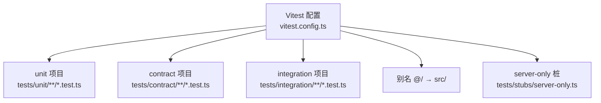
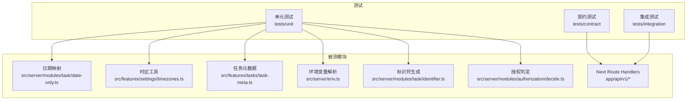
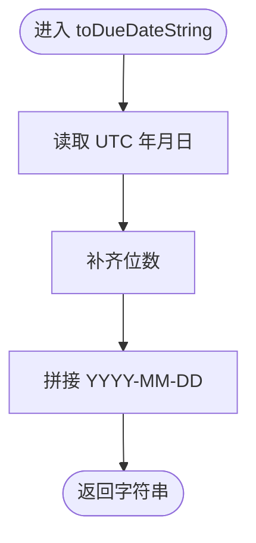
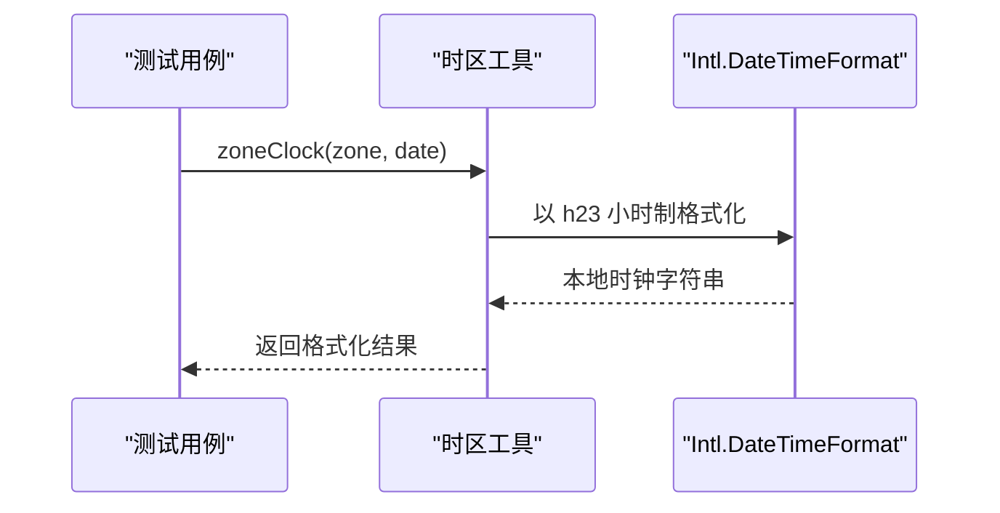
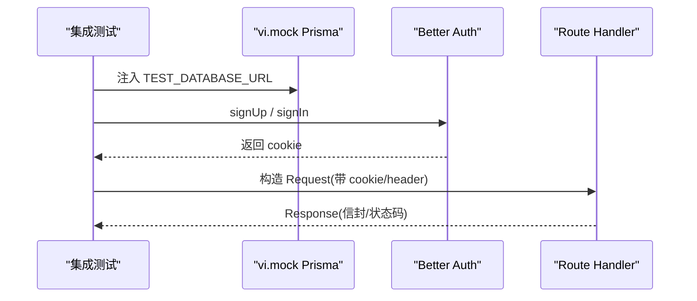
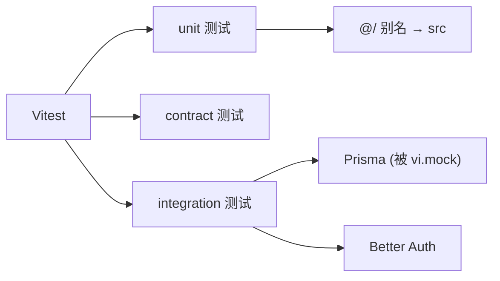

# 单元测试

<cite>
**本文引用的文件**
- [vitest.config.ts](file://vitest.config.ts)
- [package.json](file://package.json)
- [server-only.ts](file://tests/stubs/server-only.ts)
- [date-only.test.ts](file://tests/unit/date-only.test.ts)
- [timezone.test.ts](file://tests/unit/timezone.test.ts)
- [task-meta.test.ts](file://tests/unit/task-meta.test.ts)
- [env.test.ts](file://tests/unit/env.test.ts)
- [identifier.test.ts](file://tests/unit/identifier.test.ts)
- [project-access.test.ts](file://tests/unit/project-access.test.ts)
- [datetime.ts](file://src/features/tasks/real/datetime.ts)
- [date-only.ts](file://src/server/modules/task/date-only.ts)
- [task.test.ts](file://tests/integration/task.test.ts)
- [helpers.test.ts](file://tests/contract/helpers.test.ts)
</cite>

## 目录
1. [简介](#简介)
2. [项目结构](#项目结构)
3. [核心组件](#核心组件)
4. [架构总览](#架构总览)
5. [详细组件分析](#详细组件分析)
6. [依赖分析](#依赖分析)
7. [性能考虑](#性能考虑)
8. [故障排查指南](#故障排查指南)
9. [结论](#结论)
10. [附录](#附录)

## 简介
本文件为 Orbit 项目的单元测试文档，聚焦 Vitest 框架的配置与使用、测试环境设置、别名与 server-only 桩处理、测试组织规范、纯函数/工具类/无状态组件的测试方法（含模拟依赖、异步与错误处理），并给出日期处理、时区转换、任务元数据等核心功能的测试示例。同时提供覆盖率报告生成与性能优化建议。

## 项目结构
- 测试按职责划分为三类：
  - 单元测试：tests/unit，运行在 Node 环境，覆盖纯函数、工具模块、授权判定、标识符生成、环境变量解析等。
  - 契约测试：tests/contract，校验请求/响应信封、参数解析、错误构造等。
  - 集成测试：tests/integration，直连真实 PostgreSQL，调用 Next.js Route Handler，验证端到端业务流。
- E2E 走 Playwright，不在 Vitest 范围内。

图表来源
- [vitest.config.ts:14-23](file://vitest.config.ts#L14-L23)
- [vitest.config.ts:24-55](file://vitest.config.ts#L24-L55)

章节来源
- [vitest.config.ts:1-58](file://vitest.config.ts#L1-L58)
- [package.json:12-27](file://package.json#L12-L27)

## 核心组件
- Vitest 多项目配置
  - unit：Node 环境，匹配 tests/unit 下的 .test.ts。
  - contract：Node 环境，匹配 tests/contract 下的 .test.ts。
  - integration：Node 环境，匹配 tests/integration 下的 .test.ts；为控制数据库连接池压力，关闭文件级并行（fileParallelism: false）。
- 别名与桩
  - @/ 指向 src/，便于统一导入。
  - server-only 在 Vitest 中替换为空桩，避免非 React Server 环境下抛错；Next 构建仍保持边界保护。
- 脚本命令
  - pnpm test:unit / test:integration / test:contract 分别运行对应项目。

章节来源
- [vitest.config.ts:14-55](file://vitest.config.ts#L14-L55)
- [package.json:12-27](file://package.json#L12-L27)
- [server-only.ts:1-5](file://tests/stubs/server-only.ts#L1-L5)

## 架构总览
下图展示测试到被测代码的调用关系与关键路径：

图表来源
- [date-only.test.ts:1-94](file://tests/unit/date-only.test.ts#L1-L94)
- [timezone.test.ts:1-379](file://tests/unit/timezone.test.ts#L1-L379)
- [task-meta.test.ts:1-18](file://tests/unit/task-meta.test.ts#L1-L18)
- [env.test.ts:1-176](file://tests/unit/env.test.ts#L1-L176)
- [identifier.test.ts:1-51](file://tests/unit/identifier.test.ts#L1-L51)
- [project-access.test.ts:1-95](file://tests/unit/project-access.test.ts#L1-L95)
- [task.test.ts:1-200](file://tests/integration/task.test.ts#L1-L200)

## 详细组件分析

### 日期处理（date-only）
- 被测模块：src/server/modules/task/date-only.ts
  - toDueDateString：基于 UTC 将 Date 转为 YYYY-MM-DD。
  - fromDueDateString：将 YYYY-MM-DD 转为 UTC 午夜 Date，非法输入抛出 RangeError。
  - isValidDueDate：校验格式与日历合法性。
- 测试要点
  - 极端时区下往返一致（Asia/Shanghai、Pacific/Kiritimati、Pacific/Niue）。
  - 边界时间（UTC 午夜、23:59:59.999）不跨天。
  - 年份补零（公元 <1000 年）。
  - 非法输入抛出 RangeError。
- 模式与断言
  - 使用 afterEach 恢复 TZ，避免污染其他用例。
  - 使用 expect(...).toBe / toThrow(RangeError)。

图表来源
- [date-only.ts:29-35](file://src/server/modules/task/date-only.ts#L29-L35)

章节来源
- [date-only.test.ts:1-94](file://tests/unit/date-only.test.ts#L1-L94)
- [date-only.ts:1-48](file://src/server/modules/task/date-only.ts#L1-L48)

### 时区工具与显示
- 被测模块：src/features/settings/timezones.ts（客户端安全）、src/server/me/timezone.ts（服务端权威校验）
- 测试要点
  - 服务端 isValidTimezone 接受标准 IANA 标识，拒绝非法/注入/空串等。
  - 常用清单 COMMON_TIMEZONES 全部通过服务端校验。
  - 运行时完整 IANA 列表（Intl.supportedValuesOf）全部通过服务端校验。
  - 偏移计算 zoneOffsetMinutes 支持夏令时变化。
  - 标签格式化：offsetLabel、clock（h23 制）、dateLabel、dayProgress。
  - 选项构造 buildTimezoneOptions：常用项前置且顺序稳定，非常用字典序，id 唯一。
  - 搜索过滤 filterTimezoneOptions：中文/英文/大小写不敏感，精确命中优先，limit 截断。
  - deviceTimezone 返回合法 IANA 标识。
- 模式与断言
  - 固定瞬间 WINTER/SUMMER/NOON_UTC 保证可重复性。
  - 使用 toBe / toEqual / toContain / toBeCloseTo 等断言。

图表来源
- [timezone.test.ts:166-202](file://tests/unit/timezone.test.ts#L166-L202)

章节来源
- [timezone.test.ts:1-379](file://tests/unit/timezone.test.ts#L1-L379)

### 任务元数据（过期文案）
- 被测模块：src/features/tasks/task-meta.ts
- 测试要点
  - 已完成任务使用中性文案，不提示逾期或临近。
  - 未完成任务仍标记为逾期。
- 模式与断言
  - 直接调用 getDueMeta 并断言 label、overdue、tone。

章节来源
- [task-meta.test.ts:1-18](file://tests/unit/task-meta.test.ts#L1-L18)

### 环境变量解析与安全
- 被测模块：src/server/env.ts
- 测试要点
  - parseEnv 对必需字段、枚举、条件必填（AI_ENABLED）、生产密钥长度等进行校验。
  - TEST_DATABASE_URL 不得与开发库同名或指向生产库名。
  - findPublicSecretViolations 检测 NEXT_PUBLIC_* 中的秘密变量。
  - 错误信息不回显变量值（防泄露）。
- 模式与断言
  - 捕获 EnvValidationError，断言 issues[0].key、message 不含敏感值。

章节来源
- [env.test.ts:1-176](file://tests/unit/env.test.ts#L1-L176)

### 任务标识符与编号分配
- 被测模块：src/server/modules/task/identifier.ts
- 测试要点
  - formatIdentifier：拼装 projectKey-number。
  - nextTaskNumber：通过事务客户端 $queryRaw 的 RETURNING 获取 assigned，归一化 string/BigInt→number；项目不存在返回 NOT_FOUND。
- 模式与断言
  - 使用 stubTx 构造只返回固定行的 Prisma TransactionClient。
  - 使用 resolvers 断言 Promise 结果与异常类型。

章节来源
- [identifier.test.ts:1-51](file://tests/unit/identifier.test.ts#L1-L51)

### 授权判定（读/写）
- 被测模块：src/server/modules/authorization/decide.ts
- 测试要点
  - decideProjectAccess：不存在→NOT_FOUND；owner 优先于 member；非成员→NOT_FOUND。
  - decideProjectWrite：member 任意写→FORBIDDEN；owner 对归档项目仅 restore 允许；未归档 restore 幂等允许。
- 模式与断言
  - 穷举分支，断言返回角色/权限结果。

章节来源
- [project-access.test.ts:1-95](file://tests/unit/project-access.test.ts#L1-L95)

### 契约层帮助函数
- 被测模块：@/contracts（parseRequestBody、parseQueryParams、buildSuccessResponse、buildListResponse、buildErrorResponse）
- 测试要点
  - 成功/失败信封形状正确；requestId 默认占位；严格 schema 拒绝未知字段；消息长度限制。
- 模式与断言
  - 使用 safeParse 与具体字段断言。

章节来源
- [helpers.test.ts:1-133](file://tests/contract/helpers.test.ts#L1-L133)

### 集成测试（任务生命周期）
- 被测入口：Next.js Route Handlers（/api/v1/projects、/tasks/[taskId] 等）
- 测试要点
  - 动态 import route handler，绕过 HTTP 直接调用。
  - vi.mock("@/server/db/prisma") 注入绑定 TEST_DATABASE_URL 的 Prisma 客户端。
  - 认证夹具：signUpEmail + signIn，提取 cookie 用于后续请求。
  - 清理策略：按外键顺序删除子→父，确保隔离。
  - 场景覆盖：创建、编号递增、非成员 404、归档冲突、配额超限、assignee 非成员、版本冲突、状态流转、软删除/恢复、幂等重放等。
- 模式与断言
  - 构造 Request，调用路由处理器，断言 Response 状态码与信封结构。

图表来源
- [task.test.ts:46-75](file://tests/integration/task.test.ts#L46-L75)
- [task.test.ts:120-166](file://tests/integration/task.test.ts#L120-L166)

章节来源
- [task.test.ts:1-200](file://tests/integration/task.test.ts#L1-L200)

### 纯函数与无状态组件的测试实践
- 纯函数（如 datetime.formatDateTimeCN）可直接传入 ISO 字符串，断言本地化输出。
- 无状态组件/工具：以输入→输出为核心，关注边界与异常路径。
- 推荐做法
  - 固定输入（如固定 Date），避免依赖系统时间与时区。
  - 使用 describe/it 分组，beforeEach/afterEach 管理副作用（如 process.env.TZ）。
  - 对可能抛错的分支使用 toThrow 断言。

章节来源
- [datetime.ts:1-20](file://src/features/tasks/real/datetime.ts#L1-L20)

## 依赖分析
- 测试与源码耦合点
  - 单元测试通过 @/ 别名直接引入 src 下的纯函数与工具模块。
  - 集成测试通过动态 import 路由模块，绕过 HTTP，直接驱动业务编排。
- 外部依赖
  - Vitest 作为测试运行器。
  - Prisma 在集成测试中被 vi.mock 替换为测试数据库客户端。
  - Better Auth 用于签发会话 cookie。

图表来源
- [vitest.config.ts:14-23](file://vitest.config.ts#L14-L23)
- [task.test.ts:55-75](file://tests/integration/task.test.ts#L55-L75)

章节来源
- [vitest.config.ts:14-55](file://vitest.config.ts#L14-L55)
- [task.test.ts:55-75](file://tests/integration/task.test.ts#L55-L75)

## 性能考虑
- 集成测试并发控制
  - 关闭文件级并行（fileParallelism: false），避免多进程连接池叠加导致 PostgreSQL max_connections 溢出。
  - 单文件内仍可使用 Promise.all 并发，不影响内部并发度。
- 数据库连接池
  - 集成测试中为 PrismaPg 设置 max=15，并启用 statement_timeout/lock_timeout，降低锁等待风险。
- 测试隔离与清理
  - 每个运行使用 RUN_TAG 前缀，确保跨运行不冲突；按外键顺序清理数据。
- 别名与桩
  - server-only 桩避免不必要的运行时开销与错误。

章节来源
- [vitest.config.ts:42-53](file://vitest.config.ts#L42-L53)
- [task.test.ts:55-66](file://tests/integration/task.test.ts#L55-L66)
- [task.test.ts:175-194](file://tests/integration/task.test.ts#L175-L194)

## 故障排查指南
- 常见错误与定位
  - 时区相关：确认 afterEach 恢复 TZ，避免用例间污染；使用固定 Date 而非 new Date()。
  - 环境变量：检查 parseEnv 抛出的 EnvValidationError 的 key 与 message，确认是否包含敏感值。
  - 授权判定：核对 exists/isOwner/isMember 组合，确保收敛到 NOT_FOUND。
  - 标识符分配：检查 $queryRaw 返回值是否为空（项目不存在）或类型不一致（string/BigInt→number）。
  - 集成测试：确认 vi.mock 在动态 import 之前注册；检查 cookie 是否正确传递；确认清理逻辑是否执行。
- 调试技巧
  - 使用 describe/it 逐步缩小范围。
  - 打印中间结果（如 options 列表、错误对象）辅助定位。
  - 针对复杂逻辑（如时区偏移、排序）构造最小复现用例。

章节来源
- [env.test.ts:39-52](file://tests/unit/env.test.ts#L39-L52)
- [identifier.test.ts:14-51](file://tests/unit/identifier.test.ts#L14-L51)
- [project-access.test.ts:14-95](file://tests/unit/project-access.test.ts#L14-L95)
- [task.test.ts:175-194](file://tests/integration/task.test.ts#L175-L194)

## 结论
本项目采用 Vitest 多项目划分测试职责，结合别名与桩机制，实现对纯函数、工具模块、授权判定、环境变量解析等的全面覆盖；集成测试直连真实数据库与路由处理器，保障端到端一致性。通过固定瞬间、严格校验与完善的清理策略，确保了测试的可重复性与稳定性。建议在新增功能时遵循现有命名与组织规范，持续补充边界与异常用例，并关注集成测试的并发与资源占用。

## 附录
- 覆盖率报告
  - 可在 vitest.config.ts 中开启 coverage 配置（例如设置 reporters 与 include），并在 package.json scripts 中添加相应命令以生成报告。
- 性能优化技巧
  - 合理使用 describe/it 分组，减少重复初始化。
  - 对昂贵操作（如网络/IO）进行桩化或缓存。
  - 在集成测试中合理设置超时与连接池上限，避免资源争用。