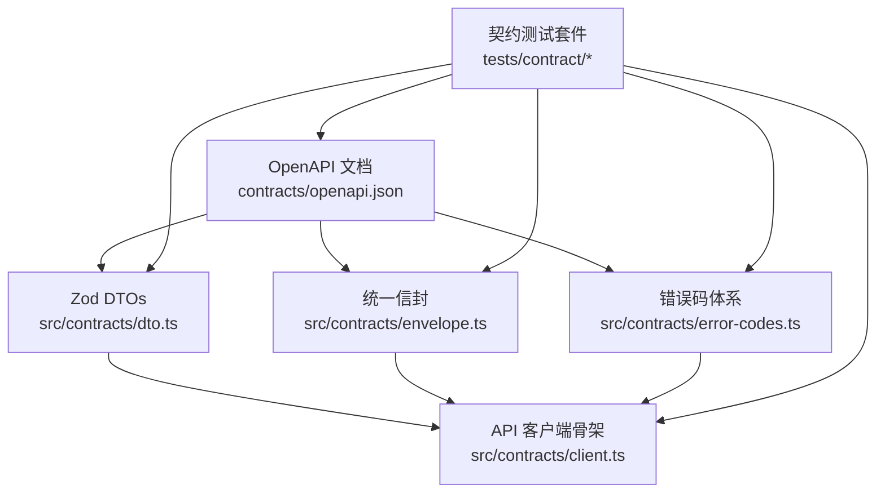
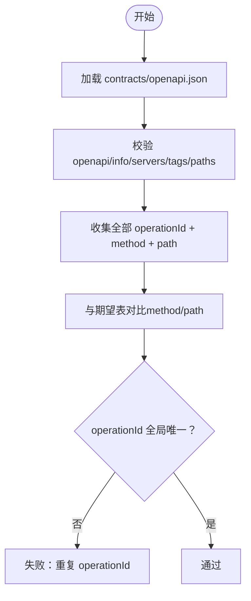
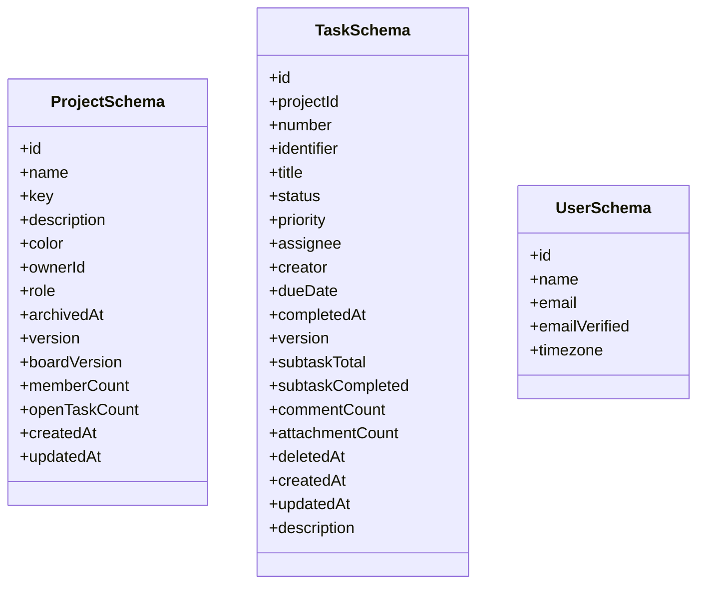
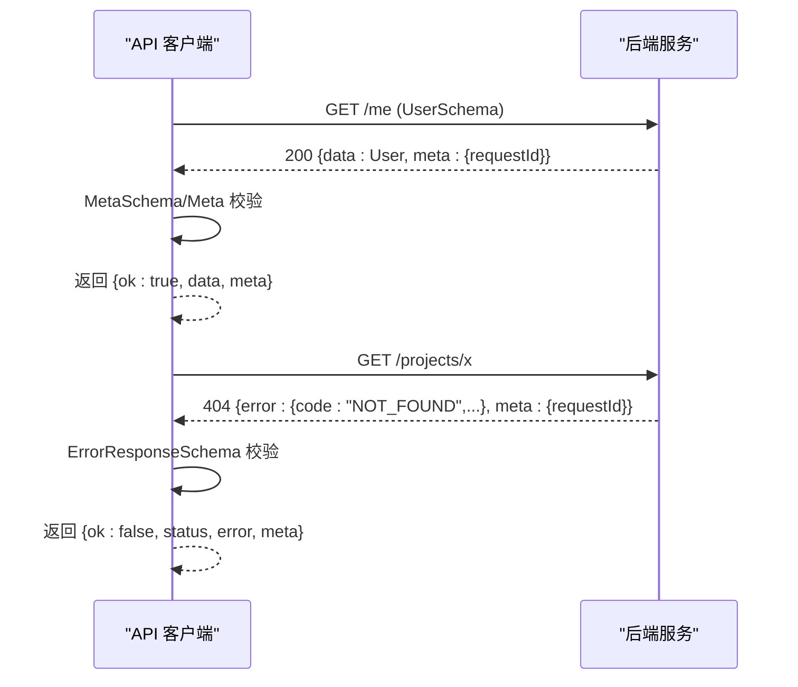
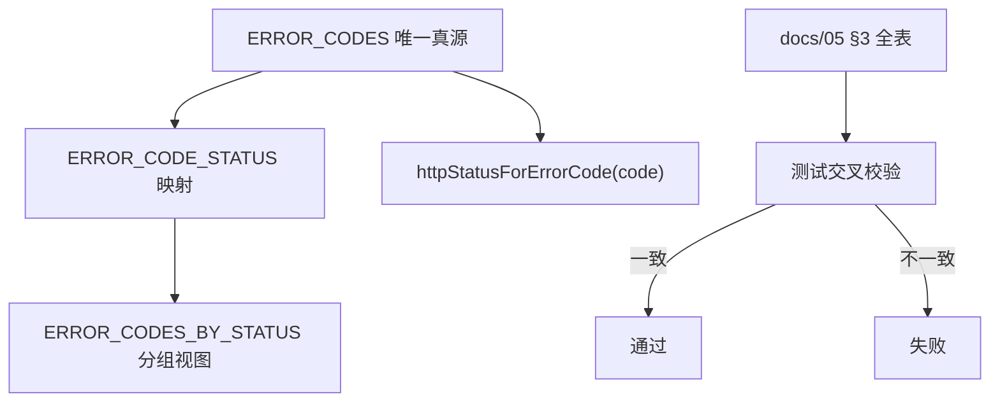
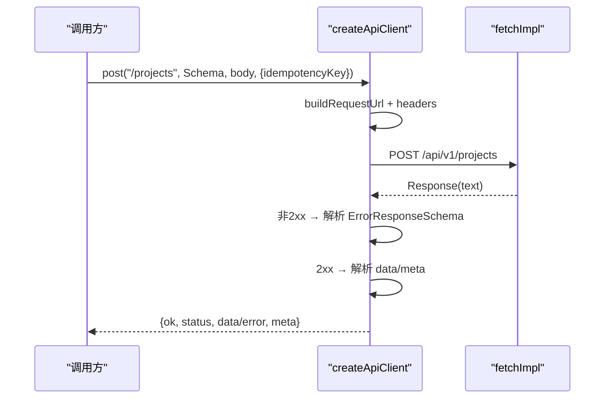
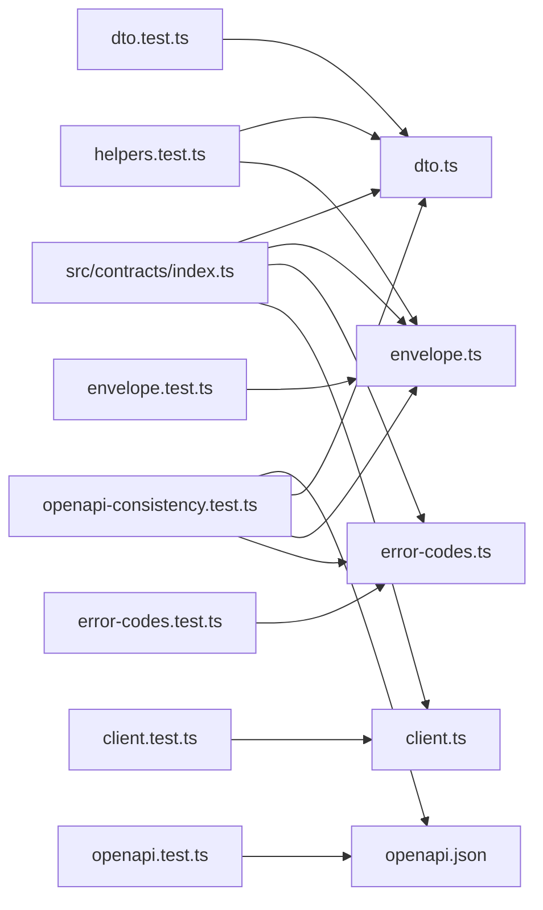

# 契约测试

<cite>
**本文引用的文件**
- [contracts/openapi.json](file://contracts/openapi.json)
- [src/contracts/index.ts](file://src/contracts/index.ts)
- [src/contracts/dto.ts](file://src/contracts/dto.ts)
- [src/contracts/envelope.ts](file://src/contracts/envelope.ts)
- [src/contracts/error-codes.ts](file://src/contracts/error-codes.ts)
- [src/contracts/client.ts](file://src/contracts/client.ts)
- [tests/contract/openapi.test.ts](file://tests/contract/openapi.test.ts)
- [tests/contract/openapi-consistency.test.ts](file://tests/contract/openapi-consistency.test.ts)
- [tests/contract/client.test.ts](file://tests/contract/client.test.ts)
- [tests/contract/dto.test.ts](file://tests/contract/dto.test.ts)
- [tests/contract/envelope.test.ts](file://tests/contract/envelope.test.ts)
- [tests/contract/error-codes.test.ts](file://tests/contract/error-codes.test.ts)
- [tests/contract/helpers.test.ts](file://tests/contract/helpers.test.ts)
- [docs/05-API-CONTRACT.md](file://docs/05-API-CONTRACT.md)
</cite>

## 目录
1. [简介](#简介)
2. [项目结构](#项目结构)
3. [核心组件](#核心组件)
4. [架构总览](#架构总览)
5. [详细组件分析](#详细组件分析)
6. [依赖关系分析](#依赖关系分析)
7. [性能与稳定性考量](#性能与稳定性考量)
8. [故障排查指南](#故障排查指南)
9. [结论](#结论)
10. [附录：示例与最佳实践](#附录示例与最佳实践)

## 简介
本文件为 Orbit 项目的“契约测试”文档，目标是确保前后端接口的一致性与稳定性。围绕 OpenAPI 规范、Zod 运行时校验、统一信封、错误码体系以及 API 客户端骨架，形成从“机器可读契约”到“可执行验证”的闭环。重点覆盖：
- 请求/响应结构与字段白名单校验
- 错误码一致性与 HTTP 状态映射
- 认证、项目、任务等关键接口的契约验证
- 版本兼容性检查、向后兼容与变更检测机制

## 项目结构
Orbit 将契约以三层方式落地：
- 机器可读契约：contracts/openapi.json（OpenAPI 3.1）
- 运行时契约：src/contracts 下的 Zod schemas、DTO、信封、错误码、客户端骨架
- 契约测试：tests/contract 下对 OpenAPI、Zod、客户端、错误码等进行断言



图表来源
- [contracts/openapi.json:1-12](file://contracts/openapi.json#L1-L12)
- [src/contracts/dto.ts:27-38](file://src/contracts/dto.ts#L27-L38)
- [src/contracts/envelope.ts:4-19](file://src/contracts/envelope.ts#L4-L19)
- [src/contracts/error-codes.ts:3-16](file://src/contracts/error-codes.ts#L3-L16)
- [src/contracts/client.ts:11-21](file://src/contracts/client.ts#L11-L21)
- [tests/contract/openapi-consistency.test.ts:36-44](file://tests/contract/openapi-consistency.test.ts#L36-L44)

章节来源
- [contracts/openapi.json:1-12](file://contracts/openapi.json#L1-L12)
- [src/contracts/index.ts:1-18](file://src/contracts/index.ts#L1-L18)
- [docs/05-API-CONTRACT.md:1-8](file://docs/05-API-CONTRACT.md#L1-L8)

## 核心组件
- OpenAPI 契约：定义 V1 业务 API 的 paths、schemas、tags、security 等，作为唯一权威源。
- Zod DTOs：严格对齐 OpenAPI components/schemas，使用 strictObject 拒绝未知字段，保障白名单输出。
- 统一信封：成功 {data, meta}、列表 {data[], PageMeta}、错误 {error, meta}，所有响应均通过 schema 校验。
- 错误码体系：集中维护 ErrorCode、HTTP 状态映射、按状态分组视图，供服务端与前端共享。
- API 客户端骨架：类型安全的 fetch 包装，自动解析信封、处理幂等键、构造 URL、抛出自定义异常。

章节来源
- [src/contracts/dto.ts:27-38](file://src/contracts/dto.ts#L27-L38)
- [src/contracts/envelope.ts:4-19](file://src/contracts/envelope.ts#L4-L19)
- [src/contracts/error-codes.ts:3-16](file://src/contracts/error-codes.ts#L3-L16)
- [src/contracts/client.ts:11-21](file://src/contracts/client.ts#L11-L21)

## 架构总览
契约测试贯穿“规范 → 实现 → 验证”的全链路：
- 规范层：OpenAPI 描述接口、参数、响应、安全要求。
- 实现层：Zod DTOs 与信封在前后端共享；客户端骨架负责网络与信封解析。
- 验证层：契约测试保证 OpenAPI 与 Zod、错误码、客户端行为三者一致。

```mermaid
sequenceDiagram
participant Dev as "开发者"
participant OA as "OpenAPI 文档"
participant Z as "Zod DTOs/信封"
participant C as "API 客户端"
participant T as "契约测试"
Dev->>OA : 维护 paths/schemas/tags/security
Dev->>Z : 同步 DTOs、信封、错误码
Dev->>C : 基于 schema 调用 get/post/patch/delete
T->>OA : 校验 operationId/method/path 一致性
T->>Z : 校验字段集合/枚举/约束
T->>C : 校验 URL 拼接/信封解析/错误处理
Note over OA,Z,C,T : 任何不一致都会导致测试失败，阻止合并
```

图表来源
- [tests/contract/openapi-consistency.test.ts:70-108](file://tests/contract/openapi-consistency.test.ts#L70-L108)
- [tests/contract/openapi-consistency.test.ts:174-236](file://tests/contract/openapi-consistency.test.ts#L174-L236)
- [tests/contract/client.test.ts:47-165](file://tests/contract/client.test.ts#L47-L165)

## 详细组件分析

### OpenAPI 契约与路径一致性
- 基路径 /api/v1，认证由 /api/auth/* 管理，不在本契约范围。
- 业务 tags 包含 Projects、Tasks、Board、Comments、Files、Activity 等。
- 契约测试逐条核对 operationId 与 method+path 的一致性，并断言无遗漏或多余操作。



图表来源
- [tests/contract/openapi.test.ts:27-55](file://tests/contract/openapi.test.ts#L27-L55)
- [tests/contract/openapi-consistency.test.ts:110-171](file://tests/contract/openapi-consistency.test.ts#L110-L171)

章节来源
- [contracts/openapi.json:1-12](file://contracts/openapi.json#L1-L12)
- [tests/contract/openapi.test.ts:27-55](file://tests/contract/openapi.test.ts#L27-L55)
- [tests/contract/openapi-consistency.test.ts:70-108](file://tests/contract/openapi-consistency.test.ts#L70-L108)

### DTOs 与字段白名单
- 所有 DTO 使用 strictObject，拒绝未知字段，防止敏感信息泄露（如 password、tokenHash、objectKey）。
- 字段名集合与 OpenAPI components/schemas 保持一致，测试逐项比对。
- 枚举值（Task.status/priority、Project.color/role、Invitation.state、Attachment.state、Activity.action/entityType）与 OpenAPI enum 完全一致。



图表来源
- [src/contracts/dto.ts:88-105](file://src/contracts/dto.ts#L88-L105)
- [src/contracts/dto.ts:194-221](file://src/contracts/dto.ts#L194-L221)
- [src/contracts/dto.ts:65-73](file://src/contracts/dto.ts#L65-L73)

章节来源
- [src/contracts/dto.ts:27-38](file://src/contracts/dto.ts#L27-L38)
- [tests/contract/dto.test.ts:73-138](file://tests/contract/dto.test.ts#L73-L138)
- [tests/contract/openapi-consistency.test.ts:174-236](file://tests/contract/openapi-consistency.test.ts#L174-L236)

### 统一信封与错误处理
- 成功信封：{data, meta:{requestId}}；列表信封：{data[], meta:PageMeta}。
- 错误信封：{error:{code,message,fieldErrors?,currentVersion?,currentBoardVersion?}, meta:{requestId}}。
- 客户端在 4xx/5xx 时解析标准错误信封；不合法则抛出 ApiClientError。



图表来源
- [src/contracts/envelope.ts:21-57](file://src/contracts/envelope.ts#L21-L57)
- [src/contracts/client.ts:178-195](file://src/contracts/client.ts#L178-L195)
- [tests/contract/client.test.ts:61-118](file://tests/contract/client.test.ts#L61-L118)

章节来源
- [src/contracts/envelope.ts:21-57](file://src/contracts/envelope.ts#L21-L57)
- [tests/contract/envelope.test.ts:27-145](file://tests/contract/envelope.test.ts#L27-L145)
- [tests/contract/client.test.ts:61-118](file://tests/contract/client.test.ts#L61-L118)

### 错误码体系与一致性
- 错误码集中维护，提供 ErrorCode 联合类型、HTTP 状态映射、按状态分组视图。
- 测试交叉校验：ERROR_CODES、ERROR_CODE_STATUS、ERROR_CODES_BY_STATUS 与 docs/05 §3 全表一致。
- httpStatusForErrorCode 提供类型安全的状态码查询。



图表来源
- [src/contracts/error-codes.ts:18-137](file://src/contracts/error-codes.ts#L18-L137)
- [tests/contract/error-codes.test.ts:17-83](file://tests/contract/error-codes.test.ts#L17-L83)

章节来源
- [src/contracts/error-codes.ts:18-137](file://src/contracts/error-codes.ts#L18-L137)
- [tests/contract/error-codes.test.ts:17-99](file://tests/contract/error-codes.test.ts#L17-L99)
- [docs/05-API-CONTRACT.md:22-42](file://docs/05-API-CONTRACT.md#L22-L42)

### API 客户端骨架与请求流程
- 默认 baseUrl 为 /api/v1，支持 query 拼接、headers、信号、幂等键。
- 写操作自动设置 Content-Type 与 Idempotency-Key。
- 成功/列表/错误三种信封分别校验，非法响应抛 ApiClientError。



图表来源
- [src/contracts/client.ts:83-88](file://src/contracts/client.ts#L83-L88)
- [src/contracts/client.ts:121-163](file://src/contracts/client.ts#L121-L163)
- [src/contracts/client.ts:178-245](file://src/contracts/client.ts#L178-L245)
- [tests/contract/client.test.ts:121-165](file://tests/contract/client.test.ts#L121-L165)

章节来源
- [src/contracts/client.ts:11-21](file://src/contracts/client.ts#L11-L21)
- [tests/contract/client.test.ts:47-165](file://tests/contract/client.test.ts#L47-L165)

### 帮助函数与构建器
- parseRequestBody/parseQueryParams：将输入转换为强类型，失败返回标准错误信封。
- buildSuccessResponse/buildListResponse/buildErrorResponse：构造符合信封的响应，非法输入直接抛错，避免吞错。

章节来源
- [tests/contract/helpers.test.ts:19-133](file://tests/contract/helpers.test.ts#L19-L133)

## 依赖关系分析
- src/contracts/index.ts 统一导出 primitives、enums、error-codes、envelope、dto、helpers、client，形成契约层公共入口。
- 契约测试依赖 OpenAPI 文档与 src/contracts 中的 Zod schemas、错误码、客户端，确保三者一致。
- 文档 docs/05-API-CONTRACT.md 作为规则与语义说明，被测试与实现共同遵循。



图表来源
- [src/contracts/index.ts:11-17](file://src/contracts/index.ts#L11-L17)
- [tests/contract/openapi.test.ts:1-56](file://tests/contract/openapi.test.ts#L1-L56)
- [tests/contract/openapi-consistency.test.ts:1-44](file://tests/contract/openapi-consistency.test.ts#L1-L44)
- [tests/contract/client.test.ts:1-166](file://tests/contract/client.test.ts#L1-L166)
- [tests/contract/dto.test.ts:1-410](file://tests/contract/dto.test.ts#L1-L410)
- [tests/contract/envelope.test.ts:1-183](file://tests/contract/envelope.test.ts#L1-L183)
- [tests/contract/error-codes.test.ts:1-99](file://tests/contract/error-codes.test.ts#L1-L99)
- [tests/contract/helpers.test.ts:1-133](file://tests/contract/helpers.test.ts#L1-L133)

章节来源
- [src/contracts/index.ts:1-18](file://src/contracts/index.ts#L1-L18)
- [tests/contract/openapi-consistency.test.ts:36-44](file://tests/contract/openapi-consistency.test.ts#L36-L44)

## 性能与稳定性考量
- 使用 strictObject 拒绝未知字段，减少不必要的数据传输与解析开销。
- 列表分页采用游标，限制 limit 上限，避免大结果集。
- 客户端对非 JSON 或空响应体快速失败，避免无效重试。
- 错误信封强制携带 requestId，便于追踪与定位问题。

[本节为通用指导，无需具体文件引用]

## 故障排查指南
- 如果契约测试失败，优先检查：
  - OpenAPI 文档是否新增/修改了 paths/schemas/tags，需要同步更新 Zod DTOs 与测试期望。
  - DTOs 是否误加了未知字段或被 strictObject 拒绝。
  - 错误码是否与 docs/05 §3 全表一致，HTTP 状态映射是否正确。
  - 客户端是否收到非标准信封或非 JSON 响应。
- 常见错误：
  - 400/422：字段校验失败，检查必填、长度、枚举、类型转换。
  - 409：版本冲突或幂等冲突，检查 expectedVersion、Idempotency-Key。
  - 401/403：认证/权限问题，检查会话 Cookie、Origin。
  - 5xx：服务端异常，查看 requestId 与服务日志。

章节来源
- [tests/contract/dto.test.ts:73-138](file://tests/contract/dto.test.ts#L73-L138)
- [tests/contract/envelope.test.ts:76-145](file://tests/contract/envelope.test.ts#L76-L145)
- [tests/contract/error-codes.test.ts:42-83](file://tests/contract/error-codes.test.ts#L42-L83)
- [tests/contract/client.test.ts:96-165](file://tests/contract/client.test.ts#L96-L165)

## 结论
Orbit 的契约测试通过 OpenAPI 文档、Zod DTOs、统一信封、错误码体系与 API 客户端骨架形成闭环，确保前后端接口的一致性与稳定性。契约测试覆盖路径一致性、字段白名单、枚举一致性、信封解析与错误处理，能有效发现并阻止破坏性变更。建议持续维护 OpenAPI 与 Zod 同步，并在每次改动后运行契约测试。

[本节为总结，无需具体文件引用]

## 附录：示例与最佳实践

### 认证 API 契约验证要点
- 认证路由位于 /api/auth/*，不在本契约范围；业务 API 基路径为 /api/v1。
- 需要认证的接口通过 sessionCookie 保护，客户端需携带同源 Cookie。
- 读取当前账户 GET /me 返回 {data:User, meta:{requestId}}。

章节来源
- [contracts/openapi.json:48-123](file://contracts/openapi.json#L48-L123)
- [docs/05-API-CONTRACT.md:1-8](file://docs/05-API-CONTRACT.md#L1-L8)

### 项目 API 契约验证要点
- 列出项目 GET /projects 支持 cursor、limit、scope、archived 查询参数。
- 创建项目 POST /projects 需要 Idempotency-Key，返回 201 或幂等重放 200。
- 读取/更新项目 GET/PATCH /projects/{projectId}，更新需 expectedVersion 与至少一个可改字段。

章节来源
- [contracts/openapi.json:209-458](file://contracts/openapi.json#L209-L458)
- [tests/contract/openapi-consistency.test.ts:70-108](file://tests/contract/openapi-consistency.test.ts#L70-L108)
- [tests/contract/dto.test.ts:184-227](file://tests/contract/dto.test.ts#L184-L227)

### 任务 API 契约验证要点
- 任务列表 GET /projects/{projectId}/tasks 使用 TaskSummary，不含 description。
- 创建任务 POST /projects/{projectId}/tasks 需要 title，可选 status/priority/assigneeId/dueDate。
- 更新任务 PATCH /tasks/{taskId} 需要 expectedVersion 与至少一个可改字段。
- 移动任务 POST /tasks/{taskId}/move 需要 expectedVersion、expectedBoardVersion、toStatus、beforeTaskId。

章节来源
- [contracts/openapi.json:459-640](file://contracts/openapi.json#L459-L640)
- [tests/contract/dto.test.ts:140-182](file://tests/contract/dto.test.ts#L140-L182)
- [tests/contract/dto.test.ts:184-227](file://tests/contract/dto.test.ts#L184-L227)

### 版本兼容性与变更检测
- 通过 openapi-consistency.test.ts 断言 operationId 集合与期望表一致，防止遗漏或多余接口。
- 通过 DTO 字段集合与枚举一致性测试，确保 OpenAPI 与 Zod 同步。
- 错误码测试交叉校验 ERROR_CODES、ERROR_CODE_STATUS、ERROR_CODES_BY_STATUS 与 docs/05 §3 全表。

章节来源
- [tests/contract/openapi-consistency.test.ts:140-171](file://tests/contract/openapi-consistency.test.ts#L140-L171)
- [tests/contract/openapi-consistency.test.ts:174-236](file://tests/contract/openapi-consistency.test.ts#L174-L236)
- [tests/contract/error-codes.test.ts:42-83](file://tests/contract/error-codes.test.ts#L42-L83)