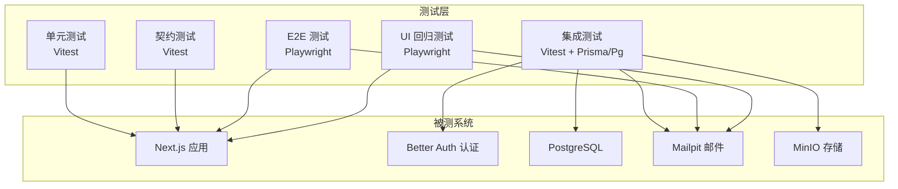
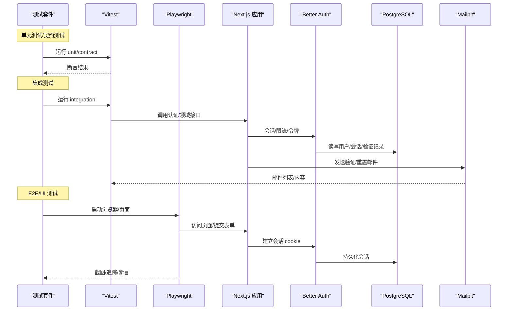
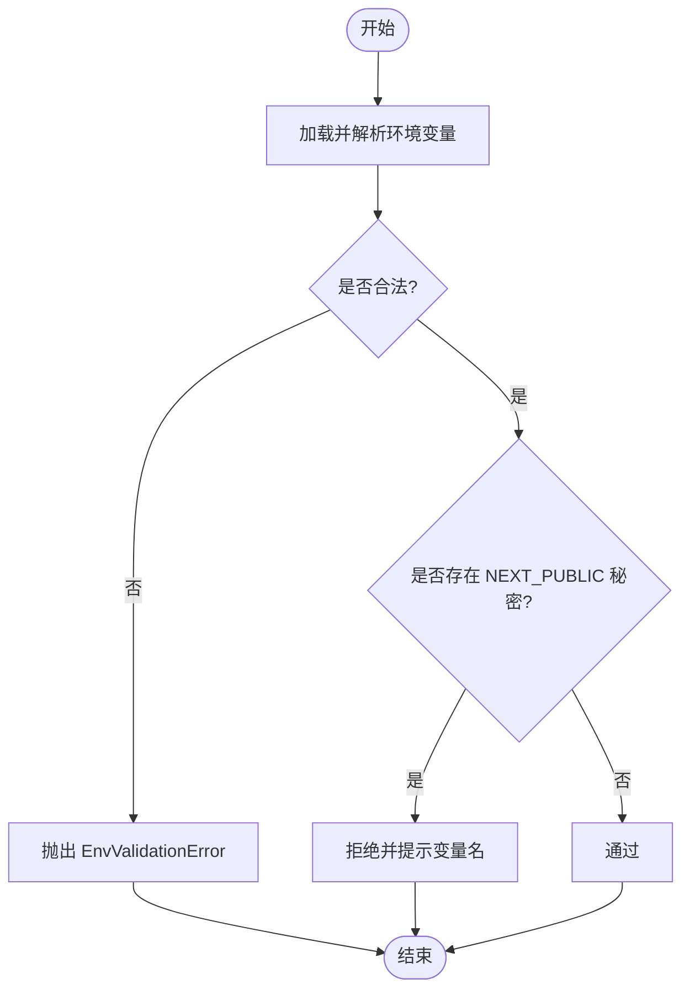
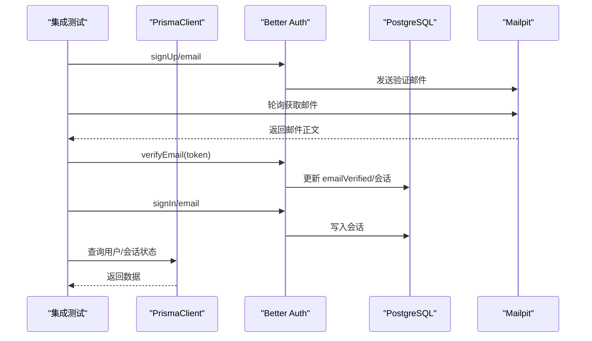
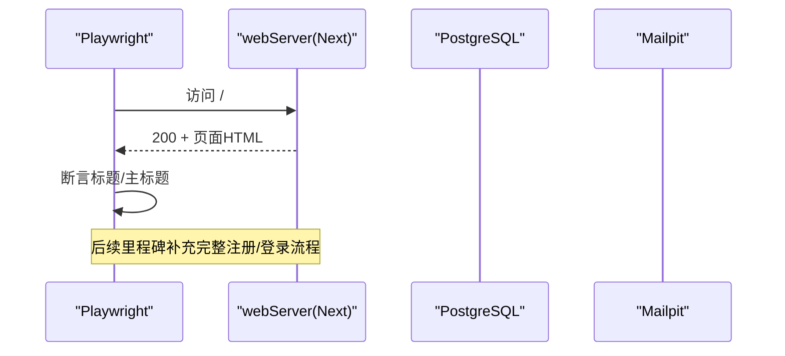
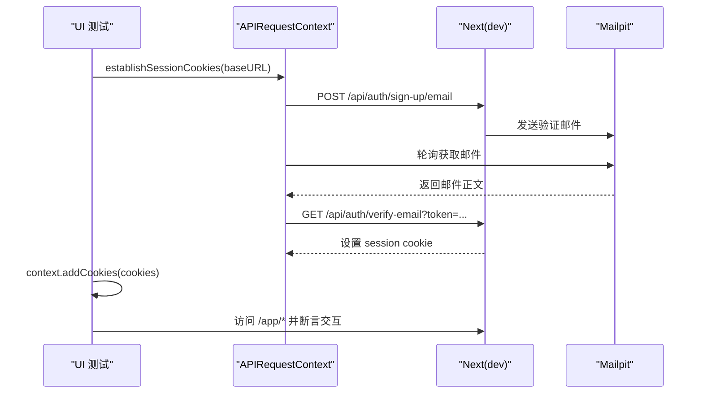
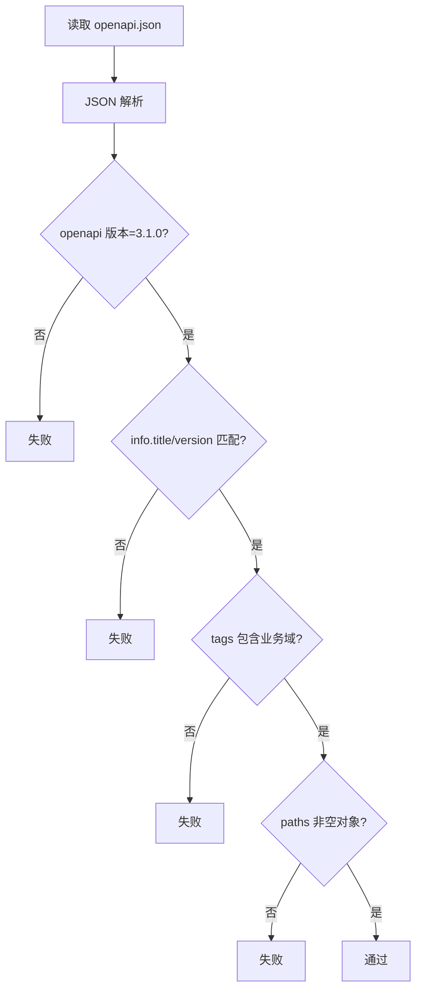
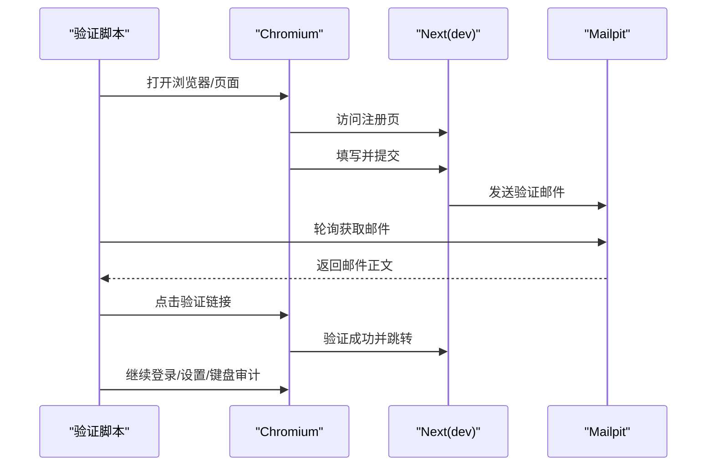
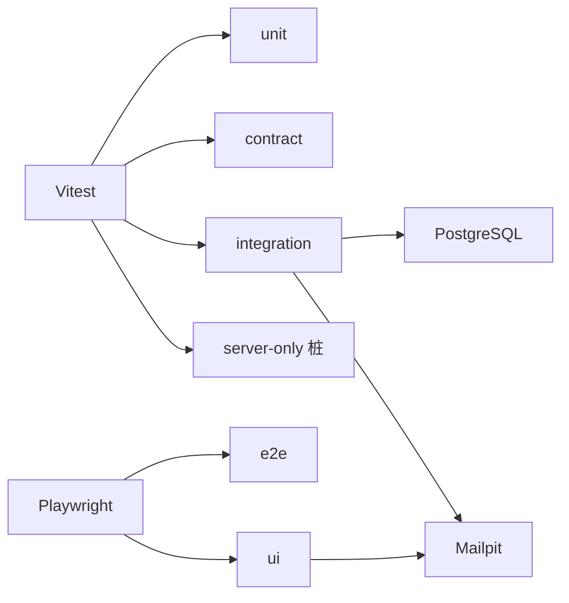

# 测试策略

<cite>
**本文引用的文件**
- [package.json](file://package.json)
- [vitest.config.ts](file://vitest.config.ts)
- [playwright.config.ts](file://playwright.config.ts)
- [playwright.ui.config.ts](file://playwright.ui.config.ts)
- [tests/stubs/server-only.ts](file://tests/stubs/server-only.ts)
- [infra/compose.dev.yml](file://infra/compose.dev.yml)
- [tests/unit/env.test.ts](file://tests/unit/env.test.ts)
- [tests/integration/auth-flow.test.ts](file://tests/integration/auth-flow.test.ts)
- [tests/integration/db-connectivity.test.ts](file://tests/integration/db-connectivity.test.ts)
- [tests/e2e/smoke.spec.ts](file://tests/e2e/smoke.spec.ts)
- [tests/ui/m0-review.spec.ts](file://tests/ui/m0-review.spec.ts)
- [tests/ui/auth-setup.ts](file://tests/ui/auth-setup.ts)
- [scripts/m1-e2e-verify.ts](file://scripts/m1-e2e-verify.ts)
- [contracts/openapi.json](file://contracts/openapi.json)
- [tests/contract/openapi.test.ts](file://tests/contract/openapi.test.ts)
</cite>

## 目录
1. [简介](#简介)
2. [项目结构](#项目结构)
3. [核心组件](#核心组件)
4. [架构总览](#架构总览)
5. [详细组件分析](#详细组件分析)
6. [依赖关系分析](#依赖关系分析)
7. [性能考量](#性能考量)
8. [故障排查指南](#故障排查指南)
9. [结论](#结论)
10. [附录](#附录)

## 简介
本测试策略为 Orbit 项目提供分层、可维护、可扩展的测试体系，覆盖单元测试、集成测试、端到端（E2E）测试与契约测试。通过 Vitest 与 Playwright 的组合，实现从纯函数到真实浏览器交互的全链路质量保障；结合 Docker Compose 提供的独立测试环境（PostgreSQL、Mailpit、MinIO），确保测试数据与环境隔离、稳定可靠。文档同时给出执行命令、最佳实践、调试技巧与覆盖率报告生成方法。

## 项目结构
Orbit 将测试按类型分目录组织：
- tests/unit：Vitest 单元测试，运行在 Node 环境，验证配置解析、工具函数等无副作用逻辑。
- tests/contract：契约测试，校验 OpenAPI 文档结构与业务 API 契约基线。
- tests/integration：集成测试，直连真实 PostgreSQL，验证认证流程、权限、任务与项目领域逻辑。
- tests/e2e：Playwright E2E，启动生产构建服务，进行冒烟与关键用户流程验证。
- tests/ui：Playwright UI 回归测试，针对开发服务器与交互细节（焦点、键盘、响应式）。
- tests/stubs：测试桩，如 server-only 在 Node 环境的空实现，避免运行时保护误伤。

图表来源
- [vitest.config.ts:1-58](file://vitest.config.ts#L1-L58)
- [playwright.config.ts:1-41](file://playwright.config.ts#L1-L41)
- [playwright.ui.config.ts:1-25](file://playwright.ui.config.ts#L1-L25)
- [infra/compose.dev.yml:1-72](file://infra/compose.dev.yml#L1-L72)

章节来源
- [package.json:12-27](file://package.json#L12-L27)
- [vitest.config.ts:1-58](file://vitest.config.ts#L1-L58)
- [playwright.config.ts:1-41](file://playwright.config.ts#L1-L41)
- [playwright.ui.config.ts:1-25](file://playwright.ui.config.ts#L1-L25)

## 核心组件
- 测试编排与脚本
  - 使用 pnpm scripts 统一入口：test:unit、test:integration、test:e2e、test:ui、test:contract。
  - check 聚合 lint、typecheck、unit 与 contract，便于本地快速自检。
- 测试框架与配置
  - Vitest：多 project 划分 unit/contract/integration，分别控制 include 路径与环境；integration 关闭文件级并行以避免连接池溢出。
  - Playwright：两套配置——生产冒烟（playwright.config.ts）与开发 UI 回归（playwright.ui.config.ts），支持 webServer 自动拉起 Next 服务。
- 测试环境与基础设施
  - Docker Compose 提供 PostgreSQL、Mailpit、MinIO，端口绑定 127.0.0.1，测试库 orbit_test 独立于开发库。
  - 环境变量加载与校验：集成测试通过 parseEnv 严格校验 TEST_DATABASE_URL 不得指向开发/生产库。
- 测试数据管理
  - 基于 RUN_TAG 或时间戳生成唯一邮箱前缀，配合 Mailpit API 轮询获取验证邮件 token，完成注册→验证→登录闭环。
  - 用例前后清理：beforeAll/afterAll 中删除以 RUN_TAG 标识的数据，保证幂等与隔离。

章节来源
- [package.json:12-27](file://package.json#L12-L27)
- [vitest.config.ts:24-55](file://vitest.config.ts#L24-L55)
- [playwright.config.ts:16-40](file://playwright.config.ts#L16-L40)
- [playwright.ui.config.ts:9-24](file://playwright.ui.config.ts#L9-L24)
- [infra/compose.dev.yml:10-68](file://infra/compose.dev.yml#L10-L68)
- [tests/integration/auth-flow.test.ts:33-60](file://tests/integration/auth-flow.test.ts#L33-L60)
- [tests/integration/db-connectivity.test.ts:6-48](file://tests/integration/db-connectivity.test.ts#L6-L48)
- [tests/ui/auth-setup.ts:89-133](file://tests/ui/auth-setup.ts#L89-L133)

## 架构总览
下图展示测试在不同层级如何与被测系统交互，以及外部依赖（数据库、邮件、存储）的参与方式。

图表来源
- [vitest.config.ts:24-55](file://vitest.config.ts#L24-L55)
- [playwright.config.ts:16-40](file://playwright.config.ts#L16-L40)
- [playwright.ui.config.ts:9-24](file://playwright.ui.config.ts#L9-L24)
- [tests/integration/auth-flow.test.ts:53-60](file://tests/integration/auth-flow.test.ts#L53-L60)
- [tests/ui/auth-setup.ts:89-133](file://tests/ui/auth-setup.ts#L89-L133)

## 详细组件分析

### 单元测试（Vitest）
- 目标与范围
  - 验证环境配置解析、安全规则（禁止 NEXT_PUBLIC 泄露秘密）、时区归一化、请求哈希等纯函数与边界条件。
- 配置要点
  - 多 project：unit 仅包含 tests/unit/**/*.test.ts，environment=node。
  - alias：@/ 映射到 src，server-only 替换为空桩，避免 Node 下抛错。
- 断言与模拟
  - 使用 Vitest 内置 expect/it/describe；对错误分支构造非法输入触发预期异常。
  - 不引入外部 mock 库，保持轻量与高内聚。
- 示例参考
  - 环境解析与安全：见 tests/unit/env.test.ts。

图表来源
- [vitest.config.ts:14-23](file://vitest.config.ts#L14-L23)
- [tests/unit/env.test.ts:54-175](file://tests/unit/env.test.ts#L54-L175)

章节来源
- [vitest.config.ts:14-23](file://vitest.config.ts#L14-L23)
- [tests/unit/env.test.ts:54-175](file://tests/unit/env.test.ts#L54-L175)

### 集成测试（Vitest + 真实数据库/邮件）
- 目标与范围
  - 认证全流程（注册→验证→登录→会话）、密码找回与重设、限流行为、权限与资源隔离、数据库连通性。
- 环境准备
  - 通过 dotenv 加载 .env.local/.env；parseEnv 校验 TEST_DATABASE_URL 独立且安全。
  - 使用 PrismaPg 适配器创建独立 PrismaClient，避免与应用单例共享。
- 邮件集成
  - 轮询 Mailpit API 获取最新验证/重置邮件，提取 token 完成后续步骤。
- 并发与稳定性
  - 集成测试禁用文件级并行（fileParallelism:false），避免连接池溢出；单个测试内部仍可使用 Promise.all 并发。
- 示例参考
  - 认证流程：tests/integration/auth-flow.test.ts
  - 数据库连通性：tests/integration/db-connectivity.test.ts

图表来源
- [tests/integration/auth-flow.test.ts:53-60](file://tests/integration/auth-flow.test.ts#L53-L60)
- [tests/integration/auth-flow.test.ts:72-109](file://tests/integration/auth-flow.test.ts#L72-L109)
- [tests/integration/auth-flow.test.ts:223-304](file://tests/integration/auth-flow.test.ts#L223-L304)
- [tests/integration/db-connectivity.test.ts:24-48](file://tests/integration/db-connectivity.test.ts#L24-L48)

章节来源
- [vitest.config.ts:42-55](file://vitest.config.ts#L42-L55)
- [tests/integration/auth-flow.test.ts:33-60](file://tests/integration/auth-flow.test.ts#L33-L60)
- [tests/integration/auth-flow.test.ts:72-109](file://tests/integration/auth-flow.test.ts#L72-L109)
- [tests/integration/auth-flow.test.ts:223-304](file://tests/integration/auth-flow.test.ts#L223-L304)
- [tests/integration/db-connectivity.test.ts:6-48](file://tests/integration/db-connectivity.test.ts#L6-L48)

### 端到端测试（Playwright）
- 目标与范围
  - 冒烟测试：首页可达、标题与主标题渲染正确。
  - 关键用户流程：注册→验证→登录→进入受保护路由。
- 配置要点
  - playwright.config.ts：默认启动生产构建服务（build && start），CI 下启用重试与 HTML 报告。
  - baseURL 默认 http://localhost:3000，避免 Origin 白名单问题。
- 示例参考
  - 冒烟测试：tests/e2e/smoke.spec.ts

图表来源
- [playwright.config.ts:16-40](file://playwright.config.ts#L16-L40)
- [tests/e2e/smoke.spec.ts:7-12](file://tests/e2e/smoke.spec.ts#L7-L12)

章节来源
- [playwright.config.ts:16-40](file://playwright.config.ts#L16-L40)
- [tests/e2e/smoke.spec.ts:7-12](file://tests/e2e/smoke.spec.ts#L7-L12)

### UI 回归测试（Playwright）
- 目标与范围
  - 导航可访问性、对话框焦点环、草稿确认、跨断点焦点恢复、直接访问面板参数保留等。
- 会话前置
  - 通过 tests/ui/auth-setup.ts 建立真实会话（sign-up → Mailpit 验证 → verify-email autoSignIn），注入 cookie 到浏览器上下文。
- 配置要点
  - playwright.ui.config.ts：针对开发 dev server，workers=1，trace/screenshot 仅在失败时保留。
- 示例参考
  - UI 回归用例：tests/ui/m0-review.spec.ts

图表来源
- [playwright.ui.config.ts:9-24](file://playwright.ui.config.ts#L9-L24)
- [tests/ui/auth-setup.ts:89-133](file://tests/ui/auth-setup.ts#L89-L133)
- [tests/ui/m0-review.spec.ts:18-24](file://tests/ui/m0-review.spec.ts#L18-L24)

章节来源
- [playwright.ui.config.ts:9-24](file://playwright.ui.config.ts#L9-L24)
- [tests/ui/auth-setup.ts:89-133](file://tests/ui/auth-setup.ts#L89-L133)
- [tests/ui/m0-review.spec.ts:18-24](file://tests/ui/m0-review.spec.ts#L18-L24)

### 契约测试（OpenAPI）
- 目标与范围
  - 校验 contracts/openapi.json 为合法 OpenAPI 3.1 文档，info/tags/paths 符合业务约定。
- 执行方式
  - 通过 Vitest contract project 运行，读取 JSON 并断言顶层结构与业务标签。
- 示例参考
  - 契约测试：tests/contract/openapi.test.ts

图表来源
- [tests/contract/openapi.test.ts:22-55](file://tests/contract/openapi.test.ts#L22-L55)

章节来源
- [tests/contract/openapi.test.ts:22-55](file://tests/contract/openapi.test.ts#L22-L55)

### 浏览器自动化脚本（M1 E2E 验证）
- 目标与范围
  - 覆盖 Flow A–E：注册→验证→登录→设置持久化→非法时区拒绝→退出与重定向→键盘可访问性审计。
- 特点
  - 自包含脚本，输出截图与 summary.json；轮询 Mailpit 获取验证链接；等待 React hydration 后再交互。
- 示例参考
  - 脚本：scripts/m1-e2e-verify.ts

图表来源
- [scripts/m1-e2e-verify.ts:45-90](file://scripts/m1-e2e-verify.ts#L45-L90)
- [scripts/m1-e2e-verify.ts:120-187](file://scripts/m1-e2e-verify.ts#L120-L187)

章节来源
- [scripts/m1-e2e-verify.ts:45-90](file://scripts/m1-e2e-verify.ts#L45-L90)
- [scripts/m1-e2e-verify.ts:120-187](file://scripts/m1-e2e-verify.ts#L120-L187)

## 依赖关系分析
- 测试与框架
  - Vitest：unit/contract/integration 三个 project，分别控制 include 与环境。
  - Playwright：两套配置，分别面向生产冒烟与开发 UI 回归。
- 测试与基础设施
  - Docker Compose：PostgreSQL、Mailpit、MinIO，端口绑定 127.0.0.1，测试库独立。
- 测试与代码
  - server-only 桩：在 Vitest 中将 server-only 替换为空模块，避免 Node 环境报错。
  - 环境变量：parseEnv 严格校验，防止测试误用生产/开发库。

图表来源
- [vitest.config.ts:24-55](file://vitest.config.ts#L24-L55)
- [playwright.config.ts:16-40](file://playwright.config.ts#L16-L40)
- [playwright.ui.config.ts:9-24](file://playwright.ui.config.ts#L9-L24)
- [tests/stubs/server-only.ts:1-5](file://tests/stubs/server-only.ts#L1-L5)
- [infra/compose.dev.yml:10-68](file://infra/compose.dev.yml#L10-L68)

章节来源
- [vitest.config.ts:24-55](file://vitest.config.ts#L24-L55)
- [playwright.config.ts:16-40](file://playwright.config.ts#L16-L40)
- [playwright.ui.config.ts:9-24](file://playwright.ui.config.ts#L9-L24)
- [tests/stubs/server-only.ts:1-5](file://tests/stubs/server-only.ts#L1-L5)
- [infra/compose.dev.yml:10-68](file://infra/compose.dev.yml#L10-L68)

## 性能考量
- 集成测试并发控制
  - 关闭文件级并行（fileParallelism:false），避免多个测试文件同时连接导致 PostgreSQL max_connections 超限；单个测试内部仍可并发发起请求。
- 浏览器自动化
  - E2E 默认 fullyParallel:true，CI 下启用重试与 HTML 报告；UI 回归 workers=1，减少资源竞争。
- 数据库连接
  - 每个集成测试使用独立 PrismaClient，避免共享连接池；测试结束后显式断开。
- 邮件轮询
  - 合理超时与轮询间隔，避免频繁请求 Mailpit；精确收件人过滤，避免跨测试干扰。

[本节为通用指导，无需特定文件引用]

## 故障排查指南
- 无法连接测试数据库
  - 检查 docker compose 已启动，TEST_DATABASE_URL 指向 orbit_test；parseEnv 会拒绝与开发/生产库同名。
  - 参考：tests/integration/db-connectivity.test.ts
- 认证流程失败
  - 确认 Mailpit 可达（默认 :8025），Origin 头设置为受信源（http://localhost:3000），baseURL 主机一致。
  - 参考：tests/integration/auth-flow.test.ts、tests/ui/auth-setup.ts
- UI 回归被重定向到登录
  - 确保 beforeEach 已通过 establishSessionCookies 注入 cookie；baseURL 与 dev server 主机一致。
  - 参考：tests/ui/m0-review.spec.ts
- E2E 服务未启动
  - playwright.config.ts 会在无 E2E_BASE_URL 时自动 build && start；CI 下复用已有服务需设置 E2E_BASE_URL。
  - 参考：playwright.config.ts

章节来源
- [tests/integration/db-connectivity.test.ts:6-48](file://tests/integration/db-connectivity.test.ts#L6-L48)
- [tests/integration/auth-flow.test.ts:33-60](file://tests/integration/auth-flow.test.ts#L33-L60)
- [tests/ui/auth-setup.ts:89-133](file://tests/ui/auth-setup.ts#L89-L133)
- [tests/ui/m0-review.spec.ts:18-24](file://tests/ui/m0-review.spec.ts#L18-L24)
- [playwright.config.ts:16-40](file://playwright.config.ts#L16-L40)

## 结论
Orbit 的测试策略通过分层设计实现了从单元到 E2E 的全面覆盖：Vitest 负责快速、稳定的单元与契约验证；集成测试直连真实数据库与邮件服务，确保核心业务流程健壮；Playwright 提供浏览器级验证与 UI 回归，保障用户体验与可访问性。借助 Docker Compose 的环境隔离与严格的配置校验，测试具备高可靠性与可重复性。建议持续完善 E2E 关键流程、扩展视觉回归用例，并在 CI 中集成覆盖率报告与产物归档。

[本节为总结，无需特定文件引用]

## 附录

### 执行命令速查
- 单元测试：pnpm test:unit
- 契约测试：pnpm test:contract
- 集成测试：pnpm test:integration
- E2E 测试：pnpm test:e2e
- UI 回归测试：pnpm test:ui
- 全量检查：pnpm check

章节来源
- [package.json:12-27](file://package.json#L12-L27)

### 测试数据与环境
- 数据库：PostgreSQL（orbit_dev 开发，orbit_test 测试），通过 parseEnv 强制隔离。
- 邮件：Mailpit（SMTP :25025，Web :8025），用于接收验证/重置邮件。
- 存储：MinIO（API :9000，控制台 :9001），当前阶段可选。
- 环境变量：.env.local/.env 由测试加载；E2E_BASE_URL 可复用已有服务。

章节来源
- [infra/compose.dev.yml:10-68](file://infra/compose.dev.yml#L10-L68)
- [tests/integration/auth-flow.test.ts:33-60](file://tests/integration/auth-flow.test.ts#L33-L60)

### 最佳实践
- 单元测试
  - 聚焦无副作用逻辑；构造边界输入与错误分支；避免引入重型依赖。
- 集成测试
  - 使用独立 PrismaClient；RUN_TAG 隔离数据；禁用文件级并行；合理超时与重试。
- E2E/UI
  - 优先使用语义化选择器（role/name）；等待 hydration 后再交互；捕获截图与追踪；CI 开启重试。
- 契约测试
  - 以 OpenAPI 为单一事实来源；断言 tags/paths 与业务域一致；随 API 演进同步更新。

[本节为通用指导，无需特定文件引用]

### 调试技巧
- Vitest
  - 使用 --reporter=list 查看实时输出；必要时缩小 include 路径定位问题。
- Playwright
  - 首次运行安装浏览器：pnpm exec playwright install --with-deps chromium
  - 失败时查看 trace 与截图；CI 下自动生成 HTML 报告。
- 邮件
  - 通过 Mailpit Web 界面查看邮件内容与链接；确认 Origin 与 BASE URL 一致。

章节来源
- [playwright.config.ts:16-40](file://playwright.config.ts#L16-L40)
- [playwright.ui.config.ts:9-24](file://playwright.ui.config.ts#L9-L24)

### 覆盖率报告生成
- Vitest 覆盖率
  - 在 vitest.config.ts 中添加 coverage 配置（provider、reporter、include/exclude），运行对应 project 即可生成报告。
- Playwright 报告
  - CI 下默认生成 HTML 报告；可通过 reporter 配置调整输出。

[本节为通用指导，无需特定文件引用]