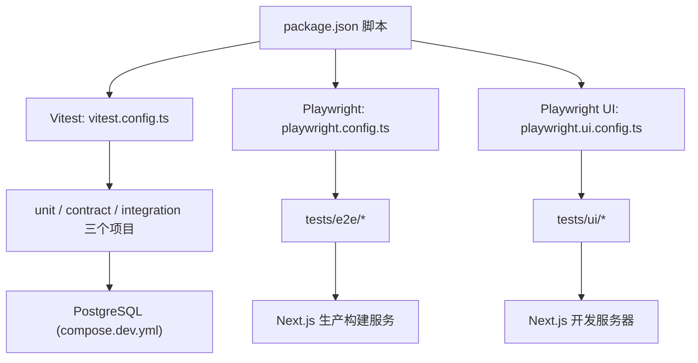
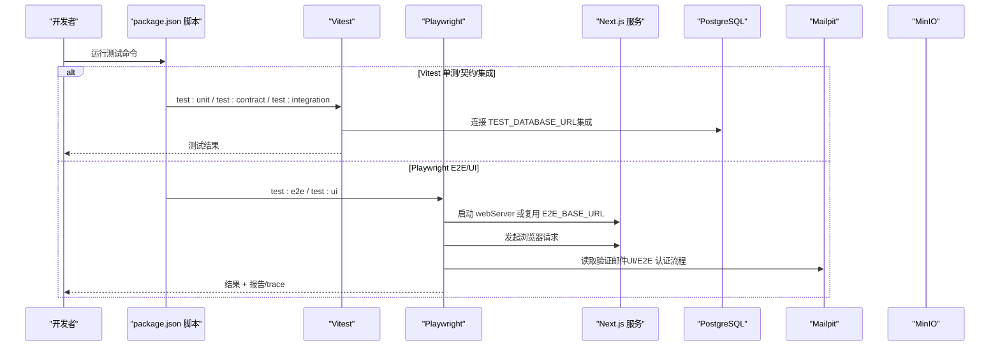
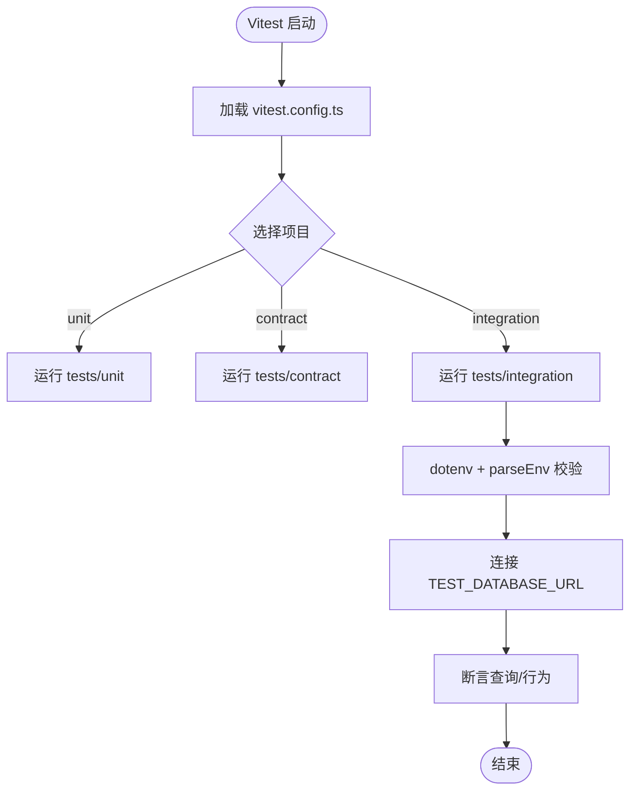
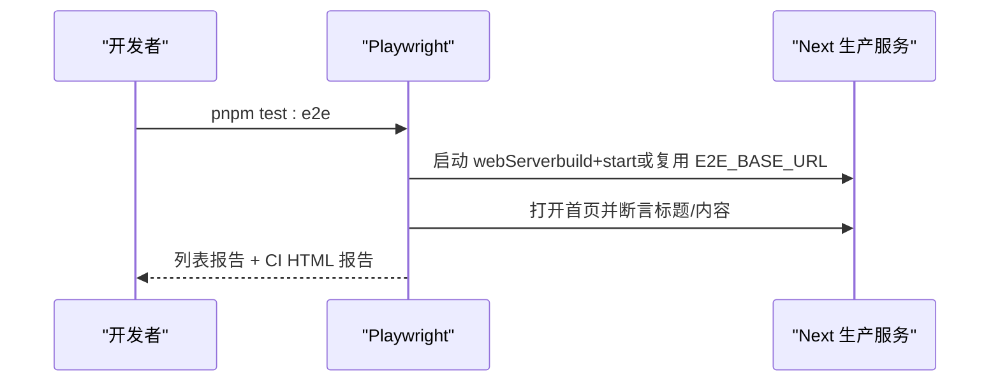
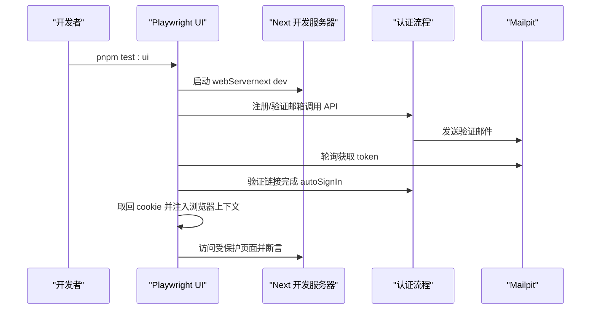
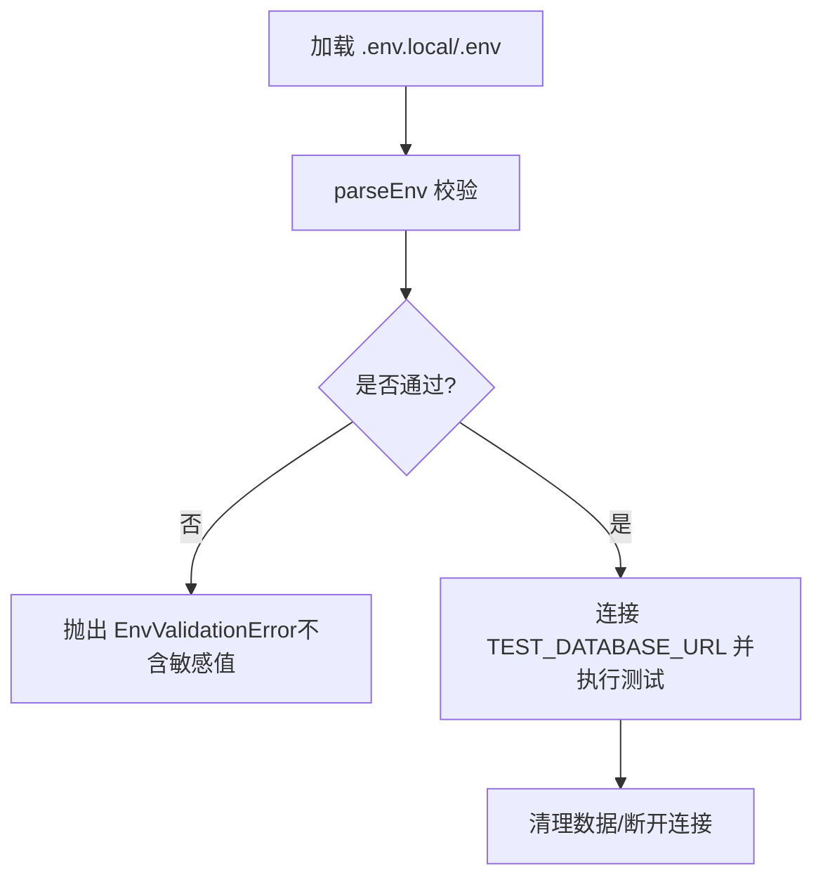
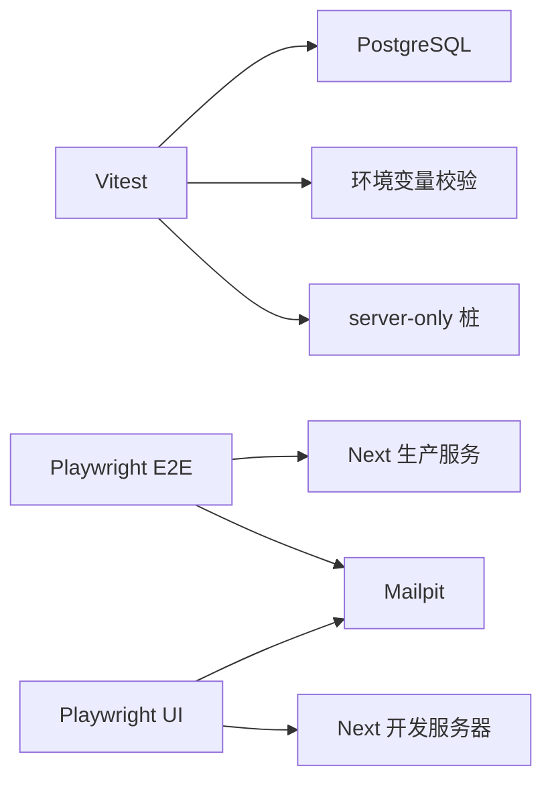

# 测试配置

<cite>
**本文引用的文件**
- [vitest.config.ts](file://vitest.config.ts)
- [playwright.config.ts](file://playwright.config.ts)
- [playwright.ui.config.ts](file://playwright.ui.config.ts)
- [package.json](file://package.json)
- [tests/stubs/server-only.ts](file://tests/stubs/server-only.ts)
- [src/server/env.ts](file://src/server/env.ts)
- [tests/unit/env.test.ts](file://tests/unit/env.test.ts)
- [tests/integration/db-connectivity.test.ts](file://tests/integration/db-connectivity.test.ts)
- [tests/integration/auth-flow.test.ts](file://tests/integration/auth-flow.test.ts)
- [tests/e2e/smoke.spec.ts](file://tests/e2e/smoke.spec.ts)
- [tests/ui/auth-setup.ts](file://tests/ui/auth-setup.ts)
- [infra/compose.dev.yml](file://infra/compose.dev.yml)
- [infra/postgres/init/01-create-test-db.sql](file://infra/postgres/init/01-create-test-db.sql)
</cite>

## 目录
1. [简介](#简介)
2. [项目结构](#项目结构)
3. [核心组件](#核心组件)
4. [架构总览](#架构总览)
5. [详细组件分析](#详细组件分析)
6. [依赖关系分析](#依赖关系分析)
7. [性能与并行执行](#性能与并行执行)
8. [故障排查指南](#故障排查指南)
9. [结论](#结论)
10. [附录：命令与环境清单](#附录命令与环境清单)

## 简介
本文件为 Orbit 项目的测试配置文档，聚焦 Vitest 与 Playwright 的配置选项、环境隔离、多项目测试组织（单元测试、集成测试、契约测试）、测试桩管理、脚本命令、持续集成要点、报告生成、性能调优与调试方法。目标是帮助开发者快速理解并稳定运行全链路测试。

## 项目结构
Orbit 将测试按类型分层组织，并通过不同配置文件与脚本进行统一编排：
- 单元测试：Vitest project unit，运行 tests/unit 下的纯 Node 环境测试。
- 契约测试：Vitest project contract，校验 OpenAPI 等契约文件。
- 集成测试：Vitest project integration，直连真实 PostgreSQL，验证数据库连接与业务流。
- E2E 测试：Playwright 默认配置，启动生产构建服务或复用外部服务，覆盖浏览器端到端流程。
- UI 回归测试：Playwright 独立配置，针对开发服务器与认证会话注入的 UI 用例。

图表来源
- [package.json:12-27](file://package.json#L12-L27)
- [vitest.config.ts:14-57](file://vitest.config.ts#L14-L57)
- [playwright.config.ts:16-40](file://playwright.config.ts#L16-L40)
- [playwright.ui.config.ts:9-24](file://playwright.ui.config.ts#L9-L24)
- [infra/compose.dev.yml:10-72](file://infra/compose.dev.yml#L10-L72)

章节来源
- [package.json:12-27](file://package.json#L12-L27)
- [vitest.config.ts:14-57](file://vitest.config.ts#L14-L57)
- [playwright.config.ts:16-40](file://playwright.config.ts#L16-L40)
- [playwright.ui.config.ts:9-24](file://playwright.ui.config.ts#L9-L24)
- [infra/compose.dev.yml:10-72](file://infra/compose.dev.yml#L10-L72)

## 核心组件
- Vitest 多项目配置：通过 projects 定义 unit、contract、integration 三类测试，分别指定环境与匹配规则；集成测试禁用文件级并行以避免 PostgreSQL 连接池溢出。
- Playwright E2E：默认启用 fullyParallel，CI 下重试与 HTML 报告输出；webServer 自动构建并启动 Next 生产服务，或通过 E2E_BASE_URL 复用已有服务。
- Playwright UI：针对开发服务器的 UI 回归，workers=1，失败时保留 trace 与截图；webServer 启动 next dev 并绑定 127.0.0.1。
- server-only 桩：在 Vitest 中将 server-only 替换为空实现，避免非 React Server 环境下抛错，不影响真实构建。
- 环境变量与校验：集中由 src/server/env.ts 提供 parseEnv/getEnv，强制安全策略（如禁止 NEXT_PUBLIC 暴露秘密、TEST_DATABASE_URL 必须独立）。

章节来源
- [vitest.config.ts:14-57](file://vitest.config.ts#L14-L57)
- [playwright.config.ts:16-40](file://playwright.config.ts#L16-L40)
- [playwright.ui.config.ts:9-24](file://playwright.ui.config.ts#L9-L24)
- [tests/stubs/server-only.ts:1-5](file://tests/stubs/server-only.ts#L1-L5)
- [src/server/env.ts:198-238](file://src/server/env.ts#L198-L238)

## 架构总览
下图展示测试运行时关键交互：Vitest 与 Playwright 如何加载配置、启动服务、访问依赖（数据库、邮件、存储）以及生成报告。

图表来源
- [package.json:12-27](file://package.json#L12-L27)
- [vitest.config.ts:24-55](file://vitest.config.ts#L24-L55)
- [playwright.config.ts:16-40](file://playwright.config.ts#L16-L40)
- [playwright.ui.config.ts:9-24](file://playwright.ui.config.ts#L9-L24)
- [infra/compose.dev.yml:10-72](file://infra/compose.dev.yml#L10-L72)

## 详细组件分析

### Vitest 多项目配置
- 项目划分：
  - unit：Node 环境，匹配 tests/unit/**/*.test.ts。
  - contract：Node 环境，匹配 tests/contract/**/*.test.ts。
  - integration：Node 环境，匹配 tests/integration/**/*.test.ts，禁用 fileParallelism 以避免 PostgreSQL 连接池溢出。
- 别名与桩：
  - @/ 指向 src/，便于测试导入源码。
  - server-only 被替换为 tests/stubs/server-only.ts，避免在纯 Node 环境抛错。
- 环境变量：
  - 集成测试通过 dotenv 加载 .env.local/.env，并使用 parseEnv 校验后再连接数据库。

图表来源
- [vitest.config.ts:14-57](file://vitest.config.ts#L14-L57)
- [tests/integration/db-connectivity.test.ts:14-49](file://tests/integration/db-connectivity.test.ts#L14-L49)
- [src/server/env.ts:198-238](file://src/server/env.ts#L198-L238)

章节来源
- [vitest.config.ts:14-57](file://vitest.config.ts#L14-L57)
- [tests/stubs/server-only.ts:1-5](file://tests/stubs/server-only.ts#L1-L5)
- [tests/integration/db-connectivity.test.ts:14-49](file://tests/integration/db-connectivity.test.ts#L14-L49)
- [src/server/env.ts:198-238](file://src/server/env.ts#L198-L238)

### Playwright E2E 配置
- 测试目录：tests/e2e。
- 并行与重试：fullyParallel=true；CI 下 retries=2，并输出 list 与 HTML 报告。
- 服务管理：默认先构建再启动 Next 生产服务；若设置 E2E_BASE_URL 则复用已有服务。
- 浏览器与追踪：使用 Desktop Chrome；首次重试开启 trace。

图表来源
- [playwright.config.ts:16-40](file://playwright.config.ts#L16-L40)
- [tests/e2e/smoke.spec.ts:1-13](file://tests/e2e/smoke.spec.ts#L1-L13)

章节来源
- [playwright.config.ts:16-40](file://playwright.config.ts#L16-L40)
- [tests/e2e/smoke.spec.ts:1-13](file://tests/e2e/smoke.spec.ts#L1-L13)

### Playwright UI 配置与会话注入
- 测试目录：tests/ui。
- 串行执行：workers=1，fullyParallel=false，确保 UI 回归稳定性。
- 服务管理：启动 next dev 并绑定 127.0.0.1；失败时保留 trace 与截图。
- 会话前置：通过 tests/ui/auth-setup.ts 建立真实会话并注入 cookie，绕过 Edge 层门禁与 layout 会话校验。

图表来源
- [playwright.ui.config.ts:9-24](file://playwright.ui.config.ts#L9-L24)
- [tests/ui/auth-setup.ts:89-133](file://tests/ui/auth-setup.ts#L89-L133)

章节来源
- [playwright.ui.config.ts:9-24](file://playwright.ui.config.ts#L9-L24)
- [tests/ui/auth-setup.ts:89-133](file://tests/ui/auth-setup.ts#L89-L133)

### 环境变量与测试隔离
- 环境变量解析：parseEnv 强制校验格式、枚举、URL、端口范围、AI 开关与凭证依赖等；错误信息仅包含变量名与预期格式，不泄露值。
- 测试库隔离：TEST_DATABASE_URL 必须指向独立库，拒绝与开发/生产库同名或命中常见命名模式。
- 本地基础设施：通过 compose.dev.yml 启动 PostgreSQL、MinIO、Mailpit；PostgreSQL 初始化脚本创建 orbit_test 库。

图表来源
- [src/server/env.ts:98-177](file://src/server/env.ts#L98-L177)
- [tests/integration/db-connectivity.test.ts:14-49](file://tests/integration/db-connectivity.test.ts#L14-L49)
- [infra/postgres/init/01-create-test-db.sql:1-8](file://infra/postgres/init/01-create-test-db.sql#L1-L8)

章节来源
- [src/server/env.ts:98-177](file://src/server/env.ts#L98-L177)
- [tests/integration/db-connectivity.test.ts:14-49](file://tests/integration/db-connectivity.test.ts#L14-L49)
- [infra/postgres/init/01-create-test-db.sql:1-8](file://infra/postgres/init/01-create-test-db.sql#L1-L8)

### 契约测试
- 目标：确保 contracts/openapi.json 可解析且具备预期的顶层结构与标签，作为后续契约测试基线。
- 运行：通过 Vitest contract 项目执行。

章节来源
- [tests/contract/openapi.test.ts:1-56](file://tests/contract/openapi.test.ts#L1-L56)
- [vitest.config.ts:34-41](file://vitest.config.ts#L34-L41)

### 集成测试示例：认证全流程
- 场景：注册→真实邮件投递→未验证登录拒绝→验证后建会话→密码找回与重置→旧会话撤销→限流 429。
- 关键点：
  - 使用独立 Prisma 客户端与 createAuth 工厂，避免与应用单例共享状态。
  - 通过 Mailpit API 轮询验证邮件并提取 token。
  - 区分 development/test 环境的限流配置。

章节来源
- [tests/integration/auth-flow.test.ts:13-60](file://tests/integration/auth-flow.test.ts#L13-L60)
- [tests/integration/auth-flow.test.ts:62-153](file://tests/integration/auth-flow.test.ts#L62-L153)
- [tests/integration/auth-flow.test.ts:155-221](file://tests/integration/auth-flow.test.ts#L155-L221)
- [tests/integration/auth-flow.test.ts:223-405](file://tests/integration/auth-flow.test.ts#L223-L405)
- [tests/integration/auth-flow.test.ts:407-464](file://tests/integration/auth-flow.test.ts#L407-L464)

## 依赖关系分析
- 测试与基础设施：
  - 集成测试依赖 PostgreSQL（compose.dev.yml），测试库由初始化脚本创建。
  - 认证相关测试依赖 Mailpit（SMTP 与 Web API）。
- 测试与服务：
  - E2E 依赖 Next 生产构建服务；UI 回归依赖开发服务器。
- 模块桩：
  - Vitest 将 server-only 替换为空桩，避免 Node 环境异常。

图表来源
- [vitest.config.ts:14-57](file://vitest.config.ts#L14-L57)
- [playwright.config.ts:16-40](file://playwright.config.ts#L16-L40)
- [playwright.ui.config.ts:9-24](file://playwright.ui.config.ts#L9-L24)
- [infra/compose.dev.yml:10-72](file://infra/compose.dev.yml#L10-L72)
- [tests/stubs/server-only.ts:1-5](file://tests/stubs/server-only.ts#L1-L5)

章节来源
- [vitest.config.ts:14-57](file://vitest.config.ts#L14-L57)
- [playwright.config.ts:16-40](file://playwright.config.ts#L16-L40)
- [playwright.ui.config.ts:9-24](file://playwright.ui.config.ts#L9-L24)
- [infra/compose.dev.yml:10-72](file://infra/compose.dev.yml#L10-L72)
- [tests/stubs/server-only.ts:1-5](file://tests/stubs/server-only.ts#L1-L5)

## 性能与并行执行
- Vitest：
  - 集成测试禁用文件级并行（fileParallelism: false），防止 PostgreSQL 连接池溢出；单个测试文件内仍可并发执行 Promise.all。
  - 建议：保持 unit/contract 并行执行以提升速度；如需进一步加速，可在 CI 中拆分任务或使用更大的 runner。
- Playwright：
  - E2E 默认 fullyParallel=true，CI 下重试两次并输出 HTML 报告；首次运行需安装浏览器。
  - UI 回归 workers=1，保证稳定性；失败时保留 trace 与截图便于定位。
- 调试：
  - Playwright：使用 --headed、--debug、trace viewer 查看失败回放；CI 下 HTML 报告便于归档。
  - Vitest：结合 VS Code 调试器或 --inspect 参数进行断点调试。

章节来源
- [vitest.config.ts:42-55](file://vitest.config.ts#L42-L55)
- [playwright.config.ts:16-40](file://playwright.config.ts#L16-L40)
- [playwright.ui.config.ts:9-24](file://playwright.ui.config.ts#L9-L24)

## 故障排查指南
- 无法连接数据库：
  - 确认已启动 compose.dev.yml 中的 PostgreSQL，并存在 orbit_test 库。
  - 检查 .env.local/.env 中 TEST_DATABASE_URL 与 DATABASE_URL 指向不同库，且格式正确。
- 认证流程失败：
  - 确认 Mailpit 已启动并可访问 SMTP/Web API。
  - 检查 BETTER_AUTH_URL 与 AUTH_TRUSTED_ORIGINS 同源，POST 请求需携带受信 Origin。
- UI 回归被重定向到登录页：
  - 使用 tests/ui/auth-setup.ts 建立会话并注入 cookie；确保 baseURL 主机与 dev server 一致（127.0.0.1）。
- 连接池溢出：
  - 集成测试已禁用文件级并行；如仍出现连接数过高，减少并发或调整数据库 max_connections。

章节来源
- [tests/integration/db-connectivity.test.ts:14-49](file://tests/integration/db-connectivity.test.ts#L14-L49)
- [tests/integration/auth-flow.test.ts:13-60](file://tests/integration/auth-flow.test.ts#L13-L60)
- [tests/ui/auth-setup.ts:89-133](file://tests/ui/auth-setup.ts#L89-L133)
- [vitest.config.ts:42-55](file://vitest.config.ts#L42-L55)

## 结论
Orbit 的测试体系通过 Vitest 与 Playwright 的分层配置实现了清晰的职责分离与稳定的执行环境：单元与契约测试快速反馈，集成测试保障数据与业务流程，E2E 与 UI 回归覆盖用户路径。借助严格的环境变量校验、独立的测试库与基础设施、合理的并行策略与完善的报告/调试能力，团队可以在本地与 CI 中高效迭代并保持质量基线。

## 附录：命令与环境清单
- 常用命令
  - 单元测试：pnpm test:unit
  - 契约测试：pnpm test:contract
  - 集成测试：pnpm test:integration
  - E2E 测试：pnpm test:e2e
  - UI 回归：pnpm test:ui
  - 完整检查：pnpm check（lint + typecheck + unit + contract）
- 关键环境变量
  - E2E_BASE_URL：复用已有服务地址，跳过 webServer 启动。
  - PORT：应用端口（默认 3000）。
  - DATABASE_URL / TEST_DATABASE_URL：开发与测试数据库连接串。
  - BETTER_AUTH_URL / AUTH_TRUSTED_ORIGINS：认证同源与受信源。
  - SMTP_* / MAILPIT_API：邮件服务配置与接口地址。
  - STORAGE_*：对象存储配置（MinIO）。
- 基础设施
  - 启动：docker compose -f infra/compose.dev.yml up -d
  - 初始化：PostgreSQL 容器启动时创建 orbit_test 库。

章节来源
- [package.json:12-27](file://package.json#L12-L27)
- [playwright.config.ts:11-14](file://playwright.config.ts#L11-L14)
- [playwright.ui.config.ts:6-7](file://playwright.ui.config.ts#L6-L7)
- [infra/compose.dev.yml:10-72](file://infra/compose.dev.yml#L10-L72)
- [infra/postgres/init/01-create-test-db.sql:1-8](file://infra/postgres/init/01-create-test-db.sql#L1-L8)