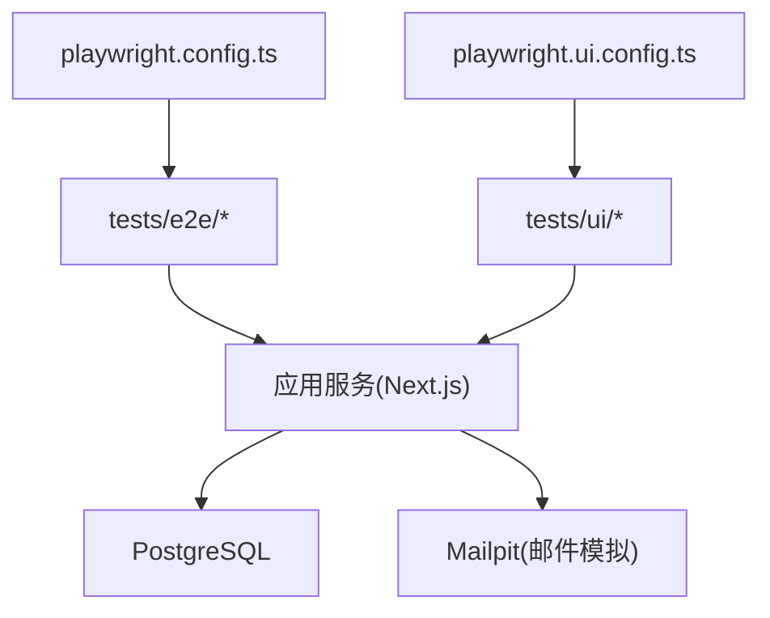
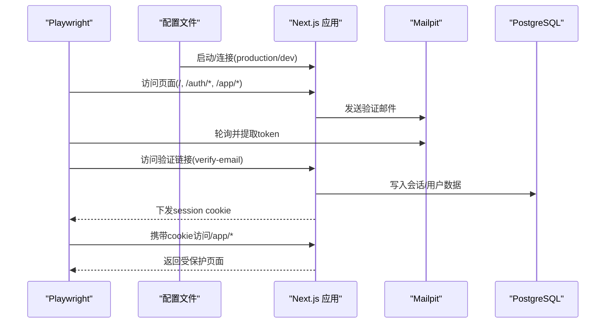
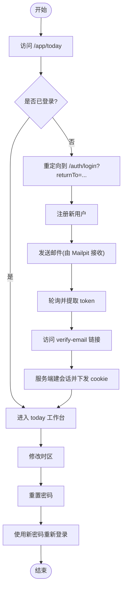
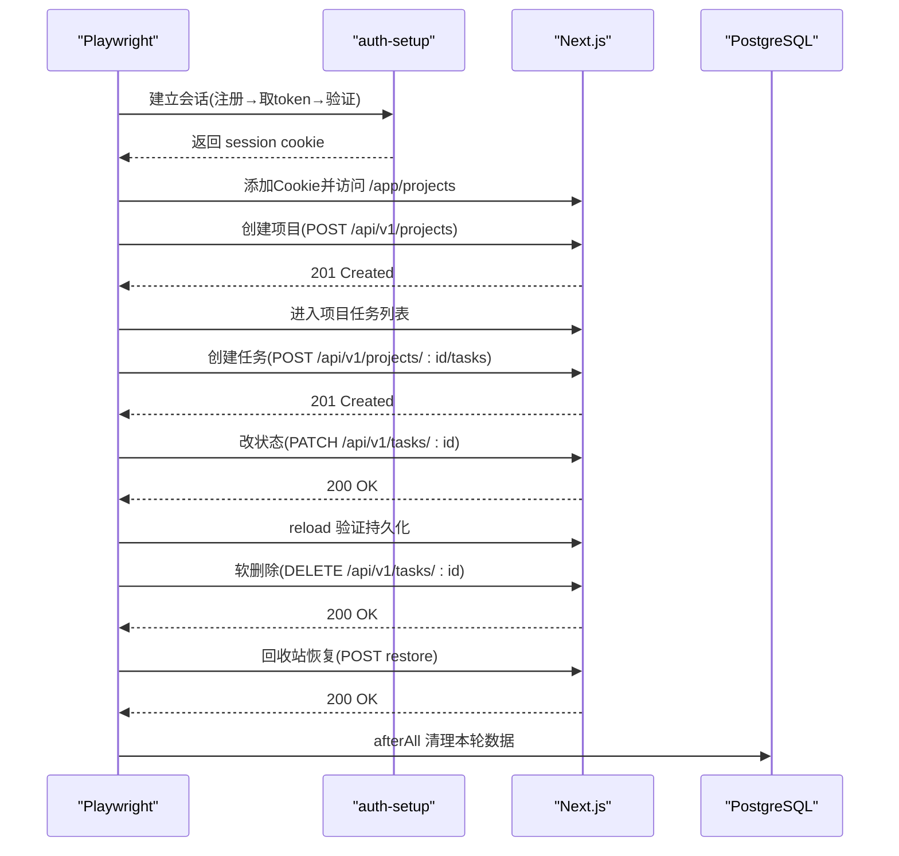
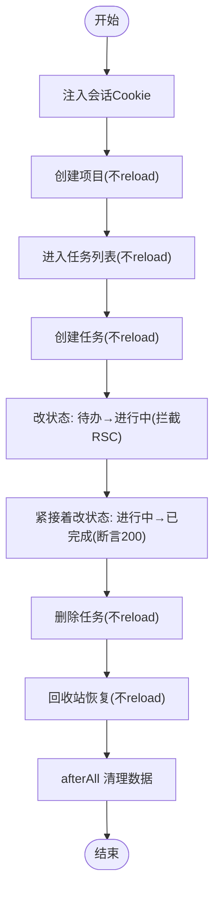
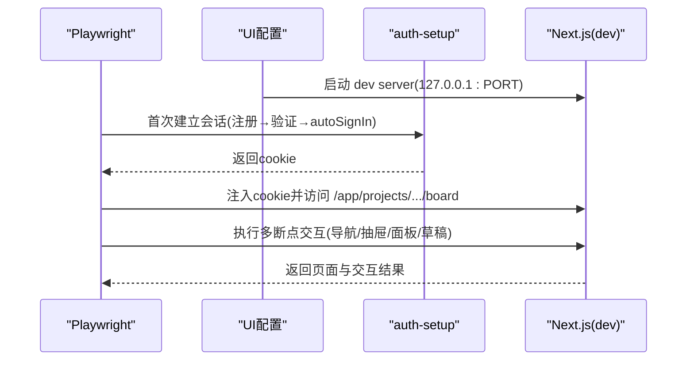
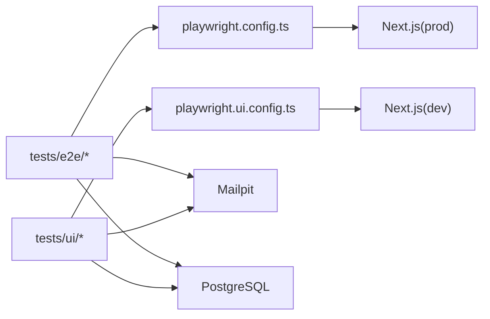

# 端到端测试

<cite>
**本文引用的文件**
- [playwright.config.ts](file://playwright.config.ts)
- [playwright.ui.config.ts](file://playwright.ui.config.ts)
- [package.json](file://package.json)
- [tests/e2e/smoke.spec.ts](file://tests/e2e/smoke.spec.ts)
- [tests/e2e/auth.spec.ts](file://tests/e2e/auth.spec.ts)
- [tests/e2e/m2-vertical.spec.ts](file://tests/e2e/m2-vertical.spec.ts)
- [tests/e2e/m2-no-reload.spec.ts](file://tests/e2e/m2-no-reload.spec.ts)
- [tests/ui/auth-setup.ts](file://tests/ui/auth-setup.ts)
- [tests/ui/m0-review.spec.ts](file://tests/ui/m0-review.spec.ts)
</cite>

## 目录
1. [简介](#简介)
2. [项目结构](#项目结构)
3. [核心组件](#核心组件)
4. [架构总览](#架构总览)
5. [详细组件分析](#详细组件分析)
6. [依赖关系分析](#依赖关系分析)
7. [性能与稳定性](#性能与稳定性)
8. [故障排查指南](#故障排查指南)
9. [结论](#结论)
10. [附录](#附录)

## 简介
本文件面向 Orbit 项目的端到端（E2E）测试，围绕 Playwright 框架在真实浏览器中的自动化能力，覆盖认证流程、项目管理、任务看板等核心用户路径。文档同时说明 UI 回归测试的会话前置、跨断点交互、可访问性与视觉回归策略，并提供调试技巧与常见问题定位方法。

## 项目结构
Orbit 的 E2E 测试位于 tests/e2e，UI 回归测试位于 tests/ui；Playwright 提供两套配置：
- playwright.config.ts：生产模式冒烟与功能用例（默认 Chromium）。
- playwright.ui.config.ts：开发服务器上的 UI 回归用例（单 worker，失败保留截图/trace）。

图表来源
- [playwright.config.ts:1-41](file://playwright.config.ts#L1-L41)
- [playwright.ui.config.ts:1-25](file://playwright.ui.config.ts#L1-L25)

章节来源
- [playwright.config.ts:1-41](file://playwright.config.ts#L1-L41)
- [playwright.ui.config.ts:1-25](file://playwright.ui.config.ts#L1-L25)
- [package.json:12-22](file://package.json#L12-L22)

## 核心组件
- 配置与运行
  - 默认项目为 Chromium，启用并行执行、CI 重试、HTML 报告。
  - webServer 自动构建并启动 Next.js 生产服务；若设置 E2E_BASE_URL 则复用外部服务。
  - UI 配置使用开发服务器，绑定 127.0.0.1，失败时保留 trace 和截图。
- 测试组织
  - smoke.spec.ts：最小冒烟，验证首页可达与标题渲染。
  - auth.spec.ts：认证全流程（注册→邮箱验证→进入应用→重设密码→会话失效后重新登录）。
  - m2-vertical.spec.ts：纵向闭环（创建项目→创建任务→状态流转→软删除→回收站恢复），每步 reload 验证持久化。
  - m2-no-reload.spec.ts：不 reload 连续写回归（捕获旧版 props 镜像导致的假 409），全程同页刷新。
  - ui/m0-review.spec.ts：UI 回归（导航、抽屉、面板焦点、草稿保护、跨断点行为）。
- 会话前置
  - tests/ui/auth-setup.ts：通过 HTTP 调用完成“注册→取验证邮件 token→验证→autoSignIn”，返回可注入浏览器的 cookie。

章节来源
- [playwright.config.ts:16-39](file://playwright.config.ts#L16-L39)
- [playwright.ui.config.ts:9-23](file://playwright.ui.config.ts#L9-L23)
- [tests/e2e/smoke.spec.ts:1-13](file://tests/e2e/smoke.spec.ts#L1-L13)
- [tests/e2e/auth.spec.ts:1-166](file://tests/e2e/auth.spec.ts#L1-L166)
- [tests/e2e/m2-vertical.spec.ts:1-255](file://tests/e2e/m2-vertical.spec.ts#L1-L255)
- [tests/e2e/m2-no-reload.spec.ts:1-295](file://tests/e2e/m2-no-reload.spec.ts#L1-L295)
- [tests/ui/auth-setup.ts:1-134](file://tests/ui/auth-setup.ts#L1-L134)
- [tests/ui/m0-review.spec.ts:1-172](file://tests/ui/m0-review.spec.ts#L1-L172)

## 架构总览
E2E 测试以 Playwright 驱动真实浏览器，按配置启动或连接 Next.js 服务，并通过 Mailpit 获取验证邮件完成认证。UI 回归测试在开发模式下运行，借助 auth-setup 建立已验证会话并注入 cookie，确保 /app/* 路由可访问。

图表来源
- [playwright.config.ts:16-39](file://playwright.config.ts#L16-L39)
- [playwright.ui.config.ts:9-23](file://playwright.ui.config.ts#L9-L23)
- [tests/ui/auth-setup.ts:89-133](file://tests/ui/auth-setup.ts#L89-L133)
- [tests/e2e/auth.spec.ts:99-154](file://tests/e2e/auth.spec.ts#L99-L154)

## 详细组件分析

### 认证流程 E2E（auth.spec.ts）
- 未登录访问 /app/today 被代理重定向到 /auth/login 并携带 returnTo。
- 登录失败展示统一文案，不泄露账户是否存在。
- 完整主流程：注册 → 从 Mailpit 取验证邮件 → 构造同源验证链接 → 验证成功进入 /app/today → 修改时区 → 重置密码 → 原 Cookie 失效 → 重新登录并回到目标页。
- 伪造/失效 Cookie 会触发重新登录，并保留 returnTo。

图表来源
- [tests/e2e/auth.spec.ts:81-165](file://tests/e2e/auth.spec.ts#L81-L165)

章节来源
- [tests/e2e/auth.spec.ts:1-166](file://tests/e2e/auth.spec.ts#L1-L166)

### 纵向闭环 E2E（m2-vertical.spec.ts）
- 建立会话（auth-setup）→ 进入项目列表 → 创建项目 → 进入任务列表 → 创建两个任务 → 行内 Select 切换状态（待办→进行中→已完成）→ reload 验证持久化 → 软删除第一个任务 → 回收站恢复 → 返回列表验证复现。
- 每步写操作均等待对应 API 响应（POST/PATCH/DELETE/restore）并校验状态码。
- afterAll 直连 PostgreSQL 按本轮唯一 email 精确清理数据，避免污染开发库。

图表来源
- [tests/e2e/m2-vertical.spec.ts:39-106](file://tests/e2e/m2-vertical.spec.ts#L39-L106)
- [tests/e2e/m2-vertical.spec.ts:108-253](file://tests/e2e/m2-vertical.spec.ts#L108-L253)
- [tests/ui/auth-setup.ts:89-133](file://tests/ui/auth-setup.ts#L89-L133)

章节来源
- [tests/e2e/m2-vertical.spec.ts:1-255](file://tests/e2e/m2-vertical.spec.ts#L1-L255)

### 无刷新连续写回归（m2-no-reload.spec.ts）
- 目标：捕获“props→useState 镜像”缺陷导致同页连续写出现假 409 的问题。
- 关键手段：
  - 拦截 RSC 刷新请求，延迟新 props 到达，制造“API 成功但 UI 仍用旧 version”的窗口。
  - 同一页面内连续两次改状态，断言第二次 PATCH 返回 200 而非 409。
  - 删除与恢复同样要求同页立即更新，无需 reload。
- 数据清理：afterAll 按 FK 顺序删除 ActivityLog、IdempotencyRecord、Task、ProjectMember、Project、Verification、User。

图表来源
- [tests/e2e/m2-no-reload.spec.ts:27-48](file://tests/e2e/m2-no-reload.spec.ts#L27-L48)
- [tests/e2e/m2-no-reload.spec.ts:117-270](file://tests/e2e/m2-no-reload.spec.ts#L117-L270)
- [tests/e2e/m2-no-reload.spec.ts:66-115](file://tests/e2e/m2-no-reload.spec.ts#L66-L115)

章节来源
- [tests/e2e/m2-no-reload.spec.ts:1-295](file://tests/e2e/m2-no-reload.spec.ts#L1-L295)

### UI 回归测试（m0-review.spec.ts）
- 会话前置：首个用例通过 auth-setup 建立真实会话并缓存 cookie，后续用例复用。
- 多断点验证：导航名称可见性、项目标记尺寸、键盘进入项目、抽屉打开/关闭与焦点恢复、任务面板焦点隔离、草稿确认、跨断点焦点保持、独立详情页不锁焦点。
- 配置特点：禁用并行、单 worker、失败保留截图与 trace。

图表来源
- [playwright.ui.config.ts:9-23](file://playwright.ui.config.ts#L9-L23)
- [tests/ui/auth-setup.ts:89-133](file://tests/ui/auth-setup.ts#L89-L133)
- [tests/ui/m0-review.spec.ts:18-24](file://tests/ui/m0-review.spec.ts#L18-L24)
- [tests/ui/m0-review.spec.ts:41-171](file://tests/ui/m0-review.spec.ts#L41-L171)

章节来源
- [tests/ui/m0-review.spec.ts:1-172](file://tests/ui/m0-review.spec.ts#L1-L172)
- [tests/ui/auth-setup.ts:1-134](file://tests/ui/auth-setup.ts#L1-L134)
- [playwright.ui.config.ts:1-25](file://playwright.ui.config.ts#L1-L25)

## 依赖关系分析
- 测试与配置
  - e2e 用例依赖 playwright.config.ts 提供的 baseURL、webServer、reporter、projects。
  - UI 用例依赖 playwright.ui.config.ts 的 baseURL（127.0.0.1）、workers=1、trace/screenshot 策略。
- 测试与外部服务
  - Mailpit：用于接收并查询验证邮件（e2e 与 UI 共用）。
  - PostgreSQL：纵向/无刷新用例 afterAll 直连清理数据。
- 模块耦合
  - e2e 与 UI 共享认证链路逻辑（auth-setup），避免对内部表结构的直接耦合，提高可维护性。

图表来源
- [playwright.config.ts:16-39](file://playwright.config.ts#L16-L39)
- [playwright.ui.config.ts:9-23](file://playwright.ui.config.ts#L9-L23)
- [tests/e2e/m2-vertical.spec.ts:53-106](file://tests/e2e/m2-vertical.spec.ts#L53-L106)
- [tests/e2e/m2-no-reload.spec.ts:66-115](file://tests/e2e/m2-no-reload.spec.ts#L66-L115)

章节来源
- [playwright.config.ts:16-39](file://playwright.config.ts#L16-L39)
- [playwright.ui.config.ts:9-23](file://playwright.ui.config.ts#L9-L23)
- [tests/e2e/m2-vertical.spec.ts:39-106](file://tests/e2e/m2-vertical.spec.ts#L39-L106)
- [tests/e2e/m2-no-reload.spec.ts:66-115](file://tests/e2e/m2-no-reload.spec.ts#L66-L115)

## 性能与稳定性
- 并行与重试
  - e2e 默认 fullyParallel=true，CI 下 retries=2，提升吞吐与鲁棒性。
  - UI 回归 workers=1，避免并发干扰 UI 状态。
- 超时与资源
  - webServer 启动超时较长（生产 240s，开发 120s），适应冷启动与数据库初始化。
  - 邮件轮询与网络重试在测试中显式实现，降低偶发失败。
- 数据隔离
  - 每个用例生成唯一 email/tag，afterAll 精确清理，避免数据污染影响稳定性。
- 建议
  - CI 环境固定端口与主机，避免 Origin/Cookie 域不一致。
  - 对慢接口增加 waitForResponse 与合理超时，减少误判。

[本节为通用指导，不直接分析具体文件]

## 故障排查指南
- 无法访问 /app/*
  - 检查是否已通过 auth-setup 注入有效 session cookie。
  - 确认 baseURL 与 apiOrigin 一致，避免 host-only cookie 不生效。
- 验证邮件未到达
  - 确认 Mailpit 可达（默认 http://localhost:8025），必要时调整 MAILPIT_API。
  - 检查主题片段与收件人地址匹配逻辑。
- 假 409 或状态不同步
  - 参考 m2-no-reload 的用例思路：拦截 RSC 刷新，验证在旧 version 窗口下的行为。
- 截图与追踪
  - UI 配置失败保留截图与 trace；e2e 可在关键步骤主动截图至 artifacts。
  - 使用 Playwright 代码生成器定位元素，结合 role/name 选择器增强稳定性。

章节来源
- [tests/ui/auth-setup.ts:46-80](file://tests/ui/auth-setup.ts#L46-L80)
- [tests/ui/auth-setup.ts:89-133](file://tests/ui/auth-setup.ts#L89-L133)
- [tests/e2e/m2-no-reload.spec.ts:27-48](file://tests/e2e/m2-no-reload.spec.ts#L27-L48)
- [playwright.ui.config.ts:16-23](file://playwright.ui.config.ts#L16-L23)

## 结论
Orbit 的 E2E 与 UI 回归测试基于 Playwright 构建了完整的用户路径验证体系：从认证、项目与任务生命周期，到无刷新连续写的边界场景，以及多断点下的交互与可访问性保障。通过统一的会话前置、严格的 API 响应断言与数据清理策略，测试具备高可信度与可维护性。建议在 CI 中固化运行，并结合截图与 trace 持续优化稳定性。

[本节为总结，不直接分析具体文件]

## 附录
- 常用命令
  - 安装浏览器：pnpm exec playwright install --with-deps chromium
  - 运行 e2e：pnpm test:e2e
  - 运行 UI 回归：pnpm test:ui
- 环境变量
  - E2E_BASE_URL：复用已有服务，跳过 webServer。
  - PORT：服务端口（默认 3000）。
  - MAILPIT_API：邮件服务地址（默认 http://localhost:8025/api/v1）。
  - E2E_AUTH_ORIGIN：Better Auth 受信源（默认 http://localhost:3000）。

章节来源
- [playwright.config.ts:11-14](file://playwright.config.ts#L11-L14)
- [playwright.ui.config.ts:6-7](file://playwright.ui.config.ts#L6-L7)
- [tests/ui/auth-setup.ts:24-28](file://tests/ui/auth-setup.ts#L24-L28)
- [package.json:12-22](file://package.json#L12-L22)