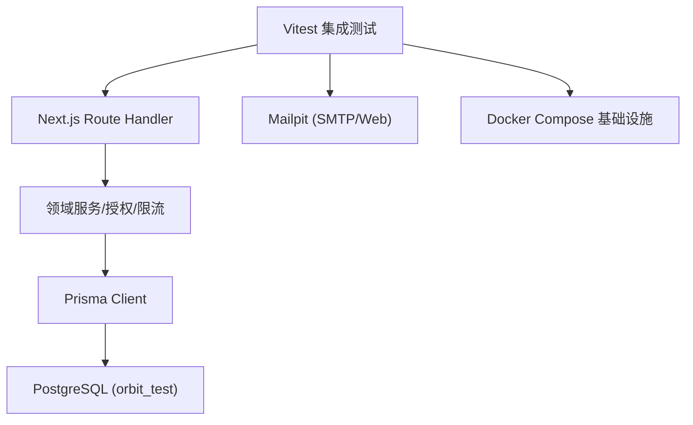
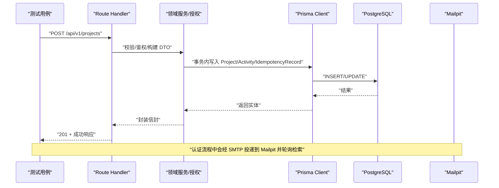
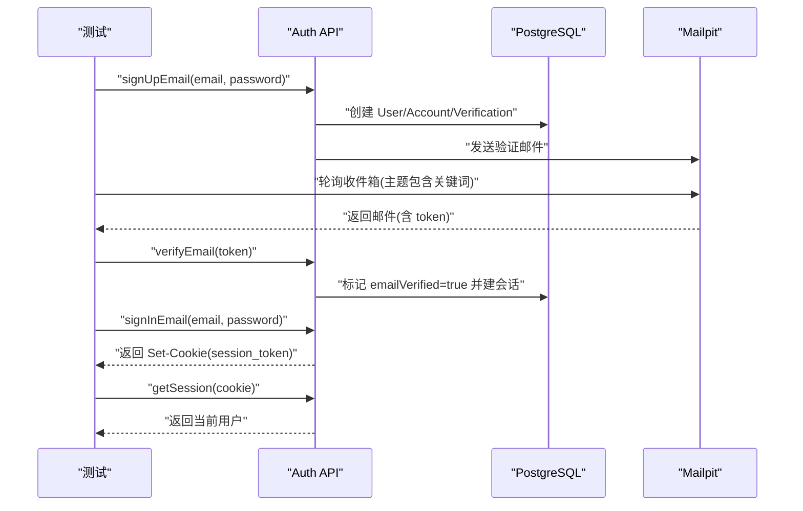
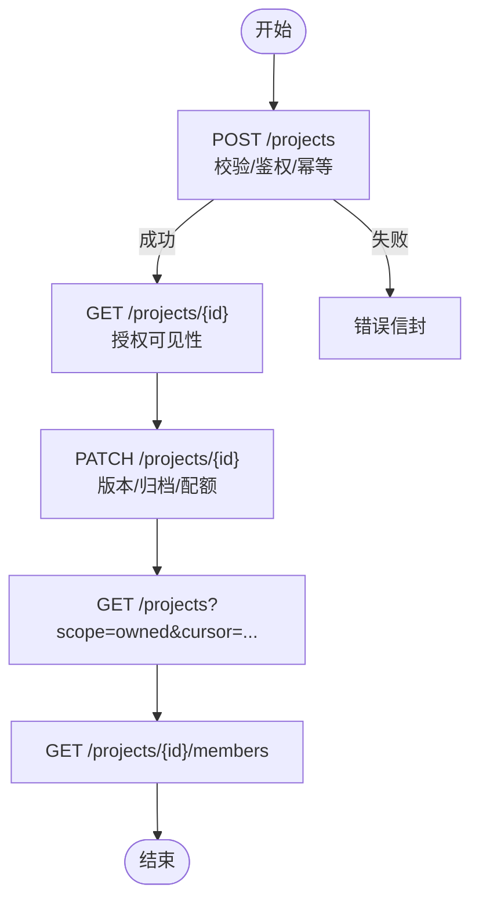
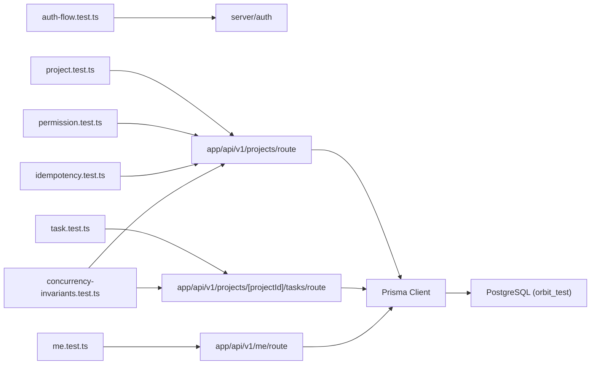

# 集成测试

<cite>
**本文引用的文件**
- [vitest.config.ts](file://vitest.config.ts)
- [compose.dev.yml](file://infra/compose.dev.yml)
- [schema.prisma](file://prisma/schema.prisma)
- [auth-flow.test.ts](file://tests/integration/auth-flow.test.ts)
- [project.test.ts](file://tests/integration/project.test.ts)
- [task.test.ts](file://tests/integration/task.test.ts)
- [permission.test.ts](file://tests/integration/permission.test.ts)
- [me.test.ts](file://tests/integration/me.test.ts)
- [idempotency.test.ts](file://tests/integration/idempotency.test.ts)
- [concurrency-invariants.test.ts](file://tests/integration/concurrency-invariants.test.ts)
- [db-connectivity.test.ts](file://tests/integration/db-connectivity.test.ts)
</cite>

## 目录
1. [简介](#简介)
2. [项目结构](#项目结构)
3. [核心组件](#核心组件)
4. [架构总览](#架构总览)
5. [详细组件分析](#详细组件分析)
6. [依赖关系分析](#依赖关系分析)
7. [性能考量](#性能考量)
8. [故障排查指南](#故障排查指南)
9. [结论](#结论)
10. [附录](#附录)

## 简介
本文件面向 Orbit 项目的集成测试体系，覆盖 API 接口、数据库操作与业务逻辑验证。重点说明：
- 测试目标与范围：认证流程、项目 CRUD、任务管理、权限校验、幂等性、并发不变量、个人设置等。
- 测试环境配置：PostgreSQL 连接、Mailpit 邮件投递、隔离的测试库与连接池策略。
- 并发控制：文件级并行限制、进程内并发、事务与行锁协同。
- 数据隔离与回滚：基于 RUN_TAG 的数据清理、按外键顺序删除、事务边界保证。
- 性能优化：连接池大小、超时参数、避免跨文件并行导致的连接数溢出。

## 项目结构
集成测试位于 tests/integration，使用 Vitest 运行；E2E 走 Playwright（不在本文范围）。关键配置与基础设施：
- Vitest 多项目：unit、contract、integration；integration 禁用文件间并行，避免连接池打满。
- Docker Compose 提供 PostgreSQL、MinIO、Mailpit，仅绑定 127.0.0.1。
- Prisma schema 定义用户、会话、项目、任务、活动日志、幂等记录等模型。



图表来源
- [vitest.config.ts:24-53](file://vitest.config.ts#L24-L53)
- [compose.dev.yml:10-72](file://infra/compose.dev.yml#L10-L72)
- [schema.prisma:14-268](file://prisma/schema.prisma#L14-L268)

章节来源
- [vitest.config.ts:24-53](file://vitest.config.ts#L24-L53)
- [compose.dev.yml:10-72](file://infra/compose.dev.yml#L10-L72)
- [schema.prisma:14-268](file://prisma/schema.prisma#L14-L268)

## 核心组件
- 认证全流程测试：注册→真实邮件→验证→登录→会话→密码找回→重设→旧会话撤销→限流行为。
- 项目域测试：创建/读取/更新/归档/恢复/成员列表/配额/分页/幂等/Origin 校验。
- 任务域测试：创建/编号/状态机/软删除/恢复/分配/配额/幂等/列表过滤。
- 权限测试：非成员与已移除用户访问统一收敛为 404，幂等重放重新授权。
- 个人设置测试：/me 的 GET/PATCH、缓存头、请求 ID、账户隔离、会话撤销。
- 幂等性测试：同 key 同 body 重放、同 key 异 body 冲突、过期后去重失效。
- 并发不变量：任务编号唯一连续、版本冲突串行化、幂等并发去重、项目 key 唯一。
- 数据库连通性：独立测试库可连接、与开发库名不同、执行查询断言。

章节来源
- [auth-flow.test.ts:13-32](file://tests/integration/auth-flow.test.ts#L13-L32)
- [project.test.ts:17-34](file://tests/integration/project.test.ts#L17-L34)
- [task.test.ts:20-37](file://tests/integration/task.test.ts#L20-L37)
- [permission.test.ts:16-30](file://tests/integration/permission.test.ts#L16-L30)
- [me.test.ts:15-39](file://tests/integration/me.test.ts#L15-L39)
- [idempotency.test.ts:7-17](file://tests/integration/idempotency.test.ts#L7-L17)
- [concurrency-invariants.test.ts:16-37](file://tests/integration/concurrency-invariants.test.ts#L16-L37)
- [db-connectivity.test.ts:6-13](file://tests/integration/db-connectivity.test.ts#L6-L13)

## 架构总览
集成测试通过直接调用 Next.js route handler（纯 Request → Response），不启动 HTTP 服务，从而覆盖真实路由编排（请求 ID → Origin → 会话 → schema → 领域服务 → 信封）。所有写操作均写入 orbit_test 数据库，并通过 vi.mock 替换应用 Prisma 单例，确保测试与开发/生产库完全隔离。



图表来源
- [project.test.ts:66-70](file://tests/integration/project.test.ts#L66-L70)
- [task.test.ts:69-75](file://tests/integration/task.test.ts#L69-L75)
- [auth-flow.test.ts:53-60](file://tests/integration/auth-flow.test.ts#L53-L60)
- [compose.dev.yml:54-68](file://infra/compose.dev.yml#L54-L68)

## 详细组件分析

### 认证流程集成测试
- 覆盖点：注册触发真实验证邮件（含品牌与链接）、未验证邮箱登录被拒、验证后建会话、登录设置 cookie、找回密码与重置、旧会话撤销、限流配置与实时 429、returnTo 安全校验。
- 数据隔离：每个运行使用 RUN_TAG 前缀生成唯一邮箱，beforeAll/afterAll 清理用户与 verification 记录。
- 邮件验证：通过 Mailpit Web API 轮询最新邮件，提取 token 完成验证或重置。



图表来源
- [auth-flow.test.ts:72-109](file://tests/integration/auth-flow.test.ts#L72-L109)
- [auth-flow.test.ts:114-143](file://tests/integration/auth-flow.test.ts#L114-L143)
- [auth-flow.test.ts:225-304](file://tests/integration/auth-flow.test.ts#L225-L304)
- [auth-flow.test.ts:324-405](file://tests/integration/auth-flow.test.ts#L324-L405)
- [auth-flow.test.ts:430-464](file://tests/integration/auth-flow.test.ts#L430-L464)

章节来源
- [auth-flow.test.ts:13-32](file://tests/integration/auth-flow.test.ts#L13-L32)
- [auth-flow.test.ts:72-109](file://tests/integration/auth-flow.test.ts#L72-L109)
- [auth-flow.test.ts:114-143](file://tests/integration/auth-flow.test.ts#L114-L143)
- [auth-flow.test.ts:225-304](file://tests/integration/auth-flow.test.ts#L225-L304)
- [auth-flow.test.ts:324-405](file://tests/integration/auth-flow.test.ts#L324-L405)
- [auth-flow.test.ts:430-464](file://tests/integration/auth-flow.test.ts#L430-L464)

### 项目 CRUD 与权限、幂等、配额、分页
- 创建：201 成功、默认色、trim 处理、幂等键缺失 400、同 key 同 body 重放 200、同 key 异 body 409、key 重复 409、非法 Origin 403。
- 读取：owner 可见、非成员 404、不存在 UUID 404、成员角色 MEMBER。
- 更新：改名 version++、无变化不 bump、expectedVersion 不符 409、member 改 403、归档/恢复、配额超限 422。
- 列表：scope=owned 游标分页、hasMore/nextCursor、archived=only 过滤、损坏 cursor 400。
- 成员列表：返回 owner+成员、不含 email、非成员 404。



图表来源
- [project.test.ts:138-151](file://tests/integration/project.test.ts#L138-L151)
- [project.test.ts:244-365](file://tests/integration/project.test.ts#L244-L365)
- [project.test.ts:367-416](file://tests/integration/project.test.ts#L367-L416)
- [project.test.ts:418-545](file://tests/integration/project.test.ts#L418-L545)
- [project.test.ts:547-601](file://tests/integration/project.test.ts#L547-L601)
- [project.test.ts:603-666](file://tests/integration/project.test.ts#L603-L666)
- [project.test.ts:668-701](file://tests/integration/project.test.ts#L668-L701)

章节来源
- [project.test.ts:17-34](file://tests/integration/project.test.ts#L17-L34)
- [project.test.ts:244-365](file://tests/integration/project.test.ts#L244-L365)
- [project.test.ts:367-416](file://tests/integration/project.test.ts#L367-L416)
- [project.test.ts:418-545](file://tests/integration/project.test.ts#L418-L545)
- [project.test.ts:547-601](file://tests/integration/project.test.ts#L547-L601)
- [project.test.ts:603-666](file://tests/integration/project.test.ts#L603-L666)
- [project.test.ts:668-701](file://tests/integration/project.test.ts#L668-L701)

### 任务生命周期与状态机
- 创建：201、identifier=KEY-number、默认 TODO/MEDIUM、assignee 校验、非成员 404、归档项目禁止创建、超配额 422、幂等重放。
- 读取：成员可读详情、非成员 404、列表排除软删除、deleted=only 只返回软删除。
- 更新：标题修改 version++、expectedVersion 不符 409、status→DONE 设置 completedAt、离开 DONE 清空、重复相同 status 不刷新、无语义变化不 bump。
- 删除：软删除后 GET 404、缺少 expectedVersion 400、非 owner·非创建者删除 403、创建者可删自己任务。
- 恢复：恢复追加列尾、原负责人退出则 assignee 置空、恢复超配额 422。

```mermaid
stateDiagram-v2
[*] --> TODO
TODO --> IN_PROGRESS : "更新状态"
IN_PROGRESS --> DONE : "completedAt 设置"
DONE --> IN_PROGRESS : "离开 DONE 清空 completedAt"
NOTE : "重复相同状态不刷新 completedAt"
```

图表来源
- [task.test.ts:321-469](file://tests/integration/task.test.ts#L321-L469)
- [task.test.ts:471-530](file://tests/integration/task.test.ts#L471-L530)
- [task.test.ts:532-675](file://tests/integration/task.test.ts#L532-L675)
- [task.test.ts:677-737](file://tests/integration/task.test.ts#L677-L737)
- [task.test.ts:739-800](file://tests/integration/task.test.ts#L739-L800)

章节来源
- [task.test.ts:20-37](file://tests/integration/task.test.ts#L20-L37)
- [task.test.ts:321-469](file://tests/integration/task.test.ts#L321-L469)
- [task.test.ts:471-530](file://tests/integration/task.test.ts#L471-L530)
- [task.test.ts:532-675](file://tests/integration/task.test.ts#L532-L675)
- [task.test.ts:677-737](file://tests/integration/task.test.ts#L677-L737)
- [task.test.ts:739-800](file://tests/integration/task.test.ts#L739-L800)

### 权限与幂等重放重新授权
- 已移除用户访问项目/任务一律 404 NOT_FOUND，不泄露存在性。
- 幂等重放重新授权：B 在被移除前用某 Idempotency-Key 成功创建任务，移除后用同 key 同 body 重放必须 404，证明重放前重新校验成员关系。

章节来源
- [permission.test.ts:16-30](file://tests/integration/permission.test.ts#L16-L30)
- [permission.test.ts:268-378](file://tests/integration/permission.test.ts#L268-L378)
- [permission.test.ts:380-431](file://tests/integration/permission.test.ts#L380-L431)

### 个人设置 /me
- GET /me：未认证 401、伪造会话 401、他人会话隔离、响应带 private,no-store、x-request-id、白名单字段。
- PATCH /me：更新 name/timezone、非法时区 400、未知字段拒绝、越权字段拒绝、Origin 校验先于会话、撤销会话后立即 401。
- 服务层：readUserById/toUserDto/buildUserUpdateData 契约与错误处理。

章节来源
- [me.test.ts:15-39](file://tests/integration/me.test.ts#L15-L39)
- [me.test.ts:223-350](file://tests/integration/me.test.ts#L223-L350)
- [me.test.ts:352-445](file://tests/integration/me.test.ts#L352-L445)
- [me.test.ts:447-581](file://tests/integration/me.test.ts#L447-L581)
- [me.test.ts:583-687](file://tests/integration/me.test.ts#L583-L687)
- [me.test.ts:689-785](file://tests/integration/me.test.ts#L689-L785)

### 幂等性语义
- 同 key 同 body 重放：200 原结果、同一资源 id、不重复副作用。
- 同 key 异 body：409 IDEMPOTENCY_CONFLICT。
- 过期记录不去重：expiresAt 过期后同 key 异 body 按全新请求执行，产生新资源。

章节来源
- [idempotency.test.ts:7-17](file://tests/integration/idempotency.test.ts#L7-L17)
- [idempotency.test.ts:155-212](file://tests/integration/idempotency.test.ts#L155-L212)

### 并发不变量
- 任务编号并发：同项目并发 createTask → number 集合连续、identifier 唯一、Project.nextTaskNumber 正确推进。
- 版本冲突并发：同任务同 expectedVersion 两个并发 PATCH → 一胜一败，DB 仅落地胜者。
- 幂等并发：同 Idempotency-Key + 同 body 并发 → Task/ActivityLog/IdempotencyRecord 各一行，所有 data.id 相同。
- 项目 key 并发唯一：同 key 不同 Idempotency-Key 并发 → 一成功其余 409，该 key 仅一行。

章节来源
- [concurrency-invariants.test.ts:16-37](file://tests/integration/concurrency-invariants.test.ts#L16-L37)
- [concurrency-invariants.test.ts:242-296](file://tests/integration/concurrency-invariants.test.ts#L242-L296)
- [concurrency-invariants.test.ts:298-344](file://tests/integration/concurrency-invariants.test.ts#L298-L344)
- [concurrency-invariants.test.ts:346-397](file://tests/integration/concurrency-invariants.test.ts#L346-L397)
- [concurrency-invariants.test.ts:399-433](file://tests/integration/concurrency-invariants.test.ts#L399-L433)

### 数据库连通性与隔离
- 显式加载 .env.local/.env，parseEnv 校验 TEST_DATABASE_URL 不得指向开发/生产库。
- 直连 PostgreSQL 执行 SELECT 1、current_database() 断言。
- 容器化基础设施：PostgreSQL 5432、Mailpit SMTP 25025/Web 8025、MinIO 9000/9001，仅绑定 127.0.0.1。

章节来源
- [db-connectivity.test.ts:6-13](file://tests/integration/db-connectivity.test.ts#L6-L13)
- [db-connectivity.test.ts:24-48](file://tests/integration/db-connectivity.test.ts#L24-L48)
- [compose.dev.yml:10-72](file://infra/compose.dev.yml#L10-L72)

## 依赖关系分析
- 测试文件依赖 Next.js route handler（动态 import），通过 vi.mock 替换 Prisma 单例，使 handler 与领域服务读写 orbit_test。
- 认证相关测试依赖 Better Auth API 与 Mailpit；项目/任务/权限测试依赖 Prisma 模型与迁移。
- 并发测试依赖数据库行锁与事务，结合连接池 max=15 与语句/锁定超时参数。



图表来源
- [project.test.ts:66-70](file://tests/integration/project.test.ts#L66-L70)
- [task.test.ts:69-75](file://tests/integration/task.test.ts#L69-L75)
- [me.test.ts:66-72](file://tests/integration/me.test.ts#L66-L72)
- [schema.prisma:14-268](file://prisma/schema.prisma#L14-L268)

章节来源
- [project.test.ts:66-70](file://tests/integration/project.test.ts#L66-L70)
- [task.test.ts:69-75](file://tests/integration/task.test.ts#L69-L75)
- [me.test.ts:66-72](file://tests/integration/me.test.ts#L66-L72)
- [schema.prisma:14-268](file://prisma/schema.prisma#L14-L268)

## 性能考量
- 连接池管理：PrismaPg 适配器设置 max=15，配合 statement_timeout=5000、lock_timeout=3000，避免连接池耗尽与长时间阻塞。
- 文件级并行限制：Vitest integration 项目设置 fileParallelism:false，防止多个测试文件并行导致连接数超过 PostgreSQL 默认 max_connections。
- 进程内并发：单个测试文件内可使用 Promise.all 发起并发请求，利用数据库行锁与事务保证一致性。
- 超时与重试：并发用例可能因锁超时映射为 409/422，断言以不变量为核心（编号唯一连续、仅一行、配额/唯一约束不破）。

章节来源
- [vitest.config.ts:44-53](file://vitest.config.ts#L44-L53)
- [project.test.ts:52-63](file://tests/integration/project.test.ts#L52-L63)
- [task.test.ts:55-66](file://tests/integration/task.test.ts#L55-L66)
- [concurrency-invariants.test.ts:55-66](file://tests/integration/concurrency-invariants.test.ts#L55-L66)

## 故障排查指南
- 数据库连接失败：确认 docker compose 已启动、TEST_DATABASE_URL 指向 orbit_test、端口未被占用。
- 邮件未到达：检查 Mailpit SMTP 25025/Web 8025 是否可用，轮询等待超时需适当延长。
- 限流触发：APP_ENV=test 关闭 Better Auth 内置限流；若仍出现 429，检查自定义规则与 IP 标识。
- 权限误判：已移除用户访问应返回 404；如出现 403，检查授权预检与锁内复核逻辑。
- 并发异常：关注 lock_timeout 与 statement_timeout；必要时调整连接池大小或减少并发度。

章节来源
- [db-connectivity.test.ts:6-13](file://tests/integration/db-connectivity.test.ts#L6-L13)
- [auth-flow.test.ts:430-464](file://tests/integration/auth-flow.test.ts#L430-L464)
- [permission.test.ts:268-378](file://tests/integration/permission.test.ts#L268-L378)
- [concurrency-invariants.test.ts:16-37](file://tests/integration/concurrency-invariants.test.ts#L16-L37)

## 结论
Orbit 的集成测试体系通过直接调用 route handler、隔离的测试库与连接池策略，全面覆盖了认证、项目、任务、权限、个人设置、幂等性与并发不变量等关键场景。借助 Docker 基础设施与 Mailpit，实现了端到端的真实断言；通过 RUN_TAG 数据隔离与严格的外键删除顺序，保证了测试的稳定性和可重复性。建议在持续集成中保持 fileParallelism:false 并监控连接池使用情况，以确保测试性能与稳定性。

## 附录
- 运行前提：docker compose -f infra/compose.dev.yml up -d；确保 TEST_DATABASE_URL 指向 orbit_test。
- 常用命令：pnpm test:integration（运行集成测试）；pnpm test:unit（单元测试）；pnpm test:contract（契约测试）。
- 关键环境变量：APP_ENV=test、BETTER_AUTH_SECRET（固定测试密钥）、AUTH_TRUSTED_ORIGINS（可信源）。