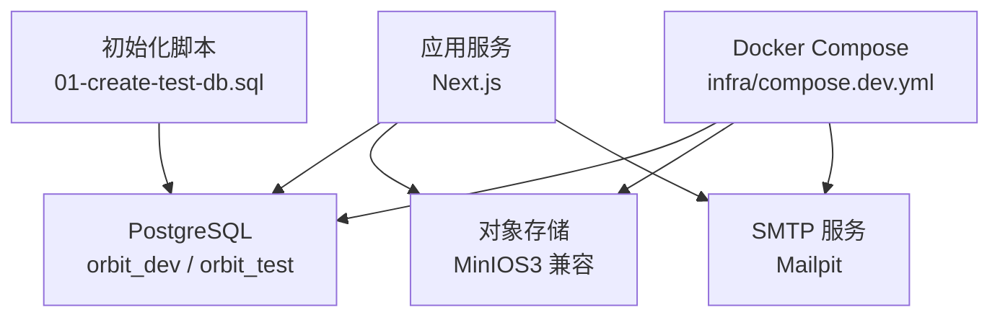
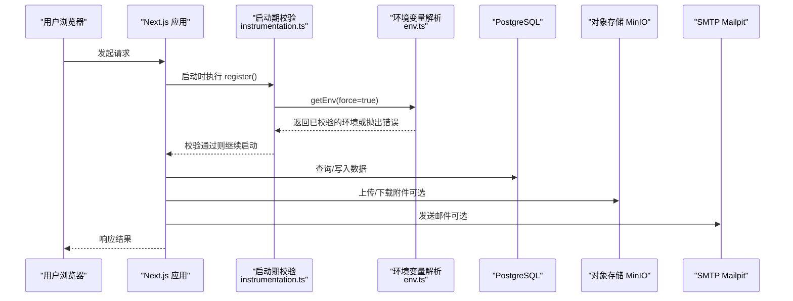
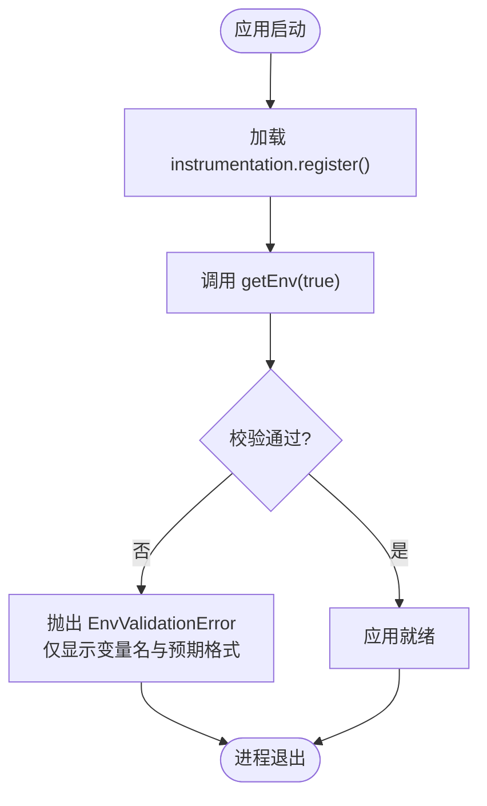
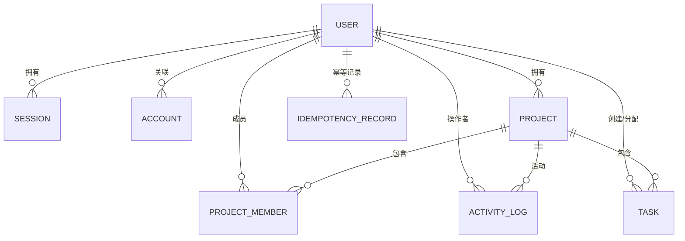
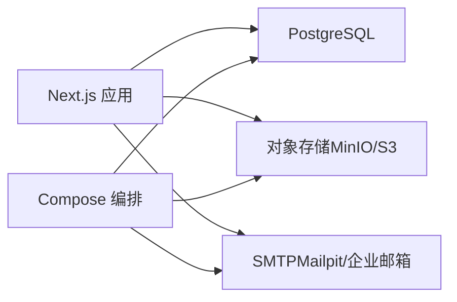

# 部署运维

<cite>
**本文引用的文件**
- [package.json](file://package.json)
- [next.config.ts](file://next.config.ts)
- [compose.dev.yml](file://infra/compose.dev.yml)
- [infra/README.md](file://infra/README.md)
- [01-create-test-db.sql](file://infra/postgres/init/01-create-test-db.sql)
- [schema.prisma](file://prisma/schema.prisma)
- [env.ts](file://src/server/env.ts)
- [instrumentation.ts](file://src/instrumentation.ts)
- [options.ts](file://src/server/auth/options.ts)
- [writer.ts](file://src/server/modules/activity/writer.ts)
- [backlog.json](file://planning/backlog.json)
</cite>

## 目录
1. [简介](#简介)
2. [项目结构](#项目结构)
3. [核心组件](#核心组件)
4. [架构总览](#架构总览)
5. [详细组件分析](#详细组件分析)
6. [依赖关系分析](#依赖关系分析)
7. [性能与构建优化](#性能与构建优化)
8. [监控、日志与健康检查](#监控日志与健康检查)
9. [备份恢复与灾难恢复](#备份恢复与灾难恢复)
10. [安全加固](#安全加固)
11. [CI/CD 与自动化运维](#cicd-与自动化运维)
12. [故障诊断与常见问题](#故障诊断与常见问题)
13. [结论](#结论)

## 简介
本运维文档面向生产环境的 Orbit 应用，覆盖容器化编排、环境变量校验与数据库初始化、构建与静态资源优化、监控告警与日志收集、健康检查、备份恢复与安全加固、以及 CI/CD 流水线与自动化运维工具。当前仓库处于 M0 基线阶段，生产级 Dockerfile、多阶段镜像与部署编排属于后续里程碑（M6），本文在现有代码基础上给出可落地的运维方案与待补齐项说明。

## 项目结构
- 基础设施编排：infra/compose.dev.yml 提供本地开发依赖（PostgreSQL、MinIO、Mailpit），全部端口仅绑定 127.0.0.1；首次启动通过 SQL 脚本创建独立测试库 orbit_test。
- 应用配置：next.config.ts 关闭框架信息泄露、外部化 pg 驱动、限制开发来源；环境变量集中校验于 src/server/env.ts，并在 Next.js instrumentation 中启动期失败快速退出。
- 数据模型与迁移：Prisma schema 定义认证与业务模型，迁移由 Prisma 管理；测试与开发数据库隔离策略由环境变量与初始化脚本保障。
- 构建与脚本：package.json 提供 dev/build/start、Prisma 生成与迁移命令、类型检查与测试脚本。

图表来源
- [compose.dev.yml:10-72](file://infra/compose.dev.yml#L10-L72)
- [01-create-test-db.sql:1-8](file://infra/postgres/init/01-create-test-db.sql#L1-L8)

章节来源
- [compose.dev.yml:1-72](file://infra/compose.dev.yml#L1-L72)
- [infra/README.md:1-18](file://infra/README.md#L1-L18)
- [next.config.ts:1-21](file://next.config.ts#L1-L21)
- [package.json:12-27](file://package.json#L12-L27)

## 核心组件
- 环境配置与校验：集中式 Zod 校验，强制非 development 环境的安全密钥长度、严格来源白名单、测试库隔离、AI 开关与凭据条件要求；错误信息仅包含变量名与预期格式，不暴露任何值。
- 启动期校验：Next.js instrumentation 在服务端启动时动态加载并执行 getEnv(true)，失败即终止进程，避免带错配置运行。
- 数据库与迁移：Prisma 客户端输出至 src/generated/prisma；迁移通过 prisma migrate deploy 在生产环境应用；schema 包含认证与业务模型及索引设计。
- 本地依赖编排：PostgreSQL、MinIO、Mailpit 通过 Compose 拉起，具备健康检查与卷持久化；SQL 初始化确保测试库独立存在。

章节来源
- [env.ts:1-238](file://src/server/env.ts#L1-L238)
- [instrumentation.ts:1-21](file://src/instrumentation.ts#L1-L21)
- [schema.prisma:14-268](file://prisma/schema.prisma#L14-L268)
- [compose.dev.yml:10-72](file://infra/compose.dev.yml#L10-L72)
- [01-create-test-db.sql:1-8](file://infra/postgres/init/01-create-test-db.sql#L1-L8)

## 架构总览
Orbit 采用 Next.js 全栈应用，服务端运行时连接 PostgreSQL 进行数据持久化，可选接入 S3 兼容对象存储用于附件，使用 SMTP 发送邮件。开发阶段通过 Compose 提供本地依赖；生产阶段需补充镜像构建与编排（见“CI/CD 与自动化运维”）。

图表来源
- [instrumentation.ts:7-20](file://src/instrumentation.ts#L7-L20)
- [env.ts:98-155](file://src/server/env.ts#L98-L155)
- [compose.dev.yml:10-72](file://infra/compose.dev.yml#L10-L72)

## 详细组件分析

### 环境变量与启动期校验
- 变量分类：区分 APP_ENV、URL、数据库连接、认证密钥、SMTP、对象存储、日志级别、AI 功能等。
- 安全约束：禁止 NEXT_PUBLIC_ 前缀暴露敏感变量；非 development 环境要求足够长度的认证密钥；AUTH_TRUSTED_ORIGINS 必须为精确来源列表且不含通配符。
- 测试隔离：TEST_DATABASE_URL 不得指向开发/生产库名，防止污染。
- 启动保护：instrumentation 在服务端启动时强制校验，失败立即终止，避免错误配置上线。

图表来源
- [instrumentation.ts:7-20](file://src/instrumentation.ts#L7-L20)
- [env.ts:98-155](file://src/server/env.ts#L98-L155)

章节来源
- [env.ts:1-238](file://src/server/env.ts#L1-L238)
- [instrumentation.ts:1-21](file://src/instrumentation.ts#L1-L21)

### 数据库与迁移
- 数据源与客户端：Prisma datasource 指定 PostgreSQL，客户端输出到 src/generated/prisma。
- 模型与索引：认证表与业务表（Project/Task/ActivityLog/IdempotencyRecord）均定义必要索引与约束，提升查询性能与一致性。
- 迁移策略：开发使用 prisma migrate dev，生产使用 prisma migrate deploy；测试库通过初始化脚本独立创建。

图表来源
- [schema.prisma:27-268](file://prisma/schema.prisma#L27-L268)

章节来源
- [schema.prisma:14-268](file://prisma/schema.prisma#L14-L268)
- [01-create-test-db.sql:1-8](file://infra/postgres/init/01-create-test-db.sql#L1-L8)

### 本地依赖编排（Compose）
- PostgreSQL：默认端口 5432，绑定 127.0.0.1，挂载数据卷，健康检查使用 pg_isready。
- MinIO：S3 兼容对象存储，API 与控制台端口分别映射，健康检查使用 mc ready。
- Mailpit：SMTP 宿主端口 25025→容器 1025，Web 控制台 8025，允许不安全认证便于开发。
- 初始化脚本：首次启动自动创建 orbit_test 测试库，与 orbit_dev 隔离。

章节来源
- [compose.dev.yml:10-72](file://infra/compose.dev.yml#L10-L72)
- [infra/README.md:1-18](file://infra/README.md#L1-L18)
- [01-create-test-db.sql:1-8](file://infra/postgres/init/01-create-test-db.sql#L1-L8)

### 认证与会话安全
- 速率限制：针对登录、注册、重置密码等敏感路径设置更严格的窗口与上限，单实例内存存储，多实例应切换为数据库或二级存储。
- Cookie 安全：根据环境启用 Secure Cookie，HttpOnly 与 SameSite 由库默认保证。
- 来源校验：AUTH_TRUSTED_ORIGINS 严格白名单，拒绝通配符。

章节来源
- [options.ts:115-140](file://src/server/auth/options.ts#L115-L140)
- [env.ts:126-155](file://src/server/env.ts#L126-L155)

### 活动日志与审计
- 元数据白名单：仅允许预定义键写入 ActivityLog.metadata，防止敏感或越权内容入库。
- 事务内追加：在事务中写入活动日志，保证一致性与可追踪性。

章节来源
- [writer.ts:36-64](file://src/server/modules/activity/writer.ts#L36-L64)

## 依赖关系分析
- 应用与服务：Next.js 应用依赖 PostgreSQL、对象存储（可选）、SMTP（可选）。
- 开发与生产差异：开发通过 Compose 提供依赖；生产需补充镜像构建、反向代理、HTTPS、密钥管理等。
- 构建产物：pg 驱动保持外部化以避免客户端打包问题；Next.js 关闭 poweredByHeader 减少信息泄露。

图表来源
- [next.config.ts:13-18](file://next.config.ts#L13-L18)
- [compose.dev.yml:10-72](file://infra/compose.dev.yml#L10-L72)

章节来源
- [next.config.ts:1-21](file://next.config.ts#L1-L21)
- [compose.dev.yml:1-72](file://infra/compose.dev.yml#L1-L72)

## 性能与构建优化
- 构建流程：pnpm build 会先执行 prisma generate，再构建 Next.js 应用；生产启动使用 next start。
- 外部化依赖：serverExternalPackages 将 pg 外部化，避免客户端 bundle 引入原生模块导致的问题。
- 安全头：poweredByHeader 关闭，减少框架信息泄露。
- 建议优化：
  - 生产镜像使用多阶段构建，仅拷贝产物与运行时依赖。
  - 启用 Next.js 压缩与缓存策略（如 CDN 缓存静态资源）。
  - 数据库连接池与超时参数按负载调优。
  - 对高频查询建立合适索引（schema 已定义关键索引）。

章节来源
- [package.json:12-27](file://package.json#L12-L27)
- [next.config.ts:13-18](file://next.config.ts#L13-L18)

## 监控、日志与健康检查
- 健康检查：
  - PostgreSQL：pg_isready 健康检查。
  - MinIO：mc ready 健康检查。
  - 应用层：可在反向代理或编排层增加 HTTP 健康端点（例如 /health）。
- 日志级别：LOG_LEVEL 支持 debug/info/warn/error，默认 info；生产建议 info 或 warn。
- 活动日志：ActivityLog 记录关键业务动作，metadata 经白名单过滤，便于审计与排障。
- 建议：
  - 统一日志格式（JSON），采集到集中式日志系统（如 Loki/Elastic）。
  - 指标采集（Prometheus）与应用性能监控（APM）接入。
  - 告警规则基于错误率、延迟、数据库连接数、磁盘使用率等。

章节来源
- [compose.dev.yml:27-52](file://infra/compose.dev.yml#L27-L52)
- [env.ts:119-124](file://src/server/env.ts#L119-L124)
- [writer.ts:36-64](file://src/server/modules/activity/writer.ts#L36-L64)

## 备份恢复与灾难恢复
- 数据库备份：
  - 定期导出 PostgreSQL 数据（逻辑备份）或物理备份（WAL/快照）。
  - 保留多份历史副本，异地存储。
- 对象存储备份：
  - 对 MinIO/S3 bucket 开启版本控制与跨区域复制。
- 恢复演练：
  - 制定恢复步骤与 RTO/RPO 目标，定期演练验证。
  - 恢复后执行数据一致性校验与冒烟测试。
- 迁移回滚：
  - 使用 Prisma 迁移版本管理，必要时准备回滚脚本与验证用例。

[本节为通用运维实践，不直接引用具体源码]

## 安全加固
- 环境变量安全：
  - 禁止 NEXT_PUBLIC_ 暴露敏感变量；非 development 环境强制长密钥。
  - AUTH_TRUSTED_ORIGINS 精确来源白名单，拒绝通配符。
- 会话与 Cookie：
  - 生产环境启用 Secure Cookie，结合 HTTPS。
  - 多实例部署切换速率限制存储为数据库或二级存储。
- 最小权限：
  - 数据库账号最小权限原则，仅授予必要权限。
  - 对象存储访问密钥最小权限策略。
- 传输安全：
  - 全站 HTTPS，禁用弱加密套件。
  - 反向代理配置 HSTS、CSP 等安全头。

章节来源
- [env.ts:25-64](file://src/server/env.ts#L25-L64)
- [env.ts:126-155](file://src/server/env.ts#L126-L155)
- [options.ts:115-140](file://src/server/auth/options.ts#L115-L140)

## CI/CD 与自动化运维
- 当前状态：生产 Dockerfile、多阶段构建与部署编排属于 M6（ORB-021），仓库尚未包含。
- 建议流水线：
  - 代码提交触发 lint、类型检查、单元测试、契约测试、端到端测试。
  - 构建镜像并推送至私有镜像仓库。
  - 部署到 staging 环境执行冒烟测试与回归测试。
  - 生产发布采用灰度/蓝绿发布，配合数据库迁移与回滚策略。
- 自动化运维：
  - 使用编排平台（Kubernetes/Docker Swarm）管理服务与依赖。
  - 配置滚动更新、健康检查、自动重启与扩缩容。
  - 密钥管理通过 Vault 或云平台密钥服务注入环境变量。

章节来源
- [backlog.json:722-745](file://planning/backlog.json#L722-L745)
- [infra/README.md:16-18](file://infra/README.md#L16-L18)

## 故障诊断与常见问题
- 环境变量校验失败：
  - 现象：应用启动失败，提示变量名与预期格式。
  - 排查：检查 APP_ENV、DATABASE_URL、BETTER_AUTH_SECRET、AUTH_TRUSTED_ORIGINS 等必填项与格式。
  - 参考：环境变量校验与错误信息生成逻辑。
- 数据库连接失败：
  - 现象：无法连接 PostgreSQL。
  - 排查：确认 DATABASE_URL 正确、端口可达、网络策略允许；检查 pg_isready 健康检查。
- 测试库冲突：
  - 现象：测试污染开发/生产数据。
  - 排查：确保 TEST_DATABASE_URL 指向独立库，且不与开发/生产库名匹配。
- 邮件发送失败：
  - 现象：SMTP 连接或认证失败。
  - 排查：检查 SMTP_HOST、SMTP_PORT、SMTP_SECURE、MAIL_FROM 等配置；确认 SMTP 服务可达。
- 对象存储上传失败：
  - 现象：附件上传报错。
  - 排查：检查 STORAGE_ENDPOINT、STORAGE_BUCKET、ACCESS_KEY_ID、SECRET_ACCESS_KEY；确认 MinIO/S3 可用。

章节来源
- [env.ts:98-155](file://src/server/env.ts#L98-L155)
- [compose.dev.yml:27-52](file://infra/compose.dev.yml#L27-L52)
- [01-create-test-db.sql:1-8](file://infra/postgres/init/01-create-test-db.sql#L1-L8)

## 结论
当前仓库提供了完善的环境变量校验、数据库模型与迁移、本地依赖编排与初始化脚本，为生产部署奠定了坚实基础。生产级镜像构建、编排与 CI/CD 将在 M6 补齐。运维人员可基于现有能力逐步落地：先确保环境变量与数据库初始化正确，再引入监控、日志、备份恢复与安全加固，最终实现稳定可靠的生产运维体系。