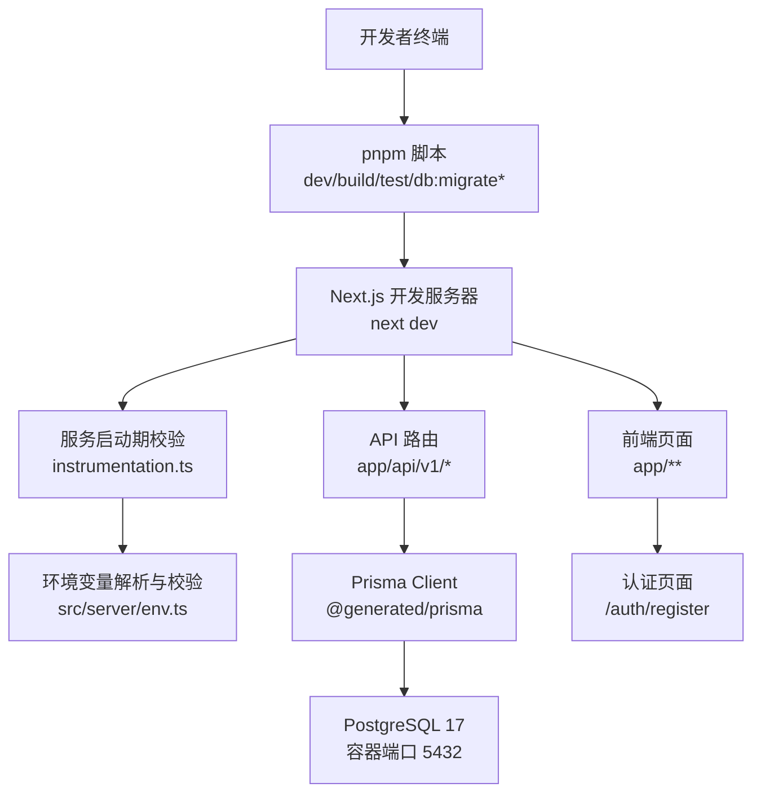
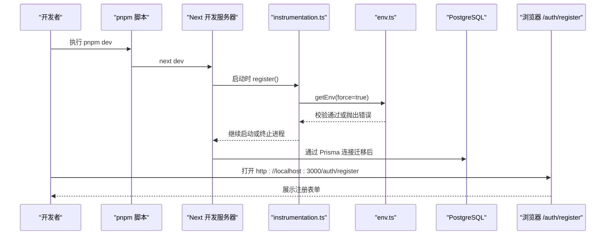
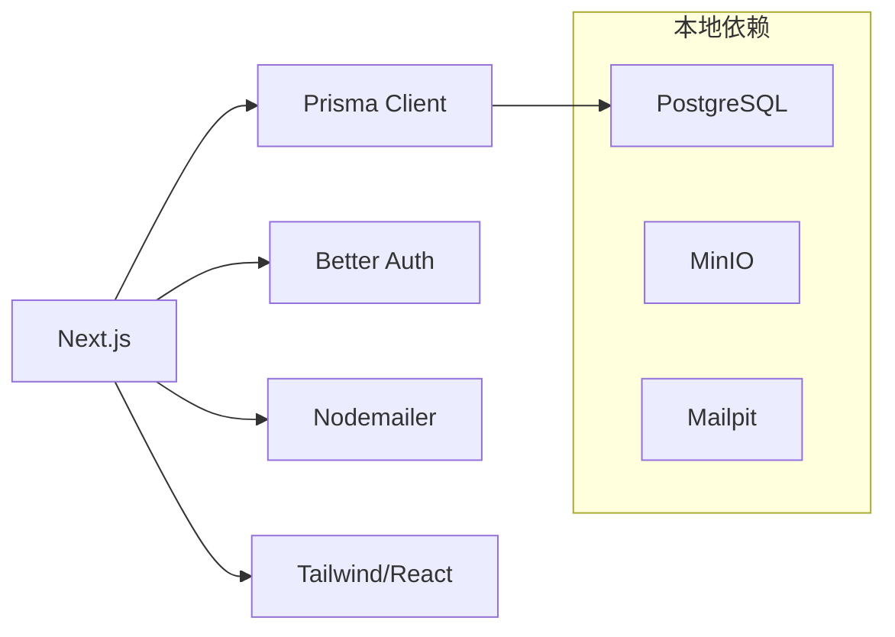

# 快速开始指南

<cite>
**本文引用的文件**
- [package.json](file://package.json)
- [README.md](file://README.md)
- [infra/compose.dev.yml](file://infra/compose.dev.yml)
- [infra/README.md](file://infra/README.md)
- [prisma.config.ts](file://prisma.config.ts)
- [prisma/schema.prisma](file://prisma/schema.prisma)
- [src/server/env.ts](file://src/server/env.ts)
- [src/instrumentation.ts](file://src/instrumentation.ts)
- [next.config.ts](file://next.config.ts)
- [scripts/check-db.ts](file://scripts/check-db.ts)
- [infra/postgres/init/01-create-test-db.sql](file://infra/postgres/init/01-create-test-db.sql)
- [src/app/auth/register/page.tsx](file://src/app/auth/register/page.tsx)
- [src/features/auth/register-form.tsx](file://src/features/auth/register-form.tsx)
</cite>

## 目录
1. [简介](#简介)
2. [项目结构](#项目结构)
3. [核心组件](#核心组件)
4. [架构总览](#架构总览)
5. [详细组件分析](#详细组件分析)
6. [依赖关系分析](#依赖关系分析)
7. [性能注意事项](#性能注意事项)
8. [故障排除指南](#故障排除指南)
9. [结论](#结论)
10. [附录：第一个功能示例](#附录：第一个功能示例)

## 简介
本指南帮助你在最短时间内完成 Orbit 的本地环境准备、数据库启动与迁移、开发服务器启动，并体验注册新用户、创建项目、添加任务等基础能力。你将了解 Node.js 与 pnpm 的版本要求、Docker Compose 启动 PostgreSQL/MinIO/Mailpit、环境变量校验机制、以及常见问题的排查方法。

## 项目结构
Orbit 采用 Next.js App Router + TypeScript 工程，使用 Prisma 管理数据库模型与迁移，通过 Docker Compose 提供本地开发依赖（PostgreSQL、MinIO、Mailpit）。应用入口由 Next.js 托管，服务端在 Node 运行时执行环境变量校验，确保配置安全与正确性。

图表来源
- [package.json:12-27](file://package.json#L12-L27)
- [src/instrumentation.ts:7-20](file://src/instrumentation.ts#L7-L20)
- [src/server/env.ts:98-155](file://src/server/env.ts#L98-L155)
- [prisma.config.ts:13-23](file://prisma.config.ts#L13-L23)
- [infra/compose.dev.yml:10-31](file://infra/compose.dev.yml#L10-L31)

章节来源
- [package.json:1-27](file://package.json#L1-L27)
- [README.md:18-55](file://README.md#L18-L55)
- [infra/README.md:1-18](file://infra/README.md#L1-L18)

## 核心组件
- 运行环境与工具链
  - Node.js ≥ 24.0.0、pnpm ≥ 10.0.0（锁定 pnpm 版本）
  - Next.js 16 App Router 开发/构建/启动脚本
  - Prisma 7 客户端生成与迁移命令
- 本地基础设施
  - PostgreSQL 17（默认 5432，仅绑定 127.0.0.1）
  - MinIO（对象存储，开发用）
  - Mailpit（SMTP 与邮件查看器，开发用）
- 环境变量与安全
  - 启动期强制校验必需变量，错误仅显示变量名与预期格式，不暴露任何值
  - 禁止将秘密类变量以 NEXT_PUBLIC_ 前缀暴露到客户端

章节来源
- [package.json:8-11](file://package.json#L8-L11)
- [package.json:12-27](file://package.json#L12-L27)
- [infra/compose.dev.yml:10-68](file://infra/compose.dev.yml#L10-L68)
- [src/server/env.ts:25-64](file://src/server/env.ts#L25-L64)
- [src/server/env.ts:98-155](file://src/server/env.ts#L98-L155)
- [src/instrumentation.ts:7-20](file://src/instrumentation.ts#L7-L20)

## 架构总览
下图展示了从“安装依赖”到“访问注册页”的端到端流程，包括环境变量校验、数据库连接、迁移与页面渲染。

图表来源
- [package.json:12-15](file://package.json#L12-L15)
- [src/instrumentation.ts:7-20](file://src/instrumentation.ts#L7-L20)
- [src/server/env.ts:227-237](file://src/server/env.ts#L227-L237)
- [prisma.config.ts:13-23](file://prisma.config.ts#L13-L23)
- [infra/compose.dev.yml:10-31](file://infra/compose.dev.yml#L10-L31)
- [src/app/auth/register/page.tsx:15-27](file://src/app/auth/register/page.tsx#L15-L27)

## 详细组件分析

### 环境准备与依赖安装
- 安装 Node.js（≥ 24.0.0）与 pnpm（≥ 10.0.0）
- 克隆仓库后在根目录执行依赖安装
- 复制环境变量模板为本地文件（不会被提交）
- 使用 pnpm 脚本进行类型检查、构建、测试与数据库操作

章节来源
- [package.json:8-11](file://package.json#L8-L11)
- [package.json:12-27](file://package.json#L12-L27)
- [README.md:22-36](file://README.md#L22-L36)

### 数据库与本地依赖（Docker Compose）
- 使用提供的 compose 文件启动 PostgreSQL、MinIO、Mailpit
- 所有服务仅绑定 127.0.0.1，避免暴露到外部网络
- 首次初始化会创建 orbit_dev 与 orbit_test 两个数据库
- 若本机 5432 被占用，可通过环境变量覆盖宿主端口并同步 .env.local 中的连接串端口

章节来源
- [infra/compose.dev.yml:1-72](file://infra/compose.dev.yml#L1-L72)
- [infra/postgres/init/01-create-test-db.sql:1-8](file://infra/postgres/init/01-create-test-db.sql#L1-L8)
- [infra/README.md:1-18](file://infra/README.md#L1-L18)

### 环境变量校验与启动保护
- 服务启动时执行环境变量校验，失败即中止进程
- 校验规则包含：URL 格式、端口范围、布尔值解析、测试库隔离、AI 开关与凭证联动等
- 错误信息仅包含变量名与预期格式，绝不回显任何敏感值
- 禁止将秘密类变量以 NEXT_PUBLIC_ 前缀暴露给客户端

章节来源
- [src/instrumentation.ts:7-20](file://src/instrumentation.ts#L7-L20)
- [src/server/env.ts:25-64](file://src/server/env.ts#L25-L64)
- [src/server/env.ts:98-155](file://src/server/env.ts#L98-L155)
- [src/server/env.ts:168-177](file://src/server/env.ts#L168-L177)
- [src/server/env.ts:179-195](file://src/server/env.ts#L179-L195)

### 数据库迁移与数据准备
- Prisma 7 通过 prisma.config.ts 显式加载 .env.local/.env，读取 DATABASE_URL
- 使用 pnpm 脚本执行迁移与种子数据
- schema.prisma 定义了认证与业务模型（M1/M2），迁移由 Prisma 管理

章节来源
- [prisma.config.ts:1-23](file://prisma.config.ts#L1-L23)
- [package.json:23-27](file://package.json#L23-L27)
- [prisma/schema.prisma:14-21](file://prisma/schema.prisma#L14-L21)
- [prisma/schema.prisma:23-92](file://prisma/schema.prisma#L23-L92)
- [prisma/schema.prisma:144-267](file://prisma/schema.prisma#L144-L267)

### 启动开发服务器与验证
- 执行开发脚本启动 Next.js 开发服务器
- 访问 http://localhost:3000，进入认证页面可体验注册流程
- 开发服务器允许本地回环主机访问，避免跨域拦截导致 HMR/资源加载失败

章节来源
- [package.json:12-15](file://package.json#L12-L15)
- [next.config.ts:1-21](file://next.config.ts#L1-L21)
- [src/app/auth/register/page.tsx:15-27](file://src/app/auth/register/page.tsx#L15-L27)

### 数据库连通性自检
- 提供独立脚本用于只读探测数据库连接，打印当前数据库、用户与服务版本
- 连接失败时输出脱敏错误信息，便于定位网络、凭据或端口问题

章节来源
- [scripts/check-db.ts:1-41](file://scripts/check-db.ts#L1-L41)

## 依赖关系分析
- 运行时依赖
  - Next.js 作为 Web 框架与路由
  - Prisma 与 PostgreSQL 适配器用于数据库访问
  - Better Auth 用于认证（M1）
  - Nodemailer 用于邮件发送（M1）
- 开发依赖
  - Playwright/Vitest/ESLint/Tailwind/TypeScript 等开发与质量工具
- 本地基础设施
  - PostgreSQL 17、MinIO、Mailpit 通过 Docker Compose 编排

图表来源
- [package.json:29-65](file://package.json#L29-L65)
- [infra/compose.dev.yml:10-68](file://infra/compose.dev.yml#L10-L68)

章节来源
- [package.json:29-65](file://package.json#L29-L65)
- [infra/compose.dev.yml:10-68](file://infra/compose.dev.yml#L10-L68)

## 性能注意事项
- 开发阶段建议保持最小化依赖与日志级别，避免不必要的重渲染与网络请求
- 数据库连接池与超时策略在测试中体现（如语句/锁超时），生产部署需根据负载调优
- 关闭 poweredByHeader 减少信息泄露；合理设置 allowedDevOrigins 提升开发体验

[本节为通用指导，不直接分析具体文件]

## 故障排除指南
- 无法连接数据库
  - 确认 Docker Compose 已启动且端口未被占用；必要时覆盖宿主端口并同步 .env.local 的连接串端口
  - 使用脚本进行只读连通性检查，观察返回信息与错误消息
- 环境变量校验失败
  - 检查 APP_ENV、APP_URL、DATABASE_URL、TEST_DATABASE_URL、BETTER_AUTH_*、SMTP_*、STORAGE_* 等必填项格式
  - 确保测试库与开发库名称不同，且不命中开发/生产库命名模式
  - 若启用 AI，需提供对应 provider/model/API key
- 开发服务器跨域/HMR 失败
  - 确认浏览器访问地址在 allowedDevOrigins 列表中（127.0.0.1、localhost）
- 端口冲突
  - 修改 compose 宿主端口映射与环境变量，并同步更新 .env.local 中的端口

章节来源
- [scripts/check-db.ts:14-39](file://scripts/check-db.ts#L14-L39)
- [src/server/env.ts:98-155](file://src/server/env.ts#L98-L155)
- [next.config.ts:13-18](file://next.config.ts#L13-L18)
- [infra/compose.dev.yml:15-19](file://infra/compose.dev.yml#L15-L19)

## 结论
通过以上步骤，你可以在本地快速拉起 Orbit 的开发环境并完成数据库迁移，随后访问注册页面体验认证流程。后续可按里程碑逐步接入项目与任务功能，结合看板与回收站完善协作体验。

[本节为总结性内容，不直接分析具体文件]

## 附录：第一个功能示例
以下示例帮助你完成“注册新用户 → 创建项目 → 添加任务”的基础闭环。请确保已完成环境准备、数据库启动与迁移。

- 注册新用户
  - 访问 /auth/register，填写姓名、邮箱、密码与确认密码
  - 系统会发送邮件进行验证（本地可使用 Mailpit 查看）
  - 验证通过后即可登录并使用功能

  章节来源
  - [src/app/auth/register/page.tsx:15-27](file://src/app/auth/register/page.tsx#L15-L27)
  - [src/features/auth/register-form.tsx:11-34](file://src/features/auth/register-form.tsx#L11-L34)

- 创建项目
  - 登录后进入项目列表或工作台，创建新项目
  - 项目包含名称、标识键、颜色、描述等字段，支持归档与版本控制

  章节来源
  - [prisma/schema.prisma:144-166](file://prisma/schema.prisma#L144-L166)

- 添加任务
  - 在项目内创建任务，设置标题、优先级、截止日期、状态等
  - 任务支持分配、软删除与恢复，具备位置排序与索引优化

  章节来源
  - [prisma/schema.prisma:221-267](file://prisma/schema.prisma#L221-L267)

- 验证安装成功
  - 访问 http://localhost:3000，确认页面正常加载
  - 使用数据库连通性脚本确认数据库可达
  - 在 Mailpit 中查看验证邮件是否送达

  章节来源
  - [scripts/check-db.ts:14-39](file://scripts/check-db.ts#L14-L39)
  - [infra/compose.dev.yml:54-68](file://infra/compose.dev.yml#L54-L68)