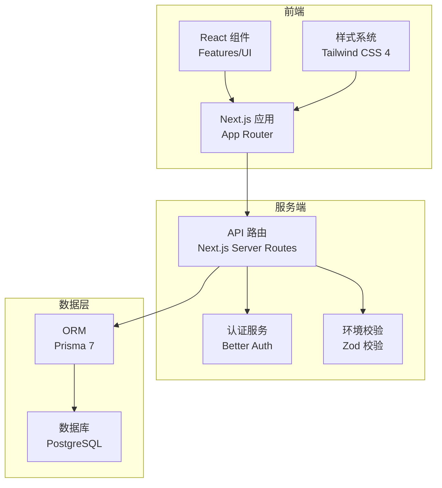
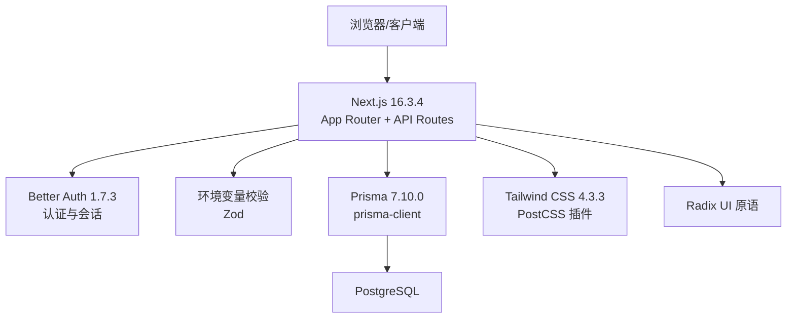
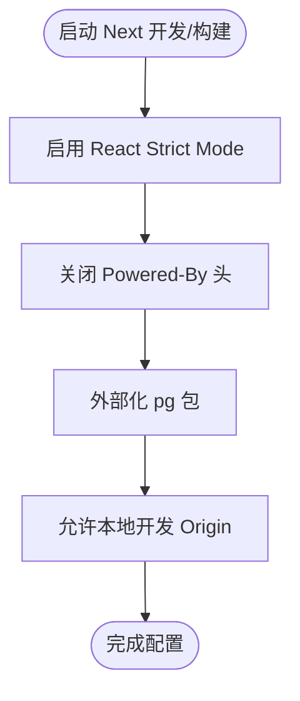
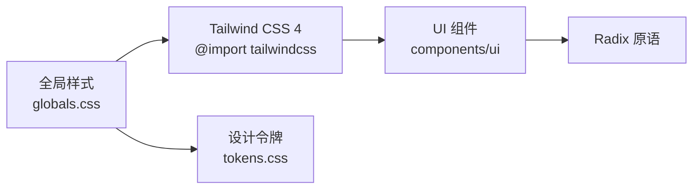
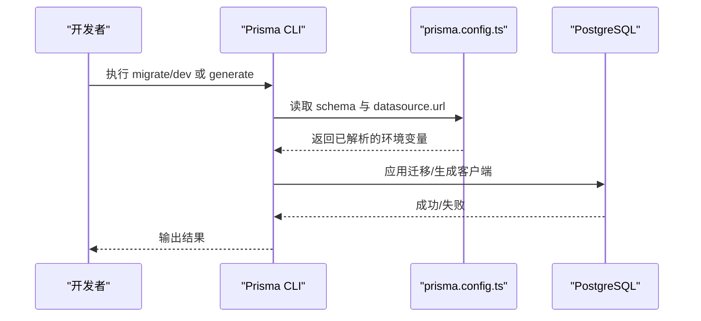
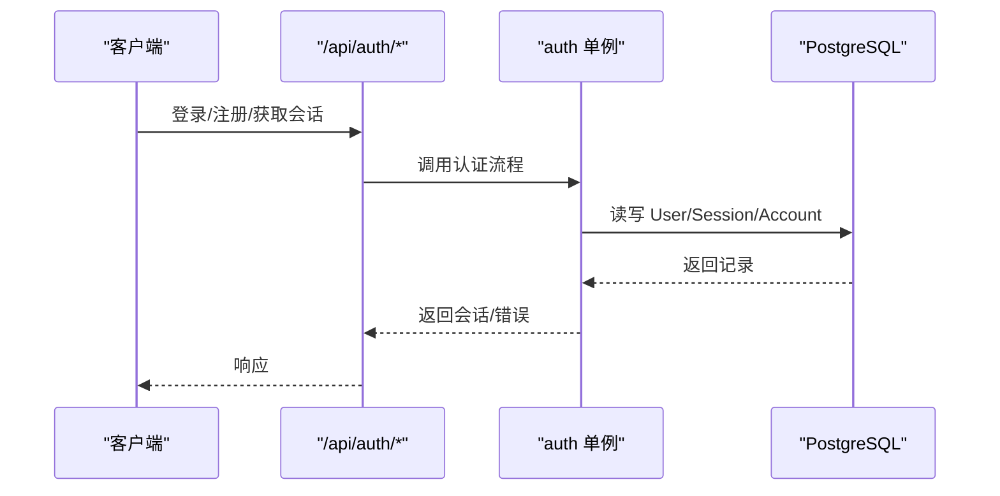
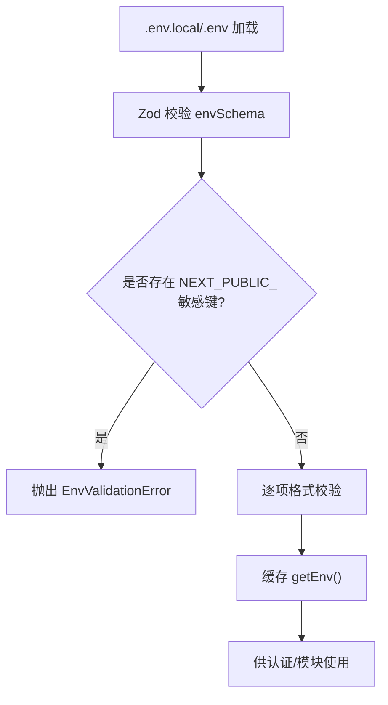
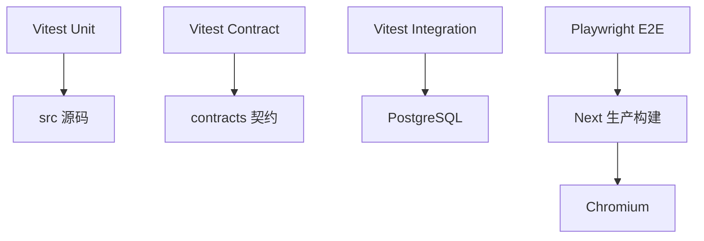
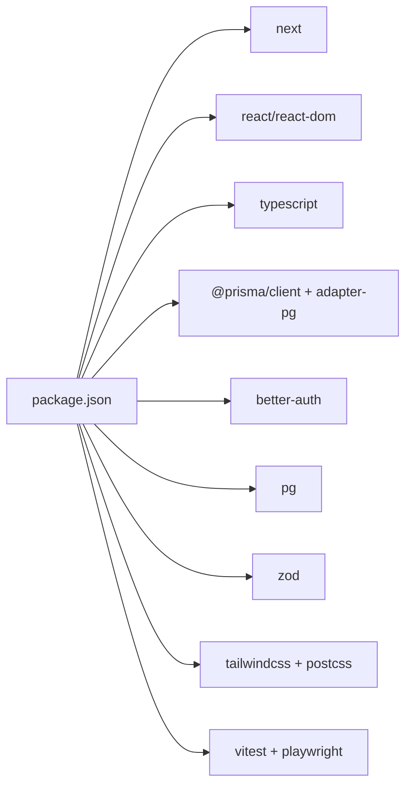

# 技术栈概览

<cite>
**本文引用的文件**
- [package.json](file://package.json)
- [next.config.ts](file://next.config.ts)
- [tsconfig.json](file://tsconfig.json)
- [postcss.config.mjs](file://postcss.config.mjs)
- [prisma.config.ts](file://prisma.config.ts)
- [prisma/schema.prisma](file://prisma/schema.prisma)
- [vitest.config.ts](file://vitest.config.ts)
- [playwright.config.ts](file://playwright.config.ts)
- [src/server/auth/index.ts](file://src/server/auth/index.ts)
- [src/server/env.ts](file://src/server/env.ts)
- [src/styles/globals.css](file://src/styles/globals.css)
- [src/components/ui/index.ts](file://src/components/ui/index.ts)
</cite>

## 目录
1. [简介](#简介)
2. [项目结构](#项目结构)
3. [核心组件](#核心组件)
4. [架构总览](#架构总览)
5. [详细组件分析](#详细组件分析)
6. [依赖关系分析](#依赖关系分析)
7. [性能考量](#性能考量)
8. [故障排查指南](#故障排查指南)
9. [结论](#结论)
10. [附录](#附录)

## 简介
本技术栈概览面向 Orbit 项目的工程基线（M0）与后续演进（M1/M2），聚焦现代化全栈组合：前端采用 Next.js 16.3.4 + React 19.2.8 + TypeScript 5.9.3；后端以 Prisma 7.10.0 作为 ORM，Better Auth 1.7.3 处理认证，PostgreSQL 作为数据库；样式体系基于 Tailwind CSS 4.3.3，UI 组件基于 Radix UI 无障碍原语；测试覆盖 Vitest 单元测试、Playwright E2E。文档同时解释各技术选型理由、版本兼容性与依赖管理策略，并提供架构图与组件关系图，兼顾初学者友好与资深开发者的技术深度。

## 项目结构
Orbit 采用“领域/特性”组织的前端结构与“服务端模块/能力”组织的后端结构，配合统一的契约层与配置中心：
- 前端路由与页面：Next.js App Router（src/app）
- 业务特性：按领域划分（src/features）
- 共享 UI 原语：Radix 封装（src/components/ui）
- 服务端能力：认证、HTTP、模块（src/server）
- 数据模型与迁移：Prisma schema 与迁移（prisma）
- 测试：单元/契约/集成/E2E（tests）
- 构建与工具链：Next、Tailwind、Vitest、Playwright、TypeScript

**图示来源**
- [next.config.ts:1-21](file://next.config.ts#L1-L21)
- [postcss.config.mjs:1-9](file://postcss.config.mjs#L1-L9)
- [prisma.config.ts:1-24](file://prisma.config.ts#L1-L24)
- [src/server/auth/index.ts:1-29](file://src/server/auth/index.ts#L1-L29)
- [src/server/env.ts:1-238](file://src/server/env.ts#L1-L238)

**章节来源**
- [package.json:1-76](file://package.json#L1-L76)
- [next.config.ts:1-21](file://next.config.ts#L1-L21)
- [postcss.config.mjs:1-9](file://postcss.config.mjs#L1-L9)
- [prisma.config.ts:1-24](file://prisma.config.ts#L1-L24)

## 核心组件
- 前端框架与运行时
  - Next.js 16.3.4：提供 App Router、服务端渲染/静态生成、API 路由、构建优化等。
  - React 19.2.8：最新稳定版，配合 Next 的编译与运行时优化。
  - TypeScript 5.9.3：严格模式开启，统一类型约束与路径别名。
- 后端与数据
  - Prisma 7.10.0：Rust-free prisma-client，输出到 src/generated/prisma；schema 仅声明 provider，连接串由 prisma.config.ts 注入。
  - Better Auth 1.7.3：认证会话、账户、验证等模型与 API；通过 /api/auth/* 暴露。
  - PostgreSQL：关系型数据库，使用 @prisma/adapter-pg 驱动。
- 样式与 UI
  - Tailwind CSS 4.3.3：CSS-first 配置，无 tailwind.config.js；通过 postcss 插件接入。
  - Radix UI：可访问性优先的原语组件（Dialog、Dropdown、Tabs、Toast 等）。
- 测试与质量
  - Vitest 5.0.0：单元/契约/集成测试，支持多 project 并行与隔离。
  - Playwright 1.63.0：E2E 自动化测试，默认 Chromium，支持 trace 与重试。
  - ESLint：代码规范检查。

**章节来源**
- [package.json:29-66](file://package.json#L29-L66)
- [tsconfig.json:1-47](file://tsconfig.json#L1-L47)
- [prisma/schema.prisma:1-268](file://prisma/schema.prisma#L1-L268)
- [vitest.config.ts:1-58](file://vitest.config.ts#L1-L58)
- [playwright.config.ts:1-41](file://playwright.config.ts#L1-L41)

## 架构总览
Orbit 采用前后端同仓（monorepo-like）的 Next.js 全栈架构：前端页面与 API 路由共存于 src/app，服务端逻辑集中在 src/server，数据模型与迁移在 prisma，样式与 UI 原语解耦复用。

**图示来源**
- [next.config.ts:1-21](file://next.config.ts#L1-L21)
- [src/server/auth/index.ts:1-29](file://src/server/auth/index.ts#L1-L29)
- [src/server/env.ts:1-238](file://src/server/env.ts#L1-L238)
- [prisma/config:1-24](file://prisma.config.ts#L1-L24)
- [postcss.config.mjs:1-9](file://postcss.config.mjs#L1-L9)

## 详细组件分析

### 前端技术栈：Next.js + React + TypeScript
- Next.js 16.3.4：启用 reactStrictMode、关闭 poweredByHeader 避免泄露信息；将 pg 外部化以避免进入客户端 bundle；允许本地回环 origin 以便开发与 E2E 调试。
- React 19.2.8：与 Next 编译链路协同，获得最新运行时与编译器优化。
- TypeScript 5.9.3：strict 模式、路径别名 @/* → src/*，确保类型安全与模块化。

**图示来源**
- [next.config.ts:1-21](file://next.config.ts#L1-L21)

**章节来源**
- [next.config.ts:1-21](file://next.config.ts#L1-L21)
- [tsconfig.json:1-47](file://tsconfig.json#L1-L47)

### 样式与 UI：Tailwind CSS 4 + Radix UI
- Tailwind CSS 4：通过 @tailwindcss/postcss 接入，无配置文件，样式入口导入 tailwindcss 与设计 tokens。
- Radix UI：提供 Dialog、Dropdown、Tabs、Toast、Tooltip 等可访问性组件，统一导出至 components/ui。

**图示来源**
- [src/styles/globals.css:1-13](file://src/styles/globals.css#L1-L13)
- [postcss.config.mjs:1-9](file://postcss.config.mjs#L1-L9)
- [src/components/ui/index.ts:1-25](file://src/components/ui/index.ts#L1-L25)

**章节来源**
- [src/styles/globals.css:1-13](file://src/styles/globals.css#L1-L13)
- [postcss.config.mjs:1-9](file://postcss.config.mjs#L1-L9)
- [src/components/ui/index.ts:1-25](file://src/components/ui/index.ts#L1-L25)

### 数据层：Prisma 7 + PostgreSQL
- Prisma 7：generator 使用新的 prisma-client，输出到 src/generated/prisma；datasource 仅声明 provider，连接串由 prisma.config.ts 加载 .env.local/.env 后注入。
- PostgreSQL：使用 @prisma/adapter-pg 驱动；schema 包含认证模型（User/Session/Account/Verification）与 M2 项目/任务域模型。

**图示来源**
- [prisma.config.ts:1-24](file://prisma.config.ts#L1-L24)
- [prisma/schema.prisma:14-21](file://prisma/schema.prisma#L14-L21)

**章节来源**
- [prisma.config.ts:1-24](file://prisma.config.ts#L1-L24)
- [prisma/schema.prisma:14-268](file://prisma/schema.prisma#L14-L268)

### 认证：Better Auth 1.7.3
- 单例 auth 实例绑定 Prisma 与已校验环境，server-only 保护避免进入客户端 bundle。
- 通过 /api/auth/* 暴露认证接口；会话类型与用户类型从库推断。

**图示来源**
- [src/server/auth/index.ts:1-29](file://src/server/auth/index.ts#L1-L29)
- [prisma/schema.prisma:23-92](file://prisma/schema.prisma#L23-L92)

**章节来源**
- [src/server/auth/index.ts:1-29](file://src/server/auth/index.ts#L1-L29)
- [prisma/schema.prisma:23-92](file://prisma/schema.prisma#L23-L92)

### 环境与配置：Zod 强校验
- 环境变量集中校验，拒绝 NEXT_PUBLIC_* 暴露敏感字段；强制 BETTER_AUTH_SECRET 长度与非 dev 环境要求；AUTH_TRUSTED_ORIGINS 精确来源列表。
- 提供 parseEnv/getEnv 纯函数与缓存，便于测试与生产一致性。

**图示来源**
- [src/server/env.ts:1-238](file://src/server/env.ts#L1-L238)

**章节来源**
- [src/server/env.ts:1-238](file://src/server/env.ts#L1-L238)

### 测试体系：Vitest + Playwright
- Vitest：unit/contract/integration 三个 project；集成测试禁用文件级并行以避免 PostgreSQL 连接池溢出。
- Playwright：e2e 默认自建服务（build+start），支持 trace、重试与 CI 报告。

**图示来源**
- [vitest.config.ts:1-58](file://vitest.config.ts#L1-L58)
- [playwright.config.ts:1-41](file://playwright.config.ts#L1-L41)

**章节来源**
- [vitest.config.ts:1-58](file://vitest.config.ts#L1-L58)
- [playwright.config.ts:1-41](file://playwright.config.ts#L1-L41)

## 依赖关系分析
- 运行时依赖
  - next、react/react-dom、better-auth、pg、@prisma/client、@prisma/adapter-pg、zod、tailwind-merge、lucide-react、nodemailer、dotenv、server-only
- 开发依赖
  - typescript、eslint、@types/*、prisma、tailwindcss/@tailwindcss/postcss、vitest、@playwright/test、tsx
- 构建与运行
  - pnpm 包管理器；Node >= 24；pnpm onlyBuiltDependencies 限定原生构建范围

**图示来源**
- [package.json:29-66](file://package.json#L29-L66)

**章节来源**
- [package.json:1-76](file://package.json#L1-L76)

## 性能考量
- Next.js 构建优化：关闭 poweredByHeader 减少响应体积；将 pg 外部化避免客户端打包体积膨胀与动态 require 问题。
- 数据库连接：集成测试禁用文件级并行，防止 PostgreSQL 默认 max_connections=100 被连接池击穿。
- 样式与资源：Tailwind CSS 4 按需生成，结合 tokens 统一管理，减少冗余样式。
- 类型与编译：TypeScript strict 模式与 isolatedModules 提升编译速度与类型安全性。

[本节为通用指导，不直接分析具体文件]

## 故障排查指南
- 环境变量校验失败
  - 现象：启动时报错，提示某变量不符合预期格式。
  - 排查：检查 DATABASE_URL、BETTER_AUTH_SECRET、AUTH_TRUSTED_ORIGINS 等是否满足约束；确认未使用 NEXT_PUBLIC_ 前缀暴露敏感键。
  - 参考实现：环境变量解析与错误构造。
- 认证跨域/同源问题
  - 现象：E2E 或本地开发时写请求被拒绝。
  - 排查：确保 E2E_BASE_URL 与 APP_URL/BETTER_AUTH_URL 同源；Next 开发服务器 allowedDevOrigins 包含 localhost/127.0.0.1。
- 数据库连接失败
  - 现象：Prisma 迁移或查询失败。
  - 排查：确认 prisma.config.ts 正确加载 .env.local/.env；DATABASE_URL 指向可用 PostgreSQL；pg 驱动未被误打包进客户端。

**章节来源**
- [src/server/env.ts:1-238](file://src/server/env.ts#L1-L238)
- [next.config.ts:1-21](file://next.config.ts#L1-L21)
- [prisma.config.ts:1-24](file://prisma.config.ts#L1-L24)

## 结论
Orbit 的技术栈以 Next.js 为核心，串联 React、TypeScript、Tailwind CSS 4 与 Radix UI，形成高效、可维护的前端体验；后端通过 Prisma 7 与 Better Auth 1.7.3 对接 PostgreSQL，提供类型安全的数据访问与成熟的认证能力；测试体系以 Vitest 与 Playwright 覆盖单元、契约、集成与 E2E，保障质量与稳定性。整体方案在版本兼容性、依赖管理与可观测性方面均有明确策略，适合小团队快速迭代与长期演进。

[本节为总结性内容，不直接分析具体文件]

## 附录
- 关键命令
  - 开发：pnpm dev（生成 Prisma 客户端并启动 Next）
  - 构建：pnpm build（生成 Prisma 客户端并构建）
  - 类型检查：pnpm typecheck
  - 测试：pnpm test:unit / test:integration / test:e2e / test:contract
  - 数据库：pnpm db:migrate:dev / db:migrate:deploy / db:seed
- 版本与引擎约束
  - Node >= 24，pnpm >= 10；onlyBuiltDependencies 限定原生构建范围，加速安装与构建。

**章节来源**
- [package.json:12-28](file://package.json#L12-L28)
- [package.json:67-74](file://package.json#L67-L74)