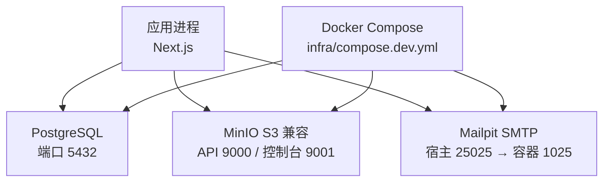
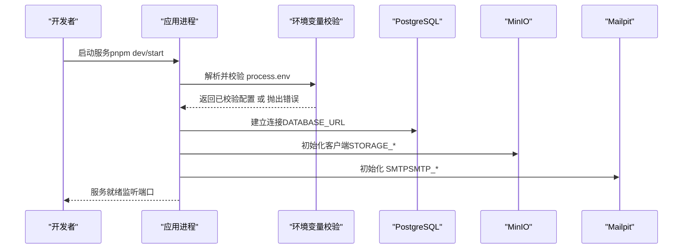
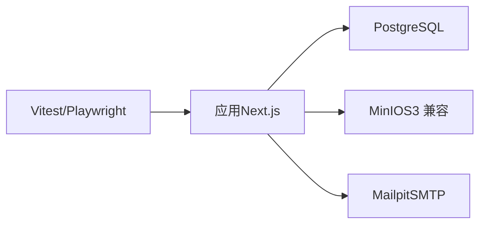

# 系统要求与环境配置

<cite>
**本文引用的文件**
- [package.json](file://package.json)
- [next.config.ts](file://next.config.ts)
- [prisma.config.ts](file://prisma.config.ts)
- [src/server/env.ts](file://src/server/env.ts)
- [infra/compose.dev.yml](file://infra/compose.dev.yml)
- [infra/README.md](file://infra/README.md)
- [scripts/README.md](file://scripts/README.md)
- [playwright.config.ts](file://playwright.config.ts)
- [vitest.config.ts](file://vitest.config.ts)
- [tests/unit/env.test.ts](file://tests/unit/env.test.ts)
- [docs/08-ENVIRONMENT-AND-DEPLOYMENT.md](file://docs/08-ENVIRONMENT-AND-DEPLOYMENT.md)
- [DEVELOPMENT-PLAN.md](file://DEVELOPMENT-PLAN.md)
</cite>

## 目录
1. [简介](#简介)
2. [项目结构](#项目结构)
3. [核心组件](#核心组件)
4. [架构总览](#架构总览)
5. [详细组件分析](#详细组件分析)
6. [依赖关系分析](#依赖关系分析)
7. [性能考虑](#性能考虑)
8. [故障排查指南](#故障排查指南)
9. [结论](#结论)
10. [附录](#附录)

## 简介
本章节面向开发者与运维人员，系统化说明 Orbit 项目的系统要求、环境配置与运行方式。内容覆盖硬件与软件环境、环境变量规范、不同环境的差异、端口与网络设置、容器化部署要求、以及环境验证与诊断方法，确保在开发、测试与生产环境中均可正确配置并稳定运行。

## 项目结构
Orbit 采用 Next.js + Prisma 的现代化全栈架构：
- 应用运行时：Next.js（Node.js），通过 package.json 声明 Node 与包管理器版本约束。
- 数据库：PostgreSQL（本地开发通过 Docker Compose 提供）。
- 对象存储：MinIO（S3 兼容，用于附件等）。
- 邮件服务：Mailpit（本地 SMTP 与查看器）。
- 配置校验：在服务启动期集中校验环境变量，避免敏感信息泄露。
- 测试：Vitest（单元/契约/集成）与 Playwright（E2E）。

图表来源
- [infra/compose.dev.yml:10-68](file://infra/compose.dev.yml#L10-L68)
- [next.config.ts:13-18](file://next.config.ts#L13-L18)

章节来源
- [package.json:8-11](file://package.json#L8-L11)
- [infra/compose.dev.yml:1-71](file://infra/compose.dev.yml#L1-L71)
- [next.config.ts:1-21](file://next.config.ts#L1-L21)

## 核心组件
- 环境变量校验与加载：集中定义所有必需变量、类型与规则，启动时校验失败仅提示变量名与预期格式，不暴露任何值。
- 数据库连接：Prisma 通过 prisma.config.ts 显式加载 .env.local/.env，读取 DATABASE_URL。
- 本地依赖编排：Docker Compose 提供 PostgreSQL、MinIO、Mailpit，端口仅绑定 127.0.0.1。
- 测试与 E2E：Vitest 多 project；Playwright 默认构建并启动应用或复用已有服务。

章节来源
- [src/server/env.ts:1-238](file://src/server/env.ts#L1-L238)
- [prisma.config.ts:1-24](file://prisma.config.ts#L1-L24)
- [infra/compose.dev.yml:1-71](file://infra/compose.dev.yml#L1-L71)
- [vitest.config.ts:1-58](file://vitest.config.ts#L1-L58)
- [playwright.config.ts:1-41](file://playwright.config.ts#L1-L41)

## 架构总览
下图展示应用与服务端依赖的交互关系，包括数据库、对象存储、邮件服务及配置校验流程。

图表来源
- [src/server/env.ts:198-238](file://src/server/env.ts#L198-L238)
- [prisma.config.ts:13-23](file://prisma.config.ts#L13-L23)
- [infra/compose.dev.yml:10-68](file://infra/compose.dev.yml#L10-L68)

## 详细组件分析

### 环境与操作系统要求
- Node.js：最低版本由 engines 字段约束为 >=24.0.0。
- 包管理器：pnpm 版本约束为 >=10.0.0，推荐使用 pnpm@10.34.5。
- 操作系统：仓库未限定具体 OS；推荐 Windows/macOS/Linux 上安装 Node 与 pnpm。若使用 Docker Compose，需安装 Docker Desktop 或等效引擎。
- 文档建议：本地开发目标包含 Node.js 24 LTS 与 pnpm 兼容稳定版本，并支持 Docker/Compose 或独立运行 PostgreSQL、MinIO、Mailpit。

章节来源
- [package.json:8-11](file://package.json#L8-L11)
- [docs/08-ENVIRONMENT-AND-DEPLOYMENT.md:1-17](file://docs/08-ENVIRONMENT-AND-DEPLOYMENT.md#L1-L17)
- [DEVELOPMENT-PLAN.md:952-969](file://DEVELOPMENT-PLAN.md#L952-L969)

### 硬件要求
- 内存：仓库未给出硬性指标。集成测试并行策略会限制文件级并行以避免数据库连接池溢出，间接反映对并发与资源使用的关注。
- 存储空间：无明确下限。对象存储与数据库数据持久化到卷中，建议根据业务增长预留空间。
- 处理器：无明确下限。本地开发通常可在常见笔记本/工作站运行。

章节来源
- [vitest.config.ts:42-53](file://vitest.config.ts#L42-L53)

### 软件环境要求
- 运行时：Node.js >=24.0.0；pnpm >=10.0.0。
- 数据库：PostgreSQL（本地开发使用 postgres:17）。
- 对象存储：MinIO（S3 兼容，本地 API 9000/控制台 9001）。
- 邮件服务：Mailpit（本地 SMTP 宿主 25025→容器 1025，Web 8025）。
- 浏览器（E2E）：首次运行需安装 Chromium（Playwright 管理）。

章节来源
- [package.json:8-11](file://package.json#L8-L11)
- [infra/compose.dev.yml:10-68](file://infra/compose.dev.yml#L10-L68)
- [playwright.config.ts:3-10](file://playwright.config.ts#L3-L10)

### 环境变量配置
- 统一校验：所有环境变量在服务启动期集中校验，失败仅显示变量名与预期格式，绝不回显值。
- 关键变量类别：
  - 应用与认证：APP_ENV、APP_URL、BETTER_AUTH_URL、BETTER_AUTH_SECRET、AUTH_TRUSTED_ORIGINS。
  - 数据库：DATABASE_URL、TEST_DATABASE_URL（必须指向独立测试库，禁止与开发/生产库同名）。
  - 邮件：SMTP_HOST、SMTP_PORT、SMTP_USER、SMTP_PASSWORD、SMTP_SECURE、MAIL_FROM。
  - 对象存储：STORAGE_ENDPOINT、STORAGE_REGION、STORAGE_BUCKET、STORAGE_ACCESS_KEY_ID、STORAGE_SECRET_ACCESS_KEY、STORAGE_FORCE_PATH_STYLE。
  - 日志与 AI：LOG_LEVEL、AI_ENABLED、AI_PROVIDER、AI_MODEL、AI_API_KEY、AI_DAILY_REQUEST_LIMIT。
- 安全约束：
  - 秘密类变量禁止 NEXT_PUBLIC_ 前缀，防止进入客户端 bundle。
  - AUTH_TRUSTED_ORIGINS 必须为精确来源列表，不允许通配符。
  - 非 development 环境要求 BETTER_AUTH_SECRET 长度≥32。
- 配置文件加载：Prisma CLI 与 Next 共享约定环境文件顺序：先 .env.local，再 .env。

章节来源
- [src/server/env.ts:25-64](file://src/server/env.ts#L25-L64)
- [src/server/env.ts:98-155](file://src/server/env.ts#L98-L155)
- [src/server/env.ts:179-238](file://src/server/env.ts#L179-L238)
- [prisma.config.ts:4-23](file://prisma.config.ts#L4-L23)
- [tests/unit/env.test.ts:8-37](file://tests/unit/env.test.ts#L8-L37)

### 不同环境的配置差异
- 开发环境（development）：
  - 允许 BETTER_AUTH_SECRET 为空（便于本地快速启动）。
  - 可使用本地 Mailpit、MinIO、PostgreSQL。
  - 推荐 APP_URL 为 http://localhost:3000。
- 测试环境（test）：
  - TEST_DATABASE_URL 必须指向独立测试库，且不得命中开发/生产库名模式。
  - 可复用开发基础设施，但数据隔离。
- 预发布/生产环境（staging/production）：
  - 必须提供足够长度的 BETTER_AUTH_SECRET。
  - APP_URL 应为完整同源地址，生产建议使用 HTTPS。
  - 日志级别建议 info 或更高。
  - 认证要求邮箱验证与可靠重置流程；不可永久关闭验证以标记发布成功。

章节来源
- [src/server/env.ts:126-155](file://src/server/env.ts#L126-L155)
- [docs/08-ENVIRONMENT-AND-DEPLOYMENT.md:41-64](file://docs/08-ENVIRONMENT-AND-DEPLOYMENT.md#L41-L64)
- [DEVELOPMENT-PLAN.md:993-1016](file://DEVELOPMENT-PLAN.md#L993-L1016)

### 端口配置与网络设置
- 应用端口：默认 3000（可通过 PORT 环境变量调整，E2E 默认读取 PORT）。
- 数据库：PostgreSQL 容器内 5432，宿主默认 5432（可通过 POSTGRES_HOST_PORT 覆盖）。
- 对象存储：MinIO API 9000、控制台 9001（均绑定 127.0.0.1）。
- 邮件服务：Mailpit SMTP 宿主 25025→容器 1025，Web 8025（均绑定 127.0.0.1）。
- 网络约束：所有端口仅绑定 127.0.0.1，避免对外暴露。
- Next 开发服务器：allowedDevOrigins 允许 127.0.0.1 与 localhost，避免跨域阻断 HMR 与资源加载。

章节来源
- [infra/compose.dev.yml:15-20](file://infra/compose.dev.yml#L15-L20)
- [infra/compose.dev.yml:39-41](file://infra/compose.dev.yml#L39-L41)
- [infra/compose.dev.yml:59-65](file://infra/compose.dev.yml#L59-L65)
- [playwright.config.ts:11-14](file://playwright.config.ts#L11-L14)
- [next.config.ts:13-18](file://next.config.ts#L13-L18)

### 容器化部署的环境要求
- Docker Compose：本地开发使用 infra/compose.dev.yml 启动 PostgreSQL、MinIO、Mailpit。
- 版本要求：仓库未指定 Docker/Docker Compose 最低版本；建议使用当前主流稳定版。
- 生产部署基线：后续里程碑将引入多阶段 Dockerfile、锁定基础镜像 digest、最小运行层与非 root 用户；首版采用持续运行的 Node 容器，配合托管 PostgreSQL、私有 S3 兼容存储与邮件服务。

章节来源
- [infra/README.md:1-18](file://infra/README.md#L1-L18)
- [docs/08-ENVIRONMENT-AND-DEPLOYMENT.md:66-83](file://docs/08-ENVIRONMENT-AND-DEPLOYMENT.md#L66-L83)
- [DEVELOPMENT-PLAN.md:1018-1035](file://DEVELOPMENT-PLAN.md#L1018-L1035)

### 环境验证脚本与诊断工具
- 数据库连通性检查：scripts/check-db.ts 只读探测 DATABASE_URL 是否可连接。
- 幂等记录清理：scripts/cleanup-idempotency.ts 分批删除过期幂等记录（走 expiresAt 索引）。
- 脚本约定：显式加载 .env.local/.env，不回显秘密/连接串，失败以非零码退出。
- 单元测试覆盖：tests/unit/env.test.ts 验证环境变量解析、安全约束与错误信息不含敏感值。

章节来源
- [scripts/README.md:1-15](file://scripts/README.md#L1-L15)
- [tests/unit/env.test.ts:155-176](file://tests/unit/env.test.ts#L155-L176)

### 配置文件模板与示例
- 环境变量模板：参考 tests/unit/env.test.ts 中的 validEnv 样本，覆盖 APP_ENV、APP_URL、DATABASE_URL、TEST_DATABASE_URL、BETTER_AUTH_URL、BETTER_AUTH_SECRET、AUTH_TRUSTED_ORIGINS、SMTP_*、MAIL_FROM、STORAGE_*、LOG_LEVEL、AI_* 等键。
- 注意：实际 .env.example 未在仓库中提供，请以测试用例中的合法开发环境样本为准进行复制与修改。

章节来源
- [tests/unit/env.test.ts:8-37](file://tests/unit/env.test.ts#L8-L37)

## 依赖关系分析
- 应用与数据库：Prisma 通过 DATABASE_URL 连接 PostgreSQL；迁移与生成由 Prisma CLI 完成。
- 应用与存储：STORAGE_* 环境变量驱动 S3 兼容客户端（MinIO 本地开发）。
- 应用与邮件：SMTP_* 与 MAIL_FROM 配置邮件发送（本地 Mailpit）。
- 测试与 E2E：Vitest 多 project 隔离；Playwright 默认构建并启动应用或复用已有服务。

图表来源
- [prisma.config.ts:13-23](file://prisma.config.ts#L13-L23)
- [infra/compose.dev.yml:10-68](file://infra/compose.dev.yml#L10-L68)
- [playwright.config.ts:31-40](file://playwright.config.ts#L31-L40)

章节来源
- [prisma.config.ts:1-24](file://prisma.config.ts#L1-L24)
- [infra/compose.dev.yml:1-71](file://infra/compose.dev.yml#L1-L71)
- [playwright.config.ts:1-41](file://playwright.config.ts#L1-L41)

## 性能考虑
- 数据库连接池：集成测试限制文件级并行以避免连接池溢出，建议在多实例部署中合理设置连接池大小（起点每实例约 5 连接，按数据库上限调整）。
- 请求体限制：生产部署规划中包含入口请求体限制与应用层文件上传限制，避免过大请求影响稳定性。
- 水平扩展：会话、幂等与限流来自数据库，不应依赖单机内存保存关键状态。

章节来源
- [vitest.config.ts:42-53](file://vitest.config.ts#L42-L53)
- [docs/08-ENVIRONMENT-AND-DEPLOYMENT.md:66-83](file://docs/08-ENVIRONMENT-AND-DEPLOYMENT.md#L66-L83)
- [DEVELOPMENT-PLAN.md:1018-1035](file://DEVELOPMENT-PLAN.md#L1018-L1035)

## 故障排查指南
- 环境变量校验失败：
  - 现象：服务启动时报错，列出缺失或格式错误的变量名与预期格式。
  - 处理：对照 src/server/env.ts 的预期格式修正；确保秘密变量未使用 NEXT_PUBLIC_ 前缀。
- 测试库冲突：
  - 现象：TEST_DATABASE_URL 与开发/生产库同名或被拒绝。
  - 处理：为测试使用独立库名（如 orbit_test），并确保不与开发/生产库名匹配。
- 端口占用：
  - 现象：PostgreSQL/Mailpit 端口无法绑定。
  - 处理：通过 POSTGRES_HOST_PORT、MAILPIT_SMTP_HOST_PORT、MAILPIT_WEB_HOST_PORT 覆盖宿主端口，并同步更新 .env.local 中的对应端口。
- 跨域问题：
  - 现象：HMR 或外部客户端访问 next dev 被拦截。
  - 处理：确认 allowedDevOrigins 包含访问主机；E2E 默认使用 localhost 以匹配 AUTH_TRUSTED_ORIGINS。

章节来源
- [src/server/env.ts:168-238](file://src/server/env.ts#L168-L238)
- [infra/compose.dev.yml:15-20](file://infra/compose.dev.yml#L15-L20)
- [infra/compose.dev.yml:59-65](file://infra/compose.dev.yml#L59-L65)
- [next.config.ts:13-18](file://next.config.ts#L13-L18)
- [playwright.config.ts:11-14](file://playwright.config.ts#L11-L14)

## 结论
Orbit 通过集中化的环境变量校验、严格的端口绑定与清晰的本地依赖编排，提供了可复现的开发体验与稳健的生产基线。遵循本文档的环境要求与配置规范，开发者可在多种环境下正确配置并运行项目；运维团队可按生产基线逐步完善容器化与部署流程。

## 附录
- 常用命令（本地开发）：
  - 安装依赖：pnpm install --frozen-lockfile
  - 启动本地依赖：docker compose -f infra/compose.dev.yml up -d
  - 执行迁移：pnpm db:migrate:dev
  - 种子数据：pnpm db:seed
  - 启动应用：pnpm dev
- 测试命令：
  - 单元测试：pnpm test:unit
  - 契约测试：pnpm test:contract
  - 集成测试：pnpm test:integration
  - E2E：pnpm test:e2e（首次需安装浏览器）

章节来源
- [docs/08-ENVIRONMENT-AND-DEPLOYMENT.md:1-17](file://docs/08-ENVIRONMENT-AND-DEPLOYMENT.md#L1-L17)
- [playwright.config.ts:3-10](file://playwright.config.ts#L3-L10)
- [package.json:12-27](file://package.json#L12-L27)