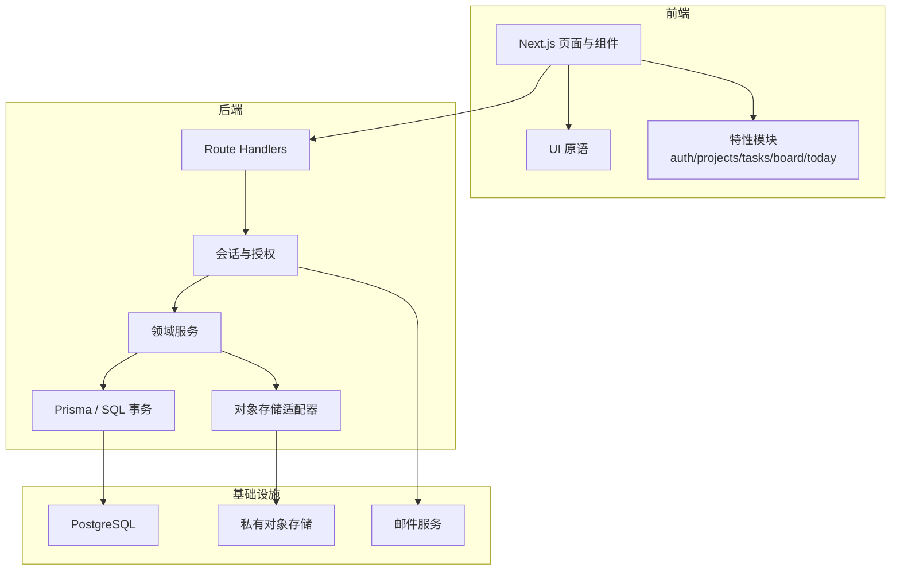
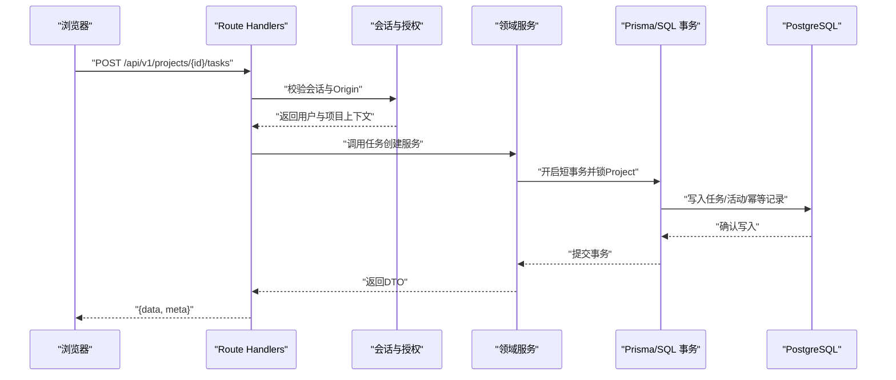
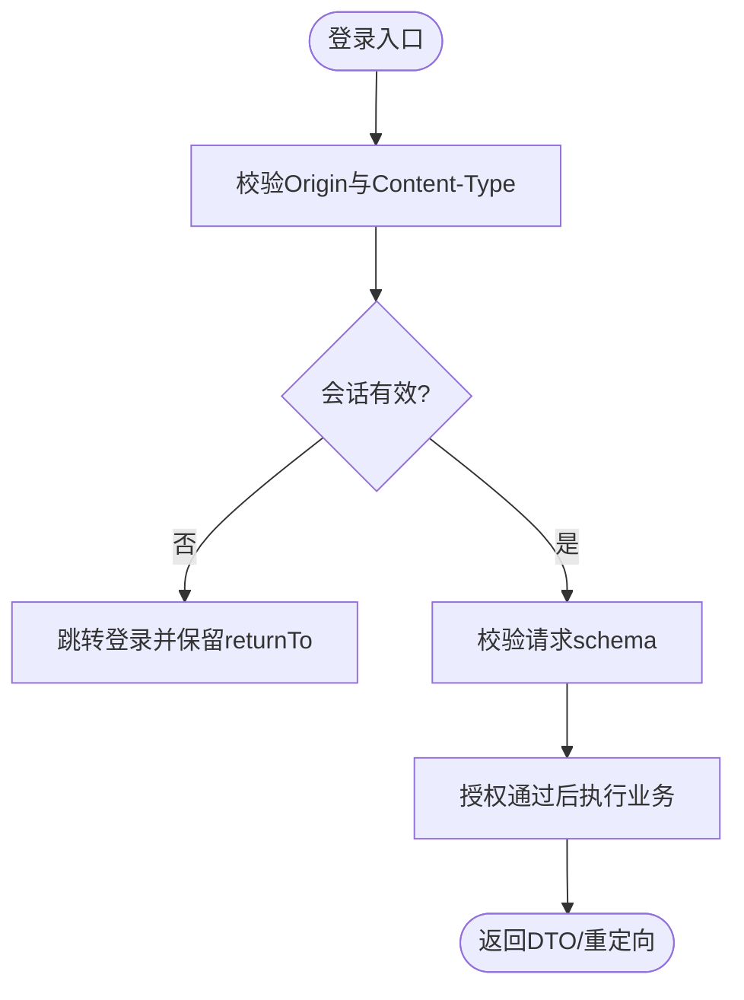
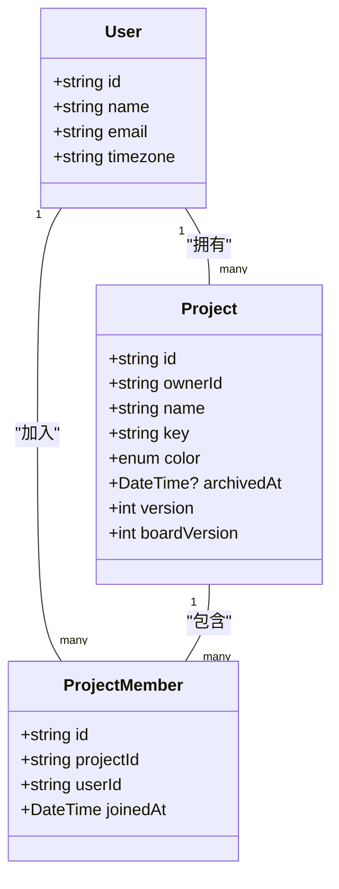
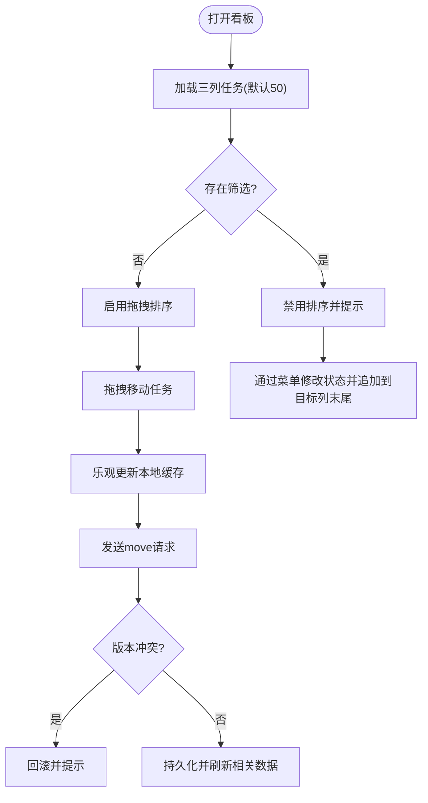
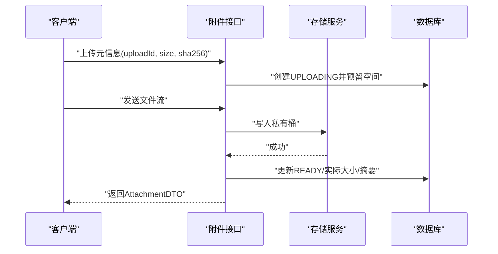
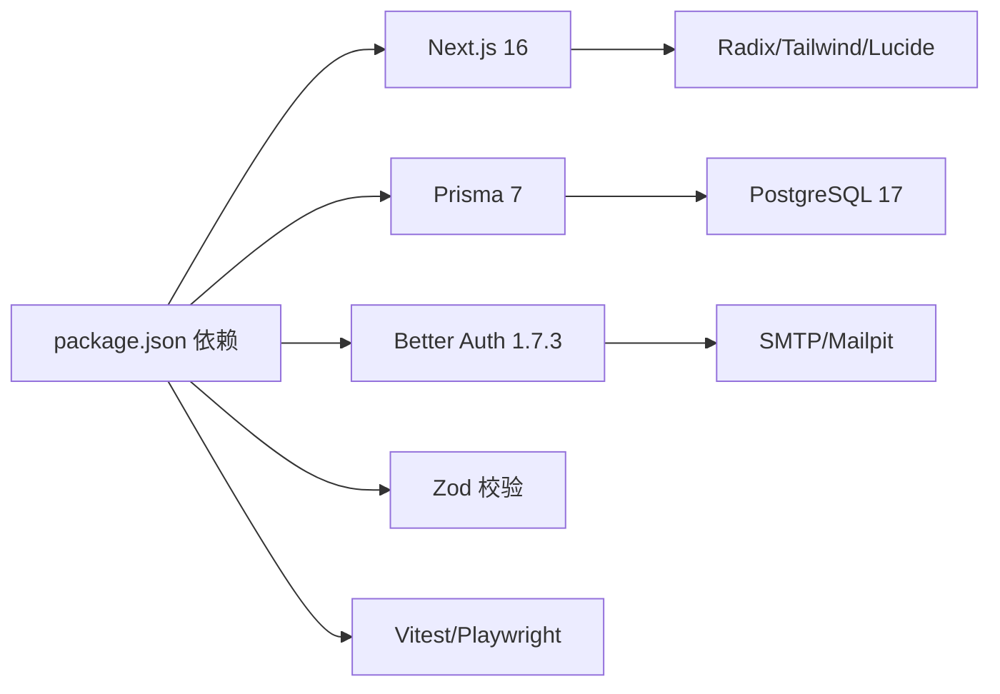

# 项目介绍与目标

<cite>
**本文引用的文件**
- [README.md](file://README.md)
- [DEVELOPMENT-PLAN.md](file://DEVELOPMENT-PLAN.md)
- [docs/00-EXECUTION-OVERVIEW.md](file://docs/00-EXECUTION-OVERVIEW.md)
- [docs/01-PRODUCT-SPEC.md](file://docs/01-PRODUCT-SPEC.md)
- [docs/02-UX-AND-DESIGN.md](file://docs/02-UX-AND-DESIGN.md)
- [docs/03-ARCHITECTURE.md](file://docs/03-ARCHITECTURE.md)
- [docs/04-DATA-MODEL.md](file://docs/04-DATA-MODEL.md)
- [docs/05-API-CONTRACT.md](file://docs/05-API-CONTRACT.md)
- [docs/versions.md](file://docs/versions.md)
- [package.json](file://package.json)
- [prisma/schema.prisma](file://prisma/schema.prisma)
- [planning/backlog.json](file://planning/backlog.json)
</cite>

## 目录
1. [引言](#引言)
2. [项目结构](#项目结构)
3. [核心组件](#核心组件)
4. [架构总览](#架构总览)
5. [详细组件分析](#详细组件分析)
6. [依赖关系分析](#依赖关系分析)
7. [性能考量](#性能考量)
8. [故障排查指南](#故障排查指南)
9. [结论](#结论)
10. [附录](#附录)

## 引言
Orbit 是一个面向个人用户与学生小团队的“项目协作 Web 应用”。它的核心愿景是：让个人开发者、课程设计者、比赛或小组作业团队，用更简单的方式完成“创建项目—邀请成员—拆分任务—看板推进—讨论与附件”的完整闭环。产品强调清晰、安静、可信的体验，避免过度装饰，把注意力放在任务、进度和协作上。

当前仓库处于 M0 工程基线阶段（并已完成 M1 认证与 M2 纵向闭环的部分实现），这意味着：
- 工程脚手架、类型系统、设计变量、基础组件、API 契约骨架已就绪；
- 数据库迁移工具链可用，开发环境可启动；
- 后续里程碑将在此基础上逐步补齐看板、协作、附件、工作台与发布质量门槛。

M0 的意义在于“先建好地基”，确保后续功能迭代有稳定的版本边界、一致的代码风格、可靠的测试与部署路径，从而降低协作成本、提高交付确定性。

**章节来源**
- [README.md:1-97](file://README.md#L1-L97)
- [DEVELOPMENT-PLAN.md:1-67](file://DEVELOPMENT-PLAN.md#L1-L67)
- [docs/00-EXECUTION-OVERVIEW.md:1-59](file://docs/00-EXECUTION-OVERVIEW.md#L1-L59)

## 项目结构
仓库采用 Next.js App Router 模块化单体组织，前后端同源，业务层独立于路由处理器，便于未来拆分为独立后端。关键目录职责如下：
- src/app：页面与 /api/v1 路由入口；auth 挂 /api/auth
- components/ui：通用 UI 原语（按钮、对话框、下拉、提示等）
- features：按领域划分的前端特性模块（认证、项目、任务、看板、今日工作台等）
- contracts：Zod schema、DTO、错误码、API 客户端与契约测试
- server：会话与授权、Prisma 事务、领域服务、HTTP 错误映射、限流等
- prisma：数据模型、迁移与种子脚本
- tests：单元、集成、端到端与契约测试
- infra：本地开发容器编排（PostgreSQL、MinIO、Mailpit）
- docs/planning/prompts/contracts：规划、提示词与机器可读 API 契约

**图表来源**
- [docs/03-ARCHITECTURE.md:25-42](file://docs/03-ARCHITECTURE.md#L25-L42)

**章节来源**
- [docs/03-ARCHITECTURE.md:25-67](file://docs/03-ARCHITECTURE.md#L25-L67)
- [package.json:12-27](file://package.json#L12-L27)

## 核心组件
- 认证与会话：基于 Better Auth，提供邮箱密码注册、验证、登录、退出、找回密码；会话使用安全 Cookie，生产启用 Secure/HttpOnly/SameSite。
- 项目与权限：Owner/Member 双角色，ownerId 为唯一所有权来源；支持归档/恢复、邀请链接、成员管理；非成员不可访问任何资源。
- 任务与看板：三列固定状态（TODO/IN_PROGRESS/DONE），支持列表筛选、分页、拖拽排序与乐观更新；任务软删除进入回收站。
- 子任务、评论与附件：子任务清单、评论纯文本、附件私有上传与下载；活动日志记录关键变更。
- 今日工作台：按逾期、今天到期、未来 7 天、进行中分类统计与展示。
- 契约与测试：OpenAPI 契约、Zod schema、DTO、错误码统一；单元/集成/E2E/契约测试覆盖关键流程。

这些组件共同构成“个人任务管理纵向闭环”，并在后续里程碑中扩展为“团队协作横向能力”。

**章节来源**
- [docs/01-PRODUCT-SPEC.md:19-122](file://docs/01-PRODUCT-SPEC.md#L19-L122)
- [docs/04-DATA-MODEL.md:480-611](file://docs/04-DATA-MODEL.md#L480-L611)
- [docs/05-API-CONTRACT.md:618-748](file://docs/05-API-CONTRACT.md#L618-L748)

## 架构总览
Orbit 采用 Next.js 模块化单体，Web 与 API 同源，业务逻辑集中在 server/modules，通过 Prisma 与 PostgreSQL 交互，附件走私有 S3 兼容存储，邮件通过 SMTP 适配器。请求生命周期包括：请求 ID → Origin/大小/限流校验 → 会话检查 → schema 校验 → 确定项目 → 领域服务内再次授权 → 短事务 → DTO → 统一响应。写操作在短事务中锁定 Project 行，再按 Task→子资源顺序处理，保证并发正确性。

**图表来源**
- [docs/03-ARCHITECTURE.md:71-77](file://docs/03-ARCHITECTURE.md#L71-L77)
- [docs/05-API-CONTRACT.md:618-635](file://docs/05-API-CONTRACT.md#L618-L635)

**章节来源**
- [docs/03-ARCHITECTURE.md:1-121](file://docs/03-ARCHITECTURE.md#L1-L121)
- [docs/05-API-CONTRACT.md:618-748](file://docs/05-API-CONTRACT.md#L618-L748)

## 详细组件分析

### 认证与个人设置
- 认证库：Better Auth 1.7.3，包含 User/Session/Account/Verification 表；User 扩展 timezone 字段。
- 安全边界：会话使用安全 Cookie；所有自有变更 API 仅接受同源请求，检查 Origin；匿名邀请预览也需合法 Origin。
- 个人设置：/me 接口支持姓名与时区修改；非法时区拒绝；退出后清理私有缓存。

**图表来源**
- [docs/03-ARCHITECTURE.md:79-87](file://docs/03-ARCHITECTURE.md#L79-L87)
- [docs/05-API-CONTRACT.md:624-635](file://docs/05-API-CONTRACT.md#L624-L635)

**章节来源**
- [docs/01-PRODUCT-SPEC.md:19-26](file://docs/01-PRODUCT-SPEC.md#L19-L26)
- [docs/03-ARCHITECTURE.md:79-87](file://docs/03-ARCHITECTURE.md#L79-L87)
- [docs/versions.md:135-165](file://docs/versions.md#L135-L165)

### 项目与权限
- 角色与权限：Owner/Member；ownerId 为唯一所有权来源；归档项目只读但允许 owner 恢复、撤销邀请、移除成员，member 可退出。
- 邀请机制：一次性链接，默认 7 天有效，最多 20 条未使用邀请；token 仅存摘要，明文仅在首次响应返回。
- 并发与一致性：写操作在短事务中锁 Project，重新检查 archived 与成员权限；成员退出立即失去服务端访问权限。

**图表来源**
- [prisma/schema.prisma:27-47](file://prisma/schema.prisma#L27-L47)
- [prisma/schema.prisma:144-179](file://prisma/schema.prisma#L144-L179)

**章节来源**
- [docs/01-PRODUCT-SPEC.md:27-61](file://docs/01-PRODUCT-SPEC.md#L27-L61)
- [docs/04-DATA-MODEL.md:508-523](file://docs/04-DATA-MODEL.md#L508-L523)

### 任务与看板
- 任务字段：标题、描述（受限 Markdown）、状态、优先级、负责人、截止日；编号在项目内递增且不复用。
- 看板三列：TODO/IN_PROGRESS/DONE；支持列内与跨列拖拽，默认每列加载 50 张，可加载至全部；无筛选且三列完整加载时才启用排序。
- 乐观更新与冲突：保存携带 expectedVersion；版本过期返回 409，保留草稿并提供重新加载；拖拽失败回滚并提示。

**图表来源**
- [docs/01-PRODUCT-SPEC.md:75-85](file://docs/01-PRODUCT-SPEC.md#L75-L85)
- [docs/04-DATA-MODEL.md:586-595](file://docs/04-DATA-MODEL.md#L586-L595)

**章节来源**
- [docs/01-PRODUCT-SPEC.md:63-85](file://docs/01-PRODUCT-SPEC.md#L63-L85)
- [docs/04-DATA-MODEL.md:524-531](file://docs/04-DATA-MODEL.md#L524-L531)
- [docs/05-API-CONTRACT.md:679-686](file://docs/05-API-CONTRACT.md#L679-L686)

### 附件与活动
- 附件流程：元信息校验与配额预留 → 流式上传 → 重新授权 → READY → 生成签名下载链接（60秒过期）。
- 活动日志：记录项目/成员/任务/子任务/评论/附件的关键动作；与业务写入同一事务，不记录敏感内容。

**图表来源**
- [docs/03-ARCHITECTURE.md:99-108](file://docs/03-ARCHITECTURE.md#L99-L108)
- [docs/05-API-CONTRACT.md:727-734](file://docs/05-API-CONTRACT.md#L727-L734)

**章节来源**
- [docs/01-PRODUCT-SPEC.md:87-95](file://docs/01-PRODUCT-SPEC.md#L87-L95)
- [docs/04-DATA-MODEL.md:540-555](file://docs/04-DATA-MODEL.md#L540-L555)

## 依赖关系分析
- 运行时与工具链：Node.js 24 LTS（实测 Node 26 通过）、pnpm 10.x、TypeScript strict。
- 前端：Next.js 16 App Router、React 19、Tailwind CSS、Radix primitives、Lucide 图标。
- 后端：Prisma 7 + PostgreSQL adapter、Better Auth 1.7.3、Zod 校验、Vitest/Playwright 测试。
- 基础设施：PostgreSQL 17、MinIO（开发期）、Mailpit（开发期）。

**图表来源**
- [package.json:29-65](file://package.json#L29-L65)
- [docs/versions.md:22-68](file://docs/versions.md#L22-L68)

**章节来源**
- [docs/versions.md:9-21](file://docs/versions.md#L9-L21)
- [docs/versions.md:22-68](file://docs/versions.md#L22-L68)
- [package.json:1-11](file://package.json#L1-L11)

## 性能考量
- 列表与看板：默认分页 30，最大 100；看板每列默认加载 50，可加载至全部；排序追加稳定 id，空截止日排最后。
- 缓存策略：TanStack Query 缓存服务器状态；可见页面 30 秒后台刷新；失焦停止轮询，聚焦后刷新。
- 并发控制：同项目写操作串行化（短事务锁 Project），不同项目仍可并发；避免在持锁期间请求外部服务。
- 附件上传：流式上传、限制字节数与 MIME；失败重试与孤儿清理；下载前重新鉴权并生成短期签名链接。

[本节为通用指导，不直接分析具体文件]

## 故障排查指南
- 认证问题：检查 Origin 是否匹配、Cookie 是否安全设置、会话是否过期；使用 /health/live 与 /health/ready 检查服务健康。
- 权限问题：非成员访问返回 404；成员越权返回 403；资源 ID 不构成权限证明。
- 版本冲突：编辑任务时 expectedVersion 不匹配返回 409；保留草稿并提供重新加载。
- 附件问题：上传失败保留输入并重试；下载失败不清空详情；检查配额与 MIME 校验。
- 数据库问题：迁移失败时检查迁移脚本与连接串；测试库隔离确保不影响开发库。

**章节来源**
- [docs/05-API-CONTRACT.md:637-657](file://docs/05-API-CONTRACT.md#L637-L657)
- [docs/03-ARCHITECTURE.md:110-117](file://docs/03-ARCHITECTURE.md#L110-L117)

## 结论
Orbit 以“简化团队协作、提高项目管理效率、提供直观的任务跟踪界面”为核心价值主张，面向个人与小团队提供轻量而可靠的项目协作体验。M0 工程基线确保了版本边界、类型安全、测试与部署路径的稳定，为后续里程碑的高质量交付奠定基础。长期路线图从 M0—M6 构建 V1 完整能力，M7 引入 AI 拆解助手作为 V1.1 扩展，不阻塞主版本发布。

[本节为总结性内容，不直接分析具体文件]

## 附录
- 目标用户：学生、个人开发者、课程设计者、比赛或小组作业团队。
- 使用场景：注册验证 → 创建项目 → 邀请队友 → 创建与分配任务 → 看板推进 → 讨论与附件 → 完成或归档项目。
- 差异化优势：桌面优先、中文友好、清晰克制的设计、严格的权限与并发控制、完整的契约与测试体系。
- 阶段性目标：M0 基线 → M1 认证 → M2 纵向闭环 → M3—M5 协作与附件 → M6 发布与质量 → M7 AI 助手。

**章节来源**
- [docs/01-PRODUCT-SPEC.md:3-10](file://docs/01-PRODUCT-SPEC.md#L3-L10)
- [DEVELOPMENT-PLAN.md:28-67](file://DEVELOPMENT-PLAN.md#L28-L67)
- [planning/backlog.json:19-99](file://planning/backlog.json#L19-L99)