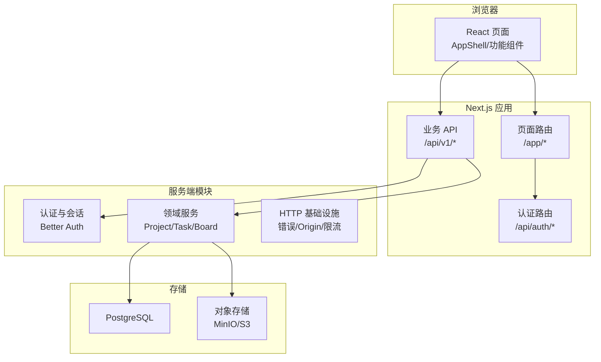
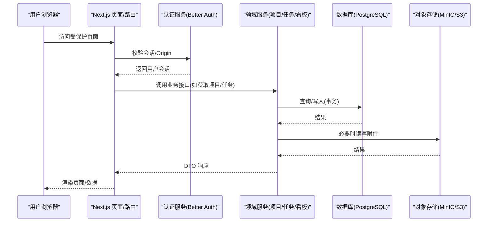
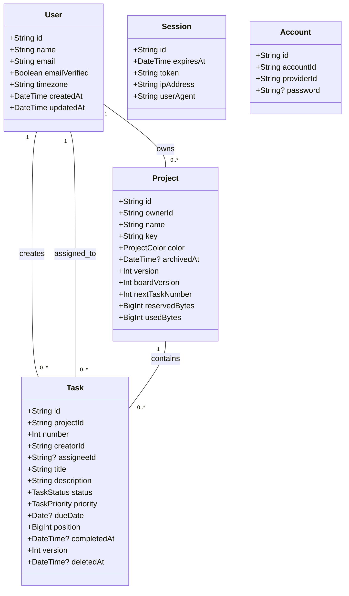

# 项目概述

<cite>
**本文引用的文件**
- [package.json](file://package.json)
- [README.md](file://README.md)
- [DEVELOPMENT-PLAN.md](file://DEVELOPMENT-PLAN.md)
- [docs/00-EXECUTION-OVERVIEW.md](file://docs/00-EXECUTION-OVERVIEW.md)
- [prisma/schema.prisma](file://prisma/schema.prisma)
- [src/server/auth/index.ts](file://src/server/auth/index.ts)
- [src/features/shell/app-shell.tsx](file://src/features/shell/app-shell.tsx)
- [contracts/openapi.json](file://contracts/openapi.json)
- [infra/compose.dev.yml](file://infra/compose.dev.yml)
- [src/app/layout.tsx](file://src/app/layout.tsx)
</cite>

## 目录
1. [简介](#简介)
2. [项目结构](#项目结构)
3. [核心功能](#核心功能)
4. [架构总览](#架构总览)
5. [关键组件与数据流](#关键组件与数据流)
6. [依赖与选型](#依赖与选型)
7. [快速开始](#快速开始)
8. [性能与可维护性要点](#性能与可维护性要点)
9. [常见问题排查](#常见问题排查)
10. [结论](#结论)

## 简介
Orbit 是面向个人用户与学生小团队的项目协作 Web 应用，当前处于 M0 工程基线阶段。M0 已建立 Next.js + TypeScript 工程、Prisma/测试/本地依赖基线、设计变量与基础组件、工作台/看板/任务详情样例，以及 DTO/错误/运行时校验/API 客户端骨架；M1 已接入真实认证与个人设置（Better Auth 全流程、/api/v1/me、/app/settings）。产品围绕创建项目、邀请成员、拆分任务、看板推进、讨论与成果附件展开，目标是交付一个真实可用、视觉统一、可维护的协作工具。

本概述从目标、核心功能、技术架构、依赖选型到快速开始进行分层说明，既帮助初学者快速上手，也为有经验的开发者提供足够的实现细节与边界约定。

**章节来源**
- [README.md:1-97](file://README.md#L1-L97)
- [docs/00-EXECUTION-OVERVIEW.md:1-59](file://docs/00-EXECUTION-OVERVIEW.md#L1-L59)

## 项目结构
仓库采用 Next.js App Router 模块化单体组织：前端页面与 API 同源，业务层独立于路由处理器，便于后续拆分为独立后端。核心目录职责如下：
- src/app：页面路由与 /api/v1 业务接口；/api/auth 挂载 Better Auth 认证路由
- src/components/ui：通用 UI 原语（按钮、对话框、下拉菜单等）
- src/features：按领域划分的功能模块（auth、projects、tasks、board、today、settings 等）
- src/contracts：Zod schema、DTO、错误码、API 客户端与 OpenAPI 契约
- src/server：服务端能力（认证、会话、授权、模块服务、HTTP 基础设施、环境变量）
- prisma：数据库模型与迁移
- infra：本地开发依赖（PostgreSQL、MinIO、Mailpit）
- docs/planning/tests/scripts：规划文档、测试与脚本

**图表来源**
- [src/features/shell/app-shell.tsx:23-40](file://src/features/shell/app-shell.tsx#L23-L40)
- [src/server/auth/index.ts:6-16](file://src/server/auth/index.ts#L6-L16)
- [contracts/openapi.json:1-20](file://contracts/openapi.json#L1-L20)
- [infra/compose.dev.yml:10-68](file://infra/compose.dev.yml#L10-L68)

**章节来源**
- [DEVELOPMENT-PLAN.md:377-421](file://DEVELOPMENT-PLAN.md#L377-L421)
- [src/app/layout.tsx:5-8](file://src/app/layout.tsx#L5-L8)

## 核心功能
- 用户认证：邮箱密码注册、邮箱验证、登录/退出、找回密码与重设密码；会话由 Better Auth 管理，支持安全 Cookie 与同源校验。
- 项目管理：创建/读取/更新/归档项目，成员关系与权限控制（OWNER/MEMBER），项目级配额与活动记录。
- 任务跟踪：任务创建、编辑、状态流转（TODO/IN_PROGRESS/DONE）、优先级、负责人、截止日、软删除与回收站恢复。
- 看板视图：三列固定看板，列内/跨列拖拽排序，分页加载与冲突处理（版本/板版本），后台刷新与乐观更新。
- 我的工作台：按逾期、今天到期、未来 7 天、进行中分类统计与列表展示。
- 评论与附件：评论纯文本、子任务清单、私有附件上传/下载（S3 兼容），活动日志记录变更。
- 个人设置：姓名与时区修改，会话与缓存清理。

这些功能在 M0 提供布局与样例，M1 完成认证与设置，M2 起逐步接入真实业务 API 与数据持久化。

**章节来源**
- [docs/00-EXECUTION-OVERVIEW.md:14-31](file://docs/00-EXECUTION-OVERVIEW.md#L14-L31)
- [README.md:5-8](file://README.md#L5-L8)

## 架构总览
Orbit 采用 Next.js 模块化单体架构，前后端同源，REST API 与 Server Components 共享同一授权与服务层。认证通过 Better Auth，数据存储使用 PostgreSQL（Prisma 7），附件存储为私有 S3 兼容对象存储（本地 MinIO）。请求生命周期包含 Origin 校验、会话检查、Schema 校验、授权、事务、DTO 映射与统一响应。

**图表来源**
- [src/server/auth/index.ts:6-16](file://src/server/auth/index.ts#L6-L16)
- [contracts/openapi.json:1-20](file://contracts/openapi.json#L1-L20)
- [infra/compose.dev.yml:10-68](file://infra/compose.dev.yml#L10-L68)

**章节来源**
- [DEVELOPMENT-PLAN.md:352-473](file://DEVELOPMENT-PLAN.md#L352-L473)

## 关键组件与数据流
- 应用外壳 AppShell：响应式侧栏/抽屉导航，区分真实数据页与 fixture 样例页，集成用户菜单与设置入口。
- 认证单例：绑定 Prisma 与已校验环境，暴露类型化的会话与用户类型，供服务端模块复用。
- 数据模型：Prisma 定义 User/Session/Account/Verification（认证库官方 schema），并扩展 timezone；M2 引入 Project/Member/Task 等实体与枚举。
- API 契约：OpenAPI 3.1 描述 V1 业务接口，包含账户、项目、成员、邀请、任务、看板、子任务、评论、文件、活动、仪表盘等标签。

**图表来源**
- [prisma/schema.prisma:27-92](file://prisma/schema.prisma#L27-L92)
- [prisma/schema.prisma:144-179](file://prisma/schema.prisma#L144-L179)
- [prisma/schema.prisma:240-267](file://prisma/schema.prisma#L240-L267)

**章节来源**
- [src/features/shell/app-shell.tsx:23-40](file://src/features/shell/app-shell.tsx#L23-L40)
- [src/server/auth/index.ts:6-16](file://src/server/auth/index.ts#L6-L16)
- [prisma/schema.prisma:14-21](file://prisma/schema.prisma#L14-L21)
- [contracts/openapi.json:1-47](file://contracts/openapi.json#L1-L47)

## 依赖与选型
- 运行环境与包管理：Node.js ≥ 24，pnpm ≥ 10；锁定 pnpm 版本与依赖树。
- 前端框架：Next.js 16 App Router + React 19；Tailwind CSS 与 Radix 基础原语构建 UI。
- 认证与会话：Better Auth 1.7.3（邮箱密码、验证、重置、数据库会话）。
- 数据持久化：PostgreSQL 17 + Prisma 7（driver adapter），本地 MinIO 作为 S3 兼容存储。
- 邮件：Mailpit（本地 SMTP 与查看器）。
- 测试：Vitest（单元/集成/契约）、Playwright（E2E/UI）。
- 其他：Zod 校验、Lucide 图标、server-only 保护服务端模块。

选型理由：
- Next.js 16 + React 19：现代全栈框架，Server Components 与 Route Handlers 天然支持同源 API，利于统一授权与缓存策略。
- Better Auth：成熟认证库，减少自研安全风险，专注业务逻辑。
- Prisma 7 + PostgreSQL：强类型 ORM 与 SQL 迁移结合，保障数据一致性与可演进性。
- Tailwind + Radix：以 tokens 统一视觉，headless 组件保证可访问性与灵活性。
- MinIO：本地 S3 兼容存储，便于模拟生产对象存储行为。

**章节来源**
- [package.json:1-76](file://package.json#L1-L76)
- [README.md:18-55](file://README.md#L18-L55)
- [DEVELOPMENT-PLAN.md:352-376](file://DEVELOPMENT-PLAN.md#L352-L376)

## 快速开始
环境要求：
- Node.js ≥ 24（推荐 v24 LTS）
- Docker Desktop（用于本地 PostgreSQL、MinIO、Mailpit）
- Windows/macOS/Linux（命令避免 Bash 专有语法）

安装步骤：
1. 安装 pnpm（一次性）：全局安装 pnpm@10.x（本机 Node 25+ 不再内置 corepack）。
2. 安装依赖：pnpm install（依赖锁定在 pnpm-lock.yaml）。
3. 配置环境变量：复制模板为 .env.local（被 .gitignore 忽略，勿提交密钥）。
4. 启动本地依赖服务：docker compose -f infra/compose.dev.yml up -d（PostgreSQL 5432、MinIO 9000/9001、Mailpit 25025/8025）。
5. 执行数据库迁移与种子：pnpm db:migrate:dev 与 pnpm db:seed。
6. 启动开发服务器：pnpm dev，访问 http://localhost:3000。

基本使用示例：
- 注册并验证邮箱后登录，进入“我的工作台”查看任务。
- 创建项目与任务，体验任务状态切换与看板视图（M0 为样例，M2 起接入真实数据）。
- 打开“个人设置”修改姓名与时区，观察会话与缓存变化。

常用命令：
- pnpm lint、pnpm typecheck、pnpm build、pnpm test:unit/integration/e2e/contract、pnpm check。

**章节来源**
- [README.md:18-55](file://README.md#L18-L55)
- [infra/compose.dev.yml:1-72](file://infra/compose.dev.yml#L1-L72)

## 性能与可维护性要点
- 请求生命周期：Origin/Content-Type/大小/限流 → 会话检查 → Schema 校验 → 授权 → 事务 → DTO → 统一响应。
- 并发与一致性：同项目写操作短事务锁 Project，再按 Task→子资源顺序锁定；版本冲突返回 409，保留草稿并提示重新加载。
- 看板排序：position/id 稳定排序，移动时计算中点或重编号，避免浮点误差；boardVersion 变更驱动前端刷新。
- 附件流程：元信息校验与预留 → 流式上传 → 再次授权 → READY → 签名下载（60 秒过期）。
- 错误与可观测性：结构化日志（requestId、route、status、durationMs、userId、projectId），敏感字段脱敏；健康检查 /health/live、/health/ready。
- 客户端缓存：Query Key 包含 userId 与过滤条件；登出/换账号/权限失效清空缓存；30 秒轮询活跃项目，失焦停止。

**章节来源**
- [DEVELOPMENT-PLAN.md:423-473](file://DEVELOPMENT-PLAN.md#L423-L473)
- [DEVELOPMENT-PLAN.md:566-603](file://DEVELOPMENT-PLAN.md#L566-L603)

## 常见问题排查
- 端口占用：若本机 5432 被占用，可通过 POSTGRES_HOST_PORT 覆盖宿主端口，并同步 .env.local 的连接串端口。
- 依赖构建拦截：pnpm 10 默认拦截构建脚本，已在 package.json 的 onlyBuiltDependencies 显式批准 Prisma 引擎、esbuild 等。
- 数据库连接：确保 prisma.config.ts 正确加载 .env.local；迁移失败时检查 DATABASE_URL 与 TEST_DATABASE_URL。
- 邮件发送：本地使用 Mailpit，确认 SMTP 端口与凭据；生产需配置已支持的邮件服务。
- 权限问题：非成员访问资源返回 404；成员越权操作返回 403；所有自有变更 API 仅接受同源请求。

**章节来源**
- [README.md:37-48](file://README.md#L37-L48)
- [infra/compose.dev.yml:15-23](file://infra/compose.dev.yml#L15-L23)
- [DEVELOPMENT-PLAN.md:431-439](file://DEVELOPMENT-PLAN.md#L431-L439)

## 结论
Orbit 以 Next.js 16 + React 19 全栈技术栈为基础，结合 Better Auth、Prisma 7、PostgreSQL 与 S3 兼容存储，构建了面向个人与小团队的协作平台。M0 奠定了工程基线与样例界面，M1 完成了认证与设置闭环，后续里程碑将逐步完善项目、任务、看板与协作能力。通过清晰的架构分层、严格的契约与一致性约束，项目具备可维护性与可扩展性，适合学习与展示全栈工程能力。