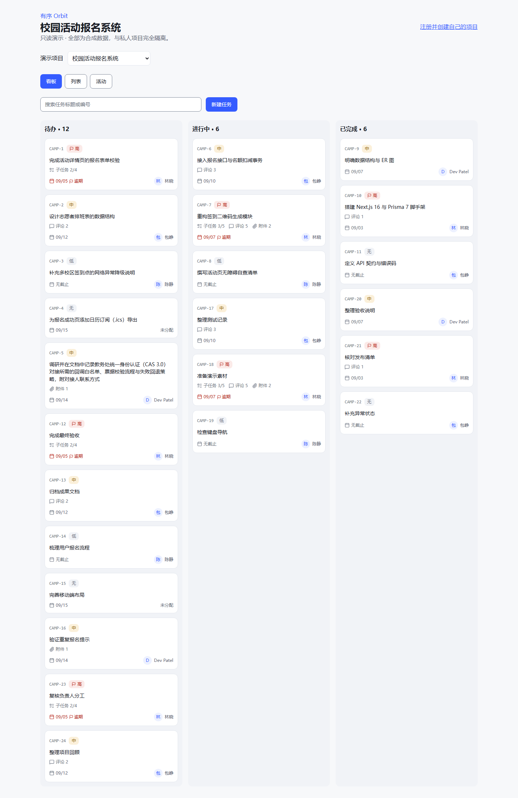
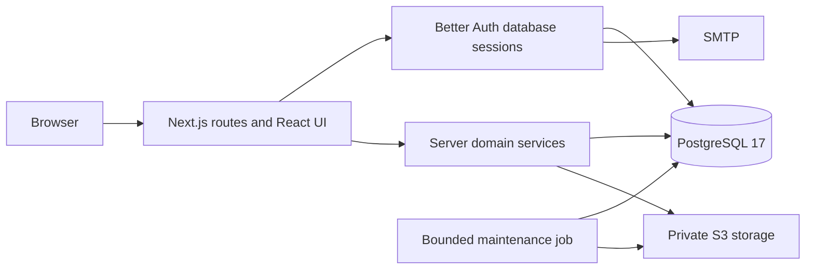

# Orbit

Orbit is a Chinese-first project collaboration app for individuals and small student teams. It brings projects, task lists, boards, comments, subtasks and private files into one place.



The implementation is available locally. Production deployment and remote CI acceptance are pending; there is no claimed public deployment URL. See [current progress](PROGRESS.md) and the [M6 operations guide](docs/M6-OPERATIONS.md).

## Try it locally

Use Node 24+, pnpm 10.34.5 and Docker. Copy `.env.example` to `.env.local`, supply a random authentication secret, and check the local ports.

```text
pnpm install --frozen-lockfile
docker compose -f infra/compose.dev.yml up -d
pnpm db:migrate:dev
pnpm db:seed
pnpm dev
```

Open `/demo` for a public, read-only synthetic dataset. It supports search, board/list/activity views and task details without reading private projects or issuing API mutations. Register and verify your email through local Mailpit to try real collaboration. Do not share writable accounts publicly.

## Architecture



Next.js 16.3.4, React 19, strict TypeScript and Prisma 7.10.0 form a modular monolith. Routes live under `src/app`, business rules under `src/server`, runtime schemas under `src/contracts`, and UI features under `src/features`. PostgreSQL stores shared production rate limits and upload leases. There is no Redis or WebSocket service.

Project membership is verified server-side. Version checks detect stale edits, project locks serialize conflicting board operations, and idempotency records protect retries. Files are private and served after authorization; failed uploads use bounded compensation. See [data model](docs/04-DATA-MODEL.md), [API contract](contracts/openapi.json), and [architecture decisions](docs/11-DECISIONS-AND-RISKS.md).

## Validation

```text
pnpm check
pnpm typecheck:scripts
pnpm test:integration
pnpm test:e2e --retries=0
pnpm test:ui --retries=0
pnpm audit --prod --audit-level=high
node --conditions=react-server --import tsx scripts/recovery-drill.ts
```

Integration tests use a real isolated PostgreSQL database. Browser suites start a separate production build, use Mailpit/MinIO, precisely clean their fixtures, and verify development/test database fingerprints. M6 includes axe scans, three viewports, a 1000-task HTTP workload at concurrency 10, and five throttled browser lab samples. Measurements describe the test environment; they are not real-user traffic or field Core Web Vitals.

The Dockerfile has separate non-root web and operations targets. Database migration is a one-off release step. Production still requires hosting, a domain, managed database/storage/mail configuration, scheduled maintenance and backups, and HTTPS acceptance with two controlled accounts.

## Demo and trade-offs

The [three-minute demo script](docs/13-DEMO-AND-PORTFOLIO.md) covers task creation, board movement, collaboration, an intentional conflict and verification evidence. Public demo data is independent from real project data. Fixed workflows and explicit saves keep the first release understandable; there is no realtime co-editing, billing, organization hierarchy or shipped AI assistant.

AI assistance was used for implementation and verification. The repository preserves actual evidence and recovered snapshots without inventing commit history. Planned production results are never reported as completed work.
