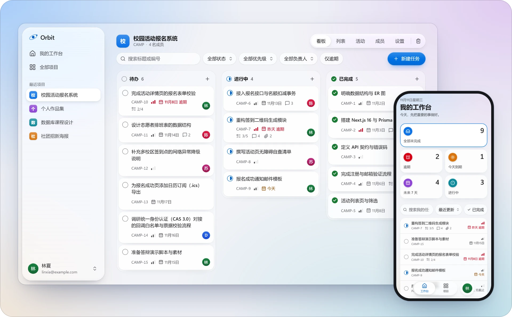
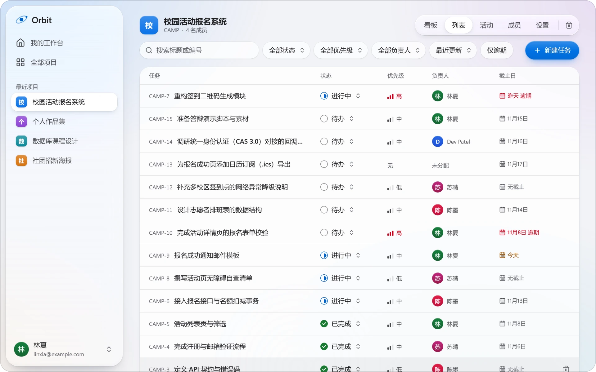
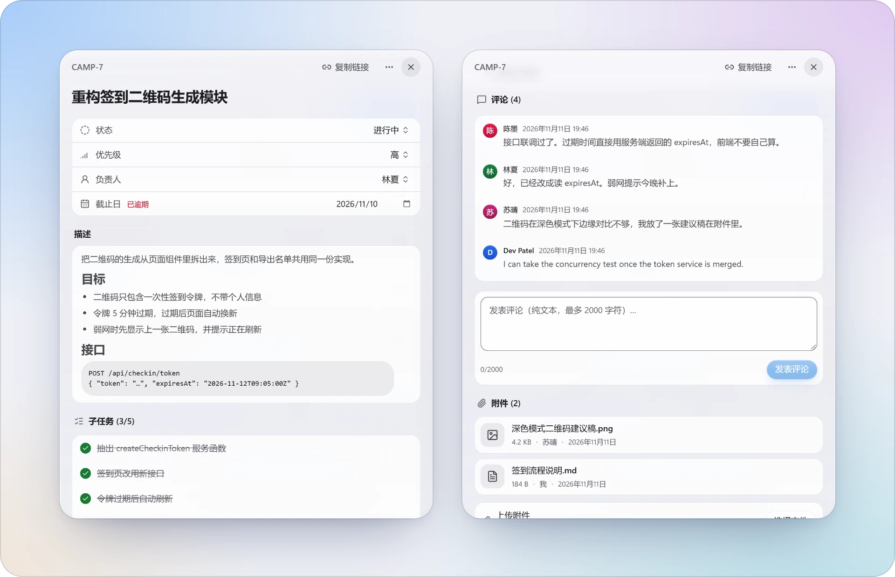
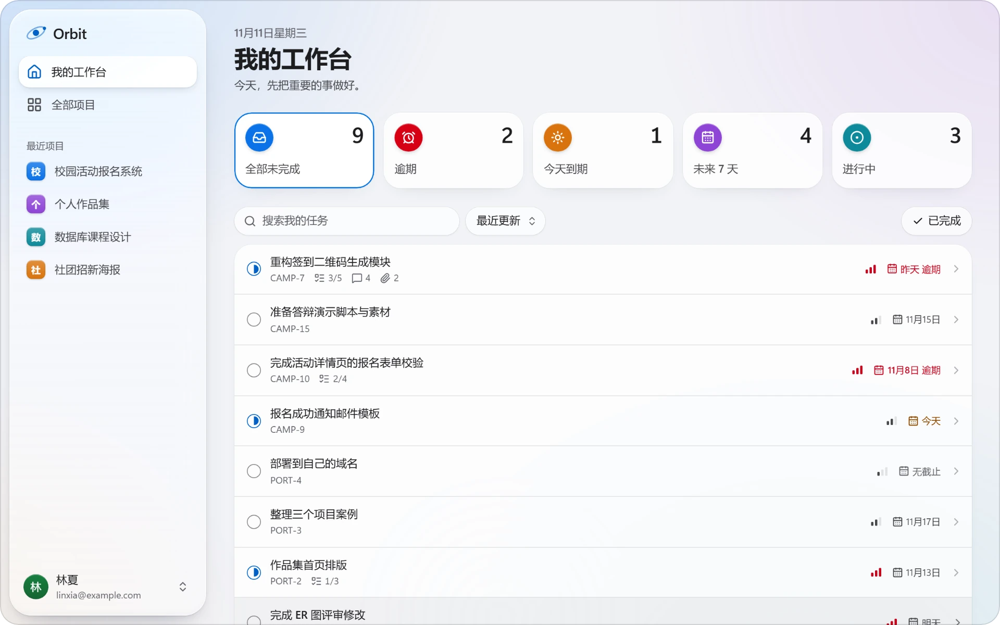
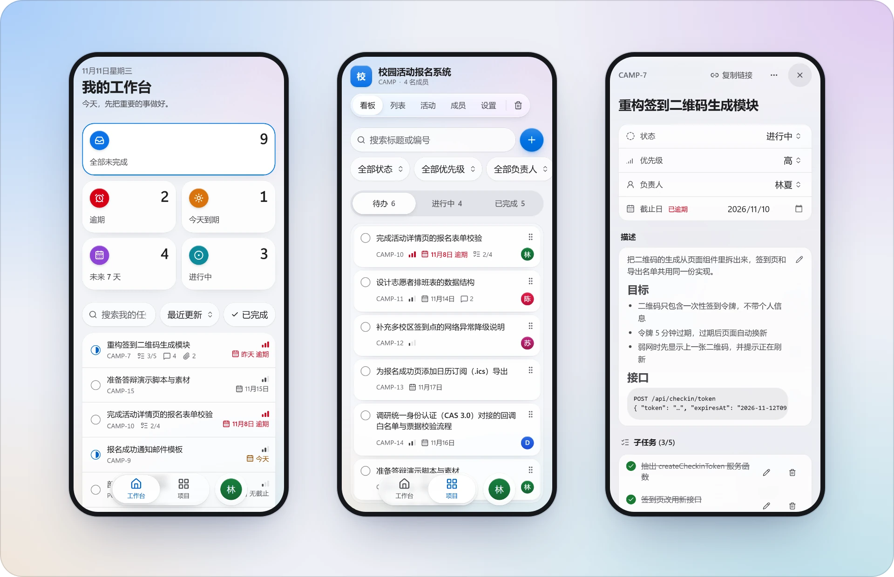
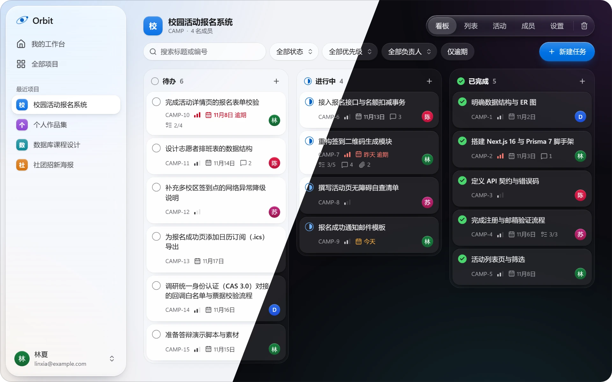

  
  <h1>Orbit</h1>
  
<strong>Know who's doing what and what comes next.</strong>

  
A workspace for coursework, hackathons, and small software projects. Keep tasks, conversations, and files together.

  

    <a href="https://smartorbit.tech/demo"><strong>Try the live demo ↗</strong></a>
    &nbsp;·&nbsp;
    <a href="https://smartorbit.tech">Open Orbit</a>
    &nbsp;·&nbsp;
    <a href="README.md">简体中文</a>
  

<a href="https://smartorbit.tech/demo">
  <picture>
    <source media="(prefers-color-scheme: dark)" srcset="docs/media/hero-dark.webp">
    
  </picture>
</a>

The live demo needs no account. Screenshots use sample data and, like Orbit, follow your light or dark mode. The app interface is in Simplified Chinese.

## From assignment to delivery

### See what's moving

The board and the list are two views of the same tasks, with assignees, priorities, and due dates in plain sight. Move a card by dragging it, from its status menu, or with the keyboard. Search and filters live in the URL, so they survive a refresh and can be shared.

<picture>
  <source media="(prefers-color-scheme: dark)" srcset="docs/media/list-dark.webp">
  
</picture>

### Collaborate in context

Every task has its own panel with a Markdown description, a subtask checklist, comments, and private attachments. Invite a teammate with a single-use link. When two people edit the same task, the second to save is told about the conflict and keeps everything they typed.

<picture>
  <source media="(prefers-color-scheme: dark)" srcset="docs/media/task-dark.webp">
  
</picture>

### Find your next task

The workbench gathers the tasks assigned to you across every project and sorts them into overdue, due today, next 7 days, and in progress. Dates follow the time zone you set.

<picture>
  <source media="(prefers-color-scheme: dark)" srcset="docs/media/today-dark.webp">
  
</picture>

## A quiet interface

Orbit's interface is close to Apple's Liquid Glass. The sidebar, navigation, and task panel are translucent layers that float above the content, and the content itself stays plain and readable.

### Complete on a phone

Navigation moves to a floating tab bar at the bottom, the board shows one column at a time, and the task panel fills the screen. You can create, read, and advance tasks on a screen 390 pixels wide.

<picture>
  <source media="(prefers-color-scheme: dark)" srcset="docs/media/mobile-dark.webp">
  
</picture>

### Light and dark

The color scheme follows the system, and body text meets WCAG AA contrast in both. When the system asks for reduced transparency, the glass becomes solid. When it asks for reduced motion, transitions are turned off.

## Details you can rely on

<table>
  <tr>
    <td width="50%" valign="top">
      <strong>Drafts are kept</strong> 
      Title and description drafts are saved on your device for 7 days. You can pick up where you left off after a refresh, a browser crash, or an expired session.
    </td>
    <td width="50%" valign="top">
      <strong>Conflicts never overwrite</strong> 
      If someone else changed the task before you saved, Orbit shows both versions and lets you choose.
    </td>
  </tr>
  <tr>
    <td valign="top">
      <strong>Works from the keyboard</strong> 
      Dragging, menus, dialogs, and the task panel all work without a mouse, and focus is always visible.
    </td>
    <td valign="top">
      <strong>Deleting is reversible</strong> 
      Deleted tasks go to the trash first. A project can be archived as read-only and restored later.
    </td>
  </tr>
  <tr>
    <td valign="top">
      <strong>Attachments stay private</strong> 
      Files are kept in private storage. Every download rechecks permission, and the download link expires after 60 seconds.
    </td>
    <td valign="top">
      <strong>The server checks access</strong> 
      Every request is checked for the session, project membership, and ownership of the resource. Anyone outside a project sees only "not found".
    </td>
  </tr>
</table>

## Stack

Orbit is a modular monolith on Next.js. Pages and the API share one origin, and domain logic is separate from the routes. Transactions, concurrency, and data isolation are tested against a real PostgreSQL database.

| Layer | Choice |
| --- | --- |
| App | Next.js 16 (App Router) · React 19 · strict TypeScript |
| Interface | Tailwind CSS 4 · Radix UI · dnd-kit · Lucide |
| Data | PostgreSQL 17 · Prisma 7 |
| Auth | Better Auth with email and password, email verification, and database sessions |
| Files and mail | Private S3-compatible object storage · SMTP |
| Testing and delivery | Vitest · Playwright · axe-core · GitHub Actions · Docker |

## Run locally

Use **Node.js 24+**, **pnpm 10.34.5**, and **Docker Compose**. Clone the repository, then install dependencies and generate a local secret from the repository root.

~~~sh
pnpm install --frozen-lockfile
cp .env.example .env.local
node -e "console.log(require('node:crypto').randomBytes(32).toString('hex'))"
~~~

On Windows PowerShell, use `Copy-Item .env.example .env.local`. Set `BETTER_AUTH_SECRET` in `.env.local` to the generated value before starting the local services and app.

~~~sh
docker compose -f infra/compose.dev.yml up -d --wait
pnpm db:migrate:deploy
pnpm dev
~~~

Open [localhost:3000](http://localhost:3000). Verification emails appear in [Mailpit](http://localhost:8025). The read-only [/demo](http://localhost:3000/demo) is available immediately.

## Repository

| Directory | Contents |
| --- | --- |
| `src/` | Next.js pages and APIs, feature UI, authorization and domain services |
| `prisma/` · `contracts/` | PostgreSQL schema, migrations, and the OpenAPI contract |
| `infra/` · `scripts/` | Containers, reverse proxy, maintenance and backups |
| `tests/` | Unit, contract, integration and browser regression tests |

[Architecture and API](docs/README.md) · [Deploy and restore](docs/OCI-DEPLOYMENT.md) · [Run tests](tests/README.md)
