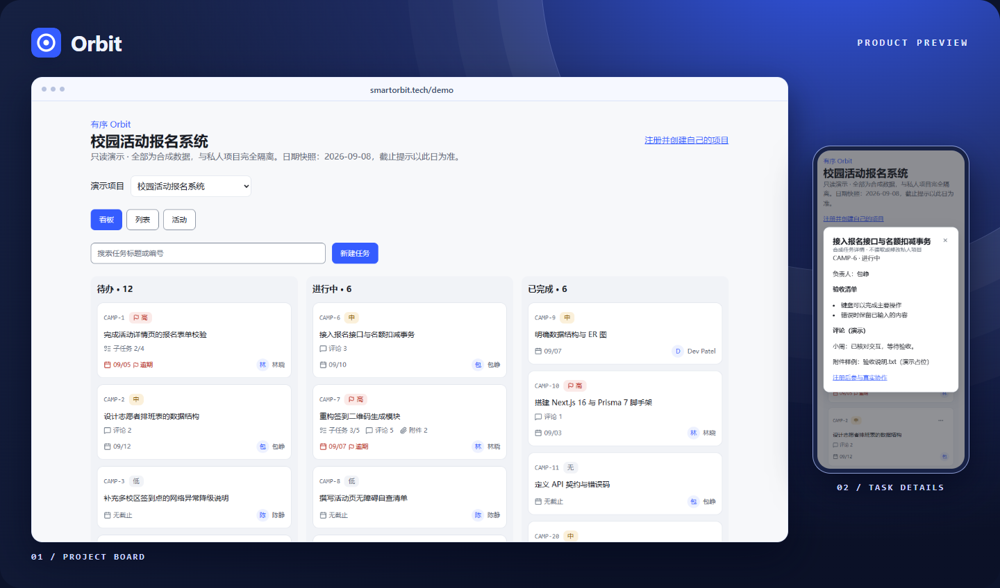

  
  <h1>有序 Orbit</h1>
  
<strong>让小团队知道谁在做什么，下一步该做什么。</strong>

  
为课程设计、比赛和小型开发项目打造的协作空间。 把任务、讨论和交付成果放在一起。

  

    <a href="https://smartorbit.tech/demo"><strong>体验在线 Demo ↗</strong></a>
    &nbsp;·&nbsp;
    <a href="https://smartorbit.tech">访问 Orbit</a>
    &nbsp;·&nbsp;
    <a href="README.en.md">English</a>
  

截图来自 Orbit 公开演示。无需注册，点开即可浏览。

## 从分工到交付

- **看清进度。** 用看板或列表查看任务，按负责人、优先级和截止日分工。拖拽和键盘菜单都能移动卡片。
- **围绕任务协作。** 用一次性链接邀请队友，在任务下写 Markdown、拆子任务、评论和上传私有附件。
- **专注自己的下一步。** 工作台汇集跨项目的待办和到期事项。编辑冲突时保留草稿，误删的任务可从回收站恢复。

## 本地运行

需要 **Node.js 24+**、**pnpm 10.34.5** 和 **Docker Compose**。克隆仓库后，在项目根目录安装依赖并生成本地密钥。

~~~sh
pnpm install --frozen-lockfile
cp .env.example .env.local
node -e "console.log(require('node:crypto').randomBytes(32).toString('hex'))"
~~~

Windows PowerShell 用 `Copy-Item .env.example .env.local`。将生成的值填入 `.env.local` 的 `BETTER_AUTH_SECRET`，再启动本地服务和应用。

~~~sh
docker compose -f infra/compose.dev.yml up -d --wait
pnpm db:migrate:deploy
pnpm dev
~~~

打开 [localhost:3000](http://localhost:3000)。注册验证邮件可在 [Mailpit](http://localhost:8025) 查看。只读 [/demo](http://localhost:3000/demo) 可直接体验。

## 项目结构

| 目录 | 内容 |
| --- | --- |
| `src/` | Next.js 页面和 API、功能组件、权限与业务服务 |
| `prisma/` · `contracts/` | PostgreSQL 数据模型、迁移和 OpenAPI 契约 |
| `infra/` · `scripts/` | 容器、反向代理、维护和备份 |
| `tests/` | 单元、契约、集成和浏览器回归 |

**技术栈**　Next.js · React · TypeScript · Tailwind CSS · PostgreSQL · Prisma · Better Auth · S3

[架构与接口](docs/README.md) · [部署与恢复](docs/OCI-DEPLOYMENT.md) · [运行测试](tests/README.md)
